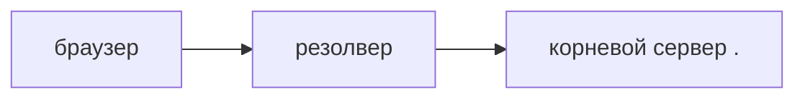
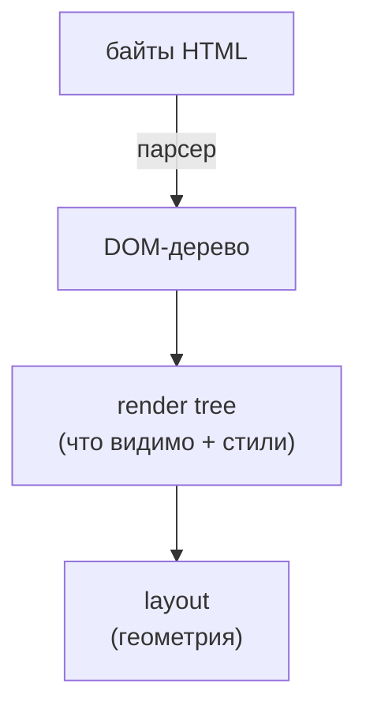
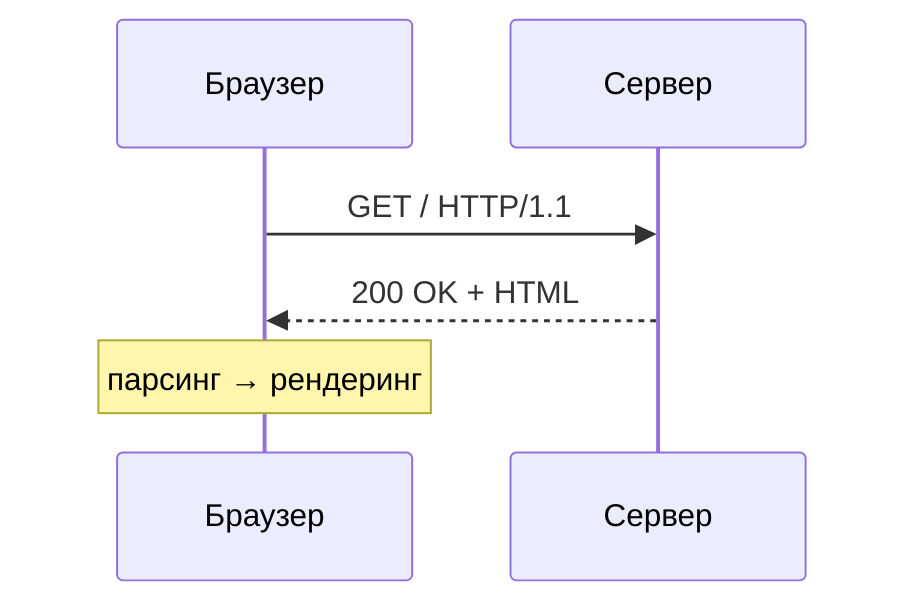
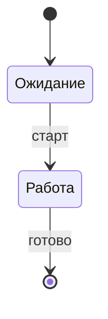

# Mermaid — диаграммы в заметках

Obsidian рендерит блоки ` ```mermaid ` нативно (движок [Mermaid](https://mermaid.js.org)). Используем для потоков, последовательностей, состояний — там, где связь узлов важнее текста, а схема живёт прямо в теле заметки. Для рисованных от руки схем остаётся Excalidraw, для функций — functionplot, а когда схема должна лечь файлом-картинкой или её типа в Mermaid нет — Graphviz и tikz: скилл `conspect` → `references/math.md` → "Генерация графики на сервере"

> [!warning] Главные грабли: `\n` в подписи НЕ работает
> Obsidian-рендер Mermaid **не** превращает литеральный `\n` в перенос строки — он показывает буквальные символы `\n` в подписи. Для многострочной подписи ставь **настоящий перенос строки** прямо внутри кавычек:
> ~~~
> A["render tree
>     (что видимо + стили)"]
> ~~~
> а не `A["render tree\n(что видимо + стили)"]`. Отступ второй строки на рендер не влияет — держи как удобно читать в исходнике. Альтернатива `<br>` тоже рендерится, но канон волта — живой перенос: исходник читается как результат

## Базовый скелет

Блок с языком `mermaid`, первая строка — тип диаграммы:

~~~

~~~

- **Подписи узлов — всегда в кавычках**: `A["текст"]`. Кириллица, пробелы, скобки, точки внутри `"..."` безопасны; без кавычек любой спецсимвол или пробел ломает парсер
- **Направление flowchart**: `TD`/`TB` (сверху вниз), `LR` (слева направо), `RL`, `BT`. Для последовательностей шагов — `LR`; для деревьев/иерархий — `TD`
- **Идентификаторы узлов** (`A`, `B`, `DOM`) — латиница/цифры, это внутренние имена, не подписи. Подпись задаётся один раз в `["..."]`, дальше узел зовётся по id

## Типы, которые реально нужны в конспектах

### flowchart — потоки и деревья
~~~

~~~
- Стрелки: `-->` (сплошная), `-.->` (пунктир), `==>` (жирная)
- Подпись на стрелке: `A -->|текст| B` или `A -- текст --> B`. Текст с пробелами/кириллицей внутри `|...|` лучше тоже в кавычках: `-->|"A 93.184.215.14"|`
- Формы узла: `["прямоуг"]`, `("скруглённый")`, `{"ромб-решение"}`, `[["подпроцесс"]]`, `(("круг"))`

### sequenceDiagram — кто кому шлёт
~~~

~~~
- `participant X as Подпись` — объявить участника с человеческим именем
- `->>` сплошная стрелка (запрос), `-->>` пунктир (ответ)
- `Note over X:` / `Note left of X:` — комментарий; `loop`/`alt`/`opt ... end` — блоки

### stateDiagram-v2 — состояния и переходы
~~~

~~~
`[*]` — начало/конец. Подпись перехода — после двоеточия

Прочие (`erDiagram`, `classDiagram`, `gitGraph`, `mindmap`, `gantt`, `pie`) — по синтаксису с [mermaid.js.org/intro](https://mermaid.js.org/intro/); те же правила про кавычки и перенос строки действуют везде

## Грабли Obsidian-рендера

- **`\n` → буквальные символы**, а не перенос (см. warning выше). Только живой перенос строки внутри `"..."` или `<br>`
- **Спецсимволы в подписях** — держи текст в кавычках. Если внутри подписи нужна сама кавычка — используй `#quot;` (HTML-entity); круглые/квадратные скобки внутри `"..."` уже безопасны
- **`|` в подписи стрелки** конфликтует с синтаксисом `-->|...|`. Если нужен модуль/дизъюнкция в тексте — оберни всю подпись в кавычки: `-->|"P(A|B)"|` или замени символ
- **Wiki-ссылки `[[...]]` внутри Mermaid не кликаются** — движок их не резолвит. Схема даёт картину, а связи расставляй `[[...]]` в прозе/таблице **рядом** с диаграммой, как в вебовских заметках: mermaid плюс таблица с колонками "Шаг", "Что происходит", "Подробно в `[[...]]`"
- **Тема/контраст** зависят от темы Obsidian (Things 3) — не хардкодь цвета через `style`, если не проверил в тёмной теме глазами

## Проверка

**Синтаксис — массово, без открытия Obsidian.** Вынеси каждый ` ```mermaid ` блок в свой `.mmd`-файл и прогони через `mermaid-cli`:

```bash
nix shell nixpkgs#mermaid-cli -c mmdc -q -i схема.mmd -o схема.svg
```

Ненулевой код возврата и текст ошибки в выводе — верный признак поломки: захваченная кавычка, незакрытый узел, `|` в подписи стрелки. По одной заметке хватит и ручной проверки, а по всему курсу или волту — прогнать так все блоки разом: дешевле, чем открывать каждую заметку. Так же ловится и `\n` вместо живого переноса — в SVG подпись останется одной строкой с буквальными `\n`

**Отрисовка — только визуально, в самом Obsidian.** У `mermaid-cli` своя версия движка, у Obsidian — своя; синтаксис общий, но рендер (перенос строк в подписи, ширина, обрезка) может отличаться. Синтаксическая проверка не заменяет открытие заметки: убедиться, что блок рисует схему (а не красный "Syntax error"), а подписи многострочны там, где задумано
