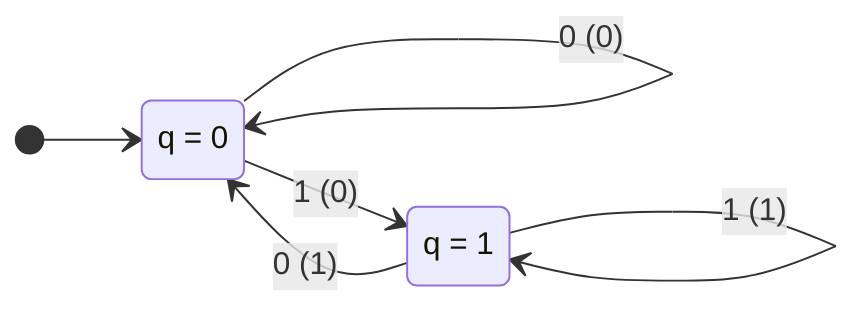

# Конечные автоматы

## Определение автомата [00:48](https://www.youtube.com/watch?t=48&v=vLMTAnLGhdI)

> [!note] Автомат [00:48](https://www.youtube.com/watch?t=48&v=vLMTAnLGhdI)
> **Автоматом** (точнее, **инициальным конечным автоматом**) называется шестёрка $D=(A,B,Q,G,F,q_0)$, где
>
> - $A$, $B$, $Q$ — конечные алфавиты: **входной**, **выходной** и **множество состояний**
> - $G\colon A\times Q\to Q$ — **функция перехода**
> - $F\colon A\times Q\to B$ — **функция выхода**
> - $q_0\in Q$ — **начальное состояние**

Слово "инициальный" лектор опускает: других автоматов в этой части курса нет

## Функционирование автомата [04:50](https://www.youtube.com/watch?t=290&v=vLMTAnLGhdI)

Автомат преобразует входные последовательности из $A^\infty$ (бесконечные последовательности над $A$) в выходные из $B^\infty$. Номер элемента пишут в скобках и читают как такт времени: вход $x(1),x(2),\dots$, выход $y(1),y(2),\dots$, состояние $q(0),q(1),q(2),\dots$ — только состояние нумеруется с нуля

> [!note] Канонические уравнения автомата [08:37](https://www.youtube.com/watch?t=517&v=vLMTAnLGhdI)
> Значения переменных связаны равенствами
> $$\begin{cases}
> y(t)=F\bigl(x(t),q(t-1)\bigr) \\
> q(t)=G\bigl(x(t),q(t-1)\bigr) \\
> q(0)=q_0
> \end{cases}\qquad t=1,2,3,\dots$$
> При $t=1$ в правых частях стоит $q(0)$: из-за этого состояние вводится с нулевого такта

### Однозначность выхода [10:57](https://www.youtube.com/watch?t=657&v=vLMTAnLGhdI)

> [!success] По любому входу канонические уравнения однозначно определяют все $q(t)$ и $y(t)$ [10:57](https://www.youtube.com/watch?t=657&v=vLMTAnLGhdI)
> Вход $a=a(1)a(2)\dots\in A^\infty$ означает $x(t)=a(t)$ при всех $t$. Значит, автомат задаёт отображение $A^\infty\to B^\infty$
>
> > [!success]- Доказательство
> > $G$, $F$ и $q_0$ фиксированы вместе с автоматом, вход $a$ задан. Состояния находятся рекурсией по $t$, начиная с $q(0)=q_0$:
> > $$q(1)=G\bigl(a(1),q_0\bigr),\quad q(2)=G\bigl(a(2),q(1)\bigr),\quad\dots,\quad q(t)=G\bigl(a(t),q(t-1)\bigr)$$
> > Для $q(t)$ нужны только $a(t)$ и уже найденное $q(t-1)$, поэтому определены все $q(t)$. Тогда
> > $$y(t)=F\bigl(a(t),q(t-1)\bigr)$$
> > определено при каждом $t$ $\blacksquare$

### Конечные слова [16:47](https://www.youtube.com/watch?t=1007&v=vLMTAnLGhdI)

> [!tip] Первые $k$ выходов определяются первыми $k$ входами, поэтому автомат преобразует слова в слова той же длины [16:47](https://www.youtube.com/watch?t=1007&v=vLMTAnLGhdI)
> Зная $a(1),\dots,a(k)$, по рекурсии находим $q(1),\dots,q(k)$, а по ним $y(1),\dots,y(k)$. Значение $q(k)$ уже не нужно: оно участвует только в $y(k+1)$
>
> Длина слова не ограничена, и автомат можно остановить в любой момент: выход на первых $k$ тактах не зависит от того, что подадут позже

## Автоматная функция [20:05](https://www.youtube.com/watch?t=1205&v=vLMTAnLGhdI)

> [!note] Автоматная функция [20:05](https://www.youtube.com/watch?t=1205&v=vLMTAnLGhdI)
> Отображение $\varphi\colon A^\infty\to B^\infty$ называется **автоматной функцией** (автоматным отображением), если существует автомат, который его реализует

> [!warning] Не всякое отображение автоматное [21:01](https://www.youtube.com/watch?t=1261&v=vLMTAnLGhdI)
> Автомат не знает будущего: отображение, в котором $k$-й символ выхода зависит не только от первых $k$ символов входа, но и от $(k+1)$-го, автомат не реализует

## Автомат задержки [21:39](https://www.youtube.com/watch?t=1299&v=vLMTAnLGhdI)

> [!example] Автомат задержки [21:51](https://www.youtube.com/watch?t=1311&v=vLMTAnLGhdI)
> $A=B=Q=\{0,1\}$, канонические уравнения
> $$\begin{cases}
> y(t)=q(t-1) \\
> q(t)=x(t) \\
> q(0)=0
> \end{cases}$$
> Здесь $F(a,q)=q$ не зависит от первого аргумента, $G(a,q)=a$ — от второго

Подставим вход $a(1)a(2)a(3)\dots$ и выпишем такты[^tact]

| Такт $t$ | 0 | 1 | 2 | 3 | 4 | 5 |
|---|---|---|---|---|---|---|
| $x$ | | $a(1)$ | $a(2)$ | $a(3)$ | $a(4)$ | $a(5)$ |
| $q$ | $0$ | $a(1)$ | $a(2)$ | $a(3)$ | $a(4)$ | $a(5)$ |
| $y$ | | $0$ | $a(1)$ | $a(2)$ | $a(3)$ | $a(4)$ |

Строка $q$ повторяет вход, строка $y$ — строку $q$, сдвинутую на такт: $y(1)=q(0)=0$, $y(2)=q(1)=a(1)$ и так далее

> [!summary] Автомат задержки переводит $a(1)a(2)a(3)\dots$ в $0\,a(1)a(2)\dots$ [24:48](https://www.youtube.com/watch?t=1488&v=vLMTAnLGhdI)
> Он выдаёт 0 на первом такте, затем входную последовательность с запаздыванием на один такт[^word]

[^tact]: Лектор поясняет, что в цифровых схемах время так и устроено: дискретные такты, а их период стараются сделать как можно короче, он определяется частотой схемы ([25:09](https://www.youtube.com/watch?t=1509&v=vLMTAnLGhdI))

[^word]: Не из лекции: на входе $10110\dots$ выход $01011\dots$

## Способы задания автомата [26:39](https://www.youtube.com/watch?t=1599&v=vLMTAnLGhdI)

Алфавиты перечисляются, а $G$ и $F$ — функции на конечных множествах. Их задают таблицей (по одной оси $A$, по другой $Q$, в клетках значения), формулами в канонических уравнениях или диаграммой Мура. Лектор говорит о четырёх представлениях автомата, между которыми нужно уметь быстро переходить ([32:46](https://www.youtube.com/watch?t=1966&v=vLMTAnLGhdI))

Для автомата задержки таблица такова[^table]

| Состояние $q$ | $a=0$: $G;F$ | $a=1$: $G;F$ |
|---|---|---|
| $0$ | $0;0$ | $1;0$ |
| $1$ | $0;1$ | $1;1$ |

[^table]: Не из лекции: лектор таблицу автомата задержки не выписывает, она получена из $G(a,q)=a$ и $F(a,q)=q$

### Диаграмма Мура [27:20](https://www.youtube.com/watch?t=1640&v=vLMTAnLGhdI)

> [!note] Диаграмма Мура [27:38](https://www.youtube.com/watch?t=1658&v=vLMTAnLGhdI)
> **Диаграммой Мура** автомата $(A,B,Q,G,F,q_0)$ называется ориентированный граф с множеством вершин $Q$. Для каждой пары $(a,q)\in A\times Q$ проводится дуга из $q$ в $q'=G(a,q)$ с пометкой $\bigl(a,F(a,q)\bigr)$: в состоянии $q$ на входной символ $a$ автомат переходит в $q'$ и выдаёт $F(a,q)$. Начальное состояние $q_0$ помечается особо

В задачнике пометку пишут $a(F)$, начальное состояние отмечают звёздочкой [30:57](https://www.youtube.com/watch?t=1857&v=vLMTAnLGhdI). Диаграмма однозначно задаёт автомат: это другой язык представления, удобный для задач на отличимость состояний[^mealy]

Диаграмма автомата задержки: пометка $a(b)$ читается как "вход $a$, выход $b$", начальное состояние — со стрелкой из чёрной точки

[^mealy]: Рисунок диаграммы лектор не приводит. Автомат лектора, $y(t)=F\bigl(x(t),q(t-1)\bigr)$, по виду выхода относится к типу Мили: выход зависит от входа и состояния. У [[Синтез автомата по ГСА#Автоматы Мили и Мура|автомата Мура]] выход зависит только от состояния; автомат задержки с $F(a,q)=q$ подходит под оба типа. Название "диаграмма Мура" не делает автомат автоматом Мура: так в курсе называется граф состояний с пометками на дугах
