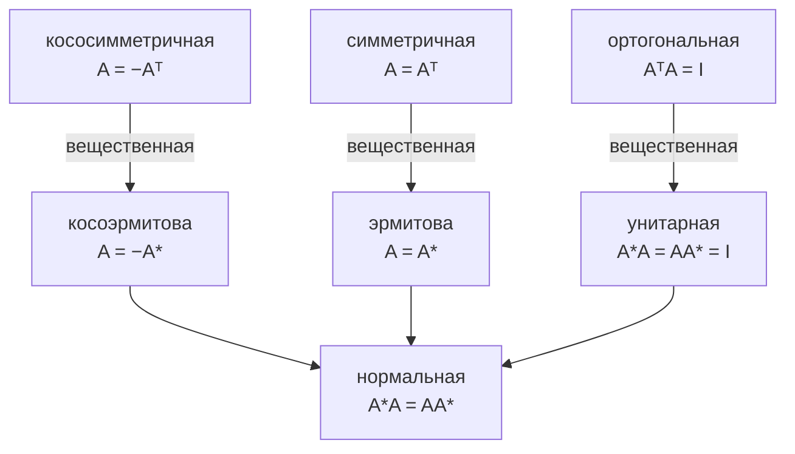

# Классы матриц

Стрелка ведёт от частного случая к общему; подпись "вещественная" — частный случай для вещественных матриц

## Сопряжённая матрица

> [!note] **Сопряжённая матрица** к прямоугольной матрице $A$ — матрица $A^*=(\overline A)^T$, где элементы $\overline A$ — [[Комплексные числа#Сопряжение и модуль|комплексно сопряжённые]] к элементам $A$
> Для $A$ размера $m\times n$ матрица $A^*$ имеет размер $n\times m$ и элементы $(A^*)_{ij}=\overline{a_{ji}}$

> [!success] $(A^*)^*=A$, $(\alpha A)^*=\bar\alpha A^*$, $(A+B)^*=A^*+B^*$, $(AB)^*=B^*A^*$[^conj]
>
> > [!success]- Доказательство
> > Сопряжение чисел сохраняет сумму и произведение, поэтому $\overline{\alpha A}=\bar\alpha\overline A$, $\overline{A+B}=\overline A+\overline B$, $\overline{AB}=\overline A\,\overline B$ и $\overline{\overline A}=A$. Остаётся применить [[Операции над матрицами#Транспонирование|правила транспонирования]]: $(AB)^*=(\overline A\,\overline B)^T=\overline B^T\,\overline A^T=B^*A^*$, остальные равенства аналогично $\blacksquare$

[^conj]: Тетрадь (p049) и пособие приводят три первых равенства без вывода, равенство $(AB)^*=B^*A^*$ используется в доказательстве про произведение унитарных матриц

> [!success] Для квадратной матрицы $\det(A^*)=\overline{\det A}$
>
> > [!success]- Доказательство
> > Определитель — сумма произведений элементов со знаками, а сопряжение сохраняет суммы и произведения, поэтому $\det\overline A=\overline{\det A}$. Тогда по [[Определитель порядка n#Транспонирование|равенству]] $|A^T|=|A|$
> > $$\det(A^*)=\det\bigl((\overline A)^T\bigr)=\det\overline A=\overline{\det A}\ \blacksquare$$

## Классы квадратных матриц

### Эрмитовы и косоэрмитовы матрицы

> [!note] Квадратная матрица $A$ **эрмитова** (**самосопряжённая**), если $A=A^*$, и **косоэрмитова**, если $A=-A^*$
> Эрмитовы матрицы названы в честь Шарля Эрмита (1822–1901), французского математика

> [!success] Определитель эрмитовой матрицы вещественен
>
> > [!success]- Доказательство
> > Для эрмитовой матрицы $\det A=\det A^*=\overline{\det A}$. Комплексное число равно сопряжённому тогда и только тогда, когда оно вещественно $\blacksquare$

> [!success] Любая квадратная матрица представима в виде $A=H_1+iH_2$ с эрмитовыми $H_1$, $H_2$, и представление единственно
> $$H_1=\frac12(A+A^*),\qquad H_2=\frac1{2i}(A-A^*)$$
>
> > [!success]- Доказательство
> > Подстановка даёт $H_1+iH_2=\frac12(A+A^*)+\frac12(A-A^*)=A$. Матрица $A+A^*$ эрмитова: $(A+A^*)^*=A^*+A$. Матрица $\frac1i(A-A^*)$ тоже: $\bigl(\frac1i(A-A^*)\bigr)^*=\frac1{-i}(A^*-A)=\frac1i(A-A^*)$. Умножение эрмитовой матрицы на вещественное число $\frac12$ сохраняет эрмитовость
> >
> > Пусть есть второе представление $A=\widetilde H_1+i\widetilde H_2$. Тогда $(H_1-\widetilde H_1)+i(H_2-\widetilde H_2)=0$, и после сопряжения $(H_1-\widetilde H_1)-i(H_2-\widetilde H_2)=0$. Сложение даёт $H_1=\widetilde H_1$, а тогда и $H_2=\widetilde H_2$ $\blacksquare$

### Вещественные, симметричные и кососимметричные матрицы

> [!note] Матрица **вещественная**, если все её элементы вещественны. Вещественная эрмитова матрица называется **симметричной**: $A=A^T$. Вещественная матрица **кососимметричная**, если $A=-A^T$
> У вещественной матрицы $A^*=A^T$, поэтому для неё условие эрмитовости превращается в $A=A^T$

> [!success] Любая квадратная вещественная матрица представима в виде $A=A_1+A_2$ с симметричной $A_1$ и кососимметричной $A_2$, и представление единственно[^real-uniq]
> $$A_1=\frac12(A+A^T),\qquad A_2=\frac12(A-A^T)$$
>
> > [!success]- Доказательство
> > Как для эрмитовых: $A_1+A_2=A$, и $A_1^T=\frac12(A^T+A)=A_1$, $A_2^T=\frac12(A^T-A)=-A_2$. Если $S_1+K_1=S_2+K_2$ — второе такое представление, то матрица $S_1-S_2=K_2-K_1$ одновременно симметрична и кососимметрична: $X=X^T=-X$, откуда $X=O$ $\blacksquare$

[^real-uniq]: Единственность в пособии заявлена без доказательства

### Унитарные матрицы

> [!note] Квадратная матрица $A$ **унитарна**, если $A^{-1}=A^*$, то есть $AA^*=I$ и $A^*A=I$
> Достаточно одного из равенств: [[Обратная матрица#Правая и левая обратные матрицы|правая и левая обратные совпадают]]

> [!success] Определитель унитарной матрицы по модулю равен $1$
>
> > [!success]- Доказательство
> > $$1=\det I=\det(AA^*)=\det A\cdot\det A^*=\det A\cdot\overline{\det A}=|\det A|^2$$
> > Значит, $|\det A|=1\ \blacksquare$

> [!success] Произведение унитарных матриц — унитарная матрица
>
> > [!success]- Доказательство
> > Пусть $A$, $B$ унитарны и $C=AB$. По [[Обратная матрица#Свойства обратной матрицы|обратной к произведению]] и $(AB)^*=B^*A^*$
> > $$C^{-1}=B^{-1}A^{-1}=B^*A^*=(AB)^*=C^*$$
> > Значит, $C^{-1}=C^*\ \blacksquare$[^unit-prod]

[^unit-prod]: В тетради (p050) стоит $C^{-1}=A^*B^*=A^{-1}B^{-1}$; обратная к произведению меняет порядок сомножителей: $C^{-1}=B^{-1}A^{-1}=B^*A^*$

> [!example] Диагональная матрица $\operatorname{diag}(q_1,\dots,q_n)$ с $|q_k|=1$ унитарна
> Её сопряжённая — $\operatorname{diag}(\bar q_1,\dots,\bar q_n)$, и произведение диагональных матриц даёт $\operatorname{diag}(|q_1|^2,\dots,|q_n|^2)=I$

### Ортогональные матрицы

> [!note] **Ортогональная матрица** — вещественная унитарная матрица: $A^{-1}=A^T$, то есть $A^TA=AA^T=I$
> Определитель ортогональной матрицы по модулю равен $1$, а как вещественное число — $+1$ или $-1$

> [!example] Ортогональные матрицы
> [[Элементарные матрицы#Матрицы перестановок|Матрица перестановок]] $P_{ik}$ ортогональна: $P_{ik}^T=P_{ik}$ и $P_{ik}^2=I$. Матрица второго порядка
> $$Q_2(\varphi)=\begin{pmatrix}\cos\varphi&-\sin\varphi\\\sin\varphi&\cos\varphi\end{pmatrix}$$
> ортогональна при любом вещественном $\varphi$
>
> > [!success]- Проверка
> > $$Q_2(\varphi)Q_2(\varphi)^T=\begin{pmatrix}\cos\varphi&-\sin\varphi\\\sin\varphi&\cos\varphi\end{pmatrix}\begin{pmatrix}\cos\varphi&\sin\varphi\\-\sin\varphi&\cos\varphi\end{pmatrix}=\begin{pmatrix}\cos^2\varphi+\sin^2\varphi&0\\0&\sin^2\varphi+\cos^2\varphi\end{pmatrix}=I$$
> > Недиагональные элементы: $\cos\varphi\sin\varphi-\sin\varphi\cos\varphi=0$. При этом $\det Q_2(\varphi)=\cos^2\varphi+\sin^2\varphi=1$ $\blacksquare$

### Нормальные матрицы

> [!note] Квадратная матрица $A$ **нормальная**, если она перестановочна с $A^*$: $A^*A=AA^*$

> [!success] Эрмитовы, косоэрмитовы и унитарные матрицы нормальны
>
> > [!success]- Доказательство
> > Эрмитова: $A^*A=AA=AA^*$. Косоэрмитова: $A^*A=(-A)A=-A^2$ и $AA^*=A(-A)=-A^2$. Унитарная: $A^*A=AA^*=I$ $\blacksquare$

> [!warning] Не всякая нормальная матрица эрмитова, косоэрмитова или унитарна
> $$A=\begin{pmatrix}1&-1\\1&1\end{pmatrix},\qquad A^*=A^T=\begin{pmatrix}1&1\\-1&1\end{pmatrix},\qquad AA^*=A^*A=\begin{pmatrix}2&0\\0&2\end{pmatrix}$$
> Матрица нормальна. Но $A\neq A^*$, $A\neq-A^*$ (диагональ $1\neq-1$) и $AA^*=2I\neq I$
