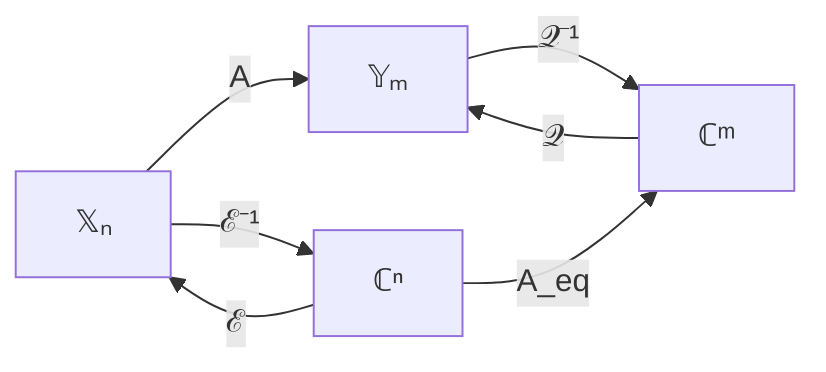

# Матрица оператора

## Матрица в паре базисов

### Определение матрицы оператора

Пусть $A\colon\mathbb{X}_n\to\mathbb{Y}_m$ — [[Линейный оператор|линейный оператор]]. Зафиксируем [[Базис и размерность#Конечномерные пространства|базисы]] $E_n=\{e^k\}_{k=1}^n$ в $\mathbb{X}_n$ и $Q_m=\{q^k\}_{k=1}^m$ в $\mathbb{Y}_m$. Каждый вектор $Ae^i$ раскладывается по $Q_m$:
$$Ae^i=a^{(eq)}_{1i}q^1+a^{(eq)}_{2i}q^2+\dots+a^{(eq)}_{mi}q^m,\qquad i=1,\dots,n$$

> [!note] **Матрица оператора** $A$ в базисах $E_n$, $Q_m$ — матрица $A_{eq}$ размера $m\times n$, $i$-й столбец которой — координаты вектора $Ae^i$ в базисе $Q_m$
> $$A_{eq}=\begin{pmatrix}a^{(eq)}_{11}&a^{(eq)}_{12}&\cdots&a^{(eq)}_{1n}\\a^{(eq)}_{21}&a^{(eq)}_{22}&\cdots&a^{(eq)}_{2n}\\\vdots&\vdots&&\vdots\\a^{(eq)}_{m1}&a^{(eq)}_{m2}&\cdots&a^{(eq)}_{mn}\end{pmatrix}$$

Так как [[Базис и размерность#Конечномерные пространства|координаты в базисе определены однозначно]], матрица $A_{eq}$ однозначно определяется оператором $A$ и базисами $E_n$, $Q_m$. Построчная запись разложений — одно матричное равенство:
$$\boxed{\,AE_n=Q_mA_{eq}\,}$$

### Координаты образа вектора

> [!success] Если $x=E_n\xi\in\mathbb{X}_n$ и $Ax=Q_m\eta\in\mathbb{Y}_m$, то
> $$\boxed{\,\eta=A_{eq}\xi\,}$$
>
> > [!success]- Доказательство
> > По линейности $A$ и равенству $AE_n=Q_mA_{eq}$
> > $$Q_m\eta=Ax=AE_n\xi=Q_mA_{eq}\xi$$
> > Координаты вектора $Ax$ в базисе $Q_m$ определены однозначно, поэтому $\eta=A_{eq}\xi$ $\blacksquare$

Формула связывает координаты векторов $x$ и $Ax$ в базисах $\mathbb{X}_n$ и $\mathbb{Y}_m$

### Коммутативная диаграмма

Базис $E_n$ задаёт [[Обратный оператор и изоморфизм|оператор]] $\mathcal{E}\colon\mathbb{C}^n\to\mathbb{X}_n$, $\mathcal{E}\xi=E_n\xi$: он по координатам строит вектор. Обратный $\mathcal{E}^{-1}\colon\mathbb{X}_n\to\mathbb{C}^n$ раскладывает вектор по базису; так же устроены $\mathcal{Q}$ и $\mathcal{Q}^{-1}$ для $Q_m$

> [!success] Матрица оператора выражается через операторы разложения по базису
> $$A_{eq}=\mathcal{Q}^{-1}A\mathcal{E},\qquad A=\mathcal{Q}A_{eq}\mathcal{E}^{-1}$$
>
> > [!success]- Доказательство
> > Для любого $\xi\in\mathbb{C}^n$ равенство $AE_n=Q_mA_{eq}$ даёт $A\mathcal{E}\xi=\mathcal{Q}A_{eq}\xi$, то есть $A\mathcal{E}=\mathcal{Q}A_{eq}$ как операторы $\mathbb{C}^n\to\mathbb{Y}_m$. Умножив слева на $\mathcal{Q}^{-1}$, получим первое равенство, а справа на $\mathcal{E}^{-1}$ — второе $\blacksquare$

Диаграмма коммутативна: путь $\mathbb{X}_n\to\mathbb{C}^n\to\mathbb{C}^m\to\mathbb{Y}_m$ даёт $Ax=\mathcal{Q}A_{eq}\mathcal{E}^{-1}x$. Чтобы найти $Ax$ по матрице: разложить $x$ по $E_n$, умножить координаты на $A_{eq}$, собрать вектор из полученных координат по $Q_m$

### Соответствие оператор–матрица

> [!success] Если в $\mathbb{X}_n$ и $\mathbb{Y}_m$ фиксированы базисы $E_n$, $Q_m$, то оператору $A\colon\mathbb{X}_n\to\mathbb{Y}_m$ однозначно соответствует матрица $A_{eq}$ размера $m\times n$, и наоборот
>
> > [!success]- Доказательство
> > Оператору соответствует единственная матрица $A_{eq}$ по определению. Обратно, для матрицы $B$ размера $m\times n$ положим $A=\mathcal{Q}B\mathcal{E}^{-1}$. Это линейный оператор $\mathbb{X}_n\to\mathbb{Y}_m$ как композиция линейных операторов, и его матрица равна $\mathcal{Q}^{-1}A\mathcal{E}=B$. Разные операторы имеют разные матрицы, так как $A=\mathcal{Q}A_{eq}\mathcal{E}^{-1}$ восстанавливает оператор по матрице $\blacksquare$

## Свойства матрицы оператора

### Оператор в одном пространстве

При $A\colon\mathbb{X}_n\to\mathbb{X}_n$ базис в образе и прообразе берут один, матрицу обозначают $A_e$:
$$AE_n=E_nA_e,\qquad A_e=\mathcal{E}^{-1}A\mathcal{E}$$

Матрица оператора не зависит от выбора базиса в двух случаях:

- нулевой оператор имеет нулевую матрицу при любых базисах
- тождественный оператор имеет единичную матрицу $I$ в любом базисе

Обратно, оператор $\mathbb{X}_n\to\mathbb{X}_n$ с матрицей, не зависящей от базиса, — скалярный, $\alpha I$ ([[Матрица оператора#Матрица, не зависящая от базиса|доказательство ниже]])

### Линейные операции и произведение

> [!success] Для любых $A,B\colon\mathbb{X}_n\to\mathbb{Y}_m$ и $\alpha,\beta\in\mathbb{C}$
> $$(\alpha A+\beta B)_{eq}=\alpha A_{eq}+\beta B_{eq}$$
>
> > [!success]- Доказательство
> > $(\alpha A+\beta B)e^i=\alpha Ae^i+\beta Be^i$. Координаты линейной комбинации векторов — та же линейная комбинация их координат, то есть $i$-й столбец слева равен $i$-му столбцу справа $\blacksquare$

Линейным операциям над операторами соответствуют [[Операции над матрицами#Сложение и умножение на число|линейные операции]] над матрицами

> [!success] Пусть $A\colon\mathbb{X}_n\to\mathbb{Y}_m$, $B\colon\mathbb{Y}_m\to\mathbb{Z}_p$, а $\{e^k\}$, $\{q^k\}$, $\{r^k\}$ — базисы $\mathbb{X}_n$, $\mathbb{Y}_m$, $\mathbb{Z}_p$. Тогда
> $$\boxed{\,(BA)_{er}=B_{qr}A_{eq}\,}$$
>
> > [!success]- Доказательство
> > Применим равенства $A_{eq}=\mathcal{Q}^{-1}A\mathcal{E}$ и $B_{qr}=\mathcal{R}^{-1}B\mathcal{Q}$, то есть $A=\mathcal{Q}A_{eq}\mathcal{E}^{-1}$, $B=\mathcal{R}B_{qr}\mathcal{Q}^{-1}$:
> > $$(BA)_{er}=\mathcal{R}^{-1}BA\mathcal{E}=\mathcal{R}^{-1}\mathcal{R}B_{qr}\mathcal{Q}^{-1}\mathcal{Q}A_{eq}\mathcal{E}^{-1}\mathcal{E}=B_{qr}A_{eq}\ \blacksquare$$

Матрицы $A$ и $B$ должны быть построены в одном и том же базисе $\{q^k\}\subset\mathbb{Y}_m$: это согласование предполагается всегда. Матрица произведения операторов равна [[Операции над матрицами#Произведение матриц|произведению]] матриц

### Примеры

> [!example] Оператор $A\colon\mathbb{C}^4\to\mathbb{C}^4$, $Ax=(x_2,x_1,x_3+x_4,x_4)$, в естественном базисе
> Столбцы — образы единичных векторов $i^k$:
> $$Ai^1=(0,1,0,0)=i^2,\quad Ai^2=(1,0,0,0)=i^1,\quad Ai^3=(0,0,1,0)=i^3,\quad Ai^4=(0,0,1,1)=i^3+i^4$$
> $$A_i=\begin{pmatrix}0&1&0&0\\1&0&0&0\\0&0&1&1\\0&0&0&1\end{pmatrix}$$

> [!example] Оператор сдвига $T\colon\mathbf{Q}_2\to\mathbf{Q}_2$, $Tq_2(z)=q_2(z+h)$, $h\in\mathbb{C}$, в пространстве $\mathbf{Q}_2$ многочленов степени $\leqslant2$ с комплексными коэффициентами, в базисе $\varphi_0=1$, $\varphi_1=z$, $\varphi_2=z^2$
> Образы базисных многочленов:
> $$T\varphi_0=\varphi_0,\qquad T\varphi_1=h\varphi_0+\varphi_1,\qquad T\varphi_2=h^2\varphi_0+2h\varphi_1+\varphi_2$$
> $$T_\varphi=\begin{pmatrix}1&h&h^2\\0&1&2h\\0&0&1\end{pmatrix}$$
> Если $q_2=a_0+a_1z+a_2z^2$, то $Tq_2=b_0+b_1z+b_2z^2$ и
> $$\begin{pmatrix}b_0\\b_1\\b_2\end{pmatrix}=T_\varphi\begin{pmatrix}a_0\\a_1\\a_2\end{pmatrix}=\begin{pmatrix}a_0+ha_1+h^2a_2\\a_1+2ha_2\\a_2\end{pmatrix}$$

## Замена базиса

Матрица оператора зависит от базисов. Пусть наряду с $E_n$, $Q_m$ заданы базисы $\tilde E_n$, $\tilde Q_m$ и известны [[Замена базиса#Матрица перехода|матрицы перехода]] $T$, $R$:
$$\tilde E_n=E_nT,\qquad \tilde Q_m=Q_mR$$

> [!success] Матрица оператора $A\colon\mathbb{X}_n\to\mathbb{Y}_m$ в новых базисах
> $$\boxed{\,A_{\tilde e\tilde q}=R^{-1}A_{eq}T\,}$$
> При $A\colon\mathbb{X}_n\to\mathbb{X}_n$ и $\tilde E_n=E_nT$
> $$A_{\tilde e}=T^{-1}A_eT$$
>
> > [!success]- Доказательство
> > Подставим $A=\mathcal{Q}A_{eq}\mathcal{E}^{-1}$ в $A_{\tilde e\tilde q}=\tilde{\mathcal{Q}}^{-1}A\tilde{\mathcal{E}}$:
> > $$A_{\tilde e\tilde q}=\tilde{\mathcal{Q}}^{-1}\mathcal{Q}A_{eq}\mathcal{E}^{-1}\tilde{\mathcal{E}}$$
> > Для любого $\xi\in\mathbb{C}^n$ имеем $\tilde{\mathcal{E}}\xi=E_nT\xi=\mathcal{E}T\xi$, поэтому $\tilde{\mathcal{E}}=\mathcal{E}T$ и $\mathcal{E}^{-1}\tilde{\mathcal{E}}=T$. Аналогично $\mathcal{Q}^{-1}\tilde{\mathcal{Q}}=R$, откуда $\tilde{\mathcal{Q}}^{-1}\mathcal{Q}=R^{-1}$. Значит, $A_{\tilde e\tilde q}=R^{-1}A_{eq}T$. В квадратном случае $R=T$ $\blacksquare$

### Подобные матрицы

> [!note] Квадратные матрицы $B$ и $C$ **подобны**, если $B=D^{-1}CD$ при некоторой невырожденной матрице $D$
> Переход от $C$ к $B$ называют **преобразованием подобия**

По формуле замены базиса матрицы одного и того же оператора $A\colon\mathbb{X}_n\to\mathbb{X}_n$ в разных базисах подобны: $A_{\tilde e}=T^{-1}A_eT$, $\tilde E_n=E_nT$, и $T$ невырожденна как [[Замена базиса#Матрица перехода|матрица перехода]]

### Матрица, не зависящая от базиса

> [!success] Если матрица оператора $A\colon\mathbb{X}_n\to\mathbb{X}_n$ не зависит от выбора базиса, то $A=\alpha I$ при некотором $\alpha\in\mathbb{C}$
>
> > [!success]- Доказательство
> > Пусть $A_e=(a_{jl})$ — матрица в каком-либо базисе. Матрицы одного оператора подобны, поэтому $A_e=BA_eB^{-1}$ и $A_eB=BA_e$ для любой невырожденной $B$
> >
> > Пусть $E_{ik}$ — матрица с единицей в позиции $(i,k)$ и нулями в остальных, $i\neq k$. Матрица $E_{ik}+I$ треугольная с единицами на диагонали, значит, невырождена, и $A_e(E_{ik}+I)=(E_{ik}+I)A_e$, откуда $A_eE_{ik}=E_{ik}A_e$
> >
> > В $A_eE_{ik}$ отличен от нуля только $k$-й столбец, равный $i$-му столбцу $A_e$: $(a_{1i},\dots,a_{ni})^T$. В $E_{ik}A_e$ отлична от нуля только $i$-я строка, равная $k$-й строке $A_e$: $(a_{k1},\dots,a_{kn})$. Равенство матриц возможно лишь если $a_{ji}=0$ при $j\neq i$ и $a_{ii}=a_{kk}$
> >
> > Номера $i\neq k$ произвольны, поэтому $A_e$ диагональна с одинаковыми диагональными элементами: $A_e=\alpha I$. Тогда $A=\mathcal{E}A_e\mathcal{E}^{-1}=\alpha I$ $\blacksquare$

Оператор $\alpha I$ — умножение на число (**скалярный оператор**). Обратно, его матрица $\mathcal{E}^{-1}(\alpha I)\mathcal{E}=\alpha I$ в любом базисе одна и та же

## Определитель и обратный оператор

### Определитель оператора

Определители подобных матриц $B=DCD^{-1}$ совпадают:
$$\det B=\det D\cdot\det C\cdot\det D^{-1}=\det C$$
Здесь $\det D\cdot\det D^{-1}=1$ по [[Определитель произведения матриц#Определитель обратной матрицы|определителю обратной матрицы]]. Матрицы $A_{\tilde e}=T^{-1}A_eT$ одного оператора подобны, поэтому $\det A_e$ не зависит от базиса

> [!note] **Определитель оператора** $A\colon\mathbb{X}_n\to\mathbb{X}_n$ — определитель его матрицы $A_e$ в любом базисе; это инвариант оператора, обозначение $\det A$
> Оператор **невырожден**, если $\det A\neq0$

### Обратный оператор и его матрица

> [!success] Для любого невырожденного оператора $A\colon\mathbb{X}_n\to\mathbb{X}_n$ существует обратный, а его матрица обратна матрице $A_e$
> $$A=\mathcal{E}A_e\mathcal{E}^{-1},\qquad A^{-1}=\mathcal{E}A_e^{-1}\mathcal{E}^{-1},\qquad(A^{-1})_e=A_e^{-1}$$
>
> > [!success]- Доказательство
> > Фиксируем базис. Матрица $A_e$ невырождена, поэтому существует [[Обратная матрица|обратная]] $A_e^{-1}$. Положим $B=\mathcal{E}A_e^{-1}\mathcal{E}^{-1}$. Из $A=\mathcal{E}A_e\mathcal{E}^{-1}$
> > $$BA=\mathcal{E}A_e^{-1}\mathcal{E}^{-1}\mathcal{E}A_e\mathcal{E}^{-1}=\mathcal{E}I\mathcal{E}^{-1}=I,\qquad AB=\mathcal{E}A_e\mathcal{E}^{-1}\mathcal{E}A_e^{-1}\mathcal{E}^{-1}=I$$
> > Значит, $B=A^{-1}$, и $(A^{-1})_e=\mathcal{E}^{-1}B\mathcal{E}=A_e^{-1}$ $\blacksquare$

> [!success] Если оператор $A\colon\mathbb{X}_n\to\mathbb{X}_n$ имеет обратный, то он невырожден
>
> > [!success]- Доказательство
> > Из $AA^{-1}=I$ и формулы для матрицы произведения $A_e(A^{-1})_e=I$. Тогда $\det A\cdot\det A^{-1}=\det I=1$, поэтому $\det A\neq0$ $\blacksquare$

> [!success] Оператор $A\colon\mathbb{X}_n\to\mathbb{X}_n$ имеет обратный тогда и только тогда, когда из $Ax=0$ следует $x=0$, то есть $\operatorname{Ker}A=\{0\}$
>
> > [!success]- Доказательство
> > Необходимость: если $A^{-1}$ существует, то из $Ax=0$ получаем $x=A^{-1}Ax=A^{-1}0=0$. Достаточность: при $\operatorname{Ker}A=\{0\}$ дефект равен нулю, и по [[Образ и ядро оператора#Теорема о ранге и дефекте|теореме о ранге и дефекте]] $\dim\operatorname{Im}A=n$, то есть $\operatorname{Im}A=\mathbb{X}_n$. Если $Ax'=Ax''$, то $x'-x''\in\operatorname{Ker}A$ и $x'=x''$. Оператор взаимно однозначен, и по [[Обратный оператор и изоморфизм|теореме об обратном операторе]] $A^{-1}$ существует $\blacksquare$

> [!example] Оператор $A$ из примера на $\mathbb{C}^4$[^inv-ex]
> $\det A_i=-1\neq0$, поэтому обратный оператор существует, $A^{-1}x=(x_2,x_1,x_3-x_4,x_4)$:
> $$A_i^{-1}=\begin{pmatrix}0&1&0&0\\1&0&0&0\\0&0&1&-1\\0&0&0&1\end{pmatrix}$$

[^inv-ex]: Пример не из лекции

## Пространство операторов

Операторы $\mathbb{X}_n\to\mathbb{Y}_m$ можно складывать и умножать на число: $(\alpha A+\beta B)x=\alpha Ax+\beta Bx$. Эти операции удовлетворяют [[Линейное пространство#Аксиомы линейного пространства|аксиомам линейного пространства]], то есть операторы $\mathbb{X}_n\to\mathbb{Y}_m$ образуют линейное пространство

> [!success] Размерность пространства линейных операторов $\mathbb{X}_n\to\mathbb{Y}_m$ равна $mn$
>
> > [!success]- Доказательство
> > Соответствие $A\mapsto A_{eq}$ при фиксированных базисах взаимно однозначно по теореме о соответствии оператор–матрица и сохраняет линейные операции, то есть является изоморфизмом на пространство матриц $m\times n$. Это [[Линейное пространство#Пространства $\mathbb{R}^n$ и $\mathbb{C}^n$|пространство]] $\mathbb{C}^{mn}$ с $mn$ независимыми элементами матрицы, его размерность равна $mn$. Размерности изоморфных пространств равны $\blacksquare$

Для вещественных $\mathbb{X}_n$, $\mathbb{Y}_m$ и умножения на вещественные числа получается вещественное линейное пространство операторов той же размерности $mn$
