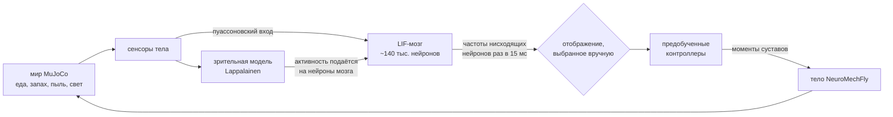

# Эмуляция мозга мухи Eon Systems

> [!abstract] Суть
> В марте 2026 стартап Eon Systems показал виртуальную дрозофилу, которая ищет еду, ест и чистит усики, и назвал это первой "загрузкой" мозга в тело. Все части взяты из открытых работ 2024 года; новое — только замкнутая петля между ними, и её код не опубликован

## Как устроен цикл

Четыре готовых компонента:

| Слой | Работа | Что даёт |
|---|---|---|
| Коннектом | [[Dorkenwald и др. — Коннектом FlyWire\|FlyWire]] | граф: ~139 тыс. нейронов, 54,5 млн синапсов, медиатор каждого нейрона |
| Мозг | [[Shiu и др. — LIF-модель всего мозга мухи\|Shiu и др.]] | спайковая [[Shiu и др. — LIF-модель всего мозга мухи\|LIF]]-модель на этом графе, без обучения |
| Зрение | [[Lappalainen и др. — Модель зрения мухи по коннектому\|Lappalainen и др.]] | предсказанная активность 64 типов клеток зрительной системы |
| Тело | [[Wang-Chen и др. — NeuroMechFly v2\|NeuroMechFly v2]] | физическое тело в MuJoCo, 87 суставов по микро-КТ |

Мозг и тело синхронизируются каждые **15 мс**: тело отдаёт сенсорные события, мозг 15 мс симулирует спайки, частоты выбранных нисходящих нейронов превращаются в команды для тела

### Входы

| Модальность | Событие в мире | Какие нейроны стимулируются |
|---|---|---|
| Вкус | контакт лапки или хоботка с сахаром или горьким | вкусовые рецепторные нейроны, [[Shiu и др. — LIF-модель всего мозга мухи#Веса из коннектома\|GRN]] |
| Обоняние | источник запаха | обонятельные рецепторные нейроны |
| Механосенсорика | "виртуальная пыль" на антенне | механорецепторы джонстонова органа |
| Зрение | рендер сцены | 64 типа клеток через модель Lappalainen |

Стимуляция — тот же приём, что в статье Shiu: пуассоновский поток спайков заданной частоты на нужные нейроны. Зрение, по признанию самой Eon, пока "somewhat decorative" и на поведение почти не влияет

### Выходы

У настоящей мухи нисходящих нейронов больше 1000, у Eon читаются около семи типов:

| Нейроны | Что запускают |
|---|---|
| DNa01, DNa02 | поворот |
| oDN1 | скорость вперёд |
| MN9 | движение хоботка, питание |
| антеннальные нисходящие | груминг антенн |
| гигантское волокно | бегство — по словам Eon, реализовано не полностью |

Частоты этих нейронов не превращаются в моменты суставов напрямую. Они включают и модулируют **предобученные низкоуровневые контроллеры**, обученные имитировать ходьбу и груминг настоящей мухи, — тот же разъём "низкоразмерная команда поверх генератора походки", что в [[Wang-Chen и др. — NeuroMechFly v2#Иерархия управления|иерархии NeuroMechFly]]

> [!warning] Отображение мозг → тело подобрано руками
> Eon прямо пишет, что многие связи между мозгом и телом "chosen by hand rather than derived". Какой нейрон включает какую программу и с каким коэффициентом — решение инженеров, а не следствие коннектома

## Что правда, а что заявление

> [!success] Что действительно показано
> - Мозговая модель без обучения, из одного графа и знаков, предсказывает участников вкусовой и груминговой цепей: 91% из 164 проверенных предсказаний — это [[Shiu и др. — LIF-модель всего мозга мухи#Результаты|результат Shiu 2024]], а не Eon
> - Замкнутая петля "сенсор → спайки → нисходящие нейроны → движение → новый сенсорный вход" собрана и работает на видео — это и есть вклад Eon

> [!failure] Что не показано
> - **Что поведение порождает мозг.** Ходьба, груминг и навигация — готовые программы тела; мозг работает переключателем между ними. Carboncopies Foundation назвала это "puppet effect"
> - **Что внутренняя динамика мозга биологична.** Никто не сверял 125 тыс. нейронов модели с записями живого мозга: ни ритмы, ни внутренний компас, ни смену состояний
> - **Воспроизводимость.** Нет статьи, нет рецензии, нет кода связки — только блог-посты и видео. Цифра "95% точности" в анонсе Eon не совпадает ни с одним числом статьи Shiu, где 91%
> - **Внутренние состояния.** В LIF-модели нет нейромодуляции, пластичности, голода, фоновой активности — без них модель не может, например, насытиться

Сама Eon оговаривается, что результат "should not yet be interpreted as a proof that structure alone is sufficient". Спор хорошо изложен в посте LessWrong "No, we haven't uploaded a fly yet" от 19 марта 2026

## Как применить

### Запустить самому

На nixos-pc — RTX 3060 на 12 ГБ, 16 потоков, 62 ГиБ памяти — хватает для всех трёх уровней. Eon гоняла fly-brain на RTX 4070 с тем же объёмом видеопамяти

1. **Мозг, как в статье** — github.com/philshiu/Drosophila_brain_model, лицензия MIT, Brian2, ноутбук `example.ipynb`. Первый эксперимент — стимулировать сахарные GRN на 100 Гц и смотреть, загорится ли MN9, затем выключать промежуточные нейроны по одному и искать необходимые. Прогон в 1000 мс — около 5 минут на поток [[Центральный процессор|CPU]], поэтому 30 прогонов стоит раскидать по 16 потокам
2. **Мозг побыстрее** — github.com/eonsystemspbc/fly-brain, лицензия [[GPL|GPL-2.0-or-later]]: та же модель на коннектоме v783 с бэкендами Brian2, Brian2CUDA, PyTorch, **NEST** (Neural Simulation Tool) [[Графический процессор|GPU]] и GeNN. Запуск `python main.py --pytorch`, выход — времена спайков в parquet с FlyWire ID
3. **Тело** — FlyGym 2.x, лицензия Apache-2.0: туториалы по [[Wang-Chen и др. — NeuroMechFly v2|CPG]], rule-based и hybrid контроллерам и по [[Графический процессор|GPU]]-симуляции через NVIDIA Warp
4. **Своя петля** — связку Eon не опубликовала, но разъём понятен: крутить модель мозга окнами по 15 мс, после окна брать частоты DNa01 и DNa02 справа и слева как команду поворота, oDN1 — как команду скорости, и подавать их двумерным нисходящим сигналом в hybrid-контроллер FlyGym. Коэффициенты придётся подбирать руками — ровно как у Eon

> [!note]- Окружение на NixOS
> В nixpkgs есть `python3Packages.brian2`, `mujoco` и `python3Packages.mujoco-warp`, но нет `flygym`, Brian2CUDA, GeNN и NEST GPU. Рабочий путь — venv через `uv` внутри nix-shell с [[CUDA]] и mujoco: из nixpkgs системные библиотеки, из PyPI — flygym и GPU-бэкенды

### Наука

- **Экраны in silico.** Модель Shiu дешёво перебирает тысячи активаций и выключений, которые в эксперименте стоят недель оптогенетики, и сужает список кандидатов до проверяемых. Так в статье нашли нейроны, необходимые для запуска питания, и 10 из 11 предсказанных активаторов MN9 подтвердились
- **Нейроморфное железо.** Весь коннектом FlyWire уместили на 12 чипов Intel Loihi 2 и получили симуляцию на порядки быстрее обычной — Wang и др., arXiv:2508.16792
- **Самец против самки.** С сентября 2026 открыт коннектом самца MaleCNS — 166 700 нейронов вместе с нервной цепочкой. Одна и та же модель на двух особях проверяет, что в поведении задаёт граф, а что — индивидуальная изменчивость
- Обзор всего направления — State of Brain Emulation Report 2025, arXiv:2510.15745, среди соавторов Shiu

### ML и робототехника

- **Коннектом как архитектурный априор.** У Lappalainen граф из биологии оставляет всего 734 обучаемых параметра, и сеть всё равно учится градиентом. Работает тем лучше, чем разреженнее связность
- **Коннектом как политика [[Обучение с подкреплением|RL]].** Jin и др., arXiv:2602.17997: весь граф мозга дрозофилы — графовая нейросеть-контроллер тела мухи, обученная deep RL; по заявлению авторов, выборочная эффективность выше графовых и неграфовых бейзлайнов
- **FlyGym как среда.** Интерфейс Gymnasium, физика MuJoCo, зрение и обоняние — готовый бенчмарк для иерархического управления с низкоразмерной командой сверху

## Что построили другие

После выхода MaleCNS появилась волна любительских "загруженных мух" на другом коннектоме:

| Проект | Что делает | Код |
|---|---|---|
| DOOMFLY | кадры ViZDoom стимулируют 3335 фоторецепторов R1–R6 и 811 R8, нисходящие DNp20 и DNpe017 управляют поворотом и движением; урон даёт аверсивный сигнал в дофаминовые PPL101 и меняет ~4184 связи Kenyon-клеток на MBON11 | github.com/nftechie/doomfly, MIT |
| NeuroCraft Fly | MaleCNS управляет мухой в Minecraft | neurocraft-fly-public |
| Fly64 | муха в Super Mario 64; автор сам пишет, что не проверял | github.com/ornata/fly |

В DOOMFLY есть то, чего нет у Eon, — пластичность: связи меняются от опыта
