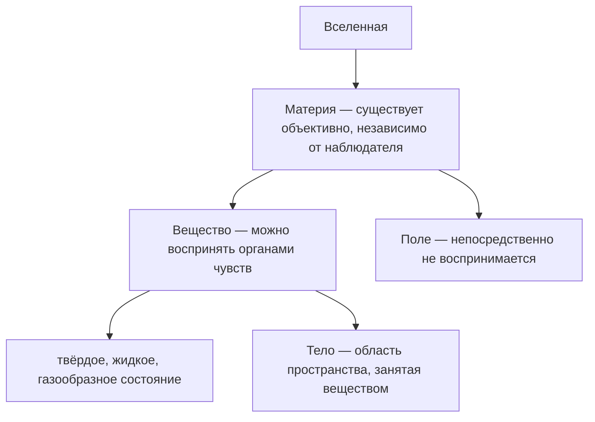
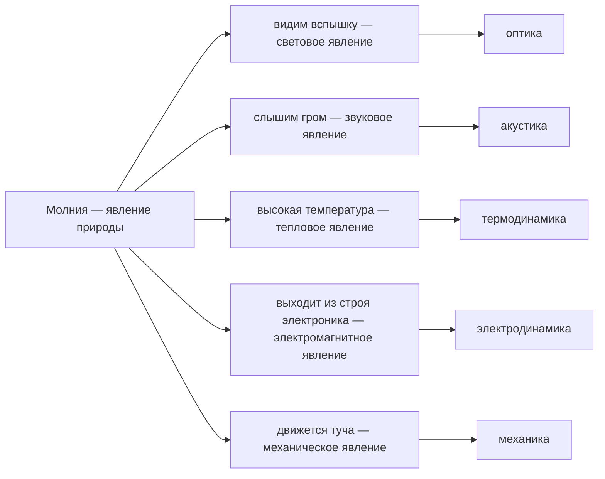

# Физика и методы познания природы

## Что изучает физика [У1 01:04](https://www.youtube.com/watch?t=64&v=2JGbRnJfG0g)

> [!note] Физика — это наука о явлениях неживой природы [У1 07:42](https://www.youtube.com/watch?t=462&v=2JGbRnJfG0g)
> Слово ввёл Аристотель: греческое "фюзис" значит "природа"
> Стакан не живой, цветок живой, поэтому измерение размеров стакана относится к физике, а рост цветка к биологии
> Явление — это изменение: в пьесе "Горе от ума" "явление второе, входит Чацкий"[^chatsky] значит, что Чацкого не было и он появился на сцене

> [!info]- Курс состоит из экскурсии и похода [У1 00:28](https://www.youtube.com/watch?t=28&v=2JGbRnJfG0g)
> В 7–8 классах Виктор проводит "экскурсию по физике": всю физику от начала до конца, но на облегчённом уровне
> В 9 классе физика изучается подробнее, с большим количеством математики и намного более сложными задачами: это уже "длительный, непростой поход"

[^chatsky]: В пьесе Чацкий впервые входит в действии 1, явлении 7 ([текст пьесы](https://ilibrary.ru/text/5/p.1/index.html)); номер явления у Виктора условный, смысл примера от этого не меняется

## Материя, вещество и поле [У1 09:57](https://www.youtube.com/watch?t=597&v=2JGbRnJfG0g)

Вселенная — всё, что нас окружает; всё, что во Вселенной находится, называется **материей**. Материя существует объективно: независимо от того, наблюдаем мы её или нет и существуем ли мы сами [У1 10:32](https://www.youtube.com/watch?t=632&v=2JGbRnJfG0g)

> [!note] Вещество — это вид материи, который можно воспринимать органами чувств [У1 11:29](https://www.youtube.com/watch?t=689&v=2JGbRnJfG0g)
> Мел, вода, воздух — вещества; вещество бывает в твёрдом, жидком и газообразном состоянии
> Второй вид материи — **поле**: в XIX веке физики выяснили, что поле существует, но воспринять его органами чувств непосредственно нельзя[^field-gap]

> [!experiment]- Воздух не виден, но его можно ощутить [У1 11:57](https://www.youtube.com/watch?t=717&v=2JGbRnJfG0g)
> На вопрос, вещество ли воздух, если его не видно, Виктор предлагает подуть: ветер — это движущийся воздух, а значит, воздух можно ощутить и он относится к веществам

> [!note] Тело — это область пространства, занятая веществом [У1 13:41](https://www.youtube.com/watch?t=821&v=2JGbRnJfG0g)
> Кусочек мела — тело, а мел — вещество, из которого оно сделано
> Из одного вещества делают разные тела, и одно тело состоит из разных веществ, поэтому эти понятия различают

| Понятие | Что это | Примеры |
| --- | --- | --- |
| Вещество | вид материи, который воспринимают органами чувств | мел (углекислый кальций), вода, воздух, сталь |
| Физическое тело | область пространства, занятая веществом | кусочек мела, карандаш, топор, рельс |
| Физическое явление | изменение с телами, веществами и полями | падение, нагревание, вспышка света |

[^field-gap]: Полного определения поля в уроке нет: Виктор говорит лишь, что поле открыто в XIX веке и непосредственно органами чувств не воспринимается ([У1 11:59](https://www.youtube.com/watch?t=719&v=2JGbRnJfG0g)). Он упоминает Майкла Фарадея в связи с полем и возвращается к нему при разговоре об электромагнитных явлениях

## Физические явления [У1 14:24](https://www.youtube.com/watch?t=864&v=2JGbRnJfG0g)

> [!note] Физические явления — это изменения, происходящие с полями, веществами и телами в неживой природе [У1 14:24](https://www.youtube.com/watch?t=864&v=2JGbRnJfG0g)
> **Явление природы** сложнее физического: оно складывается из нескольких физических явлений, идущих одновременно
> Физики "разложили природу по полочкам": каждую полочку изучает свой раздел физики, и без этого природа была бы непознаваемой

Молния — явление природы, а вспышка, гром, нагрев, сбой электроники и движение тучи — физические явления, из которых оно состоит [У1 17:08](https://www.youtube.com/watch?t=1028&v=2JGbRnJfG0g)

| Явление | Раздел физики | Где в курсе |
| --- | --- | --- |
| Механическое: движение тел относительно других тел | механика | [[Механическое движение и скорость]] |
| Тепловое | термодинамика | [[Температура. Тепловое равновесие]] |
| Звуковое | акустика | [[Механические волны. Звук]] |
| Световое | оптика | [[Свет. Прямолинейное распространение]] |
| Электрическое и магнитное, вместе — электромагнитное | электродинамика | [[Электрический ток. Электрическая цепь]] |
| Явления внутри атома, ядра и с элементарными частицами | атомная, ядерная физика и физика элементарных частиц | [[Строение ядра. Ядерная энергия]] |

Электрические и магнитные явления тесно связаны, как понял Майкл Фарадей, поэтому их принято называть электромагнитными [У1 18:21](https://www.youtube.com/watch?t=1101&v=2JGbRnJfG0g)

> [!tip] Мир атома описывается не теми законами, что движение автомобиля [У1 21:14](https://www.youtube.com/watch?t=1274&v=2JGbRnJfG0g)
> Поэтому физику атома, ядра и элементарных частиц выделяют в отдельные разделы; в школьном курсе о них говорят менее подробно, чем о механике, а подробнее их изучают в университете

> [!summary] Физика объясняет явление, описывает его количественно и предсказывает результат [У1 22:36](https://www.youtube.com/watch?t=1356&v=2JGbRnJfG0g)
> Объяснить — понять, почему явление происходит и "как цепляются шестерёнки в природе"
> Описать количественно — языком математики, через законы физики; тогда результат опыта можно предсказать, не проводя его

## Парад физических явлений [У1 23:27](https://www.youtube.com/watch?t=1407&v=2JGbRnJfG0g)

> [!experiment]+ Лодочка на слюде качается сама, пока нагрета [У1 24:06](https://www.youtube.com/watch?t=1446&v=2JGbRnJfG0g)
> На кусок алюминия кладут пластинку слюды, на неё — металлическую лодочку с горящим сухим горючим, и лодочка начинает раскачиваться, пока не остынет
> Алюминий хорошо проводит тепло и остаётся при комнатной температуре; слюда тепло проводит плохо, поэтому её верхняя сторона под лодочкой нагрета, а нижняя холодна. Нагретая часть расширяется, слюда изгибается, и под лодочкой возникает бугорок
> Лодочка скатывается с бугорка, а под новым местом нагрев создаёт новый бугорок: она скатывается обратно, проскакивает положение равновесия **по инерции** и так далее [У1 27:43](https://www.youtube.com/watch?t=1663&v=2JGbRnJfG0g)
> ![[mica-boat-oscillation.png]]
> Это [[Тепловые двигатели|тепловой двигатель]]: устройство, преобразующее энергию топлива в механическое движение. Явление природы состоит из теплопередачи ([[Внутренняя энергия. Теплопередача|термодинамика]]), [[Тепловое расширение|расширения при нагревании]] и колебательного механического движения ([[Колебания. Маятники]])

> [!experiment]- Раскалённая сетка в трубке начинает звучать [У1 29:19](https://www.youtube.com/watch?t=1759&v=2JGbRnJfG0g)
> Металлическую сетку в стеклянной трубке нагревают газовой горелкой докрасна; когда горелку убирают, сетка светится, а трубка издаёт звук
> Тепловое, световое и звуковое явления вместе образуют **термоакустический эффект**, который изучают в университетах: школьных знаний для объяснения не хватает

> [!experiment]+ Через два поляроида виден невидимый цвет напряжений в пластмассе [У1 31:46](https://www.youtube.com/watch?t=1906&v=2JGbRnJfG0g)
> Экран компьютера закрыт поляроидом; серый фильтр-поляроид в руке при повороте перестаёт пропускать свет, хотя обычное стекло или пластик от поворота не меняются
> Пластмассовый угольник между двумя поляроидами оказывается разноцветным: явление называется **интерференцией поляризованных лучей** [У1 32:58](https://www.youtube.com/watch?t=1978&v=2JGbRnJfG0g)
> Цвета показывают механические напряжения: угольник прессовали под давлением, нагревали и быстро остужали, и пластмасса остыла неравномерно, где-то сильнее сжавшись
> Так проверяют линзы и зеркала телескопов: стекло надо остужать очень медленно, чтобы напряжений не возникло, а поляроиды покажут, остались ли они[^polar]
> Виктор: "Физика — наука о чудесах, а физики — волшебники"

[^polar]: Как поляризация света связана с напряжениями, Виктор не объясняет: это тема 11 класса, поэтому здесь дан только опыт

## Научные методы изучения природы [У2 03:07](https://www.youtube.com/watch?t=187&v=Ioaq97Jp10Q)

> [!experiment]+ Два одинаковых отрезка кажутся разными [У2 03:23](https://www.youtube.com/watch?t=203&v=Ioaq97Jp10Q)
> Виктор проводит линейкой два отрезка по 40 см и добавляет одному наружные, а другому внутренние "оперения" на концах: посторонний человек скажет, что нижний отрезок длиннее верхнего
> ![[muller-lyer-illusion.png|70%]]
> Обман зрения (**иллюзия Мюллера-Лайера**) — причина, по которой глазам в физике верить нельзя: научный метод обязан исключать условия, в которых можно получить ложные данные [У2 05:01](https://www.youtube.com/watch?t=301&v=Ioaq97Jp10Q)

Научные методы изучения природы — наблюдение, гипотеза, эксперимент, закон и теория; их удобно разобрать на одном примере: как падают тела

> [!note] Наблюдение — это исследование явления без создания для этого специальных условий [У2 06:30](https://www.youtube.com/watch?t=390&v=Ioaq97Jp10Q)
> До Галилея, с глубокой древности, учёные, включая Аристотеля, экспериментов не ставили: они смотрели вокруг и размышляли

> [!note] Гипотеза — это предположение, объясняющее результаты наблюдений или опытов [У2 08:23](https://www.youtube.com/watch?t=503&v=Ioaq97Jp10Q)
> Гипотезу обобщают на любые случаи и проверяют экспериментом: она подтверждается или опровергается

> [!note] Эксперимент — это исследование явления в специально созданных условиях [У2 10:25](https://www.youtube.com/watch?t=625&v=Ioaq97Jp10Q)

### Как падают тела: от наблюдения к закону

> [!experiment]- Аристотель наблюдал, что тяжёлое падает быстрее лёгкого [У2 07:10](https://www.youtube.com/watch?t=430&v=Ioaq97Jp10Q)
> Камень падает быстро, тополиный пух медленно; лист бумаги и блокнот, отпущенные вместе, падают по-разному
> Из наблюдений получается **гипотеза**: любое тяжёлое тело всегда падает быстрее лёгкого, будь то пушинка, грецкий орех, лист бумаги или блокнот [У2 08:47](https://www.youtube.com/watch?t=527&v=Ioaq97Jp10Q)

> [!experiment]+ Свёрнутый в комок лист падает быстрее такого же расправленного [У2 11:02](https://www.youtube.com/watch?t=662&v=Ioaq97Jp10Q)
> Два одинаковых листа имеют одинаковый вес; один сворачивают в комок, вес от этого не меняется, но комок падает быстро, а лист медленно
> Комок бумаги и та же книга падают одинаково [У2 12:15](https://www.youtube.com/watch?t=735&v=Ioaq97Jp10Q)
> Значит, дело не в весе: гипотеза Аристотеля не выдерживает проверки, и появляется новая гипотеза — что-то мешает падению, и это воздух, у листа с большой площадью его действие сильнее [У2 13:50](https://www.youtube.com/watch?t=830&v=Ioaq97Jp10Q)

Новая гипотеза требует нового эксперимента: изучить падение, исключив или уменьшив влияние воздуха [У2 14:26](https://www.youtube.com/watch?t=866&v=Ioaq97Jp10Q)

> [!tip] Четыре способа убрать влияние воздуха [У2 14:44](https://www.youtube.com/watch?t=884&v=Ioaq97Jp10Q)
> 1. Уменьшить площадь: свернуть лист в комок
> 2. Изменить направление потока: лист, падающий ребром, тормозится слабее, чем плашмя [У2 15:30](https://www.youtube.com/watch?t=930&v=Ioaq97Jp10Q)
> 3. Взять тела из вещества, которое сильно притягивается к Земле: у них большая масса при малых размерах
> 4. Убрать воздух совсем

> [!experiment]- Галилей бросал с Пизанской башни пулю и ядро [У2 17:16](https://www.youtube.com/watch?t=1036&v=Ioaq97Jp10Q)
> Свинцовая мушкетная пуля лёгкая, но мала, поэтому воздух на неё почти не влияет; чугунное ядро тяжёлое. Они упали на землю практически одновременно
> Бросали, по словам Виктора, ученики Галилея, а сам он наблюдал и делал выводы; создавая специальные условия, он фактически проводил эксперимент
> Галилей уменьшил влияние воздуха, увеличив вклад силы тяжести

> [!experiment]+ Ньютон откачал воздух из трубки, и перо упало вместе с дробинкой [У2 18:18](https://www.youtube.com/watch?t=1098&v=Ioaq97Jp10Q)
> В закрытой трубке с воздухом дробинка достигает дна, когда перо только опускается. После откачки воздуха, как только трубку перевернули, перо и дробинка достигли нижнего края одновременно: воздуха нет, и движению нечему мешать
> ![[free-fall-newton-tube.png|70%]]
> На графике скорости видно, где различие: в воздухе перо быстро выходит на постоянную скорость и дальше не разгоняется, а в вакууме скорость растёт одинаково у всех тел
> ![[free-fall-speed-graph.png|70%]]

> [!experiment]- Книга закрывает лист от встречного потока воздуха [У2 20:46](https://www.youtube.com/watch?t=1246&v=Ioaq97Jp10Q)
> Если тяжёлое падает быстро, а лёгкое медленно, книга должна обогнать лист. Лист кладут на книгу или отпускают за ней, чтобы поток воздуха блокировала сама книга, и они падают одновременно

> [!summary] Закон свободного падения: все тела падают под действием силы тяжести одинаково [У2 21:29](https://www.youtube.com/watch?t=1289&v=Ioaq97Jp10Q)
> **Физический закон** — гипотеза, подтверждённая многими экспериментами, в данном случае Галилея, Ньютона и самого Виктора в разных вариантах
> "Свободного" значит, что на тела не влияет ничего, кроме притягивающего их земного шара; что значит "одинаково", разбирается позже в теме про [[Сила тяжести|силу тяжести]]

## Познание идёт по спирали [У2 23:22](https://www.youtube.com/watch?t=1402&v=Ioaq97Jp10Q)

После эксперимента снова появляется гипотеза, потом новый эксперимент, но уровнем выше; поэтому от незнания к знанию идут не по прямой, а по винтовой линии[^helix]

![[knowledge-helix.png|60%]]

> [!summary] Путь познания: наблюдение, гипотеза, эксперимент, снова гипотеза и так далее, пока многократные эксперименты не приведут к закону [У2 24:18](https://www.youtube.com/watch?t=1458&v=Ioaq97Jp10Q)
> Гипотезы по пути либо отвергаются, либо подтверждаются, а закон и есть подтверждённая гипотеза

[^helix]: Виктор уточняет, что спираль — плоская кривая, а нужная линия — винтовая, то есть пространственная; на доске она нарисована в проекции, и поэтому её витки пересекаются

## Теория [У2 25:25](https://www.youtube.com/watch?t=1525&v=Ioaq97Jp10Q)

> [!note] Теория — это количественное описание физических явлений, построенное на законах [У2 25:25](https://www.youtube.com/watch?t=1525&v=Ioaq97Jp10Q)
> Учёные придумывают физические величины, описывающие явления природы, а то, что связывает величины между собой, называется теорией. Так на основе законов свободного падения построена механика

> [!experiment]- Ньютон показал, что притягиваются любые два тела [У2 26:05](https://www.youtube.com/watch?t=1565&v=Ioaq97Jp10Q)
> Сравнивая движение Луны и падение тел (яблоко в этой истории — легенда), Ньютон установил закон всемирного тяготения: притягиваются не только мел и Земля, но и любые два тела, например двое за партой
> На основе закона построили теорию движения планет; по особенностям движения Урана предсказали следующую планету, и её открыли — Нептун, "на кончике пера" [У2 27:07](https://www.youtube.com/watch?t=1627&v=Ioaq97Jp10Q)

Классическая механика, как называют такую теорию, описывает не всё:

- при скоростях, близких к скорости света, она перестаёт работать, и Эйнштейн создал теорию относительности; скорость света превысить нельзя, а классическая механика оказывается её частным случаем [У2 27:37](https://www.youtube.com/watch?t=1657&v=Ioaq97Jp10Q)
- Макс Планк в 1900 году, описывая свечение нагретых тел, был вынужден предположить, что тела излучают свет не непрерывно, а порциями, то есть физические величины могут меняться скачком; так родилась квантовая механика, а классическая физика из неё получается как частный случай [У2 28:08](https://www.youtube.com/watch?t=1688&v=Ioaq97Jp10Q)

![[theory-applicability.png|70%]]

> [!experiment]- Большой адронный коллайдер работает на полную мощность только летом [У2 29:20](https://www.youtube.com/watch?t=1760&v=Ioaq97Jp10Q)
> Коллайдер потребляет столько энергии, что зимой её не хватает из-за отопления: зимой его ремонтируют и обслуживают, а летом проводят исследования
> Физики не останутся без работы: усложняя эксперименты, они находят явления, которые старая теория описать не может. В конце XIX века считали, что физика построена и открывать нечего, а потом Планк ввёл кванты, и с них началась квантовая физика[^planck-qm]

> [!quote] Виктор о том, зачем изучать физику тем, кто не станет физиком [У2 30:37](https://www.youtube.com/watch?t=1837&v=Ioaq97Jp10Q)
> Физика развивает ум и учит ориентироваться в мире: многие процессы в экономике описываются теми же дифференциальными уравнениями, что и в физике, а из 15 лауреатов Нобелевской премии по экономике 13 окончили физические факультеты[^nobel]

> [!tip] Физик сам ставит себе задачу, а математик решает поставленную [У2 31:38](https://www.youtube.com/watch?t=1898&v=Ioaq97Jp10Q)
> Математику, чтобы решить задачу, её нужно точно сформулировать; природа условий задач не формулирует, и хороший физик умеет выделить в хаосе явлений то, что можно изучать и исследовать
> Для этого используют **модели**: например, [[Механическое движение и скорость|материальная точка]] — тело, размерами которого в данной задаче можно пренебречь; движение материальной точки описать намного проще

[^planck-qm]: Виктор говорит "Планк открывает квантовую механику" [У2 30:10](https://www.youtube.com/watch?t=1810&v=Ioaq97Jp10Q); Планк в 1900 году ввёл [[Мега-, макро- и микромир#Микромир [У9 20 19](https //www.youtube.com/watch?t=1219&v=444YfZs-phE)|кванты излучения]], а квантовую механику как теорию построили в 1925–1926 годах Гейзенберг, Шрёдингер и другие

[^nobel]: Цифра названа в лекции без источника и здесь не подтверждена

## Задачи

> [!example]- Кто из мальчиков проводит эксперимент, а кто наблюдение [У2 33:31](https://www.youtube.com/watch?t=2011&v=Ioaq97Jp10Q)
> Дима и Олег стоят возле новой автоматической двери магазина. Дима смотрит, как дверь открывается перед каждым покупателем и закрывается за ним, а Олег медленно приближается к двери: его интересует, на какое расстояние надо подойти, чтобы сработала автоматика. Кто из мальчиков проводит эксперимент, а кто наблюдение (задачник, 1.9)
>
> Дима ничего не создаёт, он смотрит на то, что происходит без его участия, — это наблюдение. Олег сам создаёт условия и находит число: расстояние — физическая величина, а нахождение её значения — [[Физические величины и их измерение|измерение]]
> $$\boxed{\text{Дима — наблюдение, Олег — эксперимент}}$$
> Наблюдение обычно чисел не даёт, кроме астрономии, где вмешаться в ход событий нельзя; эксперимент позволяет измерять физические величины [У2 34:54](https://www.youtube.com/watch?t=2094&v=Ioaq97Jp10Q)

> [!example]+ Механические явления среди семи [У2 35:26](https://www.youtube.com/watch?t=2126&v=Ioaq97Jp10Q)
> Выберите среди явлений механические: футбольный мяч летит в окно, Солнце отражается в луже, автомобиль трогается с места, река осенью замерзает, гвоздь тонет в воде, электрический вентилятор быстро вращается, мальчик зажигает спичку (задачник, 1.19)
>
> Механическое явление — движение, изменение положения тел; по остальным явлениям смотрят, какое из изменений главное
>
> | Явление | Вид |
> | --- | --- |
> | Мяч летит в окно | механическое |
> | Солнце отражается в луже | световое |
> | Автомобиль трогается с места | механическое |
> | Река осенью замерзает | тепловое |
> | Гвоздь тонет в воде | механическое: погружение — изменение положения гвоздя, почему он тонет, изучают позже ([[Плавание тел]]) |
> | Вентилятор быстро вращается | механическое[^fan] |
> | Мальчик зажигает спичку | тепловое |
>
> $$\boxed{\text{механические — мяч, автомобиль, гвоздь, вентилятор}}$$

> [!example]- Из каких веществ состоят тела [У2 38:01](https://www.youtube.com/watch?t=2281&v=Ioaq97Jp10Q)
> Из каких веществ состоят карандаш, топор, отвёртка, пенал, трамвайные рельсы (задачник, 1.24; в условии ещё газета, стол, стул, стена дома и самолёт; в разобранном решении их нет)
>
> Тело может состоять из нескольких веществ, поэтому перечисляют все, а не одно
>
> | Тело | Вещества |
> | --- | --- |
> | Карандаш | древесина, графит, краска |
> | Топор | древесина, сталь; ручка бывает пластмассовой |
> | Отвёртка | сталь, резина, пластик |
> | Пенал | ткань, сталь; пластик — продукт переработки нефти; раньше пеналы делали деревянными |
> | Рельсы | сталь; шпалы из дерева — отдельное тело, речь именно о рельсах |

[^fan]: Большинство класса ответило "электрическое", и Виктор объяснил по русскому языку: в предложении "вентилятор вращается" подлежащее — вентилятор, сказуемое — вращается, а всё остальное "гарнир"; вращение — механическое явление [У2 37:08](https://www.youtube.com/watch?t=2228&v=Ioaq97Jp10Q)
