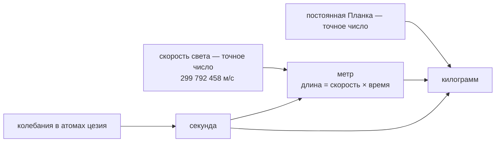

# Физические величины и их измерение

## Физическая величина [У3 04:15](https://www.youtube.com/watch?t=255&v=E-Hps8rwGDY)

Физических величин больше, чем букв в латинском и греческом алфавитах вместе, поэтому одну букву приходится использовать для нескольких величин: $\sigma$ обозначает и поверхностную плотность, и коэффициент поверхностного натяжения, и механическое напряжение [У3 01:35](https://www.youtube.com/watch?t=95&v=E-Hps8rwGDY)

> [!experiment]- Одна и та же фраза может ничего не сказать, а может вызвать слюнки [У3 06:37](https://www.youtube.com/watch?t=397&v=E-Hps8rwGDY)
> Чтобы передать другому человеку опыт, пользуются языком; но язык работает, только если человек знает, что стоит за словами
> Виктор зачитывает фразу "потоком вектора напряжённости электрического поля через площадку называется физическая величина, равная произведению модуля вектора напряжённости, площади площадки и косинуса угла между направлением вектора и нормалью": язык русский, но непонятно, а поймут её только в 10 классе
> Отрывок из Чехова о блинах, "пористых, пухлых, как плечо купеческой дочки", с икрой, сметаной и сёмгой понятен всем: там за каждым словом стоит известный образ
> Поэтому нужен научный язык, а он отличается от повседневного точностью

> [!experiment]- "Жарко" и "чистая вода" — не научные слова [У3 08:16](https://www.youtube.com/watch?t=496&v=E-Hps8rwGDY)
> Для жителя Гренландии "жарко" наступает раньше, чем для жителя Эквадора, а "чистая" морская вода прозрачна, но содержит соли: разные люди понимают слово по-разному
> Фраза "в кабинете 25 градусов" однозначна: для этого посмотрели на термометр, то есть **измерили**, и понятие "жарко" превратилось в число

> [!note] Физическая величина — это физическое понятие, выраженное числом в процессе измерения [У3 10:55](https://www.youtube.com/watch?t=655&v=E-Hps8rwGDY)
> О физической величине можно говорить, только если существует способ её измерить: если нельзя, она в физике неинтересна
> Число не обязательно считывают со шкалы прибора: бывают **косвенные измерения**, но способ получить число должен существовать [У3 11:39](https://www.youtube.com/watch?t=699&v=E-Hps8rwGDY)

> [!experiment]- Леность как физическая величина [У3 12:04](https://www.youtube.com/watch?t=724&v=E-Hps8rwGDY)
> Виктор придумывает величину "леность" и способ её мерить в разах: Петю надо попросить вынести мусор пять раз, а Машу один, поэтому Петя ленивее
> Другой способ — в минутах: Пете нужно ждать 5 минут, Маше 30 секунд
> Одну величину можно мерить разными способами и выражать разными единицами, как и в физике

> [!note] Единица измерения — это величина, принятая за единицу при измерении однородных с ней величин [У3 13:19](https://www.youtube.com/watch?t=799&v=E-Hps8rwGDY)
> У одной величины бывает много единиц, поэтому нужно договориться о единицах, общих для всех: так появилась система СИ, разобранная ниже

> [!warning] Физическую величину нельзя путать с единицей её измерения [У4 04:15](https://www.youtube.com/watch?t=255&v=8sHSZK0MDsk)
> Метр — не величина, а единица, в которой измеряют длину, ширину, высоту; величины — длина, объём, время, масса, температура

| Величина | Единицы измерения | Единица СИ |
| --- | --- | --- |
| Длина | миллиметры, сантиметры, метры, мили, дюймы, футы, локоть, верста, аршин, километры | метр |
| Время | секунды, минуты, часы, сутки, недели, месяцы, годы | секунда |
| [[Масса]] | граммы, миллиграммы, килограммы, тонны, центнеры, фунты, караты, унции | килограмм |

Единиц у величины так много, что список приходится обрывать: моряки измеряют длину милями, глубину футами и милями, англичане массу — фунтами, драгоценные камни — каратами, а золото и духи — унциями [У3 15:07](https://www.youtube.com/watch?t=907&v=E-Hps8rwGDY)

## Измерение и эталон [У3 21:07](https://www.youtube.com/watch?t=1267&v=E-Hps8rwGDY)

> [!experiment]- Пройдёт ли стол через дверь: измерение как сравнение [У3 21:07](https://www.youtube.com/watch?t=1267&v=E-Hps8rwGDY)
> У Виктора с собой нет ничего, кроме пальцев: ширина двери оказывается почти четыре "пяди" между большим и указательным пальцами, а ширина стола — ровно четыре, значит, стол пройдёт
> Он сравнивал одну длину с другой, а результат "четыре пяди" ничего не скажет другому человеку, потому что пядь у каждого своя; так же и в мультфильме "38 попугаев" удав, измеренный попугаями, оказывается длиннее, чем в мартышках: единица попугая мала, и их получается больше [У3 23:09](https://www.youtube.com/watch?t=1389&v=E-Hps8rwGDY)

> [!note] Измерение — это сравнение физической величины с однородной величиной, принятой за единицу [У3 24:12](https://www.youtube.com/watch?t=1452&v=E-Hps8rwGDY)
> Однородные величины — длина с длиной, время с временем, масса с массой
> Чтобы измерения были точными, люди договариваются, что вполне определённая величина считается единицей для всех

> [!note] Эталон — это устройство для хранения и воспроизведения единицы физической величины [У3 27:19](https://www.youtube.com/watch?t=1639&v=E-Hps8rwGDY)
> Эталон длины — самый первый, "парижский" метр — был несовершенным: при нагревании тела расширяются, и расстояние между штрихами меняется, а если единственный эталон потерян, погибает всё
> Выход — эталоны, которые можно воспроизвести где угодно, например по свойствам одинаковых атомов [У3 28:35](https://www.youtube.com/watch?t=1715&v=E-Hps8rwGDY)

### Как определяли метр [У3 25:41](https://www.youtube.com/watch?t=1541&v=E-Hps8rwGDY)

![[meridian-metre.png|60%]]

> [!experiment]- Метр — одна сорокамиллионная часть Парижского меридиана [У3 26:12](https://www.youtube.com/watch?t=1572&v=E-Hps8rwGDY)
> Французы измерили длину меридиана, проходящего от Северного полюса через Париж к Южному и снова к Северному, разделили на 40 миллионов и договорились, что это расстояние называется метром
> На рейку нанесли два штриха и получили устройство для хранения и воспроизведения единицы длины: оно до сих пор лежит в музее, но им уже не пользуются

## Международная система единиц СИ [У3 18:06](https://www.youtube.com/watch?t=1086&v=E-Hps8rwGDY)

> [!note] Международная система единиц **СИ** (System International) — единицы, принятые для физики во всём мире [У3 18:32](https://www.youtube.com/watch?t=1112&v=E-Hps8rwGDY)
> Основные единицы длины, времени и массы — метр, секунда и килограмм
> В СИ есть основные единицы и других величин: они перечислены в таблице ниже, и остальные единицы получаются из основных

| Величина | Основная единица СИ | Обозначение | Подробнее |
| --- | --- | --- | --- |
| Длина | метр | м | здесь |
| Время | секунда | с | здесь |
| Масса | килограмм | кг | [[Масса]] |
| Сила тока | ампер | А | [[Сила тока и напряжение]] |
| Температура | кельвин | К | [[Температура. Тепловое равновесие]] |
| Количество вещества | моль | моль | [[Атомы и молекулы]] |
| Сила света | кандела | кд | [[Свет. Прямолинейное распространение]] |

> [!experiment]- Моль — это такой "стакан" молекул [У3 20:00](https://www.youtube.com/watch?t=1200&v=E-Hps8rwGDY)
> Семечки и раков на базаре продают не поштучно, а стаканами, яйца — десятками; моль — тоже стакан, но с огромным числом молекул, примерно $6 \cdot 10^{23}$

Температуру физики измеряют не в градусах Цельсия и не в градусах Фаренгейта, а в кельвинах [У3 19:33](https://www.youtube.com/watch?t=1173&v=E-Hps8rwGDY)

### Эталоны СИ сегодня [У3 29:58](https://www.youtube.com/watch?t=1798&v=E-Hps8rwGDY)

> [!experiment]- Секунду больше не считают по вращению Земли [У3 29:58](https://www.youtube.com/watch?t=1798&v=E-Hps8rwGDY)
> Когда-то секунда — определённая доля звёздных суток[^solar-day], за которые Земля делает оборот вокруг своей оси. Астроном XVII–XVIII веков считал вращение равномерным, а современный установил: скорость вращения меняется, и периодически, по временам года
> Виктор объясняет это как балерина на льду: осенью листва падает, листья приближаются к оси Земли, и она вращается чуть быстрее, весной листья появляются, и вращение замедляется[^leaves]
> Заметили это благодаря атомным часам, которые точнее вращения Земли; в атомах цезия колебания при переходе между подуровнями сверхтонкой структуры основного состояния имеют строго определённый период, и число этих колебаний задаёт секунду [У3 32:01](https://www.youtube.com/watch?t=1921&v=E-Hps8rwGDY)[^cesium]

> [!experiment]- Спутники **[[GPS]]** передают время, а по задержке считают расстояние [У3 33:02](https://www.youtube.com/watch?t=1982&v=E-Hps8rwGDY)
> На каждом спутнике GPS летают маленькие атомные часы; приёмник принимает время по меньшей мере с трёх спутников[^four-sats]
> Спутник передаёт "у меня ровно 12 часов", приёмник получает сигнал в тот момент, когда у него 12 часов и 1 микросекунда: разность времён и известная скорость радиоволны дают расстояние $r = c\,\Delta t$ [У3 33:47](https://www.youtube.com/watch?t=2027&v=E-Hps8rwGDY)[^gps]

> [!summary] Скорость света в вакууме — эталон скорости: $299\,792\,458\ \text{м/с}$ точно [У3 34:15](https://www.youtube.com/watch?t=2055&v=E-Hps8rwGDY)
> Скорость света в пустоте не зависит от того, движется ли источник или наблюдатель: это один из постулатов теории относительности, поэтому удобно принять её за эталон, договорившись о точном числе в 1983 году
> При эталоне времени и эталоне скорости длина — их произведение: эталон длины по существу не нужен
> $$\boxed{l = c\,t}$$

> [!experiment]- Килограмм больше не привязан к платиново-иридиевому цилиндру [У3 35:05](https://www.youtube.com/watch?t=2105&v=E-Hps8rwGDY)
> Раньше килограмм — масса литра воды при определённой температуре, потом цилиндрик из платино-иридиевого сплава в Севре под Парижем рядом с эталоном метра. Его было страшно потерять: секунду и метр можно воспроизвести, килограмм — нет
> Постоянная Планка — величина из микромира, которую изучают в 11 классе; в единицы её измерения входят килограмм, метр и секунда. Эталоны метра и секунды есть, поэтому если присвоить постоянной Планка точное значение, как скорости света, эталон килограмма не понадобится[^planck]
> В мае 2019 года договорились об этом, и заодно обновили эталоны ампера, кельвина и моля: то, что об эталонах написано в учебнике, устарело [У3 36:53](https://www.youtube.com/watch?t=2213&v=E-Hps8rwGDY)

Скорость света связана с [[Электрическая и магнитная постоянные#^c-link|электрической и магнитной постоянными]], а последствия реформы СИ 2019 года для магнитной постоянной разобраны в [[Электрическая и магнитная постоянные|электродинамике]]

[^leaves]: Этот механизм Виктор преподносит уверенно, но главная причина сезонных изменений длины суток — обмен угловым моментом между атмосферой и твёрдой Землёй, то есть ветры (см. [Höpfner, Geophys. J. Int. 1998](https://academic.oup.com/gji/article/135/2/407/777796)); вклад листвы оценивают порядка 0,1 нс в сутки, поэтому объяснение через листья — красивая, но неверная по масштабу иллюстрация с балериной ([Auburn University](https://www.auburn.edu/cosam/news/articles/2019/09/fall_leaves_cause_days_to_shorten.htm))

[^cesium]: Число колебаний цезия-133 в определении секунды — $9\,192\,631\,770$ периодов; в лекции оно не названо

[^solar-day]: До 1960 года секунда была $1/86\,400$ средних солнечных суток, а не звёздных; звёздные сутки короче солнечных примерно на $4$ минуты ([NIST: Second, the past](https://www.nist.gov/si-redefinition/second/second-past))

[^four-sats]: Трёх спутников хватило бы при точных часах в приёмнике. У обычного приёмника атомных часов нет, поэтому неизвестных четыре — три координаты и поправка часов, — и нужен четвёртый спутник

[^gps]: Оценка не из лекции: задержке $1$ мкс соответствует $r = 3 \cdot 10^8\ \text{м/с} \cdot 10^{-6}\ \text{с} = 300$ м

[^planck]: Точное значение $h = 6{,}62607015 \cdot 10^{-34}\ \text{Дж} \cdot \text{с}$; в лекции оно не называется, Виктор говорит только, что запишет его позже

## Десятичные приставки [У3 37:13](https://www.youtube.com/watch?t=2233&v=E-Hps8rwGDY)

Расстояние от Земли до Луны неудобно измерять в метрах, размеры атома — тоже, поэтому в пределах СИ придуманы десятичные приставки, которые делают единицу больше или меньше в степень десяти [У3 37:13](https://www.youtube.com/watch?t=2233&v=E-Hps8rwGDY)

![[prefix-ladder.png|70%]]

> [!note] Десятичные приставки — это множители $10^n$, которые ставят перед названием единицы [У3 38:07](https://www.youtube.com/watch?t=2287&v=E-Hps8rwGDY)
> Санти — это $10^{-2}$, то есть одна сотая: сантиметр в сто раз меньше метра. Кило — $10^{3}$, то есть тысяча
> Знак минус в показателе значит, что степень десяти стоит в знаменателе: $10^{-3} = \dfrac{1}{10^3}$

| Приставка | Обозначение | Множитель |
| --- | --- | --- |
| гига | Г | $10^{9}$ |
| мега | М | $10^{6}$ |
| кило | к | $10^{3}$ |
| гекто | г | $10^{2}$ |
| дека | да | $10^{1}$ |
| деци | д | $10^{-1}$ |
| санти | с | $10^{-2}$ |
| милли | м | $10^{-3}$ |
| микро | мк | $10^{-6}$ |
| нано | н | $10^{-9}$ |

> [!tip] Виктор проверяет приставки физическим диктантом на четыре варианта [У4 02:14](https://www.youtube.com/watch?t=134&v=8sHSZK0MDsk)
> Говорит "кило" — надо написать $10^3$, говорит "одна сотая" — "санти", "$10^{6}$" — "мега", "$10^{9}$" — "гига"; таблица висит в классе и есть в учебнике
> Таблица приставок висит в кабинете и есть в учебнике, её надо выучить; строки гекто, дека, микро и нано в таблице выше взяты из общей таблицы приставок, а не из записи на доске

## Шкала измерительного прибора [У4 05:52](https://www.youtube.com/watch?t=352&v=8sHSZK0MDsk)

Измерения проводят приборами: линейкой, рулеткой, штангенциркулем, микрометром для длины, термометром для температуры, мерным цилиндром для объёма. У всех есть шкала, и по любой шкале надо уметь считывать значение [У4 04:53](https://www.youtube.com/watch?t=293&v=8sHSZK0MDsk)

![[scale-thermometer-anatomy.png|70%]]

> [!note] Штрих — это черта на шкале, а деление — промежуток между штрихами [У4 07:16](https://www.youtube.com/watch?t=436&v=8sHSZK0MDsk)
> Штрихи делают разной длины, чтобы удобнее ориентироваться, а числа ставят не у всех штрихов
> На шкале обязательно указана единица, в которой прибор измеряет: градусы Цельсия, миллилитры, сантиметры. Изготовление шкалы называется **градуировкой**

> [!note] Нижний предел измерения — наименьшее значение величины, которое можно измерить прибором, верхний — наибольшее [У4 08:08](https://www.youtube.com/watch?t=488&v=8sHSZK0MDsk)
> У термометра на схеме выше пределы $-10\ ^\circ$C и $50\ ^\circ$C

> [!note] Цена деления шкалы измерительного прибора — это расстояние между ближайшими штрихами шкалы, выраженное в единицах измеряемой величины [У4 09:22](https://www.youtube.com/watch?t=562&v=8sHSZK0MDsk)
> Расстояние на шкале не измеряют в сантиметрах: его выражают в единицах, в которых прибор проградуирован, например в градусах Цельсия

> [!summary] Цена деления равна разности чисел у двух ближайших подписанных штрихов, делённой на число делений между ними [У4 11:37](https://www.youtube.com/watch?t=697&v=8sHSZK0MDsk)
> $$\boxed{c = \frac{b - a}{n}}$$
> $a$ и $b$ — числа у ближайших штрихов, между которыми стоят числа; $n$ — число делений, то есть промежутков, а не штрихов между ними
> $$c = \frac{30\ ^\circ\text{C} - 20\ ^\circ\text{C}}{2} = 5\ ^\circ\text{C}$$

> [!note]- Сводка: цена деления
> | Характеристика | Значение |
> | --- | --- |
> | Обозначение | $c$ |
> | Определяющая формула | $c = \dfrac{b - a}{n}$ |
> | Единица | единица измеряемой величины: $^\circ\text{C}$ у термометра, мл у мерного цилиндра |
> | Скаляр или вектор | скаляр |
> | Как определяют | по двум ближайшим подписанным штрихам и числу делений между ними |
> | Характерные значения | линейка $1$ мм, мерный цилиндр $1$ мл, термометр $1\ ^\circ\text{C}$, медицинский термометр $0{,}1\ ^\circ\text{C}$ |

> [!tip] Единицы пишут прямо в формулах, тогда в конце они получаются сами [У4 13:14](https://www.youtube.com/watch?t=794&v=8sHSZK0MDsk)
> Если единицы вышли не те, например вместо длины получилось что-то другое, значит, в решении ошибка
> Если торопитесь и подставили только числа, единицы надо приписать к ответу в скобках

> [!tip] Удобнее брать штрихи, где одно число — ноль [У4 14:49](https://www.youtube.com/watch?t=889&v=8sHSZK0MDsk)
> Тогда разность считается в уме: $10 - 0 = 10$, делений два, значит, $5$; но нуля на шкале может не быть, и надо уметь считать по любым двум подписанным штрихам

![[scale-division-gallery.png]]

> [!experiment]- Цена деления линейки, мерного цилиндра, шприцев и термометров [У4 15:09](https://www.youtube.com/watch?t=909&v=8sHSZK0MDsk)
> Кусок линейки со штрихами $10$ и $11$: между ними два деления, значит, $0{,}5$; единицу Виктор просит указывать, потому что число без неё ничего не значит, а на шкале написано, что это сантиметры
> Линейка с десятью делениями между сантиметрами: $0{,}1$ см, то есть $1$ мм. Дюймовая: в дюйме $16$ делений, значит, $\dfrac{1}{16}$ дюйма [У4 17:15](https://www.youtube.com/watch?t=1035&v=8sHSZK0MDsk)
> Линейка с двумя шкалами: верхняя, где написано "см", — $1$ мм, а нижняя, где каждый миллиметр разделён пополам, — $0{,}5$ мм [У4 17:52](https://www.youtube.com/watch?t=1072&v=8sHSZK0MDsk)
> Мерный цилиндр: верхний предел $100$ мл, нижний $10$ мл, а между штрихами $20$ и $30$ десять делений, значит, $c = 1$ мл; на нём указана температура, потому что стекло калибруют для определённой температуры [У4 19:24](https://www.youtube.com/watch?t=1164&v=8sHSZK0MDsk)
> Большой мерный сосуд: верхний предел $2500$ мл, то есть $2{,}5$ л, а между $0$ и $500$ два деления, поэтому $c = 250$ мл
> Медицинские шприцы тоже имеют шкалу: на $20$ мл — $1$ мл, на $5$ мл — $0{,}2$ мл (между $4$ и $5$ мл пять делений, а штрихов четыре), на $2{,}5$ мл — $0{,}1$ мл [У4 22:04](https://www.youtube.com/watch?t=1324&v=8sHSZK0MDsk)

> [!experiment]- Пределы измерения — не всегда круглые числа [У4 24:26](https://www.youtube.com/watch?t=1466&v=8sHSZK0MDsk)
> У термометра с ценой деления $1\ ^\circ\text{C}$ за штрихом $100$ есть ещё одно деление, поэтому верхний предел — $101\ ^\circ\text{C}$, а на нижнем конце шкалы вместо $0$ стоит $-2\ ^\circ\text{C}$
> Виктор заметил: "откуда вы знаете, что $101$, если цену деления не определили"
> Медицинский термометр: между $38$ и $39$ десять делений, $c = 0{,}1\ ^\circ\text{C}$, пределы $34$ и $42\ ^\circ\text{C}$: больше $42$ у человека быть не может [У4 26:28](https://www.youtube.com/watch?t=1588&v=8sHSZK0MDsk)
> Красивый термометр для лабораторных работ: между $50$ и $40\ ^\circ\text{C}$ двадцать делений, поэтому $c = 0{,}5\ ^\circ\text{C}$, и столбик показывает $28\ ^\circ\text{C}$ [У4 27:13](https://www.youtube.com/watch?t=1633&v=8sHSZK0MDsk)

> [!experiment]+ Термометр в руке показывает температуру пальцев [У4 25:17](https://www.youtube.com/watch?t=1517&v=8sHSZK0MDsk)
> У термометра с ценой деления $2\ ^\circ\text{C}$: между $60$ и $40$ десять делений, $\dfrac{60 - 40}{10} = 2\ ^\circ\text{C}$. Столбик стоит на двадцати градусах и ещё $3{,}5$ деления, то есть $20 + 3{,}5 \cdot 2 = 27\ ^\circ\text{C}$
> Прежний термометр, с ценой деления $1\ ^\circ\text{C}$, показывает $28\ ^\circ\text{C}$, потому что его Виктор держал в руке: пальцы нагревали его, показание росло на глазах и скоро дошло бы до $29$ [У4 26:05](https://www.youtube.com/watch?t=1565&v=8sHSZK0MDsk)
> Вывод: приборы очень чувствительны и меряют температуру самого себя
> ![[thermometer-reading.png|80%]]

## Точность отсчёта по шкале [У4 18:50](https://www.youtube.com/watch?t=1130&v=8sHSZK0MDsk)

> [!summary] Чем меньше цена деления, тем выше точность измерения; точность отсчёта по шкале принимают равной половине цены деления [У4 19:04](https://www.youtube.com/watch?t=1144&v=8sHSZK0MDsk)
> $$\boxed{\Delta x = \frac{c}{2}}$$
> Линейка с двумя шкалами измеряет по верхней шкале с точностью до полмиллиметра, по нижней — до четверти миллиметра: $c = 1$ мм даёт $\Delta x = 0{,}5$ мм, $c = 0{,}5$ мм даёт $\Delta x = 0{,}25$ мм

> [!note]- Сводка: погрешность отсчёта по шкале
> | Характеристика | Значение |
> | --- | --- |
> | Обозначение | $\Delta x$ |
> | Формула для шкалы | $\Delta x = \dfrac{c}{2}$ |
> | Единица | единица измеряемой величины |
> | Запись результата | $x \pm \Delta x$: $20{,}7 \pm 0{,}1$ мм |
> | Скаляр или вектор | скаляр |
> | Что определяет | цена деления шкалы, для нониуса — число, указанное на приборе |
> | Характерные значения | штангенциркуль $0{,}1$ мм, микрометр $0{,}01$ мм |

### Нониус и штангенциркуль [У4 28:06](https://www.youtube.com/watch?t=1686&v=8sHSZK0MDsk)

Устройство называется нониусом и пишется со строчной буквы, а изобретателя Виктор называет монахом Нониусом и пишет это слово с прописной[^nonius]

> [!note] Нониус — это вспомогательная шкала, позволяющая измерять с точностью выше половины цены деления основной [У4 28:43](https://www.youtube.com/watch?t=1723&v=8sHSZK0MDsk)
> У основной шкалы на модели десять делений, у нониуса тоже десять, но его десять делений занимают такую же длину, как девять делений основной шкалы [У4 29:30](https://www.youtube.com/watch?t=1770&v=8sHSZK0MDsk)
> Когда нониус сдвигают, штрихи двух шкал по очереди совпадают: нуль с нулём, потом первый с первым, и так далее. Значит, на сколько сдвинули относительно целого деления, показывает номер штриха нониуса, совпавшего со штрихом основной шкалы: седьмой штрих — $0{,}7$ деления [У4 31:23](https://www.youtube.com/watch?t=1883&v=8sHSZK0MDsk)

> [!summary] Показание = целое число делений основной шкалы до нуля нониуса плюс номер совпавшего штриха нониуса, умноженный на одну десятую деления [У4 31:23](https://www.youtube.com/watch?t=1883&v=8sHSZK0MDsk)
> $$\boxed{x = N + 0{,}1\,k}$$
> $N$ — число целых делений слева от нуля нониуса, $k$ — номер штриха нониуса, совпавшего со штрихом основной шкалы; $x$ выходит в делениях основной шкалы, у штангенциркуля с ценой деления $1$ мм — в миллиметрах. Виктор говорит это словами

![[vernier-reading.png]]

> [!experiment]+ Диаметр авторучки и колпачка штангенциркулем [У4 32:20](https://www.youtube.com/watch?t=1940&v=8sHSZK0MDsk)
> Ручку зажимают между измерительными поверхностями и вынимают, не сдвигая. Целых миллиметров: $10 + 1 = 11$, а совпал пятый штрих нониуса, значит, диаметр $11{,}5$ мм при цене деления шкалы $1$ мм: точность $0{,}1$ мм лучше половины цены деления [У4 33:01](https://www.youtube.com/watch?t=1981&v=8sHSZK0MDsk)
> Точность указана на самом штангенциркуле: на нём выгравировано $0{,}1$ мм
> Внутренние измерительные поверхности позволяют измерить и внутренний диаметр: у колпачка авторучки между $10$ и $11$ мм, а совпадают то седьмой, то восьмой штрихи, поэтому $10{,}7$ или $10{,}8$ мм с точностью до десятых [У4 33:45](https://www.youtube.com/watch?t=2025&v=8sHSZK0MDsk)

[^nonius]: Историческая справка вне лекции: нониус изобрёл Педро Нунеш (1542) как систему концентрических дуг с разным числом делений для астролябии, а привычную скользящую шкалу в 1631 году предложил Пьер Вернье, но долго её тоже называли нониусом; монахами источники их не называют ([Nonius (device)](https://en.wikipedia.org/wiki/Nonius_(device)), [Pierre Vernier](https://en.wikipedia.org/wiki/Pierre_Vernier))

## Точность измерений [У7 01:26](https://www.youtube.com/watch?t=86&v=VlYZS-kQrqA)

Если тело неправильной формы, площадь измеряют палеткой, а [[Площадь и объём|объём]] — жидкостью, отливным сосудом или мерным цилиндром; измеряя объём мела линейкой, Виктор получил слишком много цифр на калькуляторе: точность определяется точностью линейки, и результат надо честно округлить [У7 00:50](https://www.youtube.com/watch?t=50&v=VlYZS-kQrqA)

> [!experiment]+ Диаметр монеты в 25 копеек четырьмя приборами [У7 03:15](https://www.youtube.com/watch?t=195&v=VlYZS-kQrqA)
> Монету по очереди меряют мерной лентой, линейкой, штангенциркулем и микрометром; Виктор спрашивает "бывают ли точные результаты измерений" и отвечает: никогда, но приборы дают результат с разной точностью
> | Прибор | Цена деления | Показание | Точность | Интервал |
> | --- | --- | --- | --- | --- |
> | Мерная лента | $5$ мм | $20$ мм | $2{,}5$ мм | от $17{,}5$ до $22{,}5$ мм |
> | Линейка | $1$ мм | $21$ мм | $0{,}5$ мм | от $20{,}5$ до $21{,}5$ мм |
> | Штангенциркуль | $1$ мм | $20{,}7$ мм | $0{,}1$ мм | от $20{,}6$ до $20{,}8$ мм |
> | Микрометр | $0{,}01$ мм | $20{,}59$ мм | $0{,}01$ мм | от $20{,}58$ до $20{,}60$ мм |
> ![[coin-measurements.png]]
> Мерная лента даёт $2$ см с точностью "два-три миллиметра": это половина цены деления $5$ мм. Микрометру верят больше всех: чем точнее измерение, тем больше цифр в результате
> Интервалы штангенциркуля и микрометра касаются в точке $20{,}6$ мм: небольшое противоречие Виктор объясняет тем, что больше погрешность штангенциркуля, чем микрометра, а абсолютно круглых монет нет, и приборы могли мерить разные хорды [У7 12:28](https://www.youtube.com/watch?t=748&v=VlYZS-kQrqA)

### Микрометр [У7 07:44](https://www.youtube.com/watch?t=464&v=VlYZS-kQrqA)

> [!experiment]- Как устроен микрометр [У7 08:27](https://www.youtube.com/watch?t=507&v=VlYZS-kQrqA)
> Между двумя измерительными поверхностями зажимают тело. На неподвижной части две шкалы: основная с ценой деления $1$ мм и дополнительная, смещённая на $0{,}5$ мм; если край барабана пришёлся на деление дополнительной шкалы, добавляют полмиллиметра
> Барабан имеет микрометрическую шкалу с ценой деления $0{,}01$ мм: вращая барабан, перемещают край относительно основной шкалы и меняют расстояние между поверхностями
> Крутить надо только за трещотку: она щёлкает и не даёт затянуть винт слишком сильно и испортить микрометр [У7 09:35](https://www.youtube.com/watch?t=575&v=VlYZS-kQrqA)
> ![[micrometer-reading.png]]
> Отсчёт монеты: $20$ мм по основной шкале, выглянуло деление дополнительной, значит, $+0{,}5$ мм, ещё $9$ делений барабана, то есть $0{,}09$ мм: $20 + 0{,}5 + 0{,}09 = 20{,}59$ мм [У7 10:32](https://www.youtube.com/watch?t=632&v=VlYZS-kQrqA)

### Значащие цифры [У7 13:25](https://www.youtube.com/watch?t=805&v=VlYZS-kQrqA)

> [!note] Значащие цифры — это цифры, которые несут информацию о точности результата [У7 13:43](https://www.youtube.com/watch?t=823&v=VlYZS-kQrqA)
> Число значащих цифр определяет точность, с которой записан результат. Первые из значащих цифр — **верные**, их можно гарантировать; последняя — **сомнительная**: если изменить её на единицу, мы недалеко уйдём от истины [У7 15:27](https://www.youtube.com/watch?t=927&v=VlYZS-kQrqA)

![[significant-digits.png]]

> [!warning] Точность определяет число значащих цифр, а не число знаков после запятой [У7 16:20](https://www.youtube.com/watch?t=980&v=VlYZS-kQrqA)
> Один результат $20{,}59$ мм, $2{,}059$ см, $0{,}2059$ дм, $0{,}02059$ м записан в разных единицах, прибор один, точность одна, значащих цифр четыре, а знаков после запятой два, три, четыре и пять
> Левые нули не значащие: они задают масштаб числа, но не точность. Нули справа значащие: $2$ см, $2{,}0$ см, $2{,}00$ см, $2{,}000$ см — четыре разные точности

> [!experiment]- Меры длины с нулями справа [У7 18:15](https://www.youtube.com/watch?t=1095&v=VlYZS-kQrqA)
> Для проверки микрометров используют набор брусков, длины которых заданы с огромной точностью: на бруске написано, например, $2{,}000$ см или ещё больше нулей, потому что его длина изготовлена очень точно; если зажать его в микрометре, должно получиться ровно два сантиметра
> Последняя цифра задаёт точность в половину её единицы: у $2{,}00$ см это $0{,}005$ см, то есть $50$ мкм, а у $2{,}000$ см — $0{,}0005$ см, то есть $5$ мкм[^micron]
> ![[zero-precision.png|80%]]

> [!warning] Точность не всегда должна быть высокой [У7 19:48](https://www.youtube.com/watch?t=1188&v=VlYZS-kQrqA)
> Тетрадь мерить до $0{,}01$ мм не нужно: она не идеально прямоугольная, и две стороны при высокой точности окажутся немного разными
> Рост тоже не нужно мерить до миллиметра: утром он больше, вечером примерно на сантиметр меньше, потому что позвоночник сжимается под весом. Виктор предлагает проделать этот опыт и убедиться [У7 20:42](https://www.youtube.com/watch?t=1242&v=VlYZS-kQrqA)
> С огромной точностью длину меряют, как правило, в научных исследованиях

> [!summary] Результат вычислений округляют до числа значащих цифр, с которым измерены данные [У7 21:44](https://www.youtube.com/watch?t=1304&v=VlYZS-kQrqA)
> Если длина измерена с двумя значащими цифрами, ответ тоже округляют до двух
> Диаметр окружности умножают на $\pi$, и $\pi$ содержит бесконечно много значащих цифр, но берут $3{,}14$: ответ не имеет права быть точнее данных. Пример не из лекции:
> $$2{,}1\ \text{см} \cdot 3{,}14 = 6{,}594\ \text{см} \approx 6{,}6\ \text{см}$$

![[rounding-circumference.png|90%]]

[^micron]: Виктор говорит "точность задана до 0,005 см или 5 мкм" ([У7 18:15](https://www.youtube.com/watch?t=1095&v=VlYZS-kQrqA)), а два числа не совпадают: $0{,}005\ \text{см} = 50\ \text{мкм}$, и $5$ мкм соответствуют $0{,}0005$ см, то есть записи $2{,}000$ см; в тексте выше оба случая разобраны по отдельности

## Стандартный вид числа [У8 03:20](https://www.youtube.com/watch?t=200&v=G6zeCTntPE4)

Единицу длины можно измерять в метрах, сантиметрах, дюймах, вершках и даже в трубках, как индейцы: "три трубки пути" — сколько трубок выкурил, пока шёл. Поэтому надо свободно пересчитывать единицы, не только длины: единицы объёма, скорости и времени тоже [У8 00:23](https://www.youtube.com/watch?t=23&v=G6zeCTntPE4)

> [!note] Стандартная форма записи числа — это произведение мантиссы на степень десяти [У8 04:11](https://www.youtube.com/watch?t=251&v=G6zeCTntPE4)
> $10^5 = 100\,000$ — единица с пятью нулями, $1{,}2 \cdot 10^{5} = 120\,000$
> Число $1{,}2 \cdot 10^{5}$ **нормализованное**: мантисса $1{,}2$ лежит от $1$ до $9{,}999\ldots$, то есть $1 \leqslant m < 10$; то же число $12 \cdot 10^{4}$ ненормализованное [У8 04:56](https://www.youtube.com/watch?t=296&v=G6zeCTntPE4)[^order]
> В справочниках физические величины записывают в нормализованном виде: у постоянной Планка $6{,}62\ldots \cdot 10^{-34}$

![[standard-form-shift.png|80%]]

> [!summary] Как считать со степенями десяти [У8 07:01](https://www.youtube.com/watch?t=421&v=G6zeCTntPE4)
> $$\boxed{10^{a} \cdot 10^{b} = 10^{a+b} \qquad \frac{10^{a}}{10^{b}} = 10^{a-b} \qquad \left(10^{a}\right)^{b} = 10^{ab} \qquad 10^{-n} = \frac{1}{10^{n}}}$$
> Умножение: десятка встречается как множитель $5$ раз и ещё $3$, всего $8$, поэтому $10^5 \cdot 10^3 = 10^8$
> Деление: из пяти нулей вычёркиваются три, остаётся $10^2 = 100$
> Возведение в степень: $\left(10^5\right)^2$ — десятка как множитель $5$ раз, взятая ещё $5$ раз, то есть $10^{10}$; $\left(10^{-3}\right)^2 = 10^{-6}$ [У8 10:21](https://www.youtube.com/watch?t=621&v=G6zeCTntPE4)
> Маленькое число $0{,}0001$: считают нули вместе с нулём перед запятой — $1, 2, 3, 4$ — и получают $10^{-4}$ [У8 09:05](https://www.youtube.com/watch?t=545&v=G6zeCTntPE4)
> Числа меньше $100\,000$ можно писать и в обычной форме, а очень маленькие, меньше одной тысячной, лучше в стандартной

[^order]: Виктор называет вторую часть — множитель $10^n$ — порядком, а первую — мантиссой, то есть число в стандартной форме "состоит из мантиссы и порядка"; в математике порядком обычно называют показатель $n$

## Преобразование единиц [У8 11:21](https://www.youtube.com/watch?t=681&v=G6zeCTntPE4)

> [!summary] Чтобы перевести единицу, приставку заменяют её множителем, а основную единицу оставляют без изменений [У8 12:19](https://www.youtube.com/watch?t=739&v=G6zeCTntPE4)
> $$\boxed{5\ \text{мм} = 5 \cdot 10^{-3}\ \text{м}}$$
> Приставку "милли" заменили на $10^{-3}$, а метры не тронули; результат оставляют в стандартном виде, как в науке, или переводят в обычный: $0{,}005$ м, как чаще делают физики

Единицы вроде "метр в квадрате" ведут как обычные величины: над ними можно делать такие же операции, как над числами

> [!summary] При переводе в квадратные единицы множитель приставки возводят в квадрат [У8 20:02](https://www.youtube.com/watch?t=1202&v=G6zeCTntPE4)
> Единицу площади берут в скобки: $5\ \text{мм}^2 = 5\,(\text{мм})^2$, переводят $\text{мм}$ в метры внутри скобок и не забывают квадрат
> $$\boxed{5\ \text{мм}^2 = 5\,\left(10^{-3}\ \text{м}\right)^2 = 5 \cdot 10^{-6}\ \text{м}^2}$$

![[area-unit-conversion.png]]

> [!summary] Скорость: метр — это километр, делённый на тысячу, а секунда — час, делённый на $3600$ [У8 36:24](https://www.youtube.com/watch?t=2184&v=G6zeCTntPE4)
> $$\boxed{1\ \frac{\text{м}}{\text{с}} = 3{,}6\ \frac{\text{км}}{\text{ч}}}$$
> Делить на дробь не надо: знаменатель умножают в числителе, и единицы получаются сами

![[speed-scale-conversion.png]]

> [!note] Литр — это кубический дециметр [У8 38:10](https://www.youtube.com/watch?t=2290&v=G6zeCTntPE4)
> $$\boxed{1\ \text{л} = 1\ \text{дм}^3}$$
> Тем же приёмом выводят, что [[Плотность|плотность]] $1\ \text{г}/\text{см}^3$ равна $1000\ \text{кг}/\text{м}^3$, а [[Площадь и объём|объём]] в литрах пересчитывают в кубические метры

> [!tip] Время: минута — $60$ с, час — $3600$ с, сутки — $86\,400$ с [У8 28:41](https://www.youtube.com/watch?t=1721&v=G6zeCTntPE4)
> Физики обозначают секунду одной буквой с, без "сек" и без точки: "сек" — обозначение времён Никиты Сергеевича Хрущёва
> При переводе из мелкой единицы в крупную делят: секунда — это минута, делённая на $60$, а час — сутки, делённые на $24$

## Задачи

> [!tip] Порядок перевода единиц
> 1. Записать величину как есть и заменить приставку или единицу её множителем
> 2. Для степени единицы (квадрат, куб) заключить единицу в скобки и возвести множитель в ту же степень
> 3. Проверить, что получились те единицы, которые нужны

### Длина

> [!example]- Перевод в метры [У8 11:46](https://www.youtube.com/watch?t=706&v=G6zeCTntPE4)
> Переведите в метры: $5$ мм, $4$ дм, $6$ км, $7$ см (упражнение 1 урока)
> $$\begin{align}
> 5\ \text{мм} &= 5 \cdot 10^{-3}\ \text{м} = 0{,}005\ \text{м} \\
> 4\ \text{дм} &= 4 \cdot 10^{-1}\ \text{м} = 0{,}4\ \text{м} \\
> 6\ \text{км} &= 6 \cdot 10^{3}\ \text{м} = 6000\ \text{м} \\
> 7\ \text{см} &= 7 \cdot 10^{-2}\ \text{м} = 0{,}07\ \text{м}
> \end{align}$$
> $$\boxed{0{,}005\ \text{м};\quad 0{,}4\ \text{м};\quad 6000\ \text{м};\quad 0{,}07\ \text{м}}$$

> [!example]- Пять метров в других единицах длины [У8 14:59](https://www.youtube.com/watch?t=899&v=G6zeCTntPE4)
> Переведите $5$ м в дециметры, километры, сантиметры, миллиметры (упражнение 2)
>
> Здесь переводят в меньшие или большие единицы: в метре $10$ дм, $100$ см и $1000$ мм, а метр — $10^{-3}$ км
> $$\begin{align}
> 5\ \text{м} &= 5 \cdot 10\ \text{дм} = 50\ \text{дм} \\
> 5\ \text{м} &= 5 \cdot 10^{-3}\ \text{км} = 0{,}005\ \text{км} \\
> 5\ \text{м} &= 5 \cdot 100\ \text{см} = 500\ \text{см} \\
> 5\ \text{м} &= 5 \cdot 10^{3}\ \text{мм} = 5000\ \text{мм}
> \end{align}$$
> $$\boxed{50\ \text{дм};\quad 0{,}005\ \text{км};\quad 500\ \text{см};\quad 5 \cdot 10^{3}\ \text{мм}}$$

### Площадь

> [!example]+ Перевод в квадратные метры [У8 18:45](https://www.youtube.com/watch?t=1125&v=G6zeCTntPE4)
> Переведите в квадратные метры: $5\ \text{мм}^2$, $4\ \text{дм}^2$, $6\ \text{км}^2$ (упражнение 3)
>
> Множитель приставки возводят в квадрат вместе с единицей
> $$\begin{align}
> 5\ \text{мм}^2 &= 5\,\left(10^{-3}\ \text{м}\right)^2 = 5 \cdot 10^{-6}\ \text{м}^2 \\
> 4\ \text{дм}^2 &= 4\,\left(10^{-1}\ \text{м}\right)^2 = 4 \cdot 10^{-2}\ \text{м}^2 = 0{,}04\ \text{м}^2 \\
> 6\ \text{км}^2 &= 6\,\left(10^{3}\ \text{м}\right)^2 = 6 \cdot 10^{6}\ \text{м}^2
> \end{align}$$
> $$\boxed{5 \cdot 10^{-6}\ \text{м}^2;\quad 0{,}04\ \text{м}^2;\quad 6 \cdot 10^{6}\ \text{м}^2}$$
> Число $5 \cdot 10^{-6}$ в обычный вид не переводят: оно слишком мало

> [!example]+ Квадратный метр в других квадратных единицах [У8 23:16](https://www.youtube.com/watch?t=1396&v=G6zeCTntPE4)
> Переведите $5\ \text{м}^2$ в квадратные километры, дециметры и миллиметры (упражнение 4)
>
> В обратную сторону метр записывают через новую единицу: $1\ \text{м} = 10^{-3}\ \text{км} = 10\ \text{дм} = 10^{3}\ \text{мм}$, и всё возводят в квадрат
> $$\begin{align}
> 5\ \text{м}^2 &= 5\,\left(10^{-3}\ \text{км}\right)^2 = 5 \cdot 10^{-6}\ \text{км}^2 \\
> 5\ \text{м}^2 &= 5\,\left(10\ \text{дм}\right)^2 = 5 \cdot 100\ \text{дм}^2 = 500\ \text{дм}^2 \\
> 5\ \text{м}^2 &= 5\,\left(10^{3}\ \text{мм}\right)^2 = 5 \cdot 10^{6}\ \text{мм}^2
> \end{align}$$
> $$\boxed{5 \cdot 10^{-6}\ \text{км}^2;\quad 500\ \text{дм}^2;\quad 5 \cdot 10^{6}\ \text{мм}^2}$$

### Время

> [!example]- Промежутки времени в секундах [У8 27:42](https://www.youtube.com/watch?t=1662&v=G6zeCTntPE4)
> Выразите в секундах: $1$ мин, $40$ мин, $1$ ч, $0{,}25$ ч, $1$ сут, $1$ ч $16$ мин (упражнение 5)
> $$\begin{align}
> 1\ \text{мин} &= 60\ \text{с} \\
> 40\ \text{мин} &= 40 \cdot 60\ \text{с} = 2400\ \text{с} \\
> 1\ \text{ч} &= 60\ \text{мин} = 60 \cdot 60\ \text{с} = 3600\ \text{с} \\
> 0{,}25\ \text{ч} &= 0{,}25 \cdot 3600\ \text{с} = 900\ \text{с} \\
> 1\ \text{сут} &= 24\ \text{ч} = 24 \cdot 3600\ \text{с} = 86\,400\ \text{с} \\
> 1\ \text{ч}\ 16\ \text{мин} &= 3600\ \text{с} + 16 \cdot 60\ \text{с} = 3600\ \text{с} + 960\ \text{с} = 4560\ \text{с}
> \end{align}$$
> $$\boxed{60;\ 2400;\ 3600;\ 900;\ 86\,400;\ 4560\ \text{с}}$$

> [!example]- Секунды в минутах, часах и сутках [У8 32:28](https://www.youtube.com/watch?t=1948&v=G6zeCTntPE4)
> Выразите: $120$ с в минутах, $1800$ с в часах, $12$ ч в сутках (упражнение 6)
>
> Из мелкой единицы в крупную переводят делением: секунда — это $\dfrac{1}{60}$ минуты, $\dfrac{1}{3600}$ часа, а час — $\dfrac{1}{24}$ суток
> $$\begin{align}
> 120\ \text{с} &= 120 \cdot \frac{1}{60}\ \text{мин} = 2\ \text{мин} \\
> 1800\ \text{с} &= 1800 \cdot \frac{1}{3600}\ \text{ч} = 0{,}5\ \text{ч} \\
> 12\ \text{ч} &= 12 \cdot \frac{1}{24}\ \text{сут} = 0{,}5\ \text{сут}
> \end{align}$$
> $$\boxed{2\ \text{мин};\quad 0{,}5\ \text{ч};\quad 0{,}5\ \text{сут}}$$

### Скорость

> [!example]+ Метры в секунду и километры в час [У8 35:22](https://www.youtube.com/watch?t=2122&v=G6zeCTntPE4)
> Переведите $1\ \text{м/с}$ в километры в час и $18\ \text{км/ч}$ в метры в секунду (упражнение 7)
>
> Метр — это километр, делённый на $1000$, секунда — час, делённый на $3600$; и наоборот: километр — $1000$ м, час — $3600$ с
> $$\begin{align}
> 1\ \frac{\text{м}}{\text{с}} &= 1 \cdot \frac{10^{-3}\ \text{км}}{\frac{1}{3600}\ \text{ч}} = \frac{3600}{1000}\ \frac{\text{км}}{\text{ч}} = 3{,}6\ \frac{\text{км}}{\text{ч}} \\
> 18\ \frac{\text{км}}{\text{ч}} &= 18 \cdot \frac{1000\ \text{м}}{3600\ \text{с}} = \frac{18}{3{,}6}\ \frac{\text{м}}{\text{с}} = 5\ \frac{\text{м}}{\text{с}}
> \end{align}$$
> Из $\text{км/ч}$ в $\text{м/с}$ делят на $3{,}6$, обратно умножают
> $$\boxed{1\ \text{м/с} = 3{,}6\ \text{км/ч};\quad 18\ \text{км/ч} = 5\ \text{м/с}}$$
