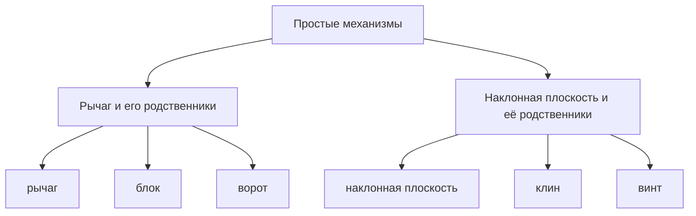

# Рычаг. Момент силы

## Простые механизмы [У78 02:09](https://www.youtube.com/watch?t=129&v=uYuzedJBG20)

> [!experiment]- Домкрат позволяет поднять часть автомобиля, хотя человек не поднимет полторы тонны [У78 02:09](https://www.youtube.com/watch?t=129&v=uYuzedJBG20)
> Легковой автомобиль имеет массу одну-две тонны; вес автомобиля массой тонну — около $10\ \text{кН}$ [У78 02:50](https://www.youtube.com/watch?t=170&v=uYuzedJBG20)
> Человек развивает силу порядка сотен ньютонов, но не десяти тысяч, и всё же при смене колеса он приподнимает часть автомобиля: остальное опирается на колёса, а помогает **домкрат** [У78 03:05](https://www.youtube.com/watch?t=185&v=uYuzedJBG20)
> Домкрат — устройство, которое позволяет, прикладывая меньшую силу, получить большую [У78 02:40](https://www.youtube.com/watch?t=160&v=uYuzedJBG20)

> [!note] Простые механизмы — это устройства для преобразования силы [У78 03:54](https://www.youtube.com/watch?t=234&v=uYuzedJBG20)
> [[Сила#^force-definition|Сила]] — вектор, поэтому её можно преобразовать двояко: изменить модуль (приложил большую, получил меньшую, а чаще наоборот) и изменить направление [У78 04:18](https://www.youtube.com/watch?t=258&v=uYuzedJBG20)
> Любой сложный механизм, будь то токарный станок, фрезерный станок или двигатель автомобиля, состоит из простых [У78 03:19](https://www.youtube.com/watch?t=199&v=uYuzedJBG20)

Простые механизмы делятся на два класса [У78 04:45](https://www.youtube.com/watch?t=285&v=uYuzedJBG20)

| Механизм | Что это | Пример из лекции |
| --- | --- | --- |
| Рычаг | твёрдое тело, вращающееся вокруг неподвижной оси | опора под брёвном, тормозная педаль |
| [[Блоки\|Блок]] | колесо с канавкой, в канавку вложена верёвка | неподвижный блок: силы $F_1$ и $F_2$ действуют на концы верёвки |
| Ворот | цилиндрический барабан с прикреплённой ручкой | ведро в колодце |
| Наклонная плоскость | плоскость, не горизонтальная и не вертикальная | бочка массой около $200$ кг, которую вкатывают, а не поднимают |
| Клин | инструмент, забиваемый молотом или топором в бревно | колка толстого полена |
| Винт | цилиндр с нарезанной резьбой, завинчиваемый в гайку | подъём части автомобиля при смене колеса |

Резьба на винте наклонена, поэтому винт — родственник наклонной плоскости [У78 11:07](https://www.youtube.com/watch?t=667&v=uYuzedJBG20)
Ручку, вставленную в отверстие винта, Виктор уже не считает простым механизмом: главная часть — сам винт [У78 11:02](https://www.youtube.com/watch?t=662&v=uYuzedJBG20)

> [!note] Ворот — это цилиндрический барабан с ручкой, вращающийся вокруг оси [У78 07:06](https://www.youtube.com/watch?t=426&v=uYuzedJBG20)
> Силой $F_1$ действуют на ручку, верёвка действует на ведро силой $F_2$; небольшим усилием поднимают тяжёлое ведро [У78 07:25](https://www.youtube.com/watch?t=445&v=uYuzedJBG20)
> Задача на ворот — в заметке [[Блоки]]

## Рычаг [У78 11:23](https://www.youtube.com/watch?t=683&v=uYuzedJBG20)

> [!note] Рычаг — это твёрдое тело, способное вращаться вокруг неподвижной оси [У78 15:40](https://www.youtube.com/watch?t=940&v=uYuzedJBG20)
> Неподвижную точку рычага называют **точкой опоры** и обозначают $O$ [У78 13:51](https://www.youtube.com/watch?t=831&v=uYuzedJBG20)
> Дальше рассматривают рычаги, на которые действуют две силы, $\vec F_1$ и $\vec F_2$, не считая силы со стороны опоры ^lever

Примеры из лекции [У78 11:37](https://www.youtube.com/watch?t=697&v=uYuzedJBG20)

- бревно как опора под рычагом: на один конец давят вниз силой $\vec F_1$, груз давит вниз своим весом $\vec F_2$
- рычаг, приподнимающий груз: силу $\vec F_1$ направляют вверх, груз действует вниз
- тормозная педаль: на неё действует сила $\vec F_1$ ноги и сила натяжения троса $\vec F_2$ [У78 14:24](https://www.youtube.com/watch?t=864&v=uYuzedJBG20)

### Рычаги первого и второго рода [У78 16:23](https://www.youtube.com/watch?t=983&v=uYuzedJBG20)

| Признак | Рычаг первого рода | Рычаг второго рода |
| --- | --- | --- |
| Точки приложения сил | по разные стороны от оси | по одну сторону от оси |
| Направления сил | в одну сторону | одна вверх, другая вниз |
| Пример | опора под брёвном | тормозная педаль, рычаг с грузом у конца |

![[lever-two-kinds.png]]

Рычаг второго рода Виктор определяет так: обе силы приложены с одной стороны от точки опоры [У78 17:26](https://www.youtube.com/watch?t=1046&v=uYuzedJBG20)

## Плечо силы [У78 18:27](https://www.youtube.com/watch?t=1107&v=uYuzedJBG20)

> [!note] Плечо силы относительно оси — это кратчайшее расстояние от линии действия силы до этой оси [У78 21:05](https://www.youtube.com/watch?t=1265&v=uYuzedJBG20)
> **Линия действия силы** — прямая, на которой лежит вектор силы [У78 19:15](https://www.youtube.com/watch?t=1155&v=uYuzedJBG20)
> Кратчайшее расстояние измеряют по перпендикуляру, опущенному из оси на линию действия [У78 19:18](https://www.youtube.com/watch?t=1158&v=uYuzedJBG20)
> Плечо силы $\vec F_1$ обозначают $l_1$, плечо силы $\vec F_2$ — $l_2$

> [!note]- Сводка: плечо силы
> | Характеристика | Значение |
> | --- | --- |
> | Обозначение | $l$ |
> | Определяющая формула | кратчайшее расстояние от оси до линии действия силы, то есть длина перпендикуляра |
> | Единица [[Физические величины и их измерение\|СИ]] | метр, м |
> | Скаляр или вектор | скаляр |
> | Как измеряют | линейкой по перпендикуляру к линии действия силы |
> | Особый случай | плечо силы, линия действия которой проходит через ось, равно нулю |
> | Связь с другими величинами | входит в момент силы $M = Fl$ |

![[lever-arm-construction.png|60%]]

Когда рычаг горизонтален, а силы вертикальны, плечо — просто отрезок рычага от оси до точки подвеса [У78 30:43](https://www.youtube.com/watch?t=1843&v=uYuzedJBG20)
В 7 классе плечо находить легко, но точное определение Виктор даёт сразу, чтобы не переучивать [У78 20:19](https://www.youtube.com/watch?t=1219&v=uYuzedJBG20)
Если сила направлена не перпендикулярно рычагу, плечо не равно расстоянию от оси до точки приложения: это видно на рисунке, где $OA$ длиннее перпендикуляра $l$

## Условие равновесия рычага [У78 23:54](https://www.youtube.com/watch?t=1434&v=uYuzedJBG20)

> [!experiment]+ Три опыта с рычагом: рычаг уравновешен, если большая сила висит на меньшем плече [У78 25:05](https://www.youtube.com/watch?t=1505&v=uYuzedJBG20)
> Рычаг с грузами по $0{,}5$ Н (масса $50$ г) выставляют горизонтально и подвешивают разные грузы; результаты Виктор записывает на доске [У78 24:39](https://www.youtube.com/watch?t=1479&v=uYuzedJBG20)
> Абсолютно одинаковых макроскопических тел не бывает, одинаковы только все электроны и все протоны, поэтому равновесие первого опыта принимают приближённо [У78 26:07](https://www.youtube.com/watch?t=1567&v=uYuzedJBG20)
>
> | Опыт | $F_1$, Н | $l_1$, см | $F_2$, Н | $l_2$, см | $F_1/F_2$ | $l_2/l_1$ |
> | --- | --- | --- | --- | --- | --- | --- |
> | 1 | $0{,}5$ | $10$ | $0{,}5$ | $10$ | $1$ | $1$ |
> | 2 | $1$ | $10$ | $2$ | $5$ | $1/2$ | $1/2$ |
> | 3 | $1{,}5$ | $20$ | $2$ | $15$ | $3/4$ | $3/4$ |
>
> Во втором опыте грузик $1$ Н уравновешивают четырьмя грузиками по $0{,}5$ Н, а место подвеса подбирают: не $20$ см и не $10$ см, а $5$ см [У78 27:04](https://www.youtube.com/watch?t=1624&v=uYuzedJBG20)
> В третьем опыте попытка повесить грузы на равных расстояниях не даёт равновесия, поэтому плечи подбирают: $20$ и $15$ см [У78 28:39](https://www.youtube.com/watch?t=1719&v=uYuzedJBG20)
> ![[lever-experiments.png]]

Отношение сил во всех трёх опытах равно обратному отношению плеч [У78 33:48](https://www.youtube.com/watch?t=2028&v=uYuzedJBG20)

> [!summary] Условие равновесия рычага: отношение двух приложенных к рычагу сил равно обратному отношению плеч этих сил [У78 34:45](https://www.youtube.com/watch?t=2085&v=uYuzedJBG20)
> $$\boxed{\frac{F_1}{F_2} = \frac{l_2}{l_1}}$$
> Точнее, равно отношение модулей сил [У79 04:28](https://www.youtube.com/watch?t=268&v=MF6PzbeUIRw)
> Формула работает, когда на рычаг действуют две силы; для большего числа сил нужно правило моментов ниже

Пока груз и его плечо не меняются, произведение $F_1 l_1$ постоянно, и сила, уравновешивающая груз, обратно пропорциональна плечу

![[lever-hyperbola.png]]

На левом графике при каждом фиксированном моменте $M = F_1 l_1$ сила растёт при сокращении плеча по гиперболе $F_1 = M/l_1$; точки — три опыта. На правом график $F_2/F_1 = l_1/l_2$ — прямая

## Выигрыш в силе рычага [У78 36:05](https://www.youtube.com/watch?t=2165&v=uYuzedJBG20)

> [!note] Выигрыш в силе рычага — это отношение $F_2/F_1$ силы, которую получают, к силе, которую прикладывают [У78 38:13](https://www.youtube.com/watch?t=2293&v=uYuzedJBG20)
> Общее понятие выигрыша в силе введено в заметке [[Гидравлический пресс|про гидравлический пресс]]; для рычага из условия равновесия $F_2 = F_1\,\dfrac{l_1}{l_2}$, поэтому
> $$\boxed{\frac{F_2}{F_1} = \frac{l_1}{l_2}}$$
> Если $l_1 \gg l_2$, малой силой $F_1$ получают с другой стороны очень большую силу $F_2$ [У78 37:20](https://www.youtube.com/watch?t=2240&v=uYuzedJBG20)

> [!quote] Дайте мне точку опоры, и я переверну Землю [У78 37:20](https://www.youtube.com/watch?t=2240&v=uYuzedJBG20)
> Слова Архимеда, автора закона рычага; Виктор называет их преувеличением, но красивым

Рычаги можно включать друг за другом и многократно увеличивать выигрыш [У78 39:19](https://www.youtube.com/watch?t=2359&v=uYuzedJBG20)
[[Гидравлический пресс|Гидравлический пресс]] тоже даёт выигрыш в силе, хотя простым механизмом не считается: те же закономерности ему присущи [У78 38:43](https://www.youtube.com/watch?t=2323&v=uYuzedJBG20)

> [!tip] Где выигрываем в силе, там проигрываем в расстоянии [У78 39:30](https://www.youtube.com/watch?t=2370&v=uYuzedJBG20)
> Когда рычаг поворачивают, конец с большим плечом опускается значительно больше, чем поднимается другой: малой силой приходится пройти большой путь [У78 39:52](https://www.youtube.com/watch?t=2392&v=uYuzedJBG20)
> Это закон природы, он действует во всех простых механизмах; подробно он разобран в теме [[Золотое правило механики. КПД]]
> ![[lever-path-force.png|70%]]

> [!experiment]- Рычаги в жизни: гаечный ключ, ножницы, качели, требушет [У78 40:24](https://www.youtube.com/watch?t=2424&v=uYuzedJBG20)
> Ручка двери и детские качели — рычаги [У78 40:55](https://www.youtube.com/watch?t=2455&v=uYuzedJBG20)
> Гайку руками не открутить, а с гаечным ключом большое плечо даёт выигрыш в силе [У78 40:56](https://www.youtube.com/watch?t=2456&v=uYuzedJBG20)
> Ножницы: расстояние от оси до колец, куда вставляют пальцы, — плечо меньшей силы, а расстояние до разрезаемого места меньше, поэтому есть выигрыш в силе [У78 41:20](https://www.youtube.com/watch?t=2480&v=uYuzedJBG20)
> Ножницы для резки металла имеют ручки длиной до метра, чтобы выигрыш был больше [У78 42:00](https://www.youtube.com/watch?t=2520&v=uYuzedJBG20)
> Требушет (катапульта): силу прикладывают к короткому плечу, а снаряд летит далеко; здесь проигрывают в силе, но выигрывают в расстоянии [У78 42:51](https://www.youtube.com/watch?t=2571&v=uYuzedJBG20)

## Момент силы [У80 00:08](https://www.youtube.com/watch?t=8&v=ix4DwQz_mC8)

Условие равновесия для двух сил не отвечает, какой груз повесить, если сил больше двух; для этого вводят новую величину [У80 01:13](https://www.youtube.com/watch?t=73&v=ix4DwQz_mC8)
Свойство пропорции переписывает условие равновесия без дробной черты: $F_1 l_1 = F_2 l_2$ [У80 05:13](https://www.youtube.com/watch?t=313&v=ix4DwQz_mC8)
Слева стоят величины только первой силы, справа только второй, и каждое произведение вычисляется одинаково: силу умножают на её плечо [У80 06:06](https://www.youtube.com/watch?t=366&v=ix4DwQz_mC8)

> [!note] Момент силы относительно оси — это физическая величина, равная произведению модуля силы на плечо силы относительно этой оси [У80 07:36](https://www.youtube.com/watch?t=456&v=ix4DwQz_mC8)
> $$\boxed{M = F\,l}$$
> Плечо привязано к положению оси, поэтому и момент силы задан относительно определённой оси [У80 07:03](https://www.youtube.com/watch?t=423&v=ix4DwQz_mC8)

> [!note]- Сводка: момент силы
> | Характеристика | Значение |
> | --- | --- |
> | Обозначение | $M$ |
> | Определяющая формула | $M = F\,l$ |
> | Единица СИ | ньютон-метр, $\text{Н}\cdot\text{м}$ |
> | Скаляр или вектор | алгебраическая величина: знак задаёт направление вращения |
> | Что характеризует | вращающее действие силы относительно оси |
> | Как измеряют | вычисляют по силе и плечу |
> | Особый случай | момент силы, линия действия которой проходит через ось, равен нулю |
> | Связь с другими величинами | [[Сила#^force-definition\|сила]], плечо силы |

Единицу $\text{Н}\cdot\text{м}$ нельзя называть джоулем: в джоулях измеряют работу и энергию ([[Механическая работа]]), поэтому момент силы измеряют в ньютон-метрах, чтобы не путать величины [У80 09:47](https://www.youtube.com/watch?t=587&v=ix4DwQz_mC8)
Работа считается по перемещению точки приложения силы, а не по плечу [У80 10:31](https://www.youtube.com/watch?t=631&v=ix4DwQz_mC8)

Условие равновесия для двух сил принимает вид $M_1 = M_2$ [У80 10:53](https://www.youtube.com/watch?t=653&v=ix4DwQz_mC8)

> [!warning] Сила со стороны опоры не входит в условие равновесия, потому что её плечо равно нулю [У81 05:08](https://www.youtube.com/watch?t=308&v=hCHwsCuRNFw)
> На рычаг действуют не две силы, а три: ещё сила упругости опоры направлена вверх и равна сумме сил грузов
> Линия действия этой силы проходит через ось, поэтому плечо равно нулю, момент равен нулю, и вращающего действия у неё нет [У81 06:14](https://www.youtube.com/watch?t=374&v=hCHwsCuRNFw)

## Правило моментов [У80 11:43](https://www.youtube.com/watch?t=703&v=ix4DwQz_mC8)

> [!experiment]- Три силы на рычаге: снятый груз возвращают на другое плечо [У80 11:43](https://www.youtube.com/watch?t=703&v=ix4DwQz_mC8)
> Слева на плече $10$ см подвешены шесть грузиков по $0{,}5$ Н, то есть $3$ Н; справа на плече $15$ см четыре грузика, $2$ Н; моменты $3\cdot 0{,}1 = 0{,}3$ и $2\cdot 0{,}15 = 0{,}3\ \text{Н}\cdot\text{м}$, рычаг в равновесии [У80 12:17](https://www.youtube.com/watch?t=737&v=ix4DwQz_mC8)
> Снимают слева $1$ Н: момент слева уменьшился, равновесие нарушено [У80 13:51](https://www.youtube.com/watch?t=831&v=ix4DwQz_mC8)
> Грузик $0{,}5$ Н можно подвесить так, чтобы равновесие вернулось: на плече $20$ см [У80 14:28](https://www.youtube.com/watch?t=868&v=ix4DwQz_mC8)
> Силу уменьшили вдвое, зато плечо увеличили вдвое, и момент восстановлен [У80 15:00](https://www.youtube.com/watch?t=900&v=ix4DwQz_mC8)
> ![[lever-moment-balance.png]]
>
> | Сила | Плечо, см | Момент, $\text{Н}\cdot\text{м}$ | Направление |
> | --- | --- | --- | --- |
> | $F_1 = 2$ Н | $10$ | $0{,}2$ | против часовой стрелки |
> | $F_3 = 0{,}5$ Н | $20$ | $0{,}1$ | против часовой стрелки |
> | $F_2 = 2$ Н | $15$ | $0{,}3$ | по часовой стрелке |

Суммарные моменты сил, вращающих рычаг в противоположные стороны, равны: $0{,}2 + 0{,}1 = 0{,}3\ \text{Н}\cdot\text{м}$ [У80 19:56](https://www.youtube.com/watch?t=1196&v=ix4DwQz_mC8)

> [!summary] Правило моментов, простая форма: рычаг в равновесии, если сумма моментов сил, вращающих его по часовой стрелке, равна сумме моментов сил, вращающих его против часовой [У80 21:09](https://www.youtube.com/watch?t=1269&v=ix4DwQz_mC8)
> $$\boxed{M_1^{\circlearrowright} + M_2^{\circlearrowright} + \dots = M_1^{\circlearrowleft} + M_2^{\circlearrowleft} + \dots}$$
> На этом объяснение в учебнике заканчивается [У80 23:02](https://www.youtube.com/watch?t=1382&v=ix4DwQz_mC8)

Числа $M = Fl$ не хранят направление вращения: силы $\vec F_1$ и $\vec F_2$ могут иметь одинаковые модули и плечи, но вращать рычаг в разные стороны [У80 24:03](https://www.youtube.com/watch?t=1443&v=ix4DwQz_mC8)

> [!note] Знак момента — это соглашение о положительном направлении вращения [У80 24:47](https://www.youtube.com/watch?t=1487&v=ix4DwQz_mC8)
> Положительным принято направление против часовой стрелки, как отсчёт угла в математике; выбор произвольный, и физик вправе взять другое [У80 25:07](https://www.youtube.com/watch?t=1507&v=ix4DwQz_mC8)
> Момент, вращающий против часовой стрелки, берут со знаком плюс, по часовой — со знаком минус [У80 25:31](https://www.youtube.com/watch?t=1531&v=ix4DwQz_mC8)
> ![[lever-moment-signs.png]]

> [!summary] Правило моментов: рычаг находится в равновесии, если алгебраическая сумма моментов действующих на него сил равна нулю [У80 26:34](https://www.youtube.com/watch?t=1594&v=ix4DwQz_mC8)
> $$\boxed{M_1 + M_2 + \dots + M_n = 0}$$
> Алгебраическая сумма — сумма с учётом знаков; количество сил любое [У80 27:41](https://www.youtube.com/watch?t=1661&v=ix4DwQz_mC8)
> Это правило универсальнее, чем условие для двух сил: дальше Виктор пользуется правилом моментов в общей или в простой форме, а условие для двух сил берёт там, где оно короче ^moment-rule

> [!tip] Порядок решения задачи на равновесие рычага [У79 09:06](https://www.youtube.com/watch?t=546&v=MF6PzbeUIRw)
> 1. Кратко записать условие и сделать рисунок; плечи, заданные числом одинаковых отрезков, выразить через длину отрезка $a$
> 2. Отметить на рисунке силы и их плечи, выбрать положительное направление вращения
> 3. Записать правило моментов, определив знак каждого момента по тому, куда сила одна вращала бы рычаг
> 4. Выразить силы через массы, $F = mg$, и сократить $g$
> 5. Решить уравнение в общем виде, подставить числа, получить рабочую формулу и ответ

> [!tip] Равновесие рычага не зависит от $g$, поэтому рычажными весами пользуются где угодно [У79 18:02](https://www.youtube.com/watch?t=1082&v=MF6PzbeUIRw)
> При $F = mg$ ускорение свободного падения сокращается из условия равновесия: рычаг, уравновешенный на Земле, останется в равновесии на Луне
> [[Сила упругости. Закон Гука|Пружинные весы]] приспособлены только под земную тяжесть, [[Масса|массу]] рычажными весами измеряют повсюду [У79 18:26](https://www.youtube.com/watch?t=1106&v=MF6PzbeUIRw)

## Задачи [У79 05:57](https://www.youtube.com/watch?t=357&v=MF6PzbeUIRw)

> Задачи из задачника Ненашева, разбор Виктора; условия по учебнику, рисунки перерисованы

### Условие равновесия рычага [У79 05:57](https://www.youtube.com/watch?t=357&v=MF6PzbeUIRw)

> [!example]- Вес первого груза при равновесии рычага, плечи заданы отрезками [У79 06:03](https://www.youtube.com/watch?t=363&v=MF6PzbeUIRw)
> **Условие.** Каков вес первого груза, если вес второго равен $40$ Н и рычаг находится в равновесии; рычаг разбит на равные отрезки, первый груз на расстоянии двух отрезков от опоры, второй — трёх
> ![[lever-task-sections.png|60%]]
>
> Верхний рисунок относится к этой задаче, нижний — к следующей
> **Решение.** Длину одного отрезка обозначают $a$: $l_1 = 2a$, $l_2 = 3a$; величина $a$ неизвестна, но и не нужна [У79 09:06](https://www.youtube.com/watch?t=546&v=MF6PzbeUIRw)
> $$\begin{align}
> \frac{P_1}{P_2} &= \frac{l_2}{l_1} \\
> P_1 &= P_2\,\frac{l_2}{l_1} = 40\ \text{Н}\cdot\frac{3a}{2a} = 60\ \text{Н}
> \end{align}$$
> **Ответ.** Вес первого груза $\boxed{60\ \text{Н}}$

> [!example]- Массы двух грузов, если общая масса $50$ кг, а плечи $8a$ и $2a$ [У79 12:40](https://www.youtube.com/watch?t=760&v=MF6PzbeUIRw)
> **Условие.** Какова масса каждого из грузов, если общая масса грузов $m = 50$ кг; рычаг разбит на десять отрезков, опора на два отрезка левее правого края, грузы на концах рычага
> **Решение.** Больший груз висит на меньшем плече, то есть справа: $l_1 = 8a$, $l_2 = 2a$ [У79 14:37](https://www.youtube.com/watch?t=877&v=MF6PzbeUIRw)
> Силы равны весам грузов, вес неподвижного груза совпадает с силой тяжести: $F_1 = m_1 g$, $F_2 = m_2 g$; в условии равновесия $g$ сокращается [У79 17:36](https://www.youtube.com/watch?t=1056&v=MF6PzbeUIRw)
> Неизвестных две, уравнение одно, добавляют $m_1 = m - m_2$ [У79 18:57](https://www.youtube.com/watch?t=1137&v=MF6PzbeUIRw)
> $$\begin{align}
> \frac{m_1}{m_2} &= \frac{l_2}{l_1}, \qquad \frac{m - m_2}{m_2} = \frac{l_2}{l_1} \\
> m\,l_1 - m_2\,l_1 &= m_2\,l_2 \quad\Rightarrow\quad m\,l_1 = m_2\,(l_1 + l_2) \\
> m_2 &= m\,\frac{l_1}{l_1 + l_2} = 50\ \text{кг}\cdot\frac{8a}{10a} = 40\ \text{кг} \\
> m_1 &= m - m_2 = 50\ \text{кг} - 40\ \text{кг} = 10\ \text{кг}
> \end{align}$$
> **Ответ.** Массы грузов $\boxed{10\ \text{кг и}\ 40\ \text{кг}}$

> [!example]+ Где поставить опору, чтобы грузы $24$ кг и $9$ кг на концах рычага длиной $165$ см уравновесились [У79 24:26](https://www.youtube.com/watch?t=1466&v=MF6PzbeUIRw)
> **Условие.** К концам рычага подвешены два груза массами $m_1 = 24$ кг и $m_2 = 9$ кг; на каком расстоянии $x$ от середины рычага нужно расположить опору, чтобы рычаг был в равновесии; длина рычага $L = 165$ см
> **Решение.** Опору сдвигают к большему грузу: где сила больше, плечо должно быть меньше [У79 27:50](https://www.youtube.com/watch?t=1670&v=MF6PzbeUIRw)
> Плечи выражают через $x$: от опоры до второго груза $l_2 = \dfrac{L}{2} + x$, до первого $l_1 = \dfrac{L}{2} - x$ [У79 30:41](https://www.youtube.com/watch?t=1841&v=MF6PzbeUIRw)
> $$\begin{align}
> \frac{m_1 g}{m_2 g} &= \frac{L/2 + x}{L/2 - x} = \frac{L + 2x}{L - 2x} \\
> m_1\,(L - 2x) &= m_2\,(L + 2x) \\
> L\,(m_1 - m_2) &= 2x\,(m_1 + m_2) \\
> x &= \frac{L}{2}\cdot\frac{m_1 - m_2}{m_1 + m_2} = \frac{165\ \text{см}}{2}\cdot\frac{15}{33} = 37{,}5\ \text{см}
> \end{align}$$
> ![[lever-task-support-shift.png]]
> Правый график показывает, что $x$ растёт с отношением масс и не превосходит $L/2$: опора доходит до края, только когда один из грузов бесконечно тяжелее другого
> **Ответ.** Опору нужно расположить на расстоянии $\boxed{37{,}5\ \text{см}}$ от середины рычага со стороны большего груза; сторона важна: при замене грузов опора смещается в другую сторону

### Правило моментов [У80 29:26](https://www.youtube.com/watch?t=1766&v=ix4DwQz_mC8)

> [!example]- Где и куда приложить силу $125$ Н к рычагу, лежащему краем на столе [У80 30:06](https://www.youtube.com/watch?t=1806&v=ix4DwQz_mC8)
> **Условие.** Рычаг — жёсткий стержень длиной $L = 2$ м, один конец которого опирается на край стола; на расстоянии $l_1 = 50$ см от края висит груз массой $m = 50$ кг; где и в каком направлении приложить вертикальную силу $F_2 = 125$ Н, чтобы рычаг был в равновесии
> ![[lever-task-table-edge.png|70%]]
> **Решение.** Ось проходит через край стола. Сила $\vec F_1$ груза вращает рычаг по часовой стрелке, поэтому $\vec F_2$ должна вращать против часовой, то есть быть направлена вверх, и стоять справа: $F_2 < F_1$, значит, её плечо должно быть больше [У80 33:15](https://www.youtube.com/watch?t=1995&v=ix4DwQz_mC8)
> Положительное направление — против часовой стрелки; $F_1 = mg$ [У80 35:22](https://www.youtube.com/watch?t=2122&v=ix4DwQz_mC8)
> $$\begin{align}
> M_1 + M_2 &= 0 \\
> -m g\,l_1 + F_2\,l_2 &= 0 \\
> l_2 &= l_1\,\frac{m g}{F_2} = 0{,}5\ \text{м}\cdot\frac{50\ \text{кг}\cdot 10\ \text{Н}/\text{кг}}{125\ \text{Н}} = 2\ \text{м}
> \end{align}$$
> Задача разрешима, потому что $l_2 = L$: силу можно приложить как раз к концу рычага [У80 37:44](https://www.youtube.com/watch?t=2264&v=ix4DwQz_mC8)
> **Ответ.** Вертикальную силу нужно направить $\boxed{\text{вверх и приложить к самому концу рычага}}$

> [!example]- Масса первого груза, если опора посередине, а на рычаг действуют три силы [У81 00:59](https://www.youtube.com/watch?t=59&v=hCHwsCuRNFw)
> **Условие.** Масса второго груза $m_2 = 2$ кг, третьего $m_3 = 6$ кг; какова масса первого груза; рычаг из восьми секций, опора посередине, груз $1$ на левом конце, груз $2$ в одной секции слева от опоры, груз $3$ на правом конце
> ![[lever-task-three-loads.png]]
> **Решение.** Плечи: $l_1 = 4a$, $l_2 = a$, $l_3 = 4a$ [У81 04:09](https://www.youtube.com/watch?t=249&v=hCHwsCuRNFw)
> Силы $\vec F_1$ и $\vec F_2$ вращают рычаг против часовой стрелки, $\vec F_3$ — по часовой; сила опоры моментов не создаёт [У81 07:28](https://www.youtube.com/watch?t=448&v=hCHwsCuRNFw)
> $$\begin{align}
> M_1 + M_2 + M_3 &= 0 \\
> m_1 g\,l_1 + m_2 g\,l_2 - m_3 g\,l_3 &= 0 \quad\Big|\ \cdot \frac{1}{g} \\
> m_1 &= \frac{m_3 l_3 - m_2 l_2}{l_1} = \frac{6\ \text{кг}\cdot 4a - 2\ \text{кг}\cdot a}{4a} = \frac{22}{4}\ \text{кг} = 5{,}5\ \text{кг}
> \end{align}$$
> Сила реакции опоры — сумма всех сил, действующих вниз, потому что рычаг не движется вверх и вниз [У81 15:41](https://www.youtube.com/watch?t=941&v=hCHwsCuRNFw)
> $$N = (m_1 + m_2 + m_3)\,g = (5{,}5 + 2 + 6)\ \text{кг}\cdot 10\ \frac{\text{Н}}{\text{кг}} = 135\ \text{Н}$$
> **Ответ.** Масса первого груза $\boxed{5{,}5\ \text{кг}}$; сила опоры $135$ Н, хотя об этом не спрашивали

> [!example]+ Масса рычага, у которого опора не посередине: сила тяжести рычага приложена в центре тяжести [У81 16:24](https://www.youtube.com/watch?t=984&v=hCHwsCuRNFw)
> **Условие.** Масса первого груза $m_1 = 10$ кг, второго $m_2 = 2$ кг; какова масса рычага; рычаг из десяти секций, опора в трёх секциях от левого края, груз $1$ в одной секции от левого края, груз $2$ в двух секциях от правого края
> **Решение.** В прошлой задаче опора стояла посередине, и сила тяжести однородного рычага проходила через ось: её момент равнялся нулю, весомый рычаг или нет — безразлично [У81 17:27](https://www.youtube.com/watch?t=1047&v=hCHwsCuRNFw)
> Здесь опора смещена, и сила тяжести рычага $m_р g$ имеет момент. Она приложена к [[Сила тяжести|центру тяжести]]; у однородного рычага он посередине [У81 20:03](https://www.youtube.com/watch?t=1203&v=hCHwsCuRNFw)
> Плечи: $l_1 = 2a$, $l_р = 2a$, $l_2 = 5a$; силы $\vec F_р$ и $\vec F_2$ вращают рычаг по часовой стрелке, $\vec F_1$ — против [У81 21:11](https://www.youtube.com/watch?t=1271&v=hCHwsCuRNFw)
> $$\begin{align}
> M_1 + M_р + M_2 &= 0 \\
> m_1 g\,l_1 - m_р g\,l_р - m_2 g\,l_2 &= 0 \quad\Big|\ \cdot \frac{1}{g} \\
> m_р &= \frac{m_1 l_1 - m_2 l_2}{l_р} = \frac{10\ \text{кг}\cdot 2a - 2\ \text{кг}\cdot 5a}{2a} = 5\ \text{кг}
> \end{align}$$
> ![[lever-task-heavy-lever.png]]
> **Ответ.** Масса рычага $\boxed{5\ \text{кг}}$

> [!example]+ Масса ящика на неравноплечих рычажных весах: среднее геометрическое двух гирь [У81 28:16](https://www.youtube.com/watch?t=1696&v=hCHwsCuRNFw)
> **Условие.** Ящик подвешен к левому плечу неравноплечего рычага и уравновешен грузом $m_1 = 6$ кг на правом плече; если ящик подвешен к правому плечу, его уравновешивает груз $m_2 = 24$ кг на левом; какова масса ящика $m$
> **Решение.** Рычажными весами массу груза считают равной массе гирь только при равных плечах: $l_1 = l_2$ [У81 29:14](https://www.youtube.com/watch?t=1754&v=hCHwsCuRNFw)
> Здесь плечи разные, опора остаётся на месте; более тяжёлый груз висит на меньшем плече, поэтому опора левее середины [У81 31:45](https://www.youtube.com/watch?t=1905&v=hCHwsCuRNFw)
> Правило моментов для каждого положения, положительное направление — против часовой стрелки [У81 33:28](https://www.youtube.com/watch?t=2008&v=hCHwsCuRNFw)
> $$\begin{align}
> \text{ящик слева:}\quad m g\,l_1 - m_1 g\,l_2 &= 0 \quad\Rightarrow\quad m\,l_1 = m_1\,l_2 \tag{1} \\
> \text{ящик справа:}\quad m_2 g\,l_1 - m g\,l_2 &= 0 \quad\Rightarrow\quad m_2\,l_1 = m\,l_2 \tag{2}
> \end{align}$$
> Чтобы плечи исчезли, делят почленно $(2)$ на $(1)$ [У81 38:01](https://www.youtube.com/watch?t=2281&v=hCHwsCuRNFw)
> $$\begin{align}
> \frac{m_2\,l_1}{m\,l_1} &= \frac{m\,l_2}{m_1\,l_2} \quad\Rightarrow\quad \frac{m_2}{m} = \frac{m}{m_1} \\
> m^2 &= m_1 m_2 \quad\Rightarrow\quad m = \sqrt{m_1 m_2} = \sqrt{6\ \text{кг}\cdot 24\ \text{кг}} = \sqrt{144}\ \text{кг}^2 = 12\ \text{кг}
> \end{align}$$
> Отрицательный корень отбрасывают: масса всегда положительна [У81 41:11](https://www.youtube.com/watch?t=2471&v=hCHwsCuRNFw)
> ![[lever-task-unequal-scales.png|60%]]
> Виктор замечает, что это не самый рациональный путь: по условию равновесия для двух сил решение вышло бы в четыре раза быстрее, но здесь тренировались в работе с уравнениями [У81 41:39](https://www.youtube.com/watch?t=2499&v=hCHwsCuRNFw)
> **Ответ.** Масса ящика $\boxed{12\ \text{кг}}$
