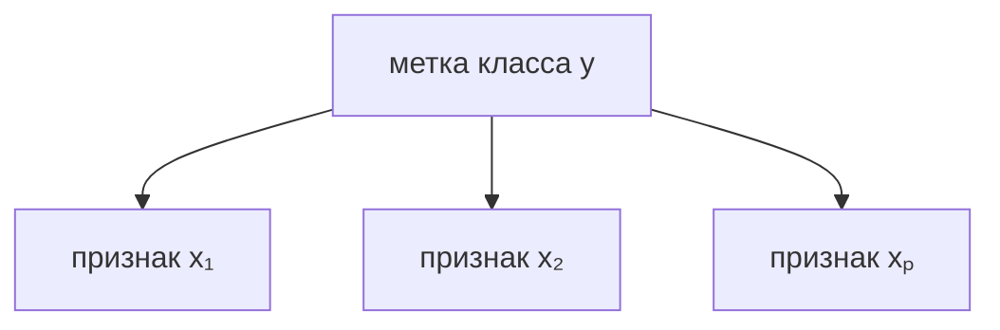
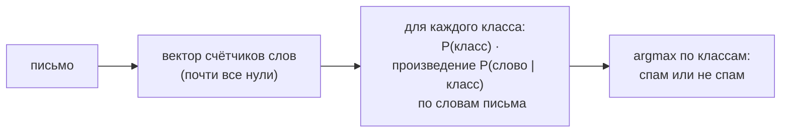

# Наивный байесовский классификатор

$$\boxed{\widehat y(\boldsymbol x)=\arg\max_{k}\ P(y=C_k)\prod_{l=1}^{p}P(x_l\mid y=C_k)}$$

**Наивный байесовский классификатор** (**NB**, naive Bayes) хранит не выборку, как [[Метод k ближайших соседей|kNN]], а оценки распределений каждого признака внутри каждого класса

## Правдоподобие [1:15:00](https://www.youtube.com/watch?v=k3UJOG-DKHE&t=4500s)

[[Метод максимального правдоподобия|Метод максимального правдоподобия]] (MLE, maximum likelihood estimation) проходит через весь курс: байесовские методы лектор не разбирает, а почти все решения курса опираются на MLE. Определения и вывод оценок живут в заметке по матстату; здесь только то, что нужно для NB и что лектор подчёркивает

> [!note] Правдоподобие — вероятность данных при параметрах, а не параметров при данных [1:15:49](https://www.youtube.com/watch?v=k3UJOG-DKHE&t=4549s)
> Пусть данные порождены распределением с параметрами $\boldsymbol\theta$. Правдоподобие — это вероятность (плотность) увидеть именно такую выборку при заданных $\boldsymbol\theta$, рассмотренная как функция $\boldsymbol\theta$:
> $$\mathcal L(\boldsymbol\theta\mid\boldsymbol X,\boldsymbol Y)=P(\boldsymbol X,\boldsymbol Y\mid\boldsymbol\theta)=P(\boldsymbol Y\mid\boldsymbol X,\boldsymbol\theta)\,P(\boldsymbol X\mid\boldsymbol\theta)=\prod_{i=1}^{n}P\bigl(\boldsymbol x^{(i)},\boldsymbol y^{(i)}\mid\boldsymbol\theta\bigr)$$
> Считать его вероятностью параметров — самая частая ошибка. Если $\boldsymbol X$ не зависит от $\boldsymbol\theta$ (лектор: "иксы пришли откуда-то извне", как в регрессии, где признаки заданы), то $P(\boldsymbol X\mid\boldsymbol\theta)=P(\boldsymbol X)$ — константа, и при максимизации её можно не учитывать[^marg]
>
> В NB это не так: $\boldsymbol\theta$ включает и параметры $P(\boldsymbol x\mid C_k)$, и частоты классов, поэтому максимизируется полное совместное правдоподобие $\prod_i P(\boldsymbol x^{(i)},y^{(i)}\mid\boldsymbol\theta)$
>
> Произведение по парам получается из того, что объекты [[Независимость случайных величин#^iid-factor|независимы и одинаково распределены]]; $\boldsymbol y$ может быть и вектором

Цель — найти $\boldsymbol\theta$, при котором $\mathcal L\to\max$ [1:19:31](https://www.youtube.com/watch?v=k3UJOG-DKHE&t=4771s). Произведение неудобно дифференцировать, поэтому берут логарифм. Он монотонно возрастает, и точка максимума не меняется (если максимум в 25, то и у логарифма в 25), а логарифм произведения — сумма логарифмов, [[Правила дифференцирования|производная суммы]] — сумма производных:
$$\ell(\boldsymbol\theta)=\log\mathcal L(\boldsymbol\theta\mid\boldsymbol X,\boldsymbol Y)=\sum_{i=1}^{n}\log P\bigl(\boldsymbol x^{(i)},\boldsymbol y^{(i)}\mid\boldsymbol\theta\bigr)\to\max_{\boldsymbol\theta}$$

> [!example] Монетка: 90 орлов и 10 решек [1:16:24](https://www.youtube.com/watch?v=k3UJOG-DKHE&t=4584s)
> Монетка — [[Схема испытаний Бернулли|бернуллиевская]] величина с единственным параметром $\boldsymbol\theta=(p)$, $p$ — вероятность орла. Какое $p$ лучше описывает выборку: $0.5$ или $0.92$? По словам лектора, при $p=0.5$ выборку из 90 орлов и 10 решек, "наверное, не настолько" вероятно получить, как при $0.92$: второе значение лучше описывает данные, и в этом смысле правдоподобнее
> $$\mathcal L(p)=p^{90}(1-p)^{10}\ \Rightarrow\ \mathcal L(0.5)\approx 7.9\cdot10^{-31},\quad \mathcal L(0.92)\approx 5.9\cdot10^{-15}$$
> Максимум — в доле орлов, $\widehat p=\dfrac{90}{100}=0.9$, там $\mathcal L\approx 7.6\cdot10^{-15}$[^coin-own]. Почему оценка равна доле, выводится в [[Метод максимального правдоподобия|матстате]] на этом же примере

![[nb-coin-likelihood.png]]

На шкале правдоподобия значение при $p=0.5$ неотличимо от нуля, на шкале логарифма оно видно[^coin-own]

[^coin-own]: Числа правдоподобия не из лекции: лектор сравнивает $p=0.5$ и $p=0.92$ словами и значений не считает. Приведена вероятность одной конкретной последовательности; для счёта "90 орлов из 100" добавится множитель $\binom{100}{90}$, он не зависит от $p$ и на положение максимума не влияет

[^marg]: На 1:17:10 лектор называет это разложение сначала "факторизуем", затем поправляется на "маргинализируем, выделяем $P(x)$ отдельно" и не возвращается к слову. Верно: это правило умножения $P(\boldsymbol X,\boldsymbol Y\mid\boldsymbol\theta)=P(\boldsymbol Y\mid\boldsymbol X,\boldsymbol\theta)P(\boldsymbol X\mid\boldsymbol\theta)$, суммирование по $\boldsymbol y$ (маргинализация) в нём не участвует

## Теорема Байеса и что в ней неизвестно [1:21:23](https://www.youtube.com/watch?v=k3UJOG-DKHE&t=4883s)

Постановка: объекты $\boldsymbol x\in\mathbb R^p$ (категориальные признаки закодированы), метка $y$ — один из $K$ классов $C_1,\dots,C_K$ без порядка. NB противопоставляется kNN: он запоминает не выборку, а достаточные статистики распределений признаков

Теорема Байеса выводится из определения условной вероятности в две строки и верна для плотностей так же, как для вероятностей; вывод и пример — в [[Формула полной вероятности и формула Байеса]], определения — в [[Условная вероятность и независимость событий]]. Для событий "у $i$-го объекта метка $C_k$" и "наблюдается вектор $\boldsymbol x^{(i)}$" [1:22:36](https://www.youtube.com/watch?v=k3UJOG-DKHE&t=4956s):
$$P\bigl(y^{(i)}=C_k\mid\boldsymbol x^{(i)}\bigr)=\frac{P\bigl(\boldsymbol x^{(i)}\mid y^{(i)}=C_k\bigr)\,P\bigl(y^{(i)}=C_k\bigr)}{P\bigl(\boldsymbol x^{(i)}\bigr)}$$

| Множитель | Название | Откуда берётся |
| --- | --- | --- |
| $P(y=C_k)$ | априорная вероятность класса | нормированная частота класса в выборке |
| $P(\boldsymbol x\mid y=C_k)$ | правдоподобие объекта при классе | неясно, как оценивать |
| $P(\boldsymbol x)$ | нормировка | неясно, как оценивать |

Легче не стало: частоту класса оценить можно, а как оценивать [[Случайный вектор и совместное распределение|совместное распределение]] $p$ признаков внутри класса и знаменатель, непонятно. Помогает слово "наивный"

## Наивное предположение [1:24:03](https://www.youtube.com/watch?v=k3UJOG-DKHE&t=5043s)

> [!important] Признаки независимы при условии метки, объекты и так независимы
> $$P\bigl(\boldsymbol x^{(i)}\mid y^{(i)}=C_k\bigr)=\prod_{l=1}^{p}P\bigl(x^{(i)}_l\mid y^{(i)}=C_k\bigr)$$
> Это предположение про признаки внутри объекта. Независимость объектов друг от друга лектор предполагает везде, если не оговорено иное, и "наивность" не про неё [1:30:56](https://www.youtube.com/watch?v=k3UJOG-DKHE&t=5456s)

Условная независимость и независимость без условия не следуют друг из друга. Из $P(x_1,x_2\mid C)=P(x_1\mid C)P(x_2\mid C)$ не следует $P(x_1,x_2)=P(x_1)P(x_2)$: признаки могут быть зависимыми через класс (слова "акция" и "скидка" вместе чаще встречаются в спаме), а внутри класса считаться независимыми

Обратное тоже неверно: пусть $x_1,x_2$ — независимые честные монеты, а метка $C=x_1\oplus x_2$; безусловно признаки независимы, но при известной метке $x_2$ однозначно определяется по $x_1$

После фиксации метки признаки между собой связей не имеют, каждый зависит только от неё. Это и есть факторизация выше

Для каждого признака можно взять своё распределение и оценить его параметры по одному столбцу выборки [1:25:36](https://www.youtube.com/watch?v=k3UJOG-DKHE&t=5136s): для категориального признака — мультиномиальное, для бинарного — [[Схема испытаний Бернулли|Бернулли]], для числового признака — любое подходящее, например для положительного числа лектор называет какое-то положительное распределение (в расшифровке неразборчиво)

Нормальное для вещественных признаков — выбор этой заметки: так устроен гауссов NB, и его лектор берёт в примере на [1:27:34](https://www.youtube.com/watch?v=k3UJOG-DKHE&t=5254s) ([[Нормальное распределение|нормальное распределение]])

### Выигрыш в числе параметров

> [!success] Наивное предположение сокращает число параметров с $p^2$ до $p$ [1:25:02](https://www.youtube.com/watch?v=k3UJOG-DKHE&t=5102s)
> Если $\boldsymbol x$ внутри класса нормален в $\mathbb R^p$, то на класс нужно оценить $p$ средних и симметричную [[Ковариация и корреляция|ковариационную]] матрицу. При независимых признаках остаются среднее и [[Дисперсия|дисперсия]] каждого:
>
> | Модель | Параметров на класс | $p=100$ |
> | --- | --- | --- |
> | Полная ковариация | $p+\dfrac{p(p+1)}{2}$ | $5150$ |
> | Наивное предположение | $2p$ | $200$ |
>
> Порядок роста по $p$ падает с $p^2$ до $p$[^params]

![[nb-gauss-contours.png]]

Оси эллипсов идут вдоль осей признаков, так как при независимости ковариационная матрица диагональна[^contours-detail]

▶ [[nb-песочница.html|Песочница наивного байеса]] — можно сменить данные и априорные вероятности, увидеть эллипсы плотностей классов и щелчком разложить числитель Байеса точки на логарифмы множителей

[^contours-detail]: Сплошной эллипс — одно стандартное отклонение, пунктир — два, плюс — среднее класса. На `blobs3` (три облака) допущение близко к верному; в `moons` внутри каждого класса признаки связаны полумесяцем, допущение неверно, и граница получается дугой с test-точностью 0.76

[^params]: Лектор называет $p^2+p$ параметров (1:25:22), порядка $10^4$ при $p=100$; это оценка сверху: ковариационная матрица симметрична, независимых элементов в ней $p(p+1)/2$, число параметров $p(p+3)/2=5150$. Порядок $p^2$ тот же, вывод не меняется. Числа в таблице не из лекции

## Что хранится и как выбирается класс [1:26:44](https://www.youtube.com/watch?v=k3UJOG-DKHE&t=5204s)

Априорная вероятность $P(C_k)$ считается один раз на класс и от объекта не зависит, знаменатель $P(\boldsymbol x)$ считается один раз на объект и не зависит от класса; для пары "объект, класс" остаётся посчитать $P(\boldsymbol x\mid C_k)$ как произведение по признакам

В отличие от kNN выборку хранить не нужно: хватает **достаточных статистик** — величин, по которым однозначно восстанавливается распределение. Они могут занимать в миллион раз меньше выборки [1:27:19](https://www.youtube.com/watch?v=k3UJOG-DKHE&t=5239s). У нормального признака это [[Выборочное среднее и выборочная дисперсия|выборочное среднее и выборочная дисперсия]]

| Метод | Что хранится после обучения | Объём |
| --- | --- | --- |
| kNN | вся таблица объектов | $n\cdot p$ чисел |
| Гауссов NB | среднее и дисперсия каждого признака в каждом классе, частота каждого класса | $2Kp+K$ чисел |

Оценки параметров — максимального правдоподобия, как в примере с монеткой; для нормального распределения они совпадают с выборочным средним и дисперсией (вывод — в [[Метод максимального правдоподобия]])

### Выбор класса

> [!success] Для наиболее вероятного класса знаменатель не нужен [1:28:44](https://www.youtube.com/watch?v=k3UJOG-DKHE&t=5324s)
> $$C^*=\arg\max_{k}P\bigl(y=C_k\mid\boldsymbol x\bigr)=\arg\max_{k}\ P\bigl(\boldsymbol x\mid y=C_k\bigr)\,P(y=C_k)$$
> Знаменатель не содержит метки класса и $\arg\max$ не меняет. Для вероятностей он нужен как нормировочный член: $P(\boldsymbol x)=\sum_{j}P(\boldsymbol x\mid C_j)P(C_j)$ по [[Формула полной вероятности и формула Байеса|формуле полной вероятности]]

На практике произведение многих малых чисел уходит в ноль, поэтому сравнивают суммы логарифмов $\log P(C_k)+\sum_l\log P(x_l\mid C_k)$, как в лог-правдоподобии $\ell$ выше

![[nb-one-feature-prior.png]]

Граница стоит там, где $P(x\mid C_0)P(C_0)=P(x\mid C_1)P(C_1)$[^prior-fig]

При равных априорных вероятностях граница — середина между средними, при $P(C_0)=0.8$ она сдвигается к менее частому классу $C_1$: для его объекта нужно более сильное свидетельство в $x$

[^prior-fig]: Один признак, два нормальных класса с общей дисперсией

### Нормировка признаков

Нормировка признаков для NB почти не нужна [1:27:55](https://www.youtube.com/watch?v=k3UJOG-DKHE&t=5275s). Плотность каждого признака оценивается по его собственным среднему и дисперсии, поэтому при растяжении признака $x_l\to c\,x_l$ плотности всех классов делятся на один и тот же множитель $\lvert c\rvert$, и $\arg\max$ по классам не меняется[^scale-lecturer]. Остаётся вопрос численной устойчивости при очень разных шкалах ^nb-scale

![[nb-scale-invariance.png|70%]]

Зоны при растяжении совпадают. Для kNN та же операция сломала бы зоны, потому что [[Метод k ближайших соседей#^knn-scale|нормировка признаков]] ему обязательна[^scale-fig]

[^scale-fig]: Первый признак умножен на 50; обе панели нарисованы в стандартизованных координатах

[^scale-lecturer]: Лектор связывает это с независимостью признаков в NB (1:27:58). Но инвариантность держится на том, что параметры подгоняются под масштаб каждого признака, и верна без наивного допущения, например для гауссовой модели с полной ковариационной матрицей; независимость тут ни при чём

## Применения и смысл наивности [1:29:25](https://www.youtube.com/watch?v=k3UJOG-DKHE&t=5365s)

NB, по словам лектора, фильтровал спам "на заре интернета": письмо описывается вектором счётчиков слов словаря, огромным и разреженным. В мультиномиальной модели слов вклад слова $l$ равен $P(\text{слово}_l\mid C_k)^{\,n_l}$, поэтому при независимости признаков в произведение входят только присутствующие в письме слова: для слова со счётчиком $n_l=0$ множитель равен 1 (в бернуллиевской модели отсутствующее слово дало бы множитель $1-P(\text{слово}_l\mid C_k)$)

Лектор предполагает, что так мог работать и фильтр Яндекс.Почты (оговорка "не уверен, надо спросить"), и что NB использовался и, наверное, до сих пор используется на Большом адронном коллайдере для грубой отсечки данных детекторов: хранить всё нельзя[^lhc]

> [!tip] Простая модель как сильный бейзлайн [1:35:17](https://www.youtube.com/watch?v=k3UJOG-DKHE&t=5717s)
> Наивные предположения полезны: простая модель редко ломается и даёт сильную точку отсчёта. Пять минут на простое решение лучше трёх дней на нейросеть, которая проиграет наивному байесу из-за переобучения

[^lhc]: Утверждения про Большой адронный коллайдер и Яндекс.Почту лектор высказывает как предположения, не проверенные ссылкой; здесь они пересказаны только как его слова. Про коллайдер он добавляет, что данные приходится хранить в том числе на магнитных лентах с последовательным доступом

## Сравнение с kNN на одних данных

![[nb-vs-knn-grid.png|80%]]

NB уступает kNN там, где внутри класса признаки связаны[^cmp-own]

| Данные | Точность kNN, train / test | Точность NB, train / test | Почему |
| --- | --- | --- | --- |
| `moons` | 0.94 / 0.96 | 0.85 / 0.76 | признаки внутри класса связаны, граница NB — дуга |
| `blobs3` | 0.92 / 0.89 | 0.93 / 0.89 | облака близки к гауссовым с независимыми признаками, наивное допущение выполнено |
| `circles` | 0.99 / 0.97 | 0.97 / 0.98 | у классов почти одно среднее, но разные дисперсии: граница у отношения гауссовых плотностей — эллипс, здесь почти окружность |
| `xor` | 0.94 / 0.93 | 0.71 / 0.73 | у классов в популяции одинаковые средние и дисперсии, внутри класса знаки координат связаны; по отдельным признакам классы не различить, и NB здесь не лучше монетки |

В строке `xor` число NB — артефакт выборки: у обучающей части класс 0 случайно сдвинут к углу $(+,+)$, NB отдаёт этому углу один класс, остальным трём другой и "угадывает" часть точек

Та же модель на свежей выборке из $2\cdot10^5$ точек того же генератора даёт $0.67$, а NB, обучаемый заново на 400 свежих выборках из 300 точек, в среднем даёт $0.52$ (от $0.29$ до $0.77$)[^xor-own]

| Свойство | Для kNN | Для гауссова NB |
| --- | --- | --- |
| Что хранит | вся выборка | оценки распределений признаков по классам |
| Что задаёт человек | $k$, метрику, веса | распределение каждого признака |
| Чувствительность к шкале | сильная | почти нет |
| Гипотеза о данных | близкие объекты имеют близкие ответы | признаки независимы при условии класса |
| Стоимость ответа | $O(np)$ | $O(Kp)$ |

[^xor-own]: Эти три числа получены повторной генерацией данных `xor` с другими seed и той же разбивкой 70/30; не из лекции

[^cmp-own]: Одна и та же разбивка на обучение и тест в каждой строке, $k=15$ для kNN; меняется только модель. Числа в сравнении не из лекции: лектор противопоставляет методы словами (хранить выборку или достаточные статистики), на одних данных их не запускает
