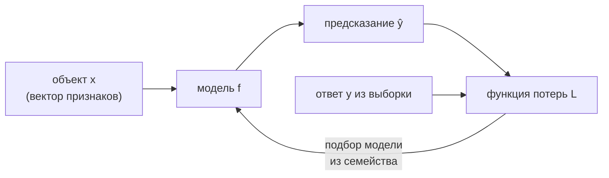

# Постановка задачи обучения с учителем
$$\boxed{\{(\boldsymbol x^{(i)},y^{(i)})\}_{i=1}^{n}\ +\ \text{семейство моделей}\ +\ \text{функция потерь}\ \Longrightarrow\ \text{лучшая модель семейства}}$$
Задача **ML** (Machine Learning) на размеченных данных: из семейства моделей выбирается та, что меньше всех ошибается на выборке

## Данные и знание [07:34](https://www.youtube.com/watch?v=k3UJOG-DKHE&t=454s)

ML окружает повседневность: колонка распознаёт речь (speech-to-text), большая языковая модель формирует ответ, text-to-speech его озвучивает; навигатор оценивает время в пути и пробки; фотография на телефоне наполовину дорисована алгоритмами

Вехи, которые выделяет лектор: в 2012 году AlexNet побил классические методы компьютерного зрения и вернул интерес к нейросетям; в 2016 году AlphaGo выиграла у Ли Седоля, "по-моему, чемпиона мира", со счётом 4:1

В шахматах Deep Blue обыграл Каспарова в 1997 году во многом перебором ходов, а в Go перебор невозможен из-за комбинаторного взрыва: помогли обучение с подкреплением и планирование. Те же методы применяют в науке, например на Большом адронном коллайдере в проекте Яндекс.ЦЕРН, в физике, биологии и биоинформатике [11:35](https://www.youtube.com/watch?v=k3UJOG-DKHE&t=695s)

Задача извлекать знание из данных старше ML [13:10](https://www.youtube.com/watch?v=k3UJOG-DKHE&t=790s). Кеплер вывел три закона движения планет из наблюдений Тихо Браге, а закон всемирного тяготения Ньютона описывает взаимодействие тел простой формулой

Эратосфен оценил радиус Земли по длинам полуденных теней в разных городах (предположив, что Земля — шар, а Солнце далеко). Знание бывает формулой, зависимостью или неформулируемой интуицией: ребёнок, видевший падения, знает, что отпущенная мышка упадёт

Отличие ML — часть этой работы берёт на себя алгоритм. Он слабее человека на малых данных и сильнее там, где данных больше, чем человек способен охватить: 300 миллионов фотографий человек не просмотрит, а [[Графический процессор|GPU]] обработает

## Обучение, выборка, объект, признак [20:03](https://www.youtube.com/watch?v=k3UJOG-DKHE&t=1203s)

> [!note] **Обучение с учителем** (supervised learning) — обучение на размеченных данных [20:03](https://www.youtube.com/watch?v=k3UJOG-DKHE&t=1203s)
> Для каждого объекта известен ответ. Разметку дают эксперты, толокеры (люди, размечающие данные вручную) или сама история: вчерашние признаки биржи и сегодняшняя цена образуют пару "признаки — ответ". Если ответов нет, это [[Постановка задачи обучения с учителем#^unsupervised|обучение без учителя]] ^supervised

> [!note] **Выборка** (датасет, dataset) — набор объектов, каждый из которых описан признаками [20:59](https://www.youtube.com/watch?v=k3UJOG-DKHE&t=1259s)
> В обучении с учителем к объектам добавлены ответы. Статистическое понятие [[Постановка задачи математической статистики|выборки]] устроено так же, только там наблюдения — числа, а здесь — векторы признаков вместе с ответами ^sample

> [!note] **Объект** (observation, datum) — наименьший элемент выборки [21:23](https://www.youtube.com/watch?v=k3UJOG-DKHE&t=1283s)
> Объект — не обязательно строка таблицы: молекула как граф (ядовита или нет), фотография, запись голоса, видео. Объектом служит всё, что можно представить в цифровом виде и обработать ^object

> [!note] **Признак** (feature, фича, предиктор) — одна из характеристик, в терминах которых описан объект [22:30](https://www.youtube.com/watch?v=k3UJOG-DKHE&t=1350s)
> Набор признаков одинаков у всех объектов выборки. Три вида:
> - **числовые**: возраст (целое неотрицательное число); на числах заданы порядок и линейные операции
> - **категориальные**: цвет глаз, родной язык; конечное множество значений, порядок не задан
> - **строки**: имя; значений бесконечно много, но строка тоже часть описания объекта
>
> Порядок на категориях навязать можно (по частоте цвета или по длине волны), но тогда это знание аналитика, а не свойство данных ^feature

![[student-table-anatomy.png|720]]

В лекции цель двойная: оценка по ML и флаг "прошёл курс"

## Кодирование признаков в вектор [24:45](https://www.youtube.com/watch?v=k3UJOG-DKHE&t=1485s)

Методы работают с векторами, поэтому любой признак приводится к числам, а объект — к вектору из $\mathbb R^p$ ([[n-мерное евклидово пространство|евклидово пространство]] признаков). Для сложных объектов (картинки, графы, аудио) строят информативные векторные представления — **эмбеддинги** (embeddings); как именно, лектор откладывает

### One-hot кодирование [25:20](https://www.youtube.com/watch?v=k3UJOG-DKHE&t=1520s)

> [!note] **One-hot кодирование** (dummy-кодирование) — флаг на каждую категорию
> Категориальный признак с $K$ значениями заменяется $K$ булевыми признаками: у объекта в флаге его категории стоит $1$, в остальных $0$. Вместо одной переменной получается вектор из $K$ компонент с единственной единицей

| Объект | Цвет глаз | `brown` | `blue` | `green` |
| --- | --- | --- | --- | --- |
| John | Brown | 1 | 0 | 0 |
| Aahna | Brown | 1 | 0 | 0 |
| Emily | Blue | 0 | 1 | 0 |
| Michael | Green | 0 | 0 | 1 |

Закодированные признаки склеиваются в один длинный вектор. Для John: возраст, оценки по статистике и Python как есть, затем флаги цвета глаз и языка. Имя в вектор не вошло: строка с бесконечным множеством значений требует отдельного кодирования, например эмбеддингом, и в этом примере опущена

$$\boldsymbol x^{(1)}=\bigl(\underbrace{22,\ 5,\ 4}_{\text{числовые}},\ \underbrace{1,0,0}_{\text{цвет глаз}},\ \underbrace{1,0,0,0,0}_{\text{язык}}\bigr)$$

### Target encoding и информативные представления [58:40](https://www.youtube.com/watch?v=k3UJOG-DKHE&t=3520s)

One-hot — самый "деревянный" способ, годный почти всегда. Если известно больше, лучше информативное векторное представление категории. При размеченных данных категорию можно заменить средним значением цели по этой категории (**target encoding**, он же mean encoding) или средним значением какой-то группы других переменных

> [!warning] Target encoding может привести к утечке цели в признаки [1:13:06](https://www.youtube.com/watch?v=k3UJOG-DKHE&t=4386s)
> Признак, посчитанный по ответам, уже содержит часть ответа. Для смешанных признаков общего рецепта нет: нужно понимать, как различие категорий повлияет на расстояния между объектами. One-hot без нормировки или весов даёт вклад либо слишком сильный, либо слишком слабый

Универсального лучшего кодирования нет. Самое эффективное — "умный" эмбеддер, учитывающий связи между объектами; по сути Word2Vec (Миколов, 2013) отображает категориальный признак "слово" в вектор с учётом контекста, в котором слова встречаются [31:56](https://www.youtube.com/watch?v=k3UJOG-DKHE&t=1916s)

## Независимость и одинаковая распределённость объектов [26:13](https://www.youtube.com/watch?v=k3UJOG-DKHE&t=1573s)

> [!important] Объекты выборки предполагаются i.i.d. [26:13](https://www.youtube.com/watch?v=k3UJOG-DKHE&t=1573s)
> Допущение i.i.d. (independent, identically distributed — независимые, одинаково распределённые) определено в матстате: [[Постановка задачи математической статистики|модель выборки]] и [[Независимость случайных величин|независимость]]. В ML оно значит:
> - **одинаково распределены**: все объекты порождены одним генератором, пришли из одной генеральной совокупности
> - **независимы**: возраст Джона, равный $22$, не влияет на возраст Эмили, равный $25$, и на то, попадёт ли Эмили в выборку

Допущение нужно, потому что на нём выводятся методы: при зависимых объектах многие из них применять некорректно. В итогах лекции лектор уточняет: на i.i.d. строится теоретическое обоснование методов, и важно понимать, когда оно нарушено (данные из разных распределений или явно зависимы), иначе методы могут дать неожиданный результат [1:34:28](https://www.youtube.com/watch?v=k3UJOG-DKHE&t=5668s). Допущение даёт право пользоваться аппаратом тервера, например [[Закон больших чисел|ЗБЧ]] и [[Центральная предельная теорема|ЦПТ]]

![[iid-violations.png|720]]

Белый медведь среди южноафриканских млекопитающих нарушает одинаковую распределённость, память шума во временном ряду — независимость

Признаки в левой выборке — вес, потребление калорий, длина шерсти; у белого медведя условия жизни другие, организм подчиняется другим законам, и гипотеза об общем распределении ломается

В ряду справа тренд и сезонность делают наблюдения распределёнными по-разному, а память шума означает, что каждое значение зависит от предыдущего. Поэтому временные ряды в простейшей постановке под i.i.d. не подходят. Лектор обещает позже построить для них представление, которое допущение уже удовлетворяет [33:13](https://www.youtube.com/watch?v=k3UJOG-DKHE&t=1993s)

> Лектор намеренно объясняет "на пальцах" и наращивает строгость постепенно: допущение здесь введено словами, строгая форма — по ссылкам выше

## Матрица объект-признак и цель [34:34](https://www.youtube.com/watch?v=k3UJOG-DKHE&t=2074s)

> [!note] **Матрица объект-признак** (матрица плана, design matrix) — все объекты в терминах признаков [35:04](https://www.youtube.com/watch?v=k3UJOG-DKHE&t=2104s)
> Строка — объект, столбец — признак; размер $n\times p$ для $n$ объектов и $p$ признаков. В sklearn её обозначают $X$. Это ещё не вся выборка: нет ответов ^design-matrix

> [!note] **Целевая переменная** (цель, таргет, target, зависимая переменная) — информация, которую нужно предсказать [36:06](https://www.youtube.com/watch?v=k3UJOG-DKHE&t=2166s)
> Обычно столбец ответов $\boldsymbol y$: по одному на объект. Матрица объект-признак $X$ и цель $\boldsymbol y$ вместе составляют выборку. Цель бывает:
> - **числом**: тогда это **задача регрессии**
> - **меткой из конечного множества без порядка** (в простейшем случае "да/нет"): тогда это **задача классификации**[^unordered]
> - **вектором**: векторная регрессия (вектор чисел) или набор меток ^target

Оценка по ML от $1$ до $5$ — число или метка (меток конечное число). Лектор откладывает вопрос и дальше работает с оценкой как с числом; слушатель позже возражает, что оценка — порядковая шкала, и ответ лектора разобран в заметке [[Функция потерь и эмпирический риск]]

> [!warning] Жаргон и однобуквенные имена
> Лектор называет "фичами", "таргетами" и "иксами" признаки, цели и объекты, но просит не называть объекты иксами: в sklearn $X$ — матрица объектов, $Y$ — цель, и однобуквенные имена переменных в коде заводить не стоит
>
> Лектор призывает не использовать sklearn в продакшене, если нет стопроцентной уверенности: библиотека писалась не для прода [35:25](https://www.youtube.com/watch?v=k3UJOG-DKHE&t=2125s)
>
> По его словам, линейные модели на C++ или Java "скорее всего чуть-чуть быстрее", и это важно при большом числе запросов в секунду; для бустинга лучше LightGBM, CatBoost и XGBoost с выгрузкой в Java и на GPU, для нейросетей нужны PyTorch, JAX или TensorFlow с автоматическим дифференцированием [40:16](https://www.youtube.com/watch?v=k3UJOG-DKHE&t=2416s)
>
> Правило касается и препроцессинга sklearn (энкодеров, скейлеров): маленькой команде с маленькой задачей, "наверное, всё ок, просто проверьте", серьёзной компании "рано или поздно это аукнется". Оно действует, пока не обоснуешь, что в твоём случае иначе, и риски берёшь на себя [1:31:26](https://www.youtube.com/watch?v=k3UJOG-DKHE&t=5486s)

[^unordered]: Лектор говорит "лишь бы они были из конечного множества и при этом упорядочены" (36:31; слово подтверждено перераспознаванием записи). Это оговорка: для классификации классы упорядочивать не нужно, категориальная цель номинальна (на 23:07 сам лектор говорит, что у категориальных величин порядок не задан), а упорядоченные метки дают уже порядковую шкалу, отдельный случай

## Формальная постановка [54:47](https://www.youtube.com/watch?v=k3UJOG-DKHE&t=3287s)

> [!summary] Три части постановки [54:47](https://www.youtube.com/watch?v=k3UJOG-DKHE&t=3287s)
> 1. **Выборка** из $n$ пар "объект — ответ": $\bigl\{(\boldsymbol x^{(i)},\,y^{(i)})\bigr\}_{i=1}^{n}$, где $\boldsymbol x^{(i)}\in\mathbb R^{p}$ — $i$-й объект, строка [[Постановка задачи обучения с учителем#^design-matrix|матрицы объект-признак]]: либо $p$ числовых признаков, либо вектор после кодирования. Ответ $y^{(i)}\in\mathbb R$ для регрессии и $y^{(i)}\in\{C_1,\dots,C_K\}$ для классификации с $K$ классами; в общем случае $y^{(i)}$ — вектор
> 2. **Модель** $f(\boldsymbol x)$ или семейство моделей, из которых выбирают; [[Функция потерь и эмпирический риск#^model|модель]] выдаёт предсказание $\hat y^{(i)}=f(\boldsymbol x^{(i)})$ для каждого объекта
> 3. **Функция потерь** $L(\boldsymbol x,y,f)$, которую нужно минимизировать: [[Функция потерь и эмпирический риск#^loss|функция потерь]] решает, какая модель лучше ^formal

Обозначения — как в Deep Learning Book (Гудфеллоу, Бенджио, Курвиль): жирный курсив — вектор, обычный курсив — его элемент, верхний индекс в скобках — номер объекта [44:23](https://www.youtube.com/watch?v=k3UJOG-DKHE&t=2663s)

## Как подходить к задаче [56:14](https://www.youtube.com/watch?v=k3UJOG-DKHE&t=3374s)

Любимый метод (бустинг, большая нейросеть, предобученная языковая модель) часто заработает, но подход некорректен. Порядок такой:

1. **Как измеряется качество**: функция потерь и метрика бизнеса или исследования. Только она определяет, что значит "хорошо" и "плохо"
2. **Сколько данных и сколько стоит их собрать**: данных мало и они дороги, а предобученных моделей нет — большие модели невыгодны, потому что придётся собрать много данных; данных много — подходит нейросеть; есть предобученная модель — ещё проще
3. **Какая модель** и с какими ограничениями

Без функции потерь можно выбрать неоптимальную модель: неизвестно, как её оценивать. Поэтому порядок слайда "выборка, модель, потеря" лектор читает со сдвигом: потеря, выборка, модель

## Регрессия и классификация [1:02:48](https://www.youtube.com/watch?v=k3UJOG-DKHE&t=3768s)

![[regression-vs-classification.png|720]]

Две классические задачи обучения с учителем, и почти все остальные сводятся к ним:

- **Регрессия**: провести через точки кривую или в общем случае гиперповерхность в $p$-мерном пространстве. Простейшая модель — [[Линейная регрессия в ML|линейная]] $\hat y=\boldsymbol w^{\top}\boldsymbol x+b$: линейная комбинация признаков плюс свободный член, чтобы прямая не была вынуждена проходить через ноль (статистическая сторона — [[Линейная регрессия|в матстате]])
- **Классификация**: разделить пространство признаков между классами. Простейшая модель на слайде — [[Логистическая регрессия|логистическая регрессия]] с сигмоидой; она разделяет два класса, на три класса картинка относится к методу ближайших соседей, о чём лектор сам оговаривается

Классификация, как правило, сводится к регрессии вероятности: предсказываемая величина должна быть не любым числом из $\mathbb R$, а вероятностью из $[0,1]$ или вектором вероятностей из $[0,1]$ с суммой, равной единице [1:04:06](https://www.youtube.com/watch?v=k3UJOG-DKHE&t=3846s)

Лектор возводит это в правило курса: "в классификации мы не метку класса предсказываем, а вероятностное распределение меток классов" [1:09:49](https://www.youtube.com/watch?v=k3UJOG-DKHE&t=4189s). Для двух классов это [[Схема испытаний Бернулли|бернуллиевская]] величина, и хватает одной вероятности $p$: вторая равна $1-p$. Как такое распределение получает [[Метод k ближайших соседей#Веса соседей|kNN с весами соседей]] — в его заметке

## Обучение без учителя [1:01:41](https://www.youtube.com/watch?v=k3UJOG-DKHE&t=3701s)

Если есть только объекты и нет $\boldsymbol y$, это **обучение без учителя** (unsupervised learning). Пример — кластеризация: ответа нет, и функционал для оптимизации придумывают под задачу. В курсе этот случай не разбирается ^unsupervised

Почти любая задача ML сводится к оптимизации некоторого функционала: его устремляют к минимуму, максимуму или экстремуму. Прежде чем выбирать метод, нужно понимать, что именно оптимизируется

## Оси данных и роль эксперта [1:34:47](https://www.youtube.com/watch?v=k3UJOG-DKHE&t=5687s)

> [!tip] Соглашение об осях: объекты, затем признаки [1:34:47](https://www.youtube.com/watch?v=k3UJOG-DKHE&t=5687s)
> Пока не оговорено иначе, нулевое измерение массива данных (по-программистски; первое по-математически) соответствует размеру выборки или подвыборки (батча), следующее — признакам. Это совпадает с [[Постановка задачи обучения с учителем#^design-matrix|матрицей объект-признак]]: объекты по строкам, признаки по столбцам. Временные ряды и упорядоченные во времени данные лектор обещает разобрать позже

> [!warning] Задачу ставит и ограничения задаёт эксперт-человек [1:35:54](https://www.youtube.com/watch?v=k3UJOG-DKHE&t=5754s)
> При правильной постановке и правильных ограничениях есть все шансы хорошо решить задачу; при неправильной результат будет плохим
