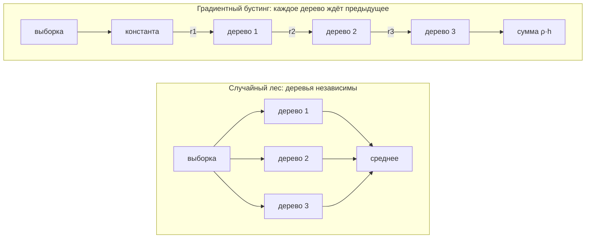

# Градиентный бустинг

$$\boxed{\hat f_T=\hat f_{T-1}+\rho_T\,h_T,\qquad h_T\approx r_T=-\frac{\partial L(y,q)}{\partial q}\Bigr|_{q=\hat f_{T-1}(\boldsymbol x)}}$$

Новая модель обучается не на ответы, а на направление, в котором надо сдвинуть предсказания ансамбля, чтобы потеря упала быстрее всего

## Постановка [22:01](https://www.youtube.com/watch?v=DqUtGa99_H8&t=1321s)

Есть выборка и функция потерь $L$. Тип задачи не важен: регрессия, классификация, что угодно, лишь бы потеря была дифференцируема [22:01](https://www.youtube.com/watch?v=DqUtGa99_H8&t=1321s). Оптимальная модель доставляет минимум потери на выборке или, в общем случае, по всему распределению данных

$$\hat f=\arg\min_{f}L\bigl(y,f(\boldsymbol x)\bigr)=\arg\min_{f}\mathsf E_{\boldsymbol x,y}\Bigl[L\bigl(y,f(\boldsymbol x)\bigr)\Bigr]$$

Ожидание лектор пишет, чтобы напомнить: ошибку нужно понижать не на обучающей выборке, а на данных, с которыми модель будет работать в продакшене [22:23](https://www.youtube.com/watch?v=DqUtGa99_H8&t=1343s) ([[Функция потерь и эмпирический риск|ожидаемый и эмпирический риск]]). На практике [[Математическое ожидание|ожидание]] заменяют средним по обучающей выборке, а при доступе к генератору данных берут его [23:02](https://www.youtube.com/watch?v=DqUtGa99_H8&t=1382s)

Что такое $f(\boldsymbol x)$, пока неясно, поэтому берётся **параметрическое семейство**: деревья, линейные модели, логистические регрессии — что угодно с параметрами [23:12](https://www.youtube.com/watch?v=DqUtGa99_H8&t=1392s). Остаётся найти оптимальные параметры

$$\hat f(\boldsymbol x)=f(\boldsymbol x,\widehat{\boldsymbol\theta}),\qquad\widehat{\boldsymbol\theta}=\arg\min_{\boldsymbol\theta}\mathsf E_{\boldsymbol x,y}\Bigl[L\bigl(y,f(\boldsymbol x,\boldsymbol\theta)\bigr)\Bigr]$$

Ансамбля здесь ещё нет. $\arg\min$ возвращает аргумент, доставляющий минимум, а $\min$ — само значение: $\arg\max$ оценок класса называет лучшего ученика, $\max$ даёт высший балл [46:41](https://www.youtube.com/watch?v=DqUtGa99_H8&t=2801s)

## Градиентный спуск в пространстве функций [24:00](https://www.youtube.com/watch?v=DqUtGa99_H8&t=1440s)

### Почему не спуск по параметрам дерева [24:40](https://www.youtube.com/watch?v=DqUtGa99_H8&t=1480s)

Спуск, который использовался на втором и третьем занятиях, для дерева не работает: потерю нельзя продифференцировать по параметрам дерева, потому что [[Решающее дерево#Градиентный спуск к дереву не применим|дерево — кусочно-постоянная функция]] [24:40](https://www.youtube.com/watch?v=DqUtGa99_H8&t=1480s)

### Идея [25:08](https://www.youtube.com/watch?v=DqUtGa99_H8&t=1508s)

Лектор просит функционального анализа не пугаться ("люди, которые хорошо шарят функциональный анализ, не кидайте помидорами", теорему Хана–Банаха доказывать не будут): рассмотрим пространство отображений из $\boldsymbol x$ в $y$, в котором каждая точка — целая модель, и пойдём по нему градиентным спуском [25:08](https://www.youtube.com/watch?v=DqUtGa99_H8&t=1508s). Похожесть видна на обычном спуске по весам [25:51](https://www.youtube.com/watch?v=DqUtGa99_H8&t=1551s) ([[Градиентный спуск]]):

$$\boldsymbol\omega_{k}=\boldsymbol\omega_0-\eta\sum_{t<k}\frac{\partial L}{\partial\boldsymbol\omega_t}\qquad\longleftrightarrow\qquad\hat f_T(\boldsymbol x)=\sum_{t}\rho_t\,h_t(\boldsymbol x)$$

слева веса — начальная точка плюс взвешенная сумма антиградиентов, справа модель — взвешенная сумма моделей. Отсюда мысль лекции [26:38](https://www.youtube.com/watch?v=DqUtGa99_H8&t=1598s): использовать модель, чтобы **аппроксимировать** (не абсолютно точно, но как можно ближе) антиградиент функции потерь по предсказаниям

### Что это значит на выборке

Потеря на выборке зависит от предсказаний на её объектах $q_i=f(\boldsymbol x^{(i)})$: это обычная функция $n$ переменных $\sum_iL(y^{(i)},q_i)$, и спуск по $\boldsymbol q=(q_1,\dots,q_n)$ — обычный спуск с шагом по антиградиенту $r_i=-\partial L/\partial q_i$

Беда в том, что $\boldsymbol q$ определён только на объектах обучения, а модель должна работать и на новых. Поэтому вектор $\boldsymbol r$ не прибавляют к $\boldsymbol q$ напрямую, а приближают моделью $h$, которая заодно обобщает его на весь $\boldsymbol x$

Почему приближение даёт убывание. Добавим к предсказаниям $\rho h$, где $h_i=h(\boldsymbol x^{(i)})$. По [[Дифференцируемость функции нескольких переменных|линейному приближению]]

$$\sum_iL\bigl(y^{(i)},q_i+\rho h_i\bigr)\approx\sum_iL\bigl(y^{(i)},q_i\bigr)-\rho\sum_ir_ih_i$$

Потеря падает тем быстрее, чем больше скалярное произведение $\langle\boldsymbol r,\boldsymbol h\rangle$ при фиксированной длине $\boldsymbol h$: [[Теория поля#Градиент|градиент указывает направление наибольшего роста]], антиградиент — наибольшего убывания. Регрессия на $\boldsymbol r$ с [[Функция потерь и эмпирический риск|MSE]] минимизирует $-2\langle\boldsymbol r,\boldsymbol h\rangle+\lVert\boldsymbol h\rVert^2$, потому что

$$\sum_i\bigl(r_i-h_i\bigr)^2=\lVert\boldsymbol r\rVert^2-2\langle\boldsymbol r,\boldsymbol h\rangle+\lVert\boldsymbol h\rVert^2$$

и $\lVert\boldsymbol r\rVert^2$ от модели не зависит. Если семейство можно умножать на число (значения в листьях дерева свободны), то минимум по масштабу даёт $\lVert\boldsymbol r\rVert^2-\langle\boldsymbol r,\boldsymbol h\rangle^2/\lVert\boldsymbol h\rVert^2$, и регрессия выбирает $h$ с наибольшим косинусом угла к $\boldsymbol r$: самую "параллельную" антиградиенту из доступных семейству

## Алгоритм [26:57](https://www.youtube.com/watch?v=DqUtGa99_H8&t=1617s)

Ансамбль, построенный за $T-1$ шаг, записывается суммой с нулевого члена, "потому что Фридман именно так предлагал" [27:02](https://www.youtube.com/watch?v=DqUtGa99_H8&t=1622s); нулевая модель — константа (слайд 23, [38:13](https://www.youtube.com/watch?v=DqUtGa99_H8&t=2293s)). Потеря зависит от $y$ и от предсказания $q$, свободной переменной ("хоть чебурашкой назовите": градиентному спуску всё равно, как называется аргумент, лишь бы функция по нему дифференцировалась [29:04](https://www.youtube.com/watch?v=DqUtGa99_H8&t=1744s))

> [!success] Шаг градиентного бустинга [26:57](https://www.youtube.com/watch?v=DqUtGa99_H8&t=1617s) ^algorithm
> $$
> \begin{aligned}
> \hat f_{T-1}(\boldsymbol x)&=\sum_{t=0}^{T-1}g_t(\boldsymbol x)\\
> r_T^{(i)}&=-\Bigl[\frac{\partial L\bigl(y^{(i)},q\bigr)}{\partial q}\Bigr]_{q=\hat f_{T-1}(\boldsymbol x^{(i)})},\qquad i=1,\dots,n\\
> \boldsymbol\theta_T&=\arg\min_{\boldsymbol\theta}\sum_{i=1}^{n}\bigl(r_T^{(i)}-h(\boldsymbol x^{(i)},\boldsymbol\theta)\bigr)^2\\
> \rho_T&=\arg\min_{\rho}\sum_{i=1}^{n}L\Bigl(y^{(i)},\ \hat f_{T-1}(\boldsymbol x^{(i)})+\rho\,h(\boldsymbol x^{(i)},\boldsymbol\theta_T)\Bigr)
> \end{aligned}
> $$
> Затем $\hat f_T=\hat f_{T-1}+\rho_Th_T$. На слайде 21 лектор поправляет индекс у $r$: стоит строчное $t$, нужно $T$ ("здесь должна быть $T$ большая, извините") [27:17](https://www.youtube.com/watch?v=DqUtGa99_H8&t=1637s). Под [[Производная функции|производной]] на слайде стоит $\hat f_T$, а нужен $\hat f_{T-1}$, как в строке для $\rho_t$ на том же слайде: это уточнение автора заметки

Что происходит на шаге:

1. На каждом объекте считается антиградиент потери по предсказанию ансамбля: куда сдвинуть ответ в пространстве ответов, чтобы потеря упала быстрее всего [28:35](https://www.youtube.com/watch?v=DqUtGa99_H8&t=1715s). Это тот же градиентный спуск, только по предсказаниям, а не по параметрам
2. Новая модель обучается как **регрессия** из $\boldsymbol x$ в $r$ с MSE, какой бы ни была исходная задача: антиградиент — число, а для векторного $y$ вектор той же размерности, что и предсказание [31:03](https://www.youtube.com/watch?v=DqUtGa99_H8&t=1863s). Потеря $L$ при этом может быть любой дифференцируемой, MSE стоит только в этой подзадаче
3. Вес $\rho_T$ задают константой, убывающей последовательностью или находят явно одномерной оптимизацией потери по $\rho$ [32:01](https://www.youtube.com/watch?v=DqUtGa99_H8&t=1921s)

> [!important] Мантра: каждая следующая модель учится на антиградиент функции ошибки предыдущего ансамбля [35:02](https://www.youtube.com/watch?v=DqUtGa99_H8&t=2102s)
> Лектор просит выучить её как мантру: точная формулировка помогает осознать метод, а зазубренная без понимания бесполезна [1:19:57](https://www.youtube.com/watch?v=DqUtGa99_H8&t=4797s). Антиградиент считается на каждом объекте отдельно, а одна модель приближает их сразу по всей выборке [55:03](https://www.youtube.com/watch?v=DqUtGa99_H8&t=3303s)
>
> В классификации лектор говорит об антиградиенте по вероятностям, а не по меткам: метка дискретна, ошибка по ней недифференцируема
>
> Библиотеки при этом ведут ансамбль в пространстве сырых оценок (логитов) и берут антиградиент по логиту, $y-\sigma(F)$: сумма деревьев по вероятности вышла бы из $[0,1]$ (раздел ниже; в `_gb.py` sklearn 1.9.1 "y - prob = neg_gradient")

Модель внутри бустинга сама по себе ничего не значит [43:44](https://www.youtube.com/watch?v=DqUtGa99_H8&t=2624s): каждая, кроме нулевой, приближает антиградиент потери всех предыдущих, без них — "антиградиент не пойми чего". Интерпретировать одно дерево бустинга в отрыве от остальных не стоит

Идти по антиградиенту "до упора" тоже не стоит [44:30](https://www.youtube.com/watch?v=DqUtGa99_H8&t=2670s): он ортогонален линиям уровня, пространство неоднородно, поэтому нужен шаг, а новая модель приближает антиградиент неточно, и после небольшого шага добавляется следующая

Чтобы узнать нужный шаг сразу по каждой оси, пришлось бы считать якобиан (так говорит лектор; в методе второго порядка это матрица вторых производных, гессиан), то есть брать метод второго порядка, а в многомерной задаче это сложно

Лектор откладывает метод второго порядка на вторую серию про нейросети и оптимизаторы и называет RMSProp линейным приближением такого поведения [45:49](https://www.youtube.com/watch?v=DqUtGa99_H8&t=2749s)

## Антиградиент для разных потерь

Антиградиент зависит от потери, и "остатки" $y-q$ — только один из вариантов:

| Потеря | $L(y,q)$ | Антиградиент $-\partial L/\partial q$ |
| --- | --- | --- |
| Квадратичная, $L=\frac12(y-q)^2$ | $\frac12(y-q)^2$ | $y-q$ |
| Квадратичная, как у лектора | $(y-q)^2$ | $2(y-q)$ |
| Абсолютная ([[Функция потерь и эмпирический риск\|MAE]]) | $\lvert y-q\rvert$ | $\operatorname{sign}(y-q)$ |
| Хьюбера, порог $\delta$ | $\frac12(y-q)^2$ при $\lvert y-q\rvert\leqslant\delta$, иначе $\delta\bigl(\lvert y-q\rvert-\frac\delta2\bigr)$ | $\operatorname{clip}(y-q,-\delta,\delta)$ |
| Экспоненциальная, $y=\pm1$ | $e^{-yq}$ | $y\,e^{-yq}$ |
| Логистическая, $y=\pm1$ | $\ln(1+e^{-yq})$ | $y/(1+e^{yq})$ |

![[gb-antigradient-losses.png]]

MSE здесь в форме $\frac12(y-q)^2$, поэтому около нуля совпадает с Хьюбером. Ограниченный антиградиент у MAE и Хьюбера не даёт большому остатку диктовать большой шаг, у экспоненты при отрицательном отступе он растёт экспоненциально

Это тот же "взрыв" экспоненты, о котором лектор предупреждает в [[Бустинг и AdaBoost|AdaBoost]] [19:59](https://www.youtube.com/watch?v=DqUtGa99_H8&t=1199s), и он же объясняет, почему подстановка экспоненциальной потери в общую схему даёт AdaBoost: производная экспоненты — экспонента [47:39](https://www.youtube.com/watch?v=DqUtGa99_H8&t=2859s)

Базовые модели в градиентном бустинге (**GBM** — gradient boosting machine) при этом регрессионные, а в AdaBoost классификаторы: лектор отвечает про общую схему, оговорку не разворачивает; для $h\in\{\pm1\}$ регрессия на антиградиент экспоненциальной потери совпадает с минимизацией взвешенной ошибки ([[Бустинг и AdaBoost|вывод]])

Для MSE производная $\dfrac{\partial}{\partial q}(y-q)^2=2(q-y)$, а то, на что учится модель, — антиградиент $2(y-q)$: он пропорционален отклонению предсказания от истинного значения

Производную лектор выводит на [37:48](https://www.youtube.com/watch?v=DqUtGa99_H8&t=2268s); на [40:17](https://www.youtube.com/watch?v=DqUtGa99_H8&t=2417s) он называет антиградиентом величину $2(q-y)$, а на [1:00:24](https://www.youtube.com/watch?v=DqUtGa99_H8&t=3624s), повторяя вывод, даёт $2(y-q)$

Множитель $2$ — вопрос договорённости: при $L=\frac12(y-q)^2$ антиградиент равен остатку $y-q$ без множителя, и [sklearn так и считает](https://scikit-learn.org/stable/modules/ensemble.html)[^half]; при $L=(y-q)^2$ множитель $2$ уходит в $\rho$

> [!warning] Остатки $y-q$ — антиградиент именно квадратичной потери [57:34](https://www.youtube.com/watch?v=DqUtGa99_H8&t=3454s)
> Фраза "каждая следующая модель корректирует ошибки (остатки) предыдущих" верна только для MSE. Для других потерь шаг идёт по антиградиенту, а не по остаткам: у MAE это знак остатка, у логистической потери — разность метки и вероятности
>
> Лектор подчёркивает это специально: регулярно остаётся в голове, что бустинг "обучается на ошибку", а надо "на антиградиент ошибки"; просто для MSE антиградиент — отклонение, потому что градиент квадратичной функции линеен [57:34](https://www.youtube.com/watch?v=DqUtGa99_H8&t=3454s)

В классификации модель выдаёт не метку, а число — логит $z$ или вероятность. Если предсказанием считать логит и вероятность $\sigma(z)$, то антиградиент логистической потери по $z$ равен $y-\sigma(z)$ для меток $y\in\{0,1\}$

Для кросс-энтропии $-\sum_kp_k\ln q_k$ (слово автора: лектор говорит "логистическая функция потерь") по вероятности $q_k$ класса $k$ антиградиент равен $p_k/q_k$

Лектор подводит итог лекции так: для логистической потери "будем учиться уже на не пойми что", это производная $p\ln q$ по $q$, "получается $p$ делить на $q$", потому что производная логарифма — единица, делённая на аргумент [1:31:05](https://www.youtube.com/watch?v=DqUtGa99_H8&t=5465s). Что именно считать предсказанием, определяет, чему учатся деревья: логит или вероятность

![[gb-outliers-mse-vs-mae.png]]

Шаг по знаку остатка даёт выбросу всего $\pm1$, поэтому пик вокруг него не растёт[^outliers]

[^half]: В [документации sklearn](https://scikit-learn.org/stable/modules/ensemble.html) сказано, что формула потери "описывает только половину настоящей функции потерь, кроме pinball и абсолютной ошибки". Для `squared_error` это значит $\frac12(y-q)^2$ и антиградиент $y-q$; в таблице строки для обоих вариантов, потому что лектор пишет $(y-q)^2$ и $2(y-q)$

[^outliers]: Числа не из лекции: градиентный бустинг на `reg1d` с четырьмя выбросами, деревья, глубина $2$, шаг $0.1$ и число деревьев $100$ одинаковы, различается только потеря; данные `reg1d` с прибавленными $+3$ в четырёх объектах (индексы $8,17,26,33$), `GradientBoostingRegressor` с `loss="squared_error"` и `loss="absolute_error"`; в sklearn деревья при `absolute_error` приближают знак остатка, а значения в листьях выбираются как медианы в смысле взвешенного процентиля sklearn (документация, раздел про функции потерь; с обычной `np.median` число $0.033$ было бы $0.052$, вывод тот же). Без выбросов те же настройки дают $0.057$ (MSE) и $0.026$ (MAE). Значения антиградиентов таблицы проверены в скрипте численной производной
## Демо с двумерным синусом [32:36](https://www.youtube.com/watch?v=DqUtGa99_H8&t=1956s)

Лектор открывает демо Алекса Рогожникова (слайд 22): поверхность $y(x_1,x_2)$ — двумерный "синус", колеблющийся по каждой оси, и модели, пытающиеся её приблизить. Дерево глубины $0$ — константа, судя по виду, среднее. Глубина $1$ — решающий пень, который описывает зависимость плохо

Глубина $2$ уже ловит максимумы и минимумы, глубины $3$–$6$ всё ближе; видно, что дерево — кусочно-постоянная функция с переходами только вдоль осей, и одно дерево "не очень эффективно" [33:18](https://www.youtube.com/watch?v=DqUtGa99_H8&t=1998s)

Затем ансамбль из $100$ деревьев, построенный по мантре выше [35:02](https://www.youtube.com/watch?v=DqUtGa99_H8&t=2102s). Глубина $0$ — сумма констант, то есть константа. Глубина $1$ — "уже не очень помогает"

Глубина $2$ — "достаточно неплохая" поверхность, лектор говорит, что она визуально практически не хуже одного дерева глубины $6$; глубина $3$ — почти идеальное описание, глубина $4$ — "почти уже нельзя придраться", $5$ и $6$ — практически идеально [35:37](https://www.youtube.com/watch?v=DqUtGa99_H8&t=2137s)

Ступеньки остаются, потому что сумма кусочно-постоянных функций кусочно-постоянна, но шаг так мал, что видны они только под углом; лектор оговаривает, что это может быть и артефакт отрисовки, а не ступенчатость деревьев [37:12](https://www.youtube.com/watch?v=DqUtGa99_H8&t=2232s)

![[gb-surface-depth.png]]

На глубине $1$ не работает ни дерево, ни бустинг: при любом пороге среднее $\sin\sin$ в каждой половине нулевое, и предсказание остаётся нулём. Это аддитивность из [[Бустинг и AdaBoost|AdaBoost]]: сумма функций одного признака не передаёт их произведение[^surface]

Ансамбль глубины $3$ точнее одного дерева глубины $6$, а ансамбль глубины $2$ хуже него: на этой поверхности по числам картина другая, чем на картинке лектора, который говорил про вид "визуально" и про свою поверхность. Ошибка на глубине $1$ — средний квадрат самой поверхности, то есть ошибка нулевого предсказания

[^surface]: На слайдах демо Рогожникова без чисел. Поверхность $\sin2\pi x_1\sin2\pi x_2$; бустинг — $100$ деревьев, шаг $0.1$. Поверхность без шума взята на сетке $30\times30$, ошибка — среднее квадрата расстояния до поверхности на сетке $100\times100$; глубина и число деревьев не выбираются, рисунок показывает, что делает глубина. У `DecisionTreeRegressor` на глубине $1$ прирост у любого порога порядка $10^{-14}$, то есть ноль с точностью до округления: пень формально делит выборку, но обе константы равны нулю до $10^{-17}$
### Пошаговое добавление деревьев [37:48](https://www.youtube.com/watch?v=DqUtGa99_H8&t=2268s)

Слева суммарный ансамбль, справа поверхность антиградиентов, для MSE — отклонений. Нулевая модель — константа, база индукции: шаг индукции описан алгоритмом [38:18](https://www.youtube.com/watch?v=DqUtGa99_H8&t=2298s)

Первое дерево глубины $3$ добавляется "более распластанным": лектор думает, что веса просто маленькие, и честно оговаривается "утверждать не готов" [39:22](https://www.youtube.com/watch?v=DqUtGa99_H8&t=2362s). С каждым деревом на карте остатков всё меньше структуры, по центру они похожи на "случайное блуждание около среднего", большие остаются на краю [40:57](https://www.youtube.com/watch?v=DqUtGa99_H8&t=2457s)

После $10$ деревьев глубины $3$ ансамбль описывает зависимость "очень даже будь здоров" [41:39](https://www.youtube.com/watch?v=DqUtGa99_H8&t=2499s)

Остатки торчат кусочками по центру потому, что ансамбль растёт ступеньками, а истинная зависимость локально близка к прямой: остаток на склоне растёт, падает на ступеньке и снова растёт [41:56](https://www.youtube.com/watch?v=DqUtGa99_H8&t=2516s)

Шкала остатков сжимается ($\pm0.5$, $\pm0.2$, $\pm0.1$ и так далее), так что картинка перерисовывается в более мелком масштабе; для глубины $4$ и выше значения лектор называет на глаз и сбивчиво, поэтому здесь сохранён только порядок величины: десять деревьев дают почти нулевой остаток, сто — идеальный [43:26](https://www.youtube.com/watch?v=DqUtGa99_H8&t=2606s)
## Пример с косинусом [56:30](https://www.youtube.com/watch?v=DqUtGa99_H8&t=3390s)

Пример из статьи ODS (Open Data Science) на Хабре (слайд 25 даёт ссылку)[^cos-origin] [56:52](https://www.youtube.com/watch?v=DqUtGa99_H8&t=3412s): один признак, $y=\cos x+\varepsilon$, шум $\varepsilon\sim\mathcal N\bigl(0,\tfrac15\bigr)$ ([[Нормальное распределение]]), $x\in[-5,5]$. [[Дисперсия]] $\tfrac15$, то есть $0{,}2$ [57:16](https://www.youtube.com/watch?v=DqUtGa99_H8&t=3436s)

Потеря MSE; базовые модели — деревья глубины $2$ ("это уже не решающие пни"); число итераций $M=3$; начальное значение — среднее [57:59](https://www.youtube.com/watch?v=DqUtGa99_H8&t=3479s)

Оговорка лектора: гиперпараметры в чистом эксперименте фиксируют заранее, здесь для наглядности размер наращивают, а чем больше гиперпараметров перебираешь, тем больше переобучаешься [58:06](https://www.youtube.com/watch?v=DqUtGa99_H8&t=3486s)

![[gb-cos-steps.gif|780]]

Первое дерево описывает отклонение от среднего; после его добавления остатки ещё несут сигнал, и второе и третье дерево учатся под него. Три дерева глубины $2$ дают "неплохую" аппроксимацию косинуса [59:39](https://www.youtube.com/watch?v=DqUtGa99_H8&t=3579s)

▶ [[boosting-песочница.html|Песочница градиентного бустинга]] — можно крутить число деревьев, шаг $\eta$ и глубину, переключать потерю MSE / MAE / Хьюбер, перетаскивать выбросы и смотреть, на каком антиградиенте учится следующее дерево и как меняются ансамбль и ошибка на обучении и на тесте

Шаг $\rho_t$ на рисунке не подбирался: для дерева, обученного на остатках по MSE, он равен единице. Для $L=\frac12(y-q)^2$ одномерный минимум по $\rho$ даёт

$$\rho^*=\arg\min_\rho\sum_i\frac{(r_i-\rho h_i)^2}{2}=\frac{\langle\boldsymbol r,\boldsymbol h\rangle}{\langle\boldsymbol h,\boldsymbol h\rangle}$$

а дерево предсказывает в листе $j$ среднее $c_j$ остатков листа, так что $\sum_{i\in j}r_ih_i=c_j\sum_{i\in j}r_i=n_jc_j^2=\sum_{i\in j}h_i^2$ и $\rho^*=1$. При $L=(y-q)^2$ антиградиент вдвое больше, лист возвращает $2c_j$, и $\rho^*=\tfrac12$: тот же шаг, множитель переехал с $h$ на $\rho$. Среднеквадратичная ошибка на обучении по шагам: $0.536$ (константа), $0.237$, $0.178$, $0.145$[^cos]

[^cos]: Не из лекции: на слайдах 25–26 другая реализация шума и без чисел; здесь $100$ точек, `DecisionTreeRegressor(max_depth=2)`, шаг $\rho_t$ посчитан по формуле, скрипт печатает $\rho_t=1.000$ на каждом шаге

[^cos-origin]: Лектор по памяти называет пример классическим, "по-моему, даже Фридмана" [56:52](https://www.youtube.com/watch?v=DqUtGa99_H8&t=3412s); подтверждения найти не удалось. [Статья ODS](https://habr.com/ru/companies/ods/articles/327250/) подаёт его как игрушечный пример без ссылки на автора
## Много простых деревьев вместо одного глубокого [48:25](https://www.youtube.com/watch?v=DqUtGa99_H8&t=2905s)

Вопрос из чата: что проще считать, $100$ деревьев глубины $2$ или одно глубины $6$? Лектор предлагает посчитать, сколько сравнений в дереве глубины $k$: $1$, $3$, $7$ для глубин $1$, $2$, $3$ [48:52](https://www.youtube.com/watch?v=DqUtGa99_H8&t=2932s). Получается $2^k-1$ предикатов[^nodes]

| Что считаем | $100$ деревьев глубины $2$ | Одно дерево глубины $6$ |
| --- | --- | --- |
| Предикатов (память) | $100\cdot(2^2-1)=300$ | $2^6-1=63$ |
| Сравнений на один объект (время предсказания) | $100\cdot2=200$ | $6$ |

Но ради качества в Random Forest нужны сильно переобученные деревья (скажем, $100$ деревьев глубины $100$ на [[Метод bootstrap|бутстреп]]-выборках со случайными подпространствами), а градиентный бустинг, по словам лектора, даёт сопоставимое качество на $100$ деревьях глубины $10$ [49:13](https://www.youtube.com/watch?v=DqUtGa99_H8&t=2953s)

Значит, он ещё и эффективнее, но "переобучается хорошо, надо быть аккуратным": утверждение лектор делает на слух, без чисел. Правило большого пальца: много простых моделей лучше малого числа сложных; доказательства лектор не встречал [53:43](https://www.youtube.com/watch?v=DqUtGa99_H8&t=3223s)

[^nodes]: Уточнение к счёту лектора. Числа $1$, $3$, $7$ — число предикатов во всём дереве, и это размер дерева (память, время обучения); при предсказании для одного объекта объект идёт по одному пути, то есть делает $k$ сравнений. Что "проще считать", зависит от того, что измерять

## Число деревьев и ранняя остановка [54:06](https://www.youtube.com/watch?v=DqUtGa99_H8&t=3246s)

> [!note] Число деревьев выбирается наращиванием ансамбля и остановкой по валидации [54:09](https://www.youtube.com/watch?v=DqUtGa99_H8&t=3249s) ^early-stopping
> Число деревьев — гиперпараметр, с которым "очень удобно": ансамбль наращивается последовательно, на валидации виден момент, когда он начал переобучаться, и можно вернуться на шаг назад, потому что весь прежний ансамбль известен. По существу это **ранняя остановка** (early stopping)

Гиперпараметры подбираются по валидации: "ничего умнее все равно нет", гладкого функционала, оптимум которого можно найти в теории, не существует, потому что всё зависит от выборки, потери, задачи и базовой модели [53:04](https://www.youtube.com/watch?v=DqUtGa99_H8&t=3184s) ([[Переобучение и валидация]])

Градиентный бустинг переобучается "упорно и эффективно": он ставит целью минимизацию потери на обучении и идёт по антиградиенту, тогда как деревья леса минимизируют ошибку жадным процессом

Поэтому ему нужно меньше деревьев для заданной ошибки и он быстро улетает в переобучение; контролировать качество на отложенной выборке и ограничивать сложность элементов ансамбля или их число — нужно [1:01:53](https://www.youtube.com/watch?v=DqUtGa99_H8&t=3713s)

Если модель переобучена, её в общем случае выбрасывают, а в бустинге можно выбросить последние деревья ансамбля; смотреть на валидацию можно после каждого дерева или каждой десятки, но чем чаще смотришь, тем больше "сливаешь" валидацию в обучение [1:20:21](https://www.youtube.com/watch?v=DqUtGa99_H8&t=4821s)

![[gb-iteration-curve.png|560]]

Валидация и test растут уже после нескольких деревьев, а train падает ниже дисперсии шума $0.2$ — нижней границы ошибки на новых данных, — потому что подгоняет шум

Выбор по валидации — $M=5$ (валидация $0.265$), на нём test равен $0.246$; после $400$ деревьев test $0.51$, вдвое хуже

Встроенная остановка sklearn (`n_iter_no_change=10`, пятая часть обучающей части на валидацию) останавливается на $12$ деревьях: это число деревьев после терпения в $10$ итераций без улучшения, а не лучшая итерация, и sklearn ансамбль не откатывает[^curve]

[^curve]: Числа не из лекции: лектор говорит об остановке по валидации словами. Данные — те же $\cos x+\varepsilon$, $\varepsilon\sim\mathcal N(0,\frac15)$, но $240$ точек и разбивка $70/30$; значение при $M$ — первые $M$ деревьев одного ансамбля из $400$; валидация — среднее по пяти блокам обучающей части. Шаг $0.3$ и глубина $4$ взяты крупными, чтобы переобучение было видно за десяток деревьев, и не подбирались
## Глубина дерева [54:31](https://www.youtube.com/watch?v=DqUtGa99_H8&t=3271s)

Для здорового ансамбля глубина $10$ или $12$ особой роли не играет: нужно решить, брать совсем неглубокие деревья, средние или очень глубокие, и последние лектор не рекомендует [54:31](https://www.youtube.com/watch?v=DqUtGa99_H8&t=3271s). На игрушечных данных из sklearn разница между $11$ и $12$ может быть заметной, но чем сложнее задача, тем меньше такая мелкая разница значит [54:50](https://www.youtube.com/watch?v=DqUtGa99_H8&t=3290s)

Вопрос из чата, взаимосвязаны ли число и глубина ("чем больше деревьев, тем меньше глубины можно брать"), лектор откладывает ("поговорю чуть дальше, там будут красивые картинки с функцией потерь") и отвечает общим правилом про валидацию и "много простых лучше мало сложных" [52:42](https://www.youtube.com/watch?v=DqUtGa99_H8&t=3162s); обещанных картинок в записи нет

## Шаг и число деревьев [32:01](https://www.youtube.com/watch?v=DqUtGa99_H8&t=1921s)

Для веса $\rho$ лектор перечисляет варианты: константа, убывающая последовательность или явный одномерный минимум [32:01](https://www.youtube.com/watch?v=DqUtGa99_H8&t=1921s). Константа, меньшая единицы, называется **шагом** или **темпом обучения** (learning rate, shrinkage) и записывается

$$\hat f_T=\hat f_{T-1}+\eta\,h_T,\qquad0<\eta\leqslant1$$

Модель приближает антиградиент неточно, поэтому небольшой шаг и добавление следующего члена надёжнее одного большого [44:54](https://www.youtube.com/watch?v=DqUtGa99_H8&t=2694s)

![[gb-zones-lr-trees.png]]

Малому шагу нужно больше деревьев, зато каждая добавка вносит меньший вклад в подгонку шума: сто деревьев при $\eta=0.01$ похожи на одно-два при $\eta=1$

При $\eta=1$ границу обрамляют всё более мелкие прямоугольники вокруг шума. При $\eta=0.01$ десять деревьев не сдвигают вероятность с $0.5$, хотя знак уже верный

Кросс-валидацией на обучающей части (пять блоков) выбрана ячейка $\eta=1$, $500$ деревьев (accuracy $0.914$), test $0.911$; следом идёт $\eta=0.1$, $100$ деревьев ($0.910$), test $0.889$. Разница между ячейками — один-два объекта: сетка показывает, как параметры двигают зону, а не какая ячейка лучше. Рекомендация документации sklearn — шаг $\eta\leqslant0.1$ и число деревьев, достаточное для ранней остановки[^lr]

[^lr]: `GradientBoostingClassifier` с деревьями глубины $2$ на `moons`; данные и разбивка те же, что у [[Решающее дерево|дерева]], [[Бэггинг|бэггинга]] и [[Случайный лес|леса]]. Не из лекции: сетка и числа посчитаны здесь; на слайдах нет сетки по шагу. Рекомендация — из раздела про усадку (shrinkage) в [документации sklearn](https://scikit-learn.org/stable/modules/ensemble.html), там же формула $F_m(x)=F_{m-1}(x)+\nu h_m(x)$. Таблица кросс-валидации по двенадцати ячейкам печатается расчётом рисунка

## Подвыборки, DART и другая базовая модель [49:50](https://www.youtube.com/watch?v=DqUtGa99_H8&t=2990s)

На вопрос, можно ли добавить в градиентный бустинг идеи Random Forest, чтобы он лучше обобщался (давать не все примеры, а только часть, и применять [[Оптимизаторы нейросетей|SGD]] вместо [[Градиентный спуск|GD]]), лектор отвечает "да" и называет DART [49:50](https://www.youtube.com/watch?v=DqUtGa99_H8&t=2990s)

Идея с подвыборкой объектов называется **стохастическим градиентным бустингом** (Stochastic Gradient Boosting), а DART — отдельный метод[^dart]

Базовым алгоритмом может быть "примерно что угодно": на каждом шаге можно учить не одно дерево, а случайный лес, работает "хорошо", и даже kNN ("не знаю зачем, но попробовать можете") [50:35](https://www.youtube.com/watch?v=DqUtGa99_H8&t=3035s)

Регуляризация бустинга — те же способы, что у базовых моделей (глубина дерева, веса), плюс ограничение числа моделей: бустинг сам по себе мета-алгоритм построения линейной комбинации [51:47](https://www.youtube.com/watch?v=DqUtGa99_H8&t=3107s). Разные базовые модели на разных шагах допустимы, "вам никто не запрещает" [56:10](https://www.youtube.com/watch?v=DqUtGa99_H8&t=3370s)

[^dart]: Уточнение к ответу лектора. Стохастический градиентный бустинг — Friedman, "Stochastic gradient boosting", Computational Statistics & Data Analysis 38 (2002); в sklearn это параметр `subsample`, подвыборка берётся без возвращения, типичное значение $0.5$ ([документация sklearn](https://scikit-learn.org/stable/modules/ensemble.html), список литературы там же). DART — K. V. Rashmi, R. Gilad-Bachrach, "DART: Dropouts meet Multiple Additive Regression Trees", **AISTATS** (International Conference on Artificial Intelligence and Statistics) 2015 ([arXiv:1505.01866](https://arxiv.org/abs/1505.01866)): в нём из ансамбля при построении очередного дерева случайно выбрасывают деревья по образцу dropout в нейросетях, чтобы поздние деревья не специализировались на немногих объектах. Это выбрасывание деревьев, а не подвыборка объектов, к которой лектор отнёс DART

Pruning в бустинге [1:29:39](https://www.youtube.com/watch?v=DqUtGa99_H8&t=5379s). Усекать дерево, которое уже приближало антиградиент, нельзя: следующие модели обучались на антиградиенте, посчитанном для старой версии, и для новой он "уже к этой модели никак не относится". Усечь можно последнее построенное дерево; усечение предыдущих лектор не видел ("может, там кто-то аккуратно это делал, но мне это не кажется адекватным") [1:30:12](https://www.youtube.com/watch?v=DqUtGa99_H8&t=5412s)

## Базовая модель: деревья, а не линейные модели [1:16:35](https://www.youtube.com/watch?v=DqUtGa99_H8&t=4595s)

Бустинг — линейная комбинация моделей [1:17:30](https://www.youtube.com/watch?v=DqUtGa99_H8&t=4650s), а линейная комбинация линейных моделей — линейная модель: $\sum_t\rho_t(\boldsymbol\omega_t^\top\boldsymbol x+b_t)=\boldsymbol\omega^{*\top}\boldsymbol x+b^*$. Из класса линейных моделей так не выбраться, поэтому бустинг над линейной регрессией бессмыслен [1:18:36](https://www.youtube.com/watch?v=DqUtGa99_H8&t=4716s)

Решающие пни можно: каждый выдаёт константу по одну сторону порога, лектор называет это линейной моделью плюс индикаторная функция [1:18:06](https://www.youtube.com/watch?v=DqUtGa99_H8&t=4686s) и по ходу оговаривается: "становится линейной. Тьфу, не линейной" [1:18:31](https://www.youtube.com/watch?v=DqUtGa99_H8&t=4711s)

Логистические регрессии можно (иногда так делают): каждая — сигмоида от $\boldsymbol\omega^\top\boldsymbol x+b$, а линейная комбинация сигмоид — не сигмоида от линейной комбинации [1:18:58](https://www.youtube.com/watch?v=DqUtGa99_H8&t=4738s). Лектор упоминает картинку, где кучей линейных моделей отделяют центр от окружающего "бублика"

Линейная регрессия на преобразованных признаках (квадраты, логарифмы), одной и той же пачке на каждом шаге, тоже ничего не даёт: получится линейная комбинация линейных моделей над теми же признаками. Если признаки менять на каждом шаге, то отличие от одной регрессии над объединением признаков неясно [1:21:18](https://www.youtube.com/watch?v=DqUtGa99_H8&t=4878s)

Почему бустинг над линейной регрессией не просто бесполезен, а даёт ту же [[Линейная регрессия|МНК]]-прямую. При точном шаге $\rho=1$ (как в алгоритме выше) после первого шага остатки ортогональны столбцам признаков и константе (нормальное уравнение, [[Линейная регрессия в ML]]), поэтому следующая регрессия на остатки возвращает нулевую функцию

На `reg1d`: первый шаг даёт наклон $-1.6256$ и сдвиг $0.7758$, ровно как одна МНК-регрессия, а наклон и сдвиг второй и третьей модели порядка $10^{-16}$, то есть ансамбль не меняется

При шаге $\eta<1$ остаток после первого шага уже не ортогонален признакам, вторая модель равна $(1-\eta)$ от первой, и ансамбль за много шагов сходится к той же прямой как $1-(1-\eta)^t$: класс функций остаётся линейным[^linear]

[^linear]: Не из лекции: число и вычисление мои; проверка — максимальная разность предсказаний ансамбля и одной МНК-регрессии по выборке равна $2\cdot10^{-16}$
## Параллелизация [1:00:33](https://www.youtube.com/watch?v=DqUtGa99_H8&t=3633s)

Random Forest удобен, когда много параллельных вычислителей: каждое дерево обучается на своём ядре и применяется на своём, а если часть вычислений упала, лес стал не из $10000$ деревьев, а из $9999$, и "вообще плевать" [1:00:33](https://www.youtube.com/watch?v=DqUtGa99_H8&t=3633s)

В бустинге предсказание можно считать параллельно по деревьям, потому что все они уже обучены, а обучение строго последовательное: чтобы учить $t+1$-е дерево, нужно обучить $t$-е. Если упала вторая модель, весь ансамбль выбрасывается, так как всё после неё опирается на её предсказание [1:01:18](https://www.youtube.com/watch?v=DqUtGa99_H8&t=3678s)

На слайде 27: лес параллелится на уровне леса, бустинг — на уровне одного дерева, внутри его построения

## Градиентный бустинг и нейросети [1:22:05](https://www.youtube.com/watch?v=DqUtGa99_H8&t=4925s)

Лектор: градиентный бустинг — "последний, наверное, алгоритм, который всё ещё где-то в районе продакшена борется стабильно и устойчиво с нейронными сетями", и "судя по всему, он тоже сдастся" за пару исключений [1:22:14](https://www.youtube.com/watch?v=DqUtGa99_H8&t=4934s)

Одно исключение — интерпретируемость, которой посвящено занятие про важность признаков: у дерева в каждой вершине видно, по какому признаку разбили, а нейросеть считает линейную комбинацию латентных представлений предыдущего слоя [1:22:28](https://www.youtube.com/watch?v=DqUtGa99_H8&t=4948s)

Нейросети не противопоставляются классическим моделям, а продолжают их: нелинейную границу можно строить жадно (дерево), итеративно (бустинг: каждая итерация при всех зафиксированных предыдущих) или непрерывно ([[Нейронная сеть|нейросеть]]: движение по антиградиенту сразу по всем промежуточным представлениям) [1:23:22](https://www.youtube.com/watch?v=DqUtGa99_H8&t=5002s)

Вопрос чата: обгонят ли нейросети градиентный бустинг на маленьком датасете [1:24:51](https://www.youtube.com/watch?v=DqUtGa99_H8&t=5091s)

Если домен общий и на нём уже обучались ([[История глубокого обучения|BERT]] с $2018$ года на маленьких наборах), нейросеть выигрывает: например, классификатор токсичных текстов она даёт за "минут пять" против получаса кода с **TF-IDF** (term frequency — inverse document frequency) и мешком слов и бустингами, и по качеству лучше

Если домен совсем новый и данных мало, нейросеть проигрывает: параметров много, данных мало; но "сколько у нас таких реальных задач, одна на миллион". Бустинг обучить проще, а нейросеть "при должном старании" даст сопоставимые результаты при примерно той же вычислительной сложности [1:28:37](https://www.youtube.com/watch?v=DqUtGa99_H8&t=5317s)

Общего рецепта против переобучения нет: лучше начинать с простых моделей и усложнять, чем наоборот [1:26:48](https://www.youtube.com/watch?v=DqUtGa99_H8&t=5208s)

## Дерево, лес и бустинг на одних данных

![[ensembles-zones-datasets.png]]

На тесте из $90$ объектов один объект весит $0.011$[^compare]

| Набор | Одно дерево | Случайный лес | AdaBoost на пнях | Градиентный бустинг |
| --- | --- | --- | --- | --- |
| `moons` | $0.92$ / $0.89$ | $0.91$ / $0.92$ | $0.90$ / $0.91$ | $0.91$ / $0.89$ |
| `circles` | $0.94$ / $0.97$ | $0.97$ / $0.97$ | $0.97$ / $0.96$ | $0.98$ / $0.96$ |
| `xor` | $0.93$ / $0.94$ | $0.94$ / $0.94$ | $0.62$ / $0.59$ | $0.93$ / $0.93$ |

В ячейках таблицы — валидация (среднее по блокам) и test

Четыре модели расходятся не больше чем на три объекта теста, кроме AdaBoost на `xor`: пни не умеют взаимодействие признаков ([[Бустинг и AdaBoost|причина]])

Бустинг глубину выбирает под набор: на `circles` кросс-валидация берёт пни (глубина $1$, граница-прямоугольник собирается из ступенек по двум осям), на `xor` и `moons` — глубину $2$, где один предикат видит оба признака

[^compare]: Строки рисунка — `moons`, `circles`, `xor` с теми же разбивками, что у [[Решающее дерево|дерева]], [[Случайный лес|леса]] и [[Бустинг и AdaBoost|AdaBoost]]. Гиперпараметры каждой модели подобраны кросс-валидацией на обучающей части (пять блоков). Числа не из лекции: у лектора на слайде 40 в прошлой лекции лес и $3$-NN на одной выборке, а бустинг на двумерных наборах он не сравнивает. Сетки подбора: дерево — `max_depth` $\in\{2,3,4,5,6,8,10,\text{None}\}$, `min_samples_leaf` $\in\{1,5,10\}$; лес из $200$ деревьев — `max_depth` $\in\{3,5,8,\text{None}\}$, `min_samples_leaf` $\in\{1,5\}$; AdaBoost на пнях — число пней $\{10,50,200\}$, шаг $\{0.1,0.5,1.0\}$; бустинг — число деревьев $\{50,200\}$, глубина $\{1,2,3\}$, шаг $\{0.05,0.2\}$
## Бустинг среди ансамблей

Строка "Бустинг" из таблицы "Сравнение видов ансамблей" перенесена сюда из заметки об ансамблях и сверена с лекцией[^handbook]:

| Что написано | Что точнее |
| --- | --- |
| Цель — снижение смещения ($\mathrm{Bias}$) | Совпадает с лекцией: на каждом шаге ансамбль усложняется, смещение суммарной модели падает, а разброс растёт [1:14:56](https://www.youtube.com/watch?v=DqUtGa99_H8&t=4496s). Оборотная сторона — быстрое переобучение, выше в разделе про число деревьев; разложение ошибки — [[Разложение на смещение и разброс]] |
| Принцип — последовательное обучение моделей, где каждая следующая корректирует ошибки (остатки) предыдущих | Остатки $y-q$ — антиградиент только квадратичной потери ([[Градиентный бустинг#Антиградиент для разных потерь\|раздел выше]]); в общем случае модель учится на антиградиент потери по предсказаниям ансамбля |
| Пример — градиентный бустинг, "основной метод для работы с табличными данными, использующий неглубокие деревья" | Лектор про табличные данные не говорит; он называет бустинг последним алгоритмом, который ещё борется с нейросетями в продакшене; про глубину: много простых моделей лучше малого числа сложных, а между глубиной $10$ и $12$ на серьёзных задачах разница мала |

[^handbook]: Строка таблицы из [Handbook Яндекса](https://education.yandex.ru/handbook/ml/article/ansambli-v-mashinnom-obuchenii), страница проверена: в строке бустинга стоят цель "снижение смещения", принцип "последовательное обучение моделей, где каждая последующая модель корректирует ошибки (остатки) предыдущих" и пример "градиентный бустинг — основной метод для работы с табличными данными, использующий неглубокие деревья". Остальные строки таблицы (бэггинг, стекинг) относятся к другим заметкам
