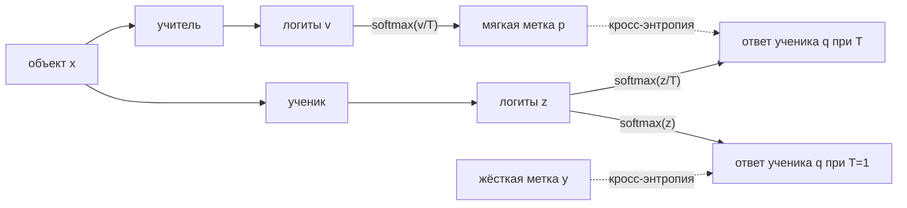

# Дистилляция знаний

$$\boxed{L=\lambda\,H\bigl(y,\,q^{(1)}\bigr)+(1-\lambda)\,T^{2}\,H\bigl(p^{(T)},\,q^{(T)}\bigr)},\qquad q^{(T)}=\mathrm{softmax}\Bigl(\frac zT\Bigr),\quad p^{(T)}=\mathrm{softmax}\Bigl(\frac vT\Bigr)$$

Ученик с логитами $z$ учится не только на жёсткой метке $y$, но и на распределении учителя с логитами $v$; $H(p,q)$ — [[Энтропия и кросс-энтропия|кросс-энтропия]]. Лектор разбирает мягкую часть, смесь с жёсткой частью и множитель $T^2$ взяты из статьи Хинтона[^mix]

[^mix]: Hinton G., Vinyals O., Dean J., ["Distilling the Knowledge in a Neural Network"](https://arxiv.org/pdf/1503.02531), 2015, раздел 2: "weighted average of two different objective functions"; жёсткая часть считается на тех же логитах при температуре $1$, мягкая — при температуре, которой получены мягкие метки, и "it is important to multiply them by $T^2$"; после обучения ученик работает при $T=1$. Вес жёсткой части обозначен здесь $\lambda$, чтобы не путать с $\alpha$ из других заметок курса

## Два этапа жизни модели [08:22](https://www.youtube.com/watch?v=9m4ytptOer4&t=502s)

До этой лекции курс решал задачу $X\to Y$: минимизировать ошибку на обучающей выборке и проверять её на валидации. Как модель потом будут эксплуатировать, не учитывалось [07:44](https://www.youtube.com/watch?v=9m4ytptOer4&t=464s). У модели два этапа:

- обучение: модель строит цепочку промежуточных представлений и линейный классификатор над ними, стартует со случайных весов, учится на размеченных данных, параметров много, процесс долгий
- использование: эксплуатация на практике

Лектор подводит к этому через вопрос, который приписывает Хинтону: одинакова ли цель жизни у гусеницы и у бабочки [04:25](https://www.youtube.com/watch?v=9m4ytptOer4&t=265s). Цели разные, значит, и устройство нужно разное [07:07](https://www.youtube.com/watch?v=9m4ytptOer4&t=427s)[^insects]. Обучать модель с нуля на размеченных данных тяжело ещё и потому, что метки несут для неё мало полезных свойств [09:43](https://www.youtube.com/watch?v=9m4ytptOer4&t=583s)

[^insects]: Аналогия есть во введении статьи Хинтона, и она про те же два этапа: обучение вытягивает структуру из больших избыточных данных и не ограничено временем, а развёртывание предъявляет жёсткие требования к задержке и вычислительным ресурсам ([arXiv:1503.02531](https://arxiv.org/pdf/1503.02531)). Лектор про задержку и память в этом сюжете не говорит

## Мягкие метки [09:49](https://www.youtube.com/watch?v=9m4ytptOer4&t=589s)

Лектор берёт $10$ классов картинок: Lada, три немецкие марки (Audi, BMW, Mercedes), КАМАЗ и грибы [10:08](https://www.youtube.com/watch?v=9m4ytptOer4&t=608s). Обученная модель получает фотографию Audi вне обучающей выборки и не выдаёт $100\,\%$ Audi [11:35](https://www.youtube.com/watch?v=9m4ytptOer4&t=695s). Вероятности машин выше, чем грибов, у немецкой тройки выше, чем у КАМАЗа и Lada, внутри тройки доминирует Audi. Числа — иллюстрация лектора, не запуск:

| Класс | Жёсткая метка | Выход учителя |
| --- | --- | --- |
| Audi | $100\,\%$ | $45\,\%$ |
| BMW и Mercedes вместе | $0$ | $40\,\%$ |
| Lada | $0$ | около $10\,\%$ |
| КАМАЗ (мусоровоз) | $0$ | $5\,\%$ |
| грибы | $0$ | около нуля |

Второй вектор информативнее: раз модель одинаково уверена в BMW и Mercedes, объект похож на оба [13:52](https://www.youtube.com/watch?v=9m4ytptOer4&t=832s). Жёсткие метки — ортогональные направления в целевом пространстве, без иерархии вроде "машина — немецкая машина — Audi" [14:46](https://www.youtube.com/watch?v=9m4ytptOer4&t=886s)

Классификатор при обучении выучивает не только "BMW или нет", но и обобщение вроде "машина или гриб" [14:11](https://www.youtube.com/watch?v=9m4ytptOer4&t=851s). Этот сигнал можно отдать более простой модели, которая сама такой путь не прошла бы [15:22](https://www.youtube.com/watch?v=9m4ytptOer4&t=922s)

**Мягкая метка** (soft label) — любое распределение на классах, кроме one-hot; определение и оценки потерь для неё — в [[Энтропия и кросс-энтропия#Многоклассовая кросс-энтропия и мягкие метки [L08 22 54](https //www.youtube.com/watch?v=9m4ytptOer4&t=1374s)|заметке про кросс-энтропию]]

### Тёмное знание

Название **тёмное знание** (dark knowledge) лектор не употребляет, оно из доклада Хинтона, Виньялса и Дина[^dark]. Тёмное знание — информация, которая лежит в малых вероятностях неправильных классов: их отношения говорят, на какие классы объект похож больше. На цифрах это видно прямо: логистическая регрессия-учитель на $8\times8$ картинках, три тестовых объекта, вероятности по десяти классам на логарифмической оси

![[distill-dark-knowledge.png|900]]

При $T=1$ правильный класс получает $0.99$ и больше. После семёрки учитель ставит девятку ($4\cdot10^{-4}$) на три порядка выше шестёрки ($3\cdot10^{-7}$), после девятки — пятёрку ($5\cdot10^{-3}$) на три порядка выше четвёрки ($3\cdot10^{-6}$)

При $T=4$ вторые места получают $0.08$–$0.15$[^digits]

Логарифм отношения вероятностей двух неправильных классов — разность их логитов, делённая на температуру: $\ln\dfrac{p_i}{p_j}=\dfrac{v_i-v_j}{T}$ ([[Softmax с температурой|подробно про softmax]]). Новой информации температура не создаёт: она сжимает диапазон, и малые вероятности становятся различимы. При $T=1$ [[Теория поля|градиент]] по логиту такого класса не больше порядка $10^{-4}$, и ученику почти безразлично, угадает ли он $10^{-4}$ или $10^{-7}$

▶ [[softmax-песочница.html|Песочница softmax]] — можно крутить логиты учителя и температуру, смотреть, как мягкая метка отличается от one-hot и как растёт энтропия

[^dark]: Слайды Hinton G., Vinyals O., Dean J., ["Dark knowledge"](https://www.ttic.edu/dl/dark14.pdf), 2014: "Softened outputs reveal the dark knowledge in the ensemble". В статье 2015 года этого слова нет, но тот же довод изложен словами: "much of the information about the learned function resides in the ratios of very small probabilities in the soft targets", в примере цифры $2$ с вероятностями $10^{-6}$ быть $3$ и $10^{-9}$ быть $7$; эти малые вероятности почти не влияют на кросс-энтропию, потому что близки к нулю ([arXiv:1503.02531](https://arxiv.org/pdf/1503.02531))

[^digits]: Не из лекции. Данные — `load_digits` из scikit-learn, $1797$ картинок $8\times8$, тест $30\,\%$, признаки поделены на $16$; учитель — `LogisticRegression` с $C=10$, выбранным 5-кратной кросс-валидацией по $\{0.01,0.1,1,10\}$ на обучающей части, точность на тесте $0.967$. Объекты — первые верно классифицированные тестовые цифр $3$, $7$ и $9$; $T=4$ взят для иллюстрации, не подбирался. Вероятности второго и третьего места: для $3$ — цифры $2$ ($6.4\cdot10^{-3}$) и $8$ ($1.5\cdot10^{-3}$), для $7$ — $9$ ($4.2\cdot10^{-4}$) и $3$ ($2.0\cdot10^{-4}$), для $9$ — $5$ ($4.7\cdot10^{-3}$) и $3$ ($1.7\cdot10^{-3}$); при $T=4$: $0.146$ и $0.102$, $0.083$ и $0.069$, $0.123$ и $0.096$

## Учитель и ученик [15:32](https://www.youtube.com/watch?v=9m4ytptOer4&t=932s)

Есть обученная модель-**учитель** (teacher) и более простая модель-**ученик** (student); термины из статьи Хинтона 2015 года [15:41](https://www.youtube.com/watch?v=9m4ytptOer4&t=941s). Предсказание учителя берётся как разметка для ученика, если учитель достаточно адекватен [16:46](https://www.youtube.com/watch?v=9m4ytptOer4&t=1006s). Лектор сравнивает это с образованием: тот, кто освоил или создал знание, передаёт его, а ученик учится быстрее; из данных "информативности $k$" учитель делает данные "информативности $2k$" [16:26](https://www.youtube.com/watch?v=9m4ytptOer4&t=986s)

Температура учителя дописана по слайду $6$, жёсткая ветка с $y$ и смесь потерь — по статье Хинтона[^mix]

## Потеря дистилляции [22:54](https://www.youtube.com/watch?v=9m4ytptOer4&t=1374s)

Вместо one-hot метки в кросс-энтропию подставляется распределение учителя: $p$ — от учителя, $q$ — от ученика [23:47](https://www.youtube.com/watch?v=9m4ytptOer4&t=1427s)

$$C=-\sum_{i=1}^Np_i\ln q_i,\qquad \frac{\partial C}{\partial z_i}=\frac1T\bigl(q_i-p_i\bigr)$$

Вывод градиента — [[Энтропия и кросс-энтропия#^softmax-ce-gradient|в заметке про кросс-энтропию]], через логарифм softmax, а [[Softmax с температурой#Градиент кросс-энтропии по логитам [0 24 23](https //www.youtube.com/watch?v=9m4ytptOer4&t=1463s)|через правило частного]] — как у лектора. Кросс-энтропия с мягкой целью отличается от [[Энтропия и кросс-энтропия#Дивергенция Кульбака–Лейблера|KL-дивергенции]] константой $H(p)$, и градиенты по параметрам ученика у них одни

Смесь с жёсткой частью и вес $\lambda$ — вклад Хинтона. Градиент всей потери по логиту ученика складывается из двух слагаемых, у мягкого стоит $T$ вместо $\frac1T$ из-за множителя $T^2$ (зачем он, ниже)[^mix]:

$$\frac{\partial L}{\partial z_i}=\lambda\bigl(q^{(1)}_i-y_i\bigr)+(1-\lambda)\,T\bigl(q^{(T)}_i-p^{(T)}_i\bigr)$$

## Высокая температура: регрессия на логитах [26:02](https://www.youtube.com/watch?v=9m4ytptOer4&t=1562s)

Лектор смотрит, во что превращается градиент мягкой части при высокой температуре. По разложению из [[Softmax с температурой|заметки про softmax]] $q_i\approx\frac1N+\frac{z_i-\bar z}{NT}$, где $\bar z$ — среднее логитов, а для $p_i$ то же самое с $v$ [26:14](https://www.youtube.com/watch?v=9m4ytptOer4&t=1574s). Вычитание даёт

$$\frac{\partial C}{\partial z_i}=\frac1T\bigl(q_i-p_i\bigr)\approx\frac1T\cdot\frac{(z_i-\bar z)-(v_i-\bar v)}{NT}=\frac{(z_i-\bar z)-(v_i-\bar v)}{NT^2}$$

Лектор записывает то же в слайдах $7$–$8$ через сумму логитов: при $\sum_jz_j=\sum_jv_j=0$ остаётся $\dfrac{z_i-v_i}{NT^2}$ [27:02](https://www.youtube.com/watch?v=9m4ytptOer4&t=1622s). Центрировать можно без потерь: softmax не меняется от вычитания константы из всех логитов [26:32](https://www.youtube.com/watch?v=9m4ytptOer4&t=1592s). Это градиент среднеквадратичной ошибки:

$$\frac{z_i-v_i}{NT^2}=\frac{1}{2NT^2}\,\frac{\partial}{\partial z_i}(z_i-v_i)^2$$

> [!success] При высокой температуре классификация по мягким меткам — регрессия логитов учителя [27:31](https://www.youtube.com/watch?v=9m4ytptOer4&t=1651s)
> Условия: $T$ велика по сравнению с модулями логитов (иначе первый порядок разложения экспоненты неверен), логиты центрированы отдельно для каждого объекта. Тогда ученик подгоняет вектор учителя по [[Функция потерь и эмпирический риск|MSE]], как в [[Градиентный бустинг|градиентном бустинге]] для регрессии [27:46](https://www.youtube.com/watch?v=9m4ytptOer4&t=1666s)

Градиент сжимается как $1/T^2$, и в смеси с жёсткой частью, у которой $T$ не входит, вес мягкой части молча падал бы при росте $T$. Множитель $T^2$ компенсирует это: при $T$ много больше модулей логитов $T(q_i-p_i)\to\frac{z_i-v_i}{N}$, величина, не зависящая от $T$, и $\lambda$ сохраняет смысл при смене температуры[^t2]

| $T$ | $\frac1T(q_1-p_1)$ | $T\,(q_1-p_1)$ | $\frac{z_1-v_1}{N}$ |
| --- | --- | --- | --- |
| $1$ | $0.2442$ | $0.2442$ | $0.3333$ |
| $2$ | $0.0925$ | $0.3699$ | $0.3333$ |
| $5$ | $0.0150$ | $0.3749$ | $0.3333$ |
| $20$ | $0.00087$ | $0.3465$ | $0.3333$ |

[^t2]: У лектора множителя $T^2$ нет, он говорит о масштабе $\frac1{NT^2}$ только как о константе в слайде $8$, а довод про $T^2$ — из статьи Хинтона, которая пишет, что без множителя относительный вклад жёстких и мягких целей менялся бы вместе с температурой ([arXiv:1503.02531](https://arxiv.org/pdf/1503.02531), раздел 2). Числа в таблице не из лекции: посчитаны по формулам выше для $N=3$, логитов ученика $z=(2,-1,-1)$ и учителя $v=(1,0,-1)$, оба центрированы, $i=1$, точный softmax. Логиты малы только относительно больших $T$, поэтому при $T=1$ и $2$ колонка ещё не вышла на предел. Статья там же называет сопоставление логитов частным случаем дистилляции и замечает, что при низких температурах дистилляция меньше внимания уделяет логитам, которые намного ниже среднего

Температура — ручка, задающая, насколько внимательно ученик смотрит на мелкие различия учителя [31:59](https://www.youtube.com/watch?v=9m4ytptOer4&t=1919s). При высокой учитываются все логиты [30:32](https://www.youtube.com/watch?v=9m4ytptOer4&t=1832s). При низкой разности [[Softmax с температурой#Температура растягивает или сжимает разности логитов [0 30 49](https //www.youtube.com/watch?v=9m4ytptOer4&t=1849s)|растягиваются]], малые логиты уходят в нулевую вероятность, и ученик следит за большими, то есть за похожими классами [30:49](https://www.youtube.com/watch?v=9m4ytptOer4&t=1849s)

## Промежуточные слои [28:49](https://www.youtube.com/watch?v=9m4ytptOer4&t=1729s)

То же сопоставление векторов можно делать не только на последнем слое, но и на всех промежуточных представлениях: так обучается DistilBERT [29:07](https://www.youtube.com/watch?v=9m4ytptOer4&t=1747s)[^bert]. Нейросеть — последовательность непрерывных дифференцируемых отображений, и ученику показывают не один прыжок от входа к ответу, а путь [29:22](https://www.youtube.com/watch?v=9m4ytptOer4&t=1762s). Образ лектора: мастер спорта поднимается на гору и расставляет флажки, а новичок идёт по ним [29:34](https://www.youtube.com/watch?v=9m4ytptOer4&t=1774s)

Пример на пальцах: учитель из $10$ слоёв шириной $512$, ученик из $5$ слоёв шириной $64$. Выход каждого второго слоя учителя отображается в выход очередного слоя ученика, и ученик получает цель посередине сети [38:44](https://www.youtube.com/watch?v=9m4ytptOer4&t=2324s):

| Слой ученика | $1$ | $2$ | $3$ | $4$ | $5$ |
| --- | --- | --- | --- | --- | --- |
| Слой учителя | $2$ | $4$ | $6$ | $8$ | $10$ |

Какую потерю брать между слоями, лектор не уверен: "ну, не знаю, MSE какую-нибудь" или MSE "с какими-нибудь фильтрами", и добавляет: "зависит от задач, кто во что горазд" [44:38](https://www.youtube.com/watch?v=9m4ytptOer4&t=2678s). Если размерности слоёв разные, как в этом примере, нужно ещё выучить отображение между ними, и это "сильно сложнее", поэтому берут слои одной размерности [44:17](https://www.youtube.com/watch?v=9m4ytptOer4&t=2657s)

[^bert]: Ошибка лектора, не исправленная: DistilBERT на $66$ млн параметров он сравнивает с моделью на $180$ млн [37:13](https://www.youtube.com/watch?v=9m4ytptOer4&t=2233s). По таблице $3$ статьи Sanh и др. ([arXiv:1910.01108](https://arxiv.org/abs/1910.01108)) у [[История глубокого обучения|BERT]]-base $110$ млн, то есть в $1.7$ раза больше, а $180$ млн стоят у ELMo. Раньше он называл BERT "в 10 раз" больше, но сам смягчил: "я не помню, во сколько раз, ладно, пускай будет в 3 раза… по-моему, в 3" [29:07](https://www.youtube.com/watch?v=9m4ytptOer4&t=1747s), и "$3$" тоже неверно. Аннотация: на $40\,\%$ меньше, на $60\,\%$ быстрее, $97\,\%$ возможностей понимания языка

## Зачем нужна дистилляция [32:08](https://www.youtube.com/watch?v=9m4ytptOer4&t=1928s)

Статья вышла в $2015$ году и развязала руки: можно сначала обучить огромную модель, потом дистиллировать её в маленькую, которая заметно быстрее, почти без потерь качества и выгоднее по вычислениям [32:11](https://www.youtube.com/watch?v=9m4ytptOer4&t=1931s). Лектор запускал на телефоне $7$-миллиардную модель и говорит, что её можно дистиллировать, например, в модель на $1.5$ млрд, которая "будет летать" [33:08](https://www.youtube.com/watch?v=9m4ytptOer4&t=1988s)

Дистилляция — способ не обучать модель с нуля, а эксплуатировать уже обученную кем-то [33:33](https://www.youtube.com/watch?v=9m4ytptOer4&t=2013s). Качество при сжатии всё же падает: на вопрос чата лектор отвечает, что полный BERT работает лучше DistilBERT, потому что параметров в нём больше [40:07](https://www.youtube.com/watch?v=9m4ytptOer4&t=2407s)

Готовых учителей много (Hugging Face), и их используют двумя путями [34:01](https://www.youtube.com/watch?v=9m4ytptOer4&t=2041s):

- бэкбон: у модели отрубают хвост и приделывают свой линейный классификатор
- дистилляция в свою модель: труднее, но может дать результат лучше

Результат статьи, который лектор цитирует: несколько учителей, обученных на разных доменах, дистиллируются в одного ученика, и он лучше любой модели, обученной сразу на всём наборе; лектор сравнивает это с университетом, где каждый преподаватель знает свой предмет [34:29](https://www.youtube.com/watch?v=9m4ytptOer4&t=2069s)[^domains]

[^domains]: Неточность лектора [34:29](https://www.youtube.com/watch?v=9m4ytptOer4&t=2069s), не исправленная: на вопрос чата он повторяет, что пример приводится в работе Хинтона 2015 года [43:55](https://www.youtube.com/watch?v=9m4ytptOer4&t=2635s). В статье Хинтона нет такого эксперимента. Дистилляция ансамбля в одну модель там показана на распознавании речи: ансамбль из $10$ моделей одной архитектуры, обученных с разной инициализацией, и ученик той же архитектуры с точностью кадров $60.8\,\%$ против $58.9\,\%$ у одиночной модели, обученной напрямую (таблица $1$). "Специалисты" по подмножествам похожих классов (раздел $5$) работают как ансамбль на выводе вместе с общей моделью, а в итоговом разделе сказано: "We have not yet shown that we can distill the knowledge in the specialists back into the single large net" ([arXiv:1503.02531](https://arxiv.org/pdf/1503.02531))

## Подбор температуры и веса смеси [37:25](https://www.youtube.com/watch?v=9m4ytptOer4&t=2245s)

Температура — гиперпараметр: лектор советует смотреть на распределения учителя "глазами", что учесть и что не учесть, и ничего умнее сказать не может [37:25](https://www.youtube.com/watch?v=9m4ytptOer4&t=2245s)

Тут $T$ и вес жёсткой части $\lambda$ подбираются, как все гиперпараметры курса, кросс-валидацией на обучающей части ([[Переобучение и валидация]]): сетка $T\in\{1,2,4,8,16\}$, $\lambda\in\{0,0.25,0.5\}$, и ученик только на жёстких метках как база сравнения. Учитель — [[Градиентный бустинг|бустинг]], ученик — сеть из четырёх нейронов; тест только показывает итог

![[distill-hard-vs-soft.png|900]]

Кросс-валидация выбрала на `moons` $T=1$ и $\lambda=0.5$, на `circles` $T=2$ и $\lambda=0.5$. На `moons` оба ученика дают $0.91$ на тесте при $0.90$ у учителя

На `circles` ученик на мягких метках получил $0.97$ против $0.98$, разница в один объект из $90$, и его граница квадратнее, как у учителя[^draws]

![[distill-temperature.png|900]]

Значения валидации лежат между $0.910$ и $0.924$ и различаются на один–три объекта из $210$ (один объект весит $0.0048$): это шум, температура на этой задаче ничего не решает

▶ [[distill-песочница.html|Песочница дистилляции]] — можно крутить $T$, вес жёсткой части и размер ученика, смотреть зоны ученика на жёстких и мягких метках рядом с зонами учителя

В такой постановке выигрыша от мягких меток ждать трудно[^regularizer]: учитель обучен на тех же $210$ точках и на них почти уверен в метках. Дистилляция помогает там, где у учителя есть то, чего нет у ученика: больше данных, ансамбль, много классов с общей структурой. Структура видна в вероятностях учителя на цифрах выше, но ученика на них мы не обучали

[^draws]: Не из лекции. Данные — `moons` и `circles` из `figkit`, по $300$ точек, тест $30\,\%$. Учитель — `GradientBoostingClassifier` с числом деревьев $\{20,50,200\}$ и глубиной $\{1,2,3\}$ по 5-кратной кросс-валидации; выбрано $200$ деревьев глубины $2$ на `moons` и глубины $1$ на `circles`. Ученик — сеть с одним скрытым слоем из четырёх нейронов `tanh`, полнобатчевый Adam. Кросс-валидация: учитель переобучается на каждом фолде, чтобы метки валидационного фолда не попали в его мягкие метки. Ученик на жёстких метках ($\lambda=1$) на `moons` $0.919$, лучший мягкий $0.924$; на `circles` $0.981$ и $0.990$. Те же $T$ и $\lambda$ на восьми других выборках `moons` (семена $1$–$8$, тот же способ разбиения): точность на тесте $0.872$ у учителя, $0.897$ у ученика на жёстких метках, $0.896$ у ученика на мягких; средняя логарифмическая потеря на тесте $0.354$, $0.350$ и $0.310$, у ученика на мягких метках она ниже в $7$ выборках из $8$. Выбор по восьми выборкам не делался: параметры взяты с основного разбиения

[^regularizer]: В статье мягкие цели действуют как регуляризатор, когда данных мало: на $3\,\%$ обучающей выборки распознавания речи модель с жёсткими метками переобучилась до $44.5\,\%$ на тесте, а с мягкими, полученными от модели, обученной на всей выборке, дошла до $57.0\,\%$ (таблица $5$, раздел $6$, [arXiv:1503.02531](https://arxiv.org/pdf/1503.02531)). Для задачи со многими классами там же [[MNIST]] (раздел $3$): сеть $800\times800$ без регуляризации — $146$ ошибок на тесте, она же с мягкими целями большой сети при $T=20$ — $74$, сама большая сеть — $67$. Числа не из лекции: в нашем опыте учитель на своей обучающей части почти уверен: средняя вероятность верного класса $0.974$ на `moons` (у $84\,\%$ объектов выше $0.95$) и $0.947$ на `circles` ($81\,\%$), то есть мягкие метки на этих точках близки к жёстким. Это согласуется с объяснением малого эффекта, но не доказывает его

## Словарь: обучение, дообучение, перенос [41:11](https://www.youtube.com/watch?v=9m4ytptOer4&t=2471s)

Вопрос чата: что такое дистилляция по отношению к дообучению и переносу знаний. Лектор предупреждает, что понятия пересекаются [43:03](https://www.youtube.com/watch?v=9m4ytptOer4&t=2583s)

| Термин | Что делают | Пример лектора |
| --- | --- | --- |
| **обучение** (training) | необученную модель обучают | — |
| **дообучение**, **тонкая настройка** (fine-tuning) | обученную модель подстраивают под задачу или данные; способов много: адаптеры, parameter-efficient fine-tuning; для них "нужна отдельная серия" | данные последнего дня на бирже [41:27](https://www.youtube.com/watch?v=9m4ytptOer4&t=2487s) |
| **перенос знаний** (transfer learning) | модель, обученную в одной области, переносят в другую | от кошек и собак к морским свинкам и тасманским дьяволам, пример "грубый" [42:07](https://www.youtube.com/watch?v=9m4ytptOer4&t=2527s) |
| **адаптация к домену** (domain adaptation) | модель переносят на нужный домен | от текстов Википедии к медицинским текстам [42:30](https://www.youtube.com/watch?v=9m4ytptOer4&t=2550s) |
| дистилляция | математическая техника: предсказания более умной модели дают более информативный сигнал | дистиллировать общую модель и дообучаться на её предсказаниях на своём домене — "transfer learning с учётом дистилляции" [43:08](https://www.youtube.com/watch?v=9m4ytptOer4&t=2588s) |

Дистилляция, по лектору, не равна дообучению: это способ и дообучения, и обучения с нуля, обучение по выборке и по модели, умеющей предсказывать ответ. Дорогую модель можно гонять, чтобы разметить данные для простой [36:07](https://www.youtube.com/watch?v=9m4ytptOer4&t=2167s)

Ученик с нуля может быть принципиально проще и выучить задачу только благодаря учителю [37:55](https://www.youtube.com/watch?v=9m4ytptOer4&t=2275s). Пример дистилляции — DistilBERT [36:51](https://www.youtube.com/watch?v=9m4ytptOer4&t=2211s): BERT — языковая модель, которую в курсе не разбирали, поэтому лектор обещает ссылки в дополнительных материалах

## Вывод лектора [44:50](https://www.youtube.com/watch?v=9m4ytptOer4&t=2690s)

Нейросети — не просто универсальный инструмент, а класс моделей, которые строят нелинейное непрерывное отображение исходного пространства в целевое; это "мантра" лектора [45:04](https://www.youtube.com/watch?v=9m4ytptOer4&t=2704s). В дистилляции нейросеть-учитель — умный генератор признаков для ученика, которого получают проще, аппроксимацией: "одна модель учится прикидываться другой" [45:29](https://www.youtube.com/watch?v=9m4ytptOer4&t=2729s). Дальше — итог курса в [[Карта методов курса|карте методов]]
