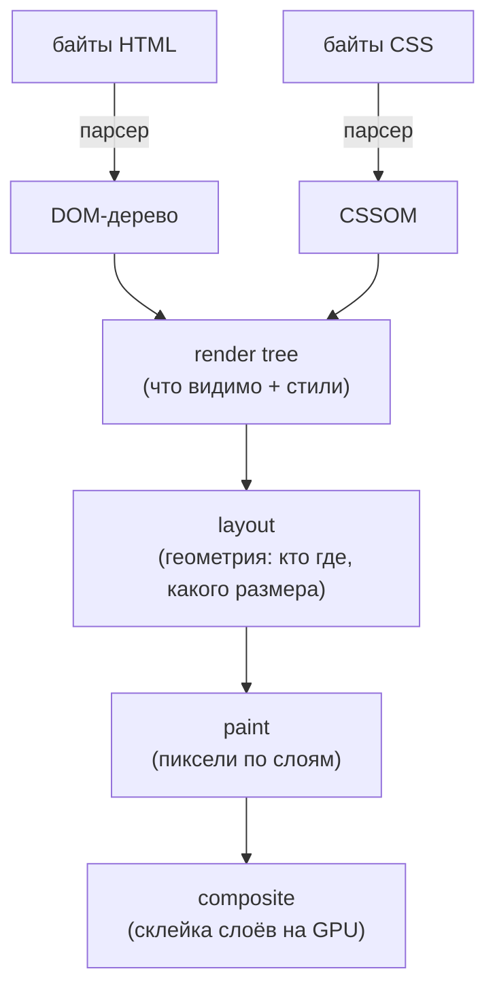

# Как браузер превращает ответ в пиксели
## Из чего сделан браузер

| Компонент | Задача | Примеры |
|---|---|---|
| **браузерный движок** | парсинг, раскладка, отрисовка | Gecko (Firefox, Zen), Blink (Chrome, Edge), WebKit (Safari) |
| **[[Типы и коэрция\|JS]]-движок** | исполнение JavaScript | SpiderMonkey (Gecko), V8 (Blink; он же в Node.js) |
| обвязка | вкладки, сеть, кэш, песочницы процессов | сам браузер |

Почти все "разные" браузеры — это Blink с разным интерфейсом; независимых движков осталось три[^1]

[^1]: Итог "войн браузеров": в первую (1995–2001) Internet Explorer задавил Netscape, во вторую (2004–2017) Firefox и Chrome вернули конкуренцию. Осадок первой войны до сих пор в каждом запросе: любой браузер представляется строкой `User-Agent`, начинающейся с `Mozilla/5.0` — сайты 90-х отдавали "продвинутую" версию только Netscape, и все притворялись им. Посмотри `navigator.userAgent` в консоли

## Пайплайн рендеринга

| Этап | Что делает | Ключевое |
|---|---|---|
| **DOM** | HTML-текст → дерево объектов | документ — это дерево; [[HTML-документ и DOM-дерево]] |
| **CSSOM** (CSS Object Model) | [[Каскад и селекторы\|CSS]]-правила → дерево стилей | каскад решает конфликты — модуль 03 |
| **render tree** | DOM × CSSOM, только видимое | `display: none` сюда не попадает |
| **layout** (reflow) | вычисление координат и размеров | самая дорогая математика страницы |
| **paint** | заливка пикселей: текст, фоны, тени | по слоям |
| **composite** | склейка слоёв | [[Графический процессор\|GPU]]; `transform`/`opacity` дёшевы — двигают готовый слой |

> [!tip] Почему это важно знать до CSS и JS
> Изменение геометрии (`width`, `top`) заставляет браузер повторить layout → paint → composite для куска страницы, а `transform` — только composite. Отсюда главное правило плавных анимаций; подробности и профилирование — в [[Рендер-пайплайн|модуле 09]]

## Где в этой картине JavaScript

Парсер, встретив `<script>`, по умолчанию **останавливается**: скрипт может дописать документ (`document.write` — привет из 2005), поэтому его надо выполнить до продолжения парсинга. Скрипт при этом видит DOM и может его менять — на этом стоит весь [[DOM API|модуль 06]]

> [!warning] Скрипты блокируют построение страницы
> Тег `<script src="…">` без атрибутов = стоп-кран парсинга: качаем, исполняем, только потом парсим дальше. Лекарства — атрибуты `defer`/`async`, разберём в [[HTML-документ и DOM-дерево|модуле 02]] и [[Производительность страницы|модуле 09]]

## Докачка ресурсов

DOM строится с первого байта, не дожидаясь конца HTML: встретили ``, `<link rel="stylesheet">`, `<script>` — запланировали ещё один [[HTTP]]-запрос. Отсюда десятки запросов на "одну страницу" в Network-вкладке и водопад загрузки, который ты измеришь в лабе `lab01-http-expedition`
