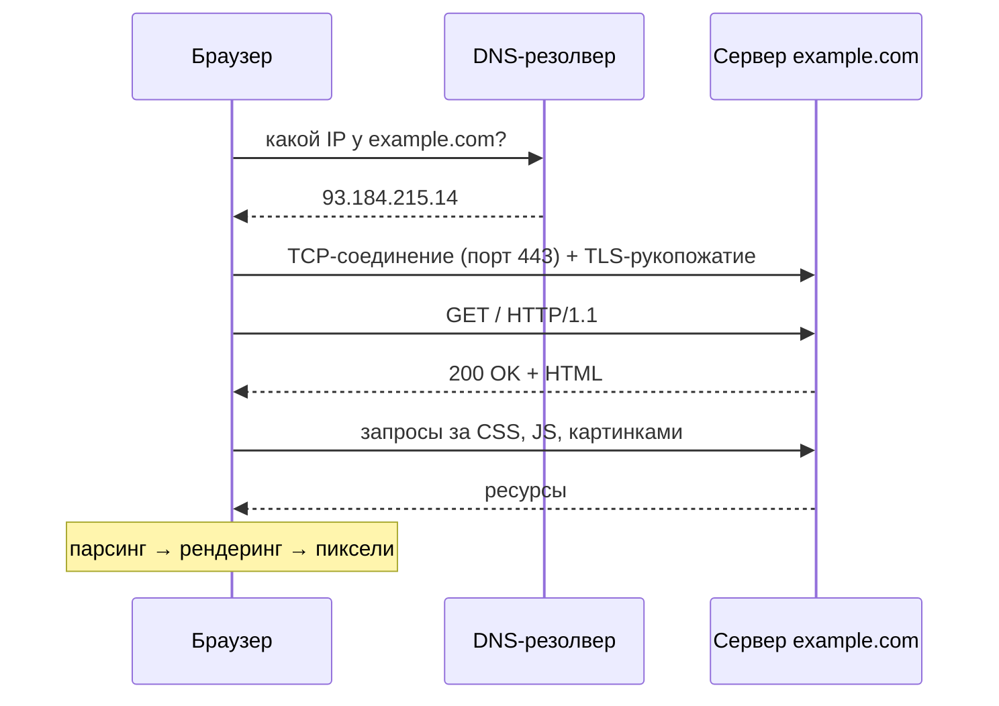

# Клиент, сервер и путь запроса
$$\boxed{\text{весь веб} = \text{клиенты посылают запросы} \rightarrow \text{серверы возвращают ответы}}$$
Всё остальное в курсе — детали того, как запрос устроен, как он доезжает и что браузер делает с ответом

## Модель клиент-сервер

> [!note] Клиент и сервер
> **Клиент** — программа, которая инициирует соединение и просит ресурс (браузер, `curl`, мобильное приложение). **Сервер** — программа, которая слушает входящие соединения на известном адресе и отвечает. Роли не привязаны к железу: один процесс может быть сервером для браузера и клиентом для базы данных

Общение всегда парой **запрос → ответ** (request/response): клиент говорит первым, сервер сам ничего не присылает[^1]. Протокол при этом **stateless** — сервер не обязан помнить прошлые запросы; как при этом существуют логины и корзины — см. cookies в [[HTTP#Cookies|HTTP]]

[^1]: Для настоящих push-уведомлений придумали отдельные механизмы — WebSocket и Server-Sent Events, до них дойдём в модуле про [[f10. Сервер и API — MOC|сервер и API]]

## Путь запроса от адресной строки до страницы

| Шаг | Что происходит | Подробно в |
|---|---|---|
| 1 | Браузер разбирает URL: схема, хост, путь | [[URL и адресация]] |
| 2 | DNS превращает имя хоста в IP-адрес | [[Протокол DNS\|DNS]] |
| 3 | Открывается [[Заголовок TCP и установление соединения\|TCP]]-соединение с сервером, для https — поверх него [[HTTP\|TLS]] | ниже |
| 4 | Браузер шлёт HTTP-запрос, сервер возвращает ответ с [[HTML-документ и DOM-дерево\|HTML]] | [[HTTP]] |
| 5 | Браузер парсит HTML, докачивает ресурсы, строит страницу | [[Как браузер превращает ответ в пиксели]] |

> [!example] Тот же путь руками
> `curl -v http://example.com` показывает шаги 2–4 в текстовом виде: резолв адреса, соединение, строки запроса (`>`) и ответа (`<`). Упражнение `ex01-http-by-hand` в `web-course/01-how-web-works/` — ровно про это

## IP и TCP

Сеть устроена слоями: каждый протокол решает одну задачу и опирается на нижний

| Слой       | Протокол | Задача                                                                                       |
| ---------- | -------- | -------------------------------------------------------------------------------------------- |
| приложение | **HTTP** | дать что просим и что получаем (текстовые сообщения)                                         |
| транспорт  | **[[Заголовок TCP и установление соединения\|TCP]]** | надёжная доставка: данные бьются на пакеты, теряющиеся досылаются, порядок восстанавливается |
| межсетевой | **[[IP-адрес и маска подсети\|IP]]** | доставка пакета по адресу через цепочку маршрутизаторов, без гарантий |

> [!tip] Порт = номер квартиры при адресе-доме
> IP-адрес находит машину, **порт**[^3] — конкретную программу на ней. У протоколов есть порты по умолчанию: 80 для http, 443 для https — поэтому в URL их не пишут. Сервер "слушает порт" — ждёт соединений на нём

> [!warning] HTTP — просто текст
> В основе самого популярного протокола планеты — человекочитаемые строки[^2]. Задачка ★1 модуля: послать HTTP-запрос без curl, голым текстом в TCP-сокет через `/dev/tcp`

[^2]: Так задумано: Тим Бернерс-Ли проектировал HTTP в CERN (Conseil Européen pour la Recherche Nucléaire) в 1989–1991 максимально простым, чтобы любой мог написать клиент или сервер. Первое сообщение по ARPANET (Advanced Research Projects Agency Network) в 1969 году, кстати, было "LO" — хотели передать "LOGIN", но сеть упала на третьей букве

[^3]: Диапазоны портов, мультиплексирование и сокет как пара адрес+порт — [[Порты и сокеты]]

## Не только браузер и не только HTML

Клиентом бывает что угодно (скрипт, [[Анатомия плагина Obsidian|плагин Obsidian]], другой сервер), а сервер возвращает не только HTML: [[Слабоструктурированные данные и JSON|JSON]] для программ, картинки, файлы. Веб-API — это тот же запрос-ответ, только с JSON вместо страниц; на этом стоит весь [[Дизайн REST API|модуль 10]]
