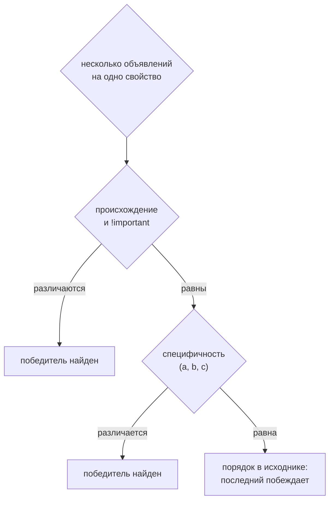

# Каскад и селекторы
**CSS** (Cascading Style Sheets — "каскадные таблицы стилей") — язык описания внешнего вида документа: [[HTML-документ и DOM-дерево|HTML]] отвечает "что это", CSS — "как это выглядит". "Каскадные" — потому что итоговый стиль элемента стекает из нескольких источников (браузер, пользователь, автор страницы), и конфликт между ними решается по формальным правилам каскада[^1]

[^1]: CSS предложил Håkon Wium Lie в 1994 в **CERN** (Conseil Européen pour la Recherche Nucléaire, Европейская организация по ядерным исследованиям) — он работал там вместе с Тимом Бернерсом-Ли. Идея каскада из нескольких таблиц стилей была главной фишкой предложения и дала языку имя. До победы CSS страницы стилизовали тегами `<font>` и вёрсткой невидимыми таблицами с распорками из прозрачных `spacer.gif` 1×1 px

## Три способа подключить стили

| Способ | Синтаксис | Когда |
|---|---|---|
| **Внешний файл** | `<link rel="stylesheet" href="style.css">` в `<head>` | всегда по умолчанию: кэшируется, один файл на весь сайт |
| **Тег `<style>`** | `<style> h1 { … } </style>` в `<head>` | маленькие демо, критический CSS |
| **Инлайн-атрибут** | `<p style="color: red">` | почти никогда: не переиспользуется, бьёт всё по специфичности |

## Анатомия правила

```css
селектор {                 /* кого стилизуем */
  свойство: значение;      /* объявление (declaration) */
  color: #1e66f5;
  font-size: 1.2rem;
}
```

**Правило** (rule) = селектор + блок объявлений. Неизвестное свойство или кривое значение браузер молча игнорирует — CSS никогда не "падает" целиком, это осознанный дизайн ради совместимости

## Селекторы

### Базовые

| Селектор | Пример | Ловит |
|---|---|---|
| тег | `p` | все `<p>` |
| класс | `.card` | все с `class="card"` |
| id | `#header` | элемент с `id="header"` (id уникален на страницу) |
| атрибут | `input[type="email"]`, `a[href^="https"]` | по атрибуту и его значению (`^=` начинается, `$=` кончается, `*=` содержит) |
| универсальный | `*` | всё |

> [!tip] Рабочая лошадка — класс
> Стилизуй классами: тег слишком широк, id слишком жёсток (нельзя переиспользовать + перебивает всё специфичностью). Селекторы по тегу — для базовой типографики (`body`, `h1`, `code`), id — для якорей и [[Типы и коэрция|JS]], не для стилей

### Комбинаторы

| Запись | Имя | Ловит |
|---|---|---|
| `article p` | потомок (пробел) | `<p>` на любой глубине внутри `<article>` |
| `article > p` | ребёнок | только непосредственные дети |
| `h2 + p` | сосед | первый `<p>` сразу после `<h2>` |
| `h2 ~ p` | все соседи после | все `<p>`-сиблинги после `<h2>` |
| `h1, h2, h3` | группировка (не комбинатор) | одно правило нескольким селекторам |

### Псевдоклассы и псевдоэлементы

**Псевдокласс** (одно двоеточие) — *состояние* существующего элемента; **псевдоэлемент** (два двоеточия) — *виртуальный* элемент, которого нет в HTML

```css
a:hover { }              /* курсор над ссылкой */
input:focus { }          /* элемент в фокусе — Tab-навигация с клавиатуры */
li:first-child { }       /* первый ребёнок родителя */
tr:nth-child(2n) { }     /* каждая чётная строка — зебра в таблицах */
input:checked { }        /* включённый чекбокс */
p::first-line { }        /* первая строка абзаца */
.card::before { content: "★"; }  /* виртуальный первый ребёнок — иконки, декор */
```

> [!tip] Современная тройка `:is()`, `:where()`, `:has()`
> `:is(h1, h2, h3) a` — свернуть перечисление; `:where(…)` — то же, но с нулевой специфичностью (удобно для базовых стилей, которые легко перебить); `:has()` — "родитель, у которого есть…": `article:has(img)` ловит статьи с картинками. `:has()` — первый в истории CSS способ смотреть *вниз* по дереву, появился только в 2023

## Каскад



Когда на одно свойство элемента претендуют несколько объявлений, браузер сравнивает их по порядку до первого различия:

1. **Происхождение и важность** — стили браузера (user agent) < стили пользователя < стили автора < `!important` автора < `!important` пользователя. Обычный порядок с `!important` *переворачивается* — так у пользователя остаётся последнее слово[^2]
2. **Специфичность селектора** — см. ниже
3. **Порядок в исходнике** — последнее объявление побеждает

[^2]: Инверсия для `!important` — осознанная защита доступности: пользовательский стиль "весь текст 200%, высокий контраст" не должен перебиваться дизайном сайта. В авторском коде `!important` — почти всегда капитуляция перед собственным каскадом; легитимные случаи — utility-классы и перебивание чужих инлайн-стилей

### Специфичность

**Специфичность** (specificity) — вес селектора, тройка чисел `(a, b, c)`, сравнивается поразрядно слева направо:

| Разряд | Что считает | Примеры |
|---|---|---|
| `a` | id | `#nav` |
| `b` | классы, атрибуты, псевдоклассы | `.card`, `[type="text"]`, `:hover` |
| `c` | теги и псевдоэлементы | `li`, `::before` |

```css
p                    /* (0,0,1) */
.note p              /* (0,1,1) */
#sidebar .note p     /* (1,1,1)  — побеждает */
```

Инлайн-`style=""` бьёт любую специфичность; `*`, `:where()` и комбинаторы весят ноль. Разряды не переполняются: `(0,10,0)` из десяти классов всё равно меньше `(1,0,0)` одного id

> [!warning] Войны специфичности
> Симптом больного CSS — селекторы-паровозы `#page .content div.card a.btn:hover` и россыпь `!important`, добавленных, чтобы перебить предыдущий паровоз. Лечение: держать специфичность плоской (один класс), а порядок побед отдавать порядку файлов. Посчитать вес можно на [калькуляторе](https://specificity.keegan.st/)

## Наследование

Текстовые свойства (`color`, `font-*`, `line-height`, `text-align`) **наследуются** — стекают с родителя на детей, пока кто-то не переопределит: задал `font-family` на `body` — получила вся страница. Геометрия (`margin`, `border`, `width`…) не наследуется — иначе рамка на `<body>` появилась бы у каждого элемента

Специальные значения — любое свойство можно явно сбросить: `inherit` (возьми у родителя), `initial` (спецификационный дефолт), `unset` (наследуемое → inherit, остальное → initial), `revert` (вернись к стилю браузера)

> [!note] DevTools показывает весь каскад
> Панель [[DevTools|Elements → Styles]] перечисляет все правила, претендовавшие на элемент: победившие, зачёркнутые проигравшие и секция Inherited from. Это главный инструмент отладки CSS — вопрос "почему стиль не применился" решается там, а не перебором в редакторе
