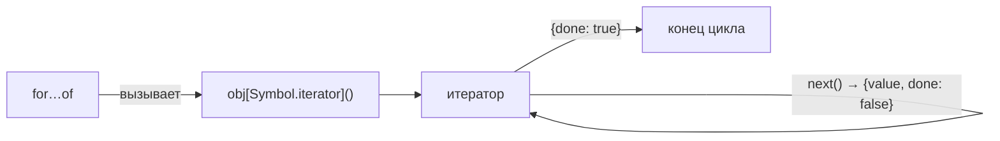

# Коллекции и итераторы
## Массив

Массив [[Типы и коэрция|JS]] — динамический, разнотипный, технически — объект с числовыми ключами и магическим `length`. Ядро повседневной работы — цепочки методов:

| Метод | Возвращает | Мутирует? |
|---|---|---|
| `map`, `filter`, `slice`, `concat`, `flat` | новый массив | нет |
| `find`, `findIndex`, `includes`, `some`, `every` | элемент / индекс / boolean | нет |
| `reduce` | что скажешь | нет |
| `push`, `pop`, `shift`, `unshift`, `splice` | разное | **да** |
| `sort`, `reverse` | тот же массив | **да** ⚠️ |

```js
users.filter(u => u.active).map(u => u.name).sort()
```

> [!warning] Две классические засады
> **`sort()` сравнивает как строки**: `[10, 9, 1].sort()` → `[1, 10, 9]`; числа — только `sort((a, b) => a - b)`. И **`sort`/`reverse` меняют массив на месте** — сортировка чужого массива портит его у всех держателей ссылки; безопасные копирующие версии `toSorted()`/`toReversed()` появились лишь в 2023

## Map и Set

| | Объект `{}` | `Map` |
|---|---|---|
| Ключи | строки и symbol (число станет строкой) | **любые значения**, включая объекты |
| Порядок | почти вставки, с нюансами | строго порядок вставки |
| Размер | `Object.keys(o).length` | `map.size` |
| Протокол | свой (`in`, `delete`) | `get`/`set`/`has`/`delete` |

**`Set`** — коллекция уникальных значений; дедупликация массива — идиома `[...new Set(arr)]`. **`WeakMap`/`WeakSet`** — ключи держатся слабо: объект-ключ никем больше не используется — сборщик мусора заберёт запись; кэши и метаданные без утечек памяти

> [!tip] Объект — для записей, Map — для словарей
> Фиксированная структура с известными полями (`user.name`) — объект; динамическая таблица "ключ → значение" с добавлением/удалением — Map. Половина легаси-кода использует объект как словарь — с сюрпризами вроде ключа `"__proto__"`, ломающего [[Объекты, прототипы и классы#Цепочка прототипов|прототип]]

## Протокол итератора

`for…of` работает с любым **итерируемым** (iterable) объектом — тем, у кого есть метод с ключом-символом `Symbol.iterator`, возвращающий **итератор**: объект с `next()` → `{ value, done }`

```js
for (const x of [1, 2, 3]) { }        // массив, строка, Map, Set, NodeList — итерируемы
const [a, b] = new Set([1, 2]);       // деструктуризация и spread тоже идут через протокол
```



Отсюда единообразие языка: один протокол обслуживает `for…of`, spread, деструктуризацию, `Array.from`, `Promise.all`. Свой класс становится итерируемым одним методом — и весь этот синтаксис начинает с ним работать

> [!warning] for…of ходит по значениям, for…in — по ключам
> `for…in` перебирает строковые ключи объекта **включая унаследованные** — для массивов он отдаст индексы-строки и чужие свойства. Правило: объекты — `Object.keys/values/entries` + `for…of`, массивы и коллекции — `for…of`, а `for…in` — почти никогда

## Генераторы

**Генератор** — функция со звёздочкой, которая умеет ставить себя на паузу: каждый `yield` отдаёт значение и замирает до следующего `next()`

```js
function* ids() {
  let i = 0;
  while (true) yield i++;      // ленивая бесконечная последовательность
}
const gen = ids();
gen.next().value;              // 0
gen.next().value;              // 1
```

Генератор автоматически итерируем — это самый короткий способ написать свой итератор. Ленивость — главная сила: значения вычисляются по требованию, бесконечные последовательности и обход дерева ([[HTML-документ и DOM-дерево|DOM]]) без выделения массива под всё сразу[^1]

[^1]: До async/await генераторы были и способом писать асинхронный код: библиотека co (2013) гоняла промисы через `yield`. `async`/`await` — по сути тот же генератор, где `next()` дёргает рантайм по мере готовности промисов; транспиляторы старых браузеров буквально так его и компилировали
