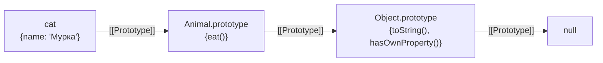

# Объекты, прототипы и классы
Объект в [[Типы и коэрция|JS]] — динамический словарь "ключ → значение": свойства добавляются и удаляются на лету, ключи — строки или symbol. Наследование — не от классов, а от других объектов: **прототипное**. `class` (2015) — удобный синтаксис поверх той же механики, не новая модель[^1]

[^1]: Прототипную модель Brendan Eich взял из языка Self (Xerox PARC — Palo Alto Research Center / Stanford, 1986) — начальство Netscape требовало "сделай похоже на Java", но на классы как в Java не было времени, и он спрятал Self-модель под Java-подобный синтаксис. Двадцать лет спустя `class` завершил маскировку

## Литерал и работа со свойствами

```js
const user = {
  name: "Ilya",
  "full name": "с пробелом — только в кавычках и через скобки",
  greet() { return `Привет, ${this.name}`; },   // метод-шорткат
};
user.age = 22;              // добавить можно всегда
user["full name"];          // доступ по вычисляемому ключу
delete user.age;
"name" in user;             // проверка наличия
Object.keys(user);          // массив ключей — основа всех обходов
```

Копирование — **по ссылке**: `const b = user` даёт второе имя того же объекта. Поверхностная копия — `{...user}` ([[Современный синтаксис#Spread и rest|spread]]), глубокая — `structuredClone(user)`

## Цепочка прототипов

У каждого объекта есть скрытая ссылка `[[Prototype]]` на другой объект. Чтение свойства, которого нет у самого объекта, продолжает поиск по цепочке — до `null`



Поэтому у "пустого" объекта есть `toString()` — он найден выше по цепочке. **Запись** же всегда идёт в сам объект: присвоил `cat.eat = …` — затенил (shadowing) прототипный метод, не изменив его

```js
Object.getPrototypeOf(cat)        // штатное чтение цепочки
cat instanceof Animal             // есть ли Animal.prototype в цепочке cat
```

> [!tip] Методы массивов и строк живут в прототипах
> `[1,2].map` — это `Array.prototype.map`, единственная функция на все массивы мира. Дописать метод в `Array.prototype` можно — и так делали: полифилы (докачка недостающих методов в старые браузеры) работают ровно так. Но сорить в чужие прототипы в прикладном коде — моветон с историей[^2]

[^2]: Библиотека MooTools (2007) расширяла прототипы так активно, что комитет TC39 дважды переименовывал новые методы стандарта, чтобы не сломать сайты на ней: метод `contains` стал `includes`, а `flatten` — `flat`. Инцидент вошёл в историю как SmooshGate — по шуточному предложению назвать метод `smoosh`

## this

**`this`** — не "объект, где функция написана", а "то, на чём её вызвали". Определяется *в момент вызова*:

| Вызов | this |
|---|---|
| `obj.method()` | `obj` — что слева от точки |
| `fn()` | `undefined` (в strict mode; иначе глобальный объект) |
| `new Fn()` | свежесозданный объект |
| `fn.call(x)` / `fn.apply(x)` / `fn.bind(x)` | явно заданный `x` |

```js
const greet = user.greet;
greet();                   // this потерян! undefined.name — TypeError
const bound = user.greet.bind(user);   // прибить намертво
```

Потеря this при передаче метода как колбэка — грабли №1; лечится `bind` или стрелкой-обёрткой `() => user.greet()`. [[Функции и замыкания#Три способа объявить|Стрелки]] своего this не имеют и наследуют его от места создания — поэтому колбэки внутри методов пишут стрелками

## Классы

```js
class Animal {
  #energy = 100;                       // приватное поле — снаружи невидимо
  constructor(name) { this.name = name; }
  eat(amount) { this.#energy += amount; }
  get hungry() { return this.#energy < 30; }   // геттер
  static compare(a, b) { … }           // метод самого класса, не экземпляров
}

class Cat extends Animal {
  constructor(name) {
    super(name);                       // обязателен до первого this
  }
  eat(amount) { super.eat(amount / 2); }   // переопределение + вызов родителя
}
```

Под капотом: `class` создаёт функцию-конструктор, методы кладёт в `Cat.prototype`, а `extends` выстраивает `[[Prototype]]`-цепочку `cat → Cat.prototype → Animal.prototype`. Проверяется одной строкой: `typeof Animal === "function"`

> [!note] Композиция чаще наследования
> Глубокие иерархии `extends` в JS-коде редки: типичный стиль — объекты-данные + функции над ними, а классы там, где есть настоящее состояние с инвариантами ([[Анатомия плагина Obsidian|плагин Obsidian]] — класс, потому что того требует [[Программный интерфейс приложения|API]]). Если выбор неочевиден — начинай с функций, класс всегда успеется
