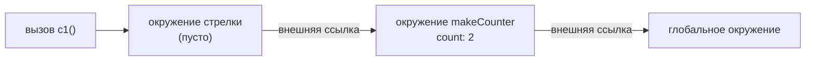

# Функции и замыкания
Функции в [[Типы и коэрция|JS]] — **значения первого класса**: их присваивают переменным, кладут в массивы, передают и возвращают из других функций. На этом стоит половина языка — колбэки, [[Event loop|асинхронность]], методы массивов

## Три способа объявить

```js
function sum(a, b) { return a + b; }        // Function Declaration
const sum = function (a, b) { … };          // Function Expression
const sum = (a, b) => a + b;                // стрелочная (arrow)
```

Declaration **всплывает** (hoisting): вызов до строки объявления работает — определения собираются до выполнения кода. Expression и стрелка живут как обычные переменные. Стрелка без фигурных скобок неявно возвращает выражение; вернуть объект-литерал — скобки: `() => ({a: 1})`

> [!important] Стрелка — это не сокращение, а другая функция
> У стрелочной функции **нет своих** `this` и `arguments` — она берёт их из окружающего кода лексически. Для колбэков это то, что нужно (главная причина её появления в 2015); для [[Объекты, прототипы и классы#this|методов объектов]] — дисквалификация: this укажет наружу, а не на объект

### Параметры

```js
function draw(x, y = 0, ...rest) { }     // значение по умолчанию + rest-параметр (массив)
draw(1);                                 // недостающие → undefined, лишние молча игнорируются
```

Проверки числа аргументов нет — ни ошибки, ни предупреждения. Дисциплину сигнатур в JS-мире наводит [[Система типов TypeScript|TypeScript]]

## Область видимости

| | `var` (до 2015) | `let` / `const` |
|---|---|---|
| Границы | функция | блок `{ }` |
| До объявления | `undefined` (всплывает с значением) | ReferenceError — "мёртвая зона" |
| Повторное объявление | молча ок | SyntaxError |

Современное правило: **`const` по умолчанию, `let` где переприсваиваешь, `var` никогда**. `const` запрещает переприсваивание *ссылки*, не изменение содержимого: `const arr = []; arr.push(1)` — легально

## Замыкание

**Замыкание** (closure) — функция вместе с окружением, в котором она родилась: внутренняя функция видит переменные внешней даже после того, как внешняя завершилась

```js
function makeCounter() {
  let count = 0;                 // живёт, пока жив счётчик
  return () => ++count;
}
const c1 = makeCounter(), c2 = makeCounter();
c1(); c1();   // 1, 2
c2();         // 1 — у каждого замыкания своё окружение
```

Механика: каждая функция при создании запоминает ссылку на своё **лексическое окружение** (Lexical Environment — внутренний объект с локальными переменными и ссылкой на внешнее окружение). Поиск имени идёт по цепочке окружений наружу — до глобального



> [!success] Замыкание — это приватность до классов
> Снаружи до `count` не добраться никак — только через возвращённые функции. Так JS десятилетиями делал инкапсуляцию (паттерн "модуль"), пока не появились [[Модули|настоящие модули]] и `#приватные` поля классов

> [!warning] Классическая ловушка — var в цикле
> ```js
> for (var i = 0; i < 3; i++) setTimeout(() => console.log(i));   // 3, 3, 3
> for (let i = 0; i < 3; i++) setTimeout(() => console.log(i));   // 0, 1, 2
> ```
> `var` — одна переменная на весь цикл, все колбэки замкнулись на неё одну; `let` создаёт **свежую привязку на каждую итерацию** — это специально прописано в стандарте ради этого сценария. Вопрос с собеседований №1 всех времён

## Функции высшего порядка

**Функция высшего порядка** — принимает или возвращает функции. Ежедневная тройка на массивах:

```js
[1, 2, 3].map(x => x * 2)        // [2, 4, 6] — преобразовать каждый
[1, 2, 3].filter(x => x % 2)     // [1, 3] — отобрать
[1, 2, 3].reduce((acc, x) => acc + x, 0)   // 6 — свернуть в одно значение
```

Возврат функции из функции — способ "запечь" параметры (каррирование и частичное применение):

```js
const multiply = a => b => a * b;
const double = multiply(2);       // замыкание запомнило a = 2
double(21);                       // 42
```

> [!note] IIFE — след прошлой эпохи
> **IIFE** (Immediately Invoked Function Expression — немедленно вызываемое функциональное выражение): `(function () { … })()`. До модулей так изолировали область видимости скрипта, чтобы не сорить в глобальную. Встретишь в любом коде старше 2016 и в [[f01. Как устроен веб — MOC|самотестах нашей практики]] — там это до сих пор честный способ не сорить на страницу
