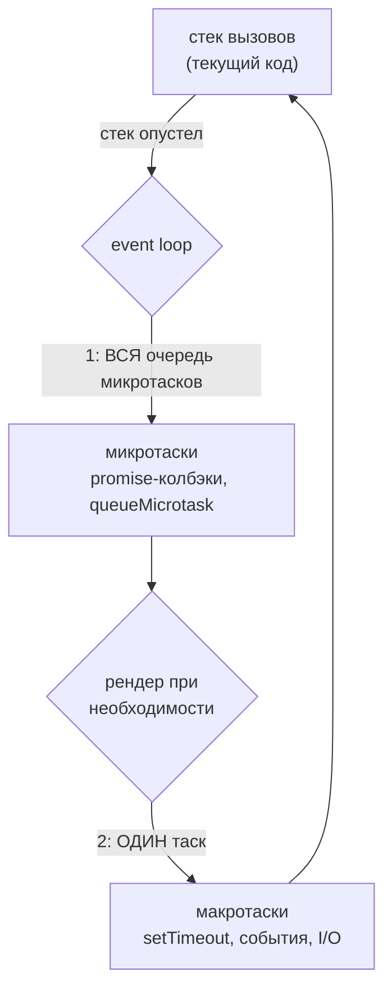

# Event loop
[[Типы и коэрция|JS]] выполняется **в один поток**: один стек вызовов, ничего не работает "параллельно"[^1]. Асинхронность — иллюзия, собранная из очередей: долгие операции (сеть, таймеры, диск) уходят в браузерное/системное [[Программный интерфейс приложения|API]], а их колбэки становятся в очередь и ждут, пока стек освободится. **Event loop** (событийный цикл) — вечный диспетчер: "стек пуст? — беру следующий таск из очереди"

[^1]: Настоящие параллельные потоки в JS есть — Web Workers (и worker_threads в Node), но у них нет общей памяти с основным потоком (обмен сообщениями), поэтому модель "один поток + очереди" не ломается. Тяжёлую математику — в worker, иначе страница замрёт



## Стек, таски, микротаски

| Очередь | Кто попадает | Когда разгребается |
|---|---|---|
| **макротаски** (tasks) | `setTimeout`/`setInterval`, события [[HTML-документ и DOM-дерево\|DOM]], I/O | по **одному** за оборот цикла |
| **микротаски** (microtasks) | `.then`/`catch`/`finally` [[Промисы|промисов]], `queueMicrotask`, `await`-продолжения | **вся очередь до дна** после каждого таска, до рендера |

Правило одно, но объясняет всё: *после каждого макротаска браузер вычерпывает микротаски полностью, и только потом может отрисовать кадр и взять следующий макротаск*

> [!example] Канонический квиз на порядок
> ```js
> console.log("1");
> setTimeout(() => console.log("2"));
> Promise.resolve().then(() => console.log("3"));
> console.log("4");
> // → 1 4 3 2
> ```
> Синхронный код до конца (1, 4) → микротаски (3) → макротаск (2). `setTimeout(fn, 0)` — не "сразу", а "в следующий оборот, когда до тебя дойдёт"

## Следствия, которые кусаются

> [!warning] Долгий синхронный код замораживает всё
> Пока стек не пуст, event loop стоит: клики не обрабатываются, страница не перерисовывается, `setTimeout` не срабатывает. Цикл на 10⁹ итераций = зависшая вкладка. Отсюда паттерн "нарезать работу": большие вычисления бьют на куски по setTimeout/`requestIdleCallback` или уносят в Worker

> [!warning] Бесконечные микротаски голоднее бесконечного цикла
> Микротаск, который ставит новый микротаск, **никогда не отдаст управление**: очередь вычерпывается до дна, а дно убегает. Рендер и таймеры голодают (starvation). Тот же код через setTimeout безвреден — по одному на оборот, между ними живёт рендер. Это главная семантическая разница очередей, а не "микротаски просто быстрее"

> [!note] setTimeout не обещает точность
> Задержка — это "не раньше чем": реальный запуск зависит от занятости цикла. Вложенные таймеры глубже 5 уровней браузер притормаживает минимум до 4ms, фоновые вкладки — до секунды и грубее (экономия батареи). Измерять время по таймерам нельзя — только `performance.now()`

## Где это видно руками

- Визуализатор [Loupe](http://latentflip.com/loupe/) — анимация стека, очередей и цикла; десять минут игры заменяют главу книги
- DevTools → Performance: запись покажет каждый таск полосой; таск длиннее 50ms помечается как **Long Task** — красный флаг отзывчивости ([[Производительность страницы|модуль 09]])
- В Node цикл тот же по духу, но фаз больше (timers → I/O → check…) и есть `process.nextTick` — микротаск "вне очереди", даже раньше промисов[^2]

[^2]: Исторический курьёз: `process.nextTick` появился в Node раньше стандартных микротасков и оказался с ними несовместим по приоритету — теперь в доках Node прямо написано "используйте queueMicrotask". Легаси-API живёт вечно; см. `typeof null` из [[Типы и коэрция]]
