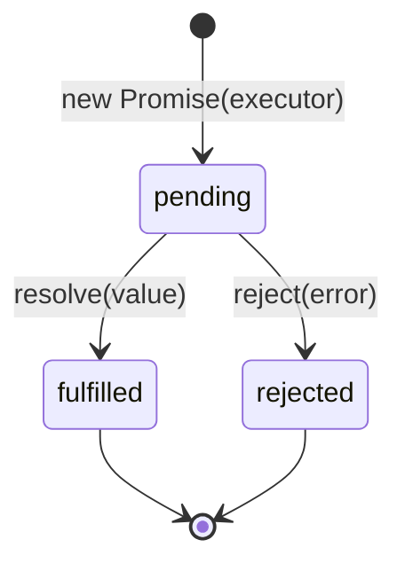

# Промисы
**Промис** (Promise — "обещание") — объект-контейнер для значения, которое появится позже: результат сетевого запроса, таймера, чтения файла. Вместо "передай колбэк внутрь операции" — "операция вернёт объект, на который подпишешься"

## Зачем

```js
loadUser(id, (err, user) => {
  if (err) return handle(err);
  loadPosts(user, (err, posts) => {
    if (err) return handle(err);
    loadComments(posts[0], (err, comments) => {   // лесенка растёт вправо →
      …
```

Колбэчный стиль (весь Node до 2015[^1]) не композируется: ошибки размазаны по каждому уровню, параллельность — ручная бухгалтерия счётчиков, лесенка нечитаема. Промис делает асинхронный результат **значением** — его можно возвращать, хранить, комбинировать

[^1]: Соглашение Node "колбэк последним аргументом, ошибка первым" (error-first callbacks) было настолько тотальным, что для перевода миллионов таких [[Программный интерфейс приложения|API]] на промисы в стандартную библиотеку добавили `util.promisify`, а у fs появился зеркальный `fs/promises`. Термин "callback hell" имел собственный сайт-манифест callbackhell.com

## Состояния



Состояние меняется **один раз навсегда** (settled — "устаканился"): повторные resolve/reject молча игнорируются. Подписка после устаканивания тоже работает — колбэк просто сразу встанет в [[Event loop|очередь микротасков]]; "опоздать подписаться" невозможно

```js
const p = new Promise((resolve, reject) => {
  setTimeout(() => resolve(42), 1000);
});
p.then(value => …, error => …);
```

## Цепочки

`.then` **возвращает новый промис** — из результата колбэка. На этом стоят цепочки:

```js
fetch(url)
  .then(resp => resp.json())      // вернул промис → цепочка ЖДЁТ его
  .then(data => data.items.length)
  .then(n => console.log(n))
  .catch(err => console.error("на любом этапе выше:", err))
  .finally(() => spinner.hide());
```

Правила: колбэк вернул значение → следующий then получит его; вернул *промис* → цепочка подождёт и получит его результат (автораспаковка); бросил исключение → полёт до ближайшего `.catch`. `catch(f)` — просто сахар для `then(undefined, f)`

> [!warning] Две ошибки, которые делают все
> **Разрыв цепочки**: написал `p.then(…)` без return внутри и без catch в конце — ошибка утонула. Правило: каждая цепочка либо возвращается наружу (`return fetch(…)`) — и тогда за неё отвечает вызывающий, либо заканчивается `.catch`. Непойманный reject браузер бросает событием `unhandledrejection` в консоль.
> **Вложенность вместо цепочки**: `then(x => { p2.then(…) })` — вернулся callback hell в новой одежде. Внутренний промис надо `return`

> [!tip] Промисификация — обернуть старое API
> ```js
> const wait = ms => new Promise(res => setTimeout(res, ms));
> const geo = () => new Promise((res, rej) =>
>   navigator.geolocation.getCurrentPosition(res, rej));
> ```
> `new Promise` в прикладном коде нужен почти исключительно для этого — оборачивания колбэчных API. Если внутри executor нет колбэка/события — скорее всего, промис тут вообще не нужен (антипаттерн "explicit construction": `new Promise(res => res(fetch(url)))` — это просто `fetch(url)`)

## Статические конструкторы

```js
Promise.resolve(x)       // готовый fulfilled — нормализация "может значение, может промис"
Promise.reject(err)
Promise.withResolvers()  // { promise, resolve, reject } — резолв снаружи (2024); раньше этот
                         // паттерн звали deferred и собирали руками
```

Комбинаторы для *нескольких* промисов (`all`, `race`, `allSettled`, `any`) — в [[Параллельность, гонки и отмена]]
