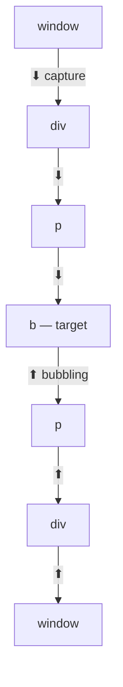

# События
```js
button.addEventListener("click", event => { … });
button.removeEventListener("click", тотЖеСамыйFn);      // снять — только ту же ссылку
button.addEventListener("click", fn, { once: true });    // сам снимется после первого раза
window.addEventListener("scroll", fn, { signal });       // авточистка через AbortSignal
```

`addEventListener` — единственный правильный способ подписки: обработчиков сколько угодно, есть опции. Атрибут `onclick="…"` в [[HTML-документ и DOM-дерево|HTML]] и свойство `el.onclick` — легаси с одним слотом[^1]

[^1]: Модель событий — поле первой браузерной войны: Netscape предлагал погружение (capture), Microsoft — всплытие (bubbling). **W3C** (World Wide Web Consortium) в 2000 узаконил *обе фазы сразу* — редкий случай, когда стандарт объединил несовместимые взгляды конкурентов, и теперь у каждого события два прохода по дереву

## Объект события

| Поле | Что |
|---|---|
| `event.target` | где событие **случилось** (самый глубокий элемент) |
| `event.currentTarget` | на ком висит **этот обработчик** (= this) |
| `event.type` | "click", "input"… |
| у мыши/клавиш | `clientX/Y`, `key`, `ctrlKey`, `button` |

Разница target/currentTarget — ключ к делегированию ниже

## Всплытие и погружение

Клик по `<b>` внутри `<p>` внутри `<div>` порождает **одно** событие, которое проходит дерево дважды: вниз от window к цели (**capture**, фаза погружения) и обратно вверх (**bubbling**, всплытие). Обработчики по умолчанию слушают всплытие; `{ capture: true }` — погружение



`event.stopPropagation()` обрывает дальнейший путь. Пользоваться с недоверием к себе: заглушенное всплытие ломает чужие обработчики на предках (аналитику, закрытие попапов по клику мимо) — почти всегда правильнее проверка условия в обработчике, чем глушение события

## Делегирование

Не вешать обработчик на каждый из 500 элементов списка — один на общего предка, а виновника вычислять из target:

```js
list.addEventListener("click", e => {
  const item = e.target.closest("[data-task-id]");   // клик мог быть по вложенному span
  if (!item || !list.contains(item)) return;
  toggleTask(item.dataset.taskId);
});
```

**Делегирование** даёт три вещи: один обработчик вместо сотен, автоматическая работа для элементов, добавленных *позже*, и меньше утечек. Обратная сторона всплытия, превращённая в главный паттерн [[Пользовательский интерфейс|UI]] на ванильном [[Типы и коэрция|JS]] — [[URL и адресация|SPA]]-проект модуля (`web-course/06-js-browser/project-app/`) будет держаться на нём

## Отмена умолчаний

```js
form.addEventListener("submit", e => {
  e.preventDefault();               // не перезагружать страницу — обработаем сами
});
link.addEventListener("click", e => e.preventDefault());   // SPA-навигация
```

У многих событий есть действие браузера по умолчанию: submit отправляет и перезагружает, клик по ссылке — переход. `preventDefault()` отменяет действие, **не** трогая распространение события (а stopPropagation — наоборот; их вечно путают)

> [!warning] События ввода: input против change
> `input` стреляет на каждый символ, `change` — по завершении (blur у текста, сразу у чекбоксов/select). Живой поиск и валидация на лету — `input`. Для дорогих реакций на input — debounce (отложить, пока пользователь не замолчит): напишем руками в практике

## Свои события

```js
el.dispatchEvent(new CustomEvent("task:done", { bubbles: true, detail: { id: 42 } }));
document.addEventListener("task:done", e => log(e.detail.id));
```

**CustomEvent** — свои сообщения через [[HTML-документ и DOM-дерево|DOM]]: компоненты общаются, не зная друг о друге (шина событий из коробки). `bubbles: true` — чтобы слушать на document; полезные данные — в `detail`. Так же устроена связь компонентов в [[Анатомия плагина Obsidian|Obsidian]] — `workspace.on(…)` концептуально то же самое
