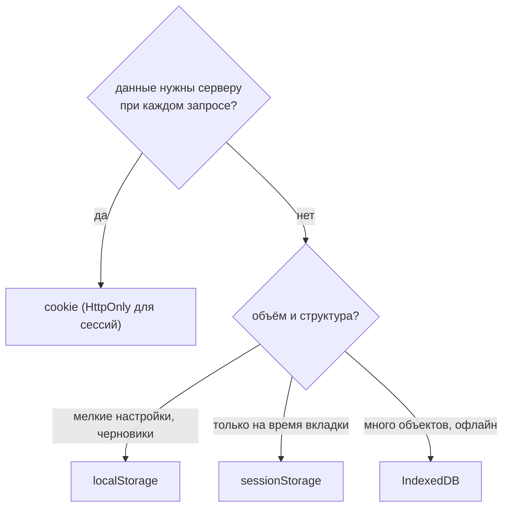

# Хранение данных в браузере
Всё, что страница сохраняет у пользователя, привязано к **origin** (схема + домен + порт, [[Безопасность в браузере|подробно в модуле 09]]): сайт видит только своё. Хранилищ несколько — различаются временем жизни, объёмом и тем, ездят ли данные на сервер

| Хранилище | Живёт | Объём | Едет на сервер? | Интерфейс |
|---|---|---|---|---|
| `localStorage` | вечно (пока не почистят) | ~5 МБ | нет | синхронный, строки |
| `sessionStorage` | вкладка | ~5 МБ | нет | тот же |
| cookies | по expires | 4 КБ на штуку | **да, в каждом запросе** | кривой |
| IndexedDB | вечно | сотни МБ+ | нет | асинхронный, объекты |

## localStorage и sessionStorage

```js
localStorage.setItem("theme", "dark");
localStorage.getItem("theme");            // "dark" | null
localStorage.removeItem("theme");

// хранит ТОЛЬКО строки — объекты через JSON:
localStorage.setItem("tasks", JSON.stringify(tasks));
const tasks = JSON.parse(localStorage.getItem("tasks") ?? "[]");
```

`sessionStorage` — тот же [[Программный интерфейс приложения|API]], но на время вкладки (переживает F5, умирает с вкладкой, у каждой вкладки свой). Типичные жильцы localStorage: тема, черновики форм, состояние [[Пользовательский интерфейс|UI]], данные нашего [[fetch|SPA]] до появления сервера

> [!warning] Три подводных камня localStorage
> **Синхронность** — блокирует поток; мегабайты писать нельзя, мелочь — можно. **Строки** — забытый [[Слабоструктурированные данные и JSON|JSON]].stringify кладёт `"[object Object]"` (и это баг-классика). **Исключения** — в приватных режимах некоторых браузеров setItem может бросить; критичную запись оборачивай try/catch. Плюс общая правда: пользователь может почистить всё в любой момент — хранилище браузера это **кэш удобства**, а не база данных

> [!tip] Событие storage — бесплатная синхронизация вкладок
> Запись в localStorage стреляет событием `storage` **в других вкладках** того же origin. Тёмная тема, переключённая в одной вкладке, мгновенно применяется во всех — три строчки кода, выглядит как магия

## Cookies

```js
document.cookie = "theme=dark; max-age=31536000; path=/";   // да, интерфейс — вот такой
```

**Cookie** ([[HTTP#Cookies|из модуля 01]]) — единственное хранилище, которое браузер сам прикладывает к каждому [[HTTP]]-запросу. Поэтому их место — **идентификация для сервера** (сессия, токен), и только: возить в cookies данные UI — платить их объёмом в каждом запросе

Серверная сессия должна ставиться с флагом `HttpOnly` — такая cookie *невидима из [[Типы и коэрция|JS]]* вообще (`document.cookie` её не покажет) — это защита от кражи через [[Безопасность в браузере|XSS]], [[Аутентификация и сессии|модуль 10]]

## IndexedDB

Полноценная асинхронная база в браузере: объекты без сериализации, индексы, транзакции, сотни мегабайт. Нужна офлайн-приложениям (почта, заметки, карты) и всем, кому мало 5 МБ. Родной API — колбэчный и многословный (проектировался до промисов), поэтому в бою берут обёртку `idb`; для наших задач хватит localStorage, а IndexedDB достаточно узнавать в чужом коде DevTools → Application[^1]

[^1]: Вкладка Application в DevTools — карта всех хранилищ сразу: Storage → и Local Storage, и cookies, и IndexedDB любого сайта можно разглядывать и править вживую. Загляни, что хранит о тебе YouTube — поучительно

## Выбор


