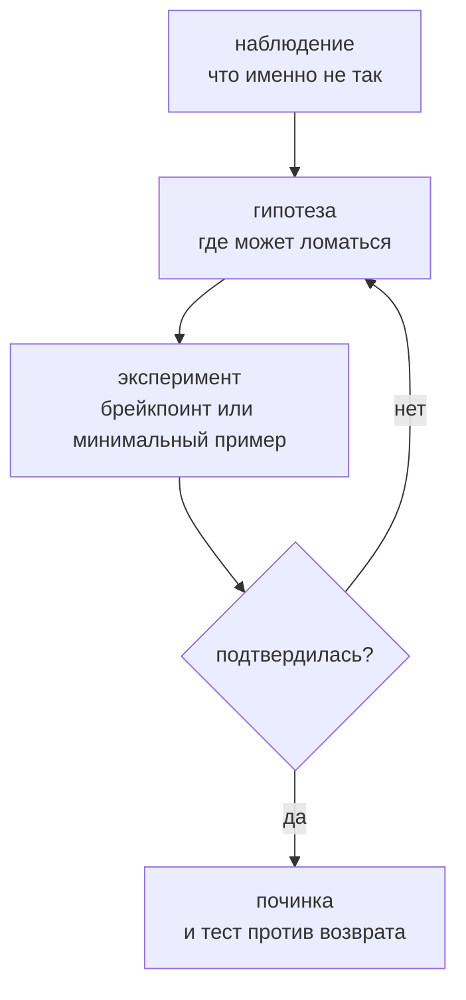

# Отладка
**Отладка** (debugging) — систематический поиск расхождения между тем, что код делает, и тем, что ты *думаешь*, что он делает[^1]. Инструмент номер один — не `console.log`, а **брейкпоинт**: остановленная программа, в которой можно осмотреться

[^1]: Термин "bug" старше компьютеров — Эдисон жаловался на "bugs" в аппаратуре ещё в 1878. Но канонический экспонат — журнал Гарвардского Mark II за 1947 год, куда команда Грейс Хоппер вклеила настоящую моль, найденную в реле, с подписью "First actual case of bug being found". Журнал с молью хранится в Смитсоновском музее

## Брейкпоинты

Клик по номеру строки в DevTools → Sources (или `debugger;` прямо в коде — программа встанет там, если DevTools открыты). Дальше — управление временем:

| Кнопка | Что делает |
|---|---|
| Resume (F8) | ехать до следующего брейкпоинта |
| Step over (F10) | следующая строка, не ныряя в вызовы |
| Step into (F11) | нырнуть внутрь вызываемой функции |
| Step out (Shift+F11) | доиграть текущую функцию и вынырнуть |

На паузе доступно всё: **Scope** — живые переменные (включая [[Функции и замыкания|замыкания]] — видно, что реально захвачено), **Call Stack** — как сюда попали, **Watch** — свои выражения, консоль выполняется *в контексте паузы*

> [!tip] Брейкпоинты бывают умными
> Правый клик по строке открывает целый арсенал, о котором многие не знают годами:
> - **условный брейкпоинт** — стоп только когда `id === 42` (внутри цикла на 10000 итераций незаменим)
> - **logpoint** — не останавливаясь, печатать выражение: `console.log` без правки кода и пересборки
> - брейкпоинты на **событие** (стоп на любой `click`), на **изменение [[HTML-документ и DOM-дерево|DOM]]-узла**, на **[[fetch|XHR]]/fetch по подстроке [[URL и адресация|URL]]** — когда неизвестно, *чей* код творит безобразие, но известно, *что* происходит

Минифицированный прод отлаживается благодаря **sourcemap** — карте "собранный код → исходник" от [[Бандлеры|бандлера]]: DevTools показывают твой [[Система типов TypeScript|TS]], хотя исполняется совсем другое

## Console

```js
console.table(cards);                  // массив объектов — таблицей с сортировкой
console.dir(el);                       // объект как дерево (для DOM-узлов — не HTML, а свойства)
console.trace("кто меня вызвал?");     // стек вызовов в точке
console.group("рендер"); … console.groupEnd();   // сворачиваемая группа логов
console.time("parse"); … console.timeEnd("parse");   // замер длительности (серьёзные замеры — [[Производительность страницы|профилировщик]])
console.count("клик");                 // счётчик срабатываний
console.assert(x > 0, "x упал в минус", x);      // лог только при нарушении
```

В самой консоли: `$0` — последний выбранный в Elements узел, `$$("li")` — querySelectorAll покороче, `copy(obj)` — объект в буфер обмена, `monitorEvents($0, "click")` — шпион за событиями

> [!warning] console.log живого объекта лжёт
> Консоль печатает *ссылку*: раскрыл объект позже — увидел его **текущее** состояние, не момент лога. Классическая мистификация "лог показывает правильное значение, а код падал". Снимок на момент лога — `console.log(structuredClone(obj))` или [[Слабоструктурированные данные и JSON|JSON]]-трюк

## Отладка Node

Тот же протокол инспектора, что у браузера:

```bash
node --inspect-brk script.js   # пауза на первой строке; --inspect — без паузы
```

Дальше `chrome://inspect` в браузере — и знакомый Sources для серверного кода. Редакторы говорят на том же протоколе через **DAP** (Debug Adapter Protocol — протокол адаптеров отладки): в nixvim это nvim-dap, брейкпоинты не выходя из редактора. Vitest тоже отлаживается: `vitest --inspect-brk --no-file-parallelism`

## Метод

Отладка — применение научного метода к коду:



- **Минимальное воспроизведение** — выбрасывай куски, пока баг не исчезнет: последний выброшенный и виноват. Тот же принцип автоматизирует `git bisect` — двоичный поиск сломавшего коммита по истории
- **Читай сообщение об ошибке целиком**, включая стек, — поразительная доля вопросов "почему падает" отвечена в первой же строке трейса ([[Ошибки и их обработка]])
- **Резиновая уточка**: объясни проблему вслух кому угодно, хоть игрушке, — на середине объяснения ответ часто находится сам[^2]. Это не шутка, а следствие того, что проговаривание заставляет проверить допущения, которые "и так очевидны"

[^2]: Rubber duck debugging канонизирован книгой "The Pragmatic Programmer" (1999): один из авторов возил с собой резиновую утку и требовал объяснять код ей
