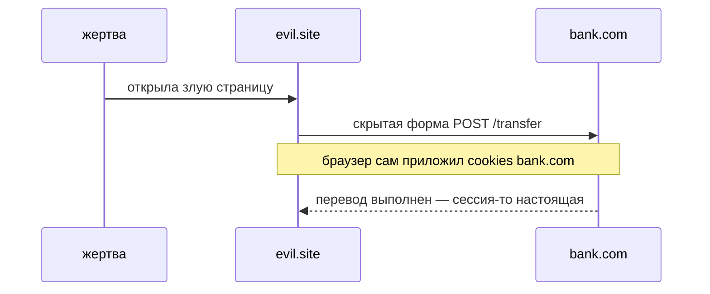

# Безопасность в браузере
Браузер — единственная программа, которая ежедневно исполняет код тысяч незнакомцев, и модель угроз у веба своя: не "взломали сервер", а "чужая страница дотянулась до твоих данных". Фундамент защиты — **same-origin policy** (SOP, политика одного источника): документы разных источников изолированы друг от друга

## Origin и его политика

**Origin** (источник) — тройка **схема + домен + порт**: `https://bank.com` и `http://bank.com` — разные, `https://evil.bank.com` — тоже. Внутри origin — всё общее; чужому origin браузер запрещает: читать [[HTML-документ и DOM-дерево|DOM]] другой вкладки/iframe, [[Хранение данных в браузере|localStorage и cookies]] чужого сайта, **читать ответы** [[fetch]] на чужой origin (сам запрос уйдёт — ответ не отдадут; управляемое ослабление — [[CORS на практике|CORS]])

SOP объясняет и странность из [[Модули|модуля 04]]: `file://` — origin-изгой ("null origin"), поэтому модули не работают без локального сервера

## XSS

**XSS** (Cross-Site Scripting — межсайтовый скриптинг; X вместо C, чтобы не путать с [[Каскад и селекторы|CSS]]) — атакующий добивается исполнения *своего* [[Типы и коэрция|JS]] на *твоей* странице. Это мгновенный мат: его код внутри твоего origin имеет всё — cookies, хранилища, действия от имени жертвы[^1]

| Вид | Механика |
|---|---|
| **stored** | зловред сохранён у тебя же: комментарий `<script>…</script>` показан всем |
| **reflected** | зловред в ссылке: `?q=` отражается в страницу поиска |
| **DOM-based** | сервер ни при чём: твой же JS вставил данные в `innerHTML` |

Защита по убыванию важности:

1. **данные не бывают разметкой**: вставка только через `textContent`/`value` ([[DOM API#^xss-innerhtml|правило из модуля 06]]); на сервере — экранирование при шаблонизации
2. **CSP** как страховка (ниже)
3. `HttpOnly` у cookies — JS их не видит, украсть сессию сложнее ([[Аутентификация и сессии|модуль 10]])

[^1]: Легенда жанра — червь **Samy** (MySpace, 2005): Сэми Камкар обошёл фильтры и вписал в свой профиль JS, который добавлял смотрящего в друзья и *копировал себя* в его профиль. Экспонента: миллион заражённых профилей за 20 часов, у всех в статусе "but most of all, samy is my hero". MySpace лёг, Камкар получил 3 года без компьютеров — сегодня он уважаемый security-исследователь, а червь Samy — вечный пример "фильтровать [[HTML-документ и DOM-дерево|HTML]] руками нельзя"

## CSRF

**CSRF** (Cross-Site Request Forgery — подделка межсайтового запроса) эксплуатирует то, что cookies исторически ездили с *любым* запросом на свой домен — даже отправленным с чужой страницы



Защита: атрибут cookie **SameSite** (`Lax` — дефолт современных браузеров: cookie не едет с cross-site POST) + **CSRF-токены** (форма несёт секрет, которого чужая страница знать не может). Практика — в [[Аутентификация и сессии]]

## CSP

**CSP** (Content Security Policy — политика безопасности контента) — [[HTTP|HTTP]]-заголовок, декларирующий, *откуда* странице можно грузить и исполнять код:

```http
Content-Security-Policy: default-src 'self'; script-src 'self'; img-src 'self' https:
```

Инлайновый `<script>` и `onclick="…"`-атрибуты при этом запрещены — потому современный код и живёт в [[События|addEventListener]]: XSS-вставка `<script>alert(1)</script>` просто не исполнится. Внедрять безболезненно позволяет режим `Content-Security-Policy-Report-Only` — не блокирует, а жалуется в консоль

## Остальной щит

| Заголовок | От чего |
|---|---|
| `Strict-Transport-Security` (**HSTS** — HTTP Strict Transport Security, принудительный [[HTTP\|HTTPS]]) | даунгрейд на http и перехват первого запроса |
| `X-Content-Type-Options: nosniff` | браузерное "угадывание" типов файлов (картинка, исполненная как скрипт) |
| `frame-ancestors 'none'` (в CSP) | **кликджекинг**: твой сайт в невидимом iframe, жертва кликает "не туда" |

> [!tip] Чужой сайт — тоже учебник
> Вкладка Network → любой ответ → Headers: у серьёзных сайтов (банк, GitHub) секция security-заголовков — готовый конспект лучших практик. Быстрый аудит любого сайта — securityheaders.com
