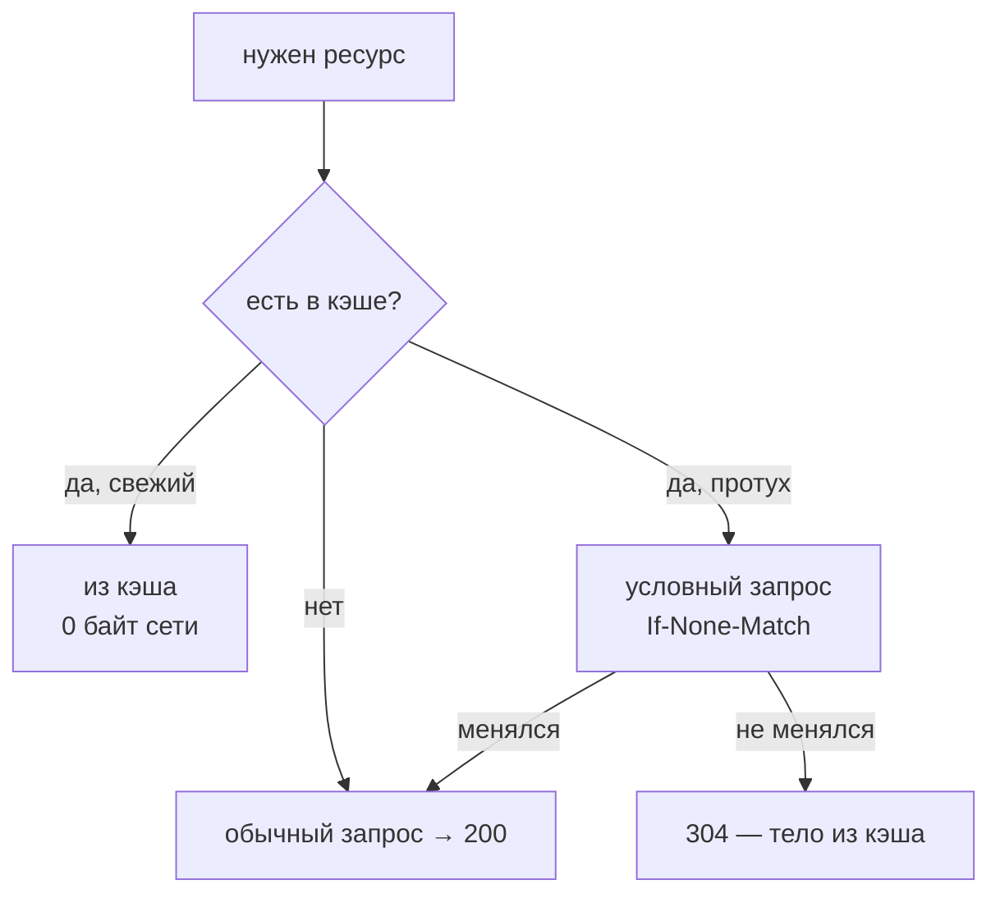

# Кэширование и сеть глубже
Самый быстрый запрос — тот, которого не было. **[[HTTP|HTTP]]-кэш** — хранение копий ответов у клиента; управляется заголовками ответа, и неправильная настройка бьёт в обе стороны: "тормозит" при выключенном кэше, "у пользователей старая версия" при включённом[^1]

[^1]: "There are only two hard things in Computer Science: cache invalidation and naming things" — Фил Карлтон (Netscape). Вебу досталась именно инвалидация: как заставить миллион браузеров забыть закэшированное? Спойлер ниже: никак — вместо этого меняют имя файла, элегантно сводя первую трудную проблему ко второй

## Свежесть и валидация

Два независимых механизма:

- **свежесть** — `Cache-Control: max-age=3600`: час можно брать из кэша *вообще без сети*
- **валидация** — протухший ответ не выбрасывается: браузер шлёт условный запрос с `If-None-Match: <ETag>` (**ETag** — отпечаток версии ресурса от сервера); не изменилось — сервер отвечает голым **304 Not Modified** без тела

Словарь `Cache-Control`: `no-cache` — хранить можно, но валидируй каждый раз (имя врёт!); `no-store` — не хранить вовсе (личные данные); `private` — только браузеру, не промежуточным кэшам; `immutable` — не перепроверяй даже на F5

## Паттерн вечного кэша

Индустриальный стандарт раздачи статики — разгадка хэшей в именах файлов от [[Бандлеры|Vite]] (`app-Bf3k9x.js`):

| Файл | Заголовок | Логика |
|---|---|---|
| `index.html` | `no-cache` | всегда валидируется — лёгкий, зато свежий |
| `assets/app-Bf3k9x.js` | `max-age=31536000, immutable` | кэш на год: содержимое сменилось → сменился хэш → это уже *другой [[URL и адресация\|URL]]* |

Инвалидация не нужна: новый деплой меняет имена файлов, html указывает на новые, старые просто отмирают. Так поедет и [[Деплой сайта|наш сайт]]

## Сжатие

Текстовые форматы ([[HTML-документ и DOM-дерево|HTML]], [[Типы и коэрция|JS]], [[Каскад и селекторы|CSS]], [[Слабоструктурированные данные и JSON|JSON]]) жмутся в 3–10 раз; браузер объявляет `Accept-Encoding: gzip, br`, сервер отвечает сжатым. **gzip** (1992) — везде; **brotli** (`br`, Google 2015) — на ~15–20% плотнее, стандарт для статики[^2]. Картинки/видео уже сжаты — их не трогают

[^2]: Brotli выигрывает в том числе за счёт читерства: в алгоритм вшит **словарь на 120 КБ** типичных веб-фрагментов — `
` (заранее открыть соединение к домену шрифтов/[[Программный интерфейс приложения|API]]), `dns-prefetch`, `preload` (качай сейчас, понадобится скоро)

## CDN

**CDN** (Content Delivery Network — сеть доставки контента) — сотни кэш-серверов по миру; [[Протокол DNS|DNS]]/anycast приводит пользователя на ближайший, оттуда статика едет за десятки мс вместо сотен через океан. Для владельца сайта — это ещё и щит (поглощение DDoS, [[HTTP|TLS]] на границе); бесплатные уровни Cloudflare/Netlify сделали CDN нормой даже для пет-проектов

> [!tip] Кэш проверяется руками за минуту
> Network → колонка Size: `(disk cache)`/`(memory cache)` — из кэша, `304` — валидация. Галка "Disable cache" в DevTools объясняет вечное недоумение "почему у меня всё быстро, а у людей медленно" — у тебя она снята, у пользователя кэш холодный. Совет вне очевидного: `curl -sI <url>` на свои и чужие сайты — читать `cache-control` продакшнов поучительнее статей
