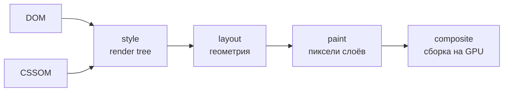

# Рендер-пайплайн
**Рендер-пайплайн** — конвейер, которым браузер превращает [[HTML-документ и DOM-дерево|DOM]] и стили в пиксели каждого кадра. [[Как браузер превращает ответ в пиксели#Пайплайн рендеринга|Обзорную картину]] мы видели в модуле 01; теперь — по этапам и с главным практическим вопросом: *что из пайплайна перезапускает каждое моё изменение*

## Этапы

| Этап | Что делает | Детали |
|---|---|---|
| **style** | каждому узлу — итоговые стили | это исполнение [[Каскад и селекторы|каскада]]; результат — **render tree** |
| **layout** (reflow) | геометрия: кто где и какого размера | вся механика [[Поток и позиционирование|потока]]; изменение одного узла может сдвинуть тысячи |
| **paint** | растеризация: границы, тексты, тени → пиксели | рисует не в экран, а в **слои** |
| **composite** | [[Графический процессор\|GPU]] складывает слои в кадр | отдельный поток — работает, даже когда main thread занят |

Render tree ≠ DOM: в нём только видимое — `display: none` узла нет вовсе, а `visibility: hidden` есть (место занимает — layout его считает)[^1]

[^1]: Движков рендеринга в мире осталось три: **Blink** (Chrome/Edge/Opera — форк WebKit 2013 года), **WebKit** (Safari; сам — форк KHTML из линуксового KDE (K Desktop Environment): код Konqueror дожил до миллиардов айфонов), **Gecko** (Firefox). Все браузеры "четвёртые и далее" — обёртки над Blink, поэтому "работает в Chrome" почти стало определением веба — чему **W3C** (World Wide Web Consortium) сопротивляется

## Цена изменения

Правишь свойство — перезапускается его этап *и всё после него*:

| Изменил | Перезапуск | Цена |
|---|---|---|
| `transform`, `opacity` | только composite | почти даром — GPU |
| `color`, `background`, `box-shadow` | paint → composite | средне |
| `width`, `font-size`, `top`, класс с ними | layout → paint → composite | дорого: **reflow** каскадом по соседям |

Это фундамент правила из [[Переходы и анимации]] "анимируй только transform и opacity" — теперь видно, *почему*: такая анимация не будит ни layout, ни paint, и живёт в композиторе плавной, даже если main thread захлебнулся [[Типы и коэрция|JS]]-ом

> [!warning] Чтение геометрии — тоже триггер
> `offsetHeight`, `getBoundingClientRect()`, `getComputedStyle()` заставляют браузер **синхронно** доиграть layout, если есть несделанные изменения. Цикл "записал стиль → прочитал размер" — [[DOM API#^layout-thrashing|layout thrashing]]: reflow на каждой итерации вместо одного

## Кадр и бюджет

Экран 60 Гц → кадр каждые **16.6 мс**; минус работа самого браузера — твоему коду остаётся ~10 мс. Рендер встроен в [[Event loop]]: браузер рисует между тасками, поэтому таск длиннее бюджета = пропущенные кадры = **jank** (рывки, "дёргается"). Колбэки `requestAnimationFrame` выполняются прямо перед style — идеальная точка для JS-анимаций и DOM-замеров

## Слои и GPU

Браузер сам выносит в отдельные слои то, что двигается (transform-анимации, видео, canvas). Подсказать заранее — `will-change: transform`[^2]. Слой = текстура в памяти GPU, поэтому щедрость наказуема: сотня слоёв на глубоком макете съедает память планшета

[^2]: До появления `will-change` (2015) слой выбивали хаком `transform: translateZ(0)` — "null transform hack": бессмысленная 3D-трансформация заставляла браузер завести GPU-слой. В легаси-коде встречается до сих пор — теперь ты знаешь, что это не магия, а костыль

> [!tip] Всё это видно глазами
> DevTools → Rendering (⋮ → More tools): **Paint flashing** подсвечивает зелёным перерисовываемые области (анимация мигает всей страницей? — ты дёргаешь layout), **Layer borders** показывает границы GPU-слоёв, **Frame rendering stats** — живой FPS (frames per second). Смотреть на свою страницу с включённым paint flashing — отрезвляюще
