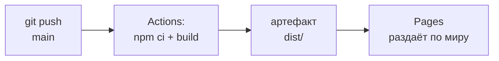

# Деплой сайта
Статический сайт хостится радикально проще [[Деплой в Docker|сервера]]: `dist/` — файлы, а раздавать файлы умеет любой [[Кэширование и сеть глубже|CDN]] бесплатно, глобально и с [[HTTP|HTTPS]]. Node в проде не нужен вовсе: сборка случилась один раз, дальше едет готовое[^1]

[^1]: Раскладку "предсобранная статика на CDN + динамика через [[Программный интерфейс приложения|API]]" называют **Jamstack** — ровно наша схема dist + deck-api. Первый массовый статический хостинг с деплоем из гита — GitHub Pages (2008); сегодня в нише Netlify, Vercel, Cloudflare Pages: git push → сборка → раздача по миру за секунды. Отдельная веха — Let's Encrypt (2015): некоммерческий центр сертификации сделал [[HTTP|TLS]]-сертификаты бесплатными и автоматическими, до него HTTPS стоил денег и ручной возни — потому его и не было у половины веба

## base-путь

Раздача из подпапки (`username.github.io/deck-web/`, не корень домена) ломает абсолютные пути `/assets/…`:

```ts
// vite.config.ts
export default defineConfig({
  base: "/deck-web/",   // ← имя репозитория; для корня домена — "/"
});
```

Vite перепишет ссылки на ассеты с этим префиксом. Симптом забытого `base` узнаётся мгновенно: страница грузится, но белая, в консоли — 404 на весь [[Типы и коэрция|JS]] и [[Каскад и селекторы|CSS]]

## Деплой через CI

Ручная заливка `dist/` работает, но правильная дорога — **CI/CD** (Continuous Integration / Continuous Deployment): git push сам собирает и публикует. GitHub Actions — workflow-файл в репозитории:

```yaml
# .github/workflows/deploy.yml
name: deploy
on:
  push: { branches: [main] }
jobs:
  build:
    runs-on: ubuntu-latest
    steps:
      - uses: actions/checkout@v4
      - uses: actions/setup-node@v4
        with: { node-version: 22 }
      - run: npm ci && npm run build
      - uses: actions/upload-pages-artifact@v3
        with: { path: dist }
  deploy:
    needs: build
    runs-on: ubuntu-latest
    permissions: { pages: write, id-token: write }
    steps:
      - uses: actions/deploy-pages@v4
```



Ценность не в экономии двух команд, а в **воспроизводимости**: сборка на чистой машине из [[Node и npm#Semver|lock-файла]] (`npm ci`), без "у меня на ноуте собиралось". Забытый в коммите файл роняет CI сразу — а не пользователя потом. Побочный бонус: деплой атомарен — артефакт публикуется целиком, полусобранного состояния между версиями посетитель не увидит

## Свой домен

Домен — это записи **[[Протокол DNS|DNS]]** у регистратора: `A` — имя → IPv4-адрес, `CNAME` — имя → другое имя. Для Pages достаточно `CNAME deck.example.com → username.github.io` плюс имя домена в настройках репозитория — сертификат на него выпустится автоматически. Проверка распространения записи — `dig deck.example.com` ([[URL и адресация|модуль 01]] в боевых условиях)

## Что достаётся бесплатно

| Возможность | Как |
|---|---|
| **HTTPS** | сертификат Let's Encrypt автоматом |
| **CDN** | раздача с ближайшего к пользователю узла |
| **[[Кэширование и сеть глубже\|вечный кэш]]** | хэши в именах от Vite → `immutable` работает сам |
| **откат** | git revert → CI выкатит прошлую версию |

> [!tip] Куда что деплоить — по природе, а не по привычке
> Один вопрос: нужен ли серверный код на каждый запрос? Нет (наш клиент, лендинг, блог, документация) → статический хостинг, бесплатно и неубиваемо. Да ([[Сервер на Hono и SQLite|API]], база, сессии) → контейнер на **VPS** (Virtual Private Server) или облако. Типичное приложение — гибрид: статика фронта на CDN + отдельный API-сервер, между ними [[CORS на практике|CORS]] или общий домен через прокси
