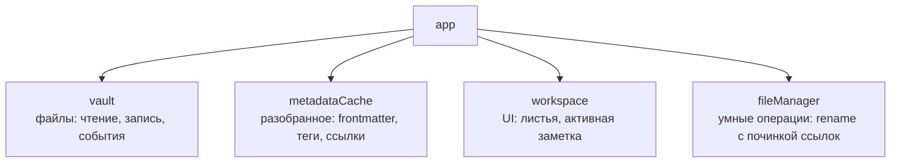

# Obsidian API
[[Программный интерфейс приложения|API]] Obsidian описан одним файлом деклараций `obsidian.d.ts` — [[tsconfig и файлы деклараций#Чтение реального .d.ts|читать который]] мы уже умеем; это и есть первоисточник документации. Корень всего — объект **`app`**: от него ветвятся подсистемы, и 90% кода плагина — вызовы `this.app.<что-то>`



## Vault против MetadataCache

| | `app.vault` | `app.metadataCache` |
|---|---|---|
| про что | сырые файлы на диске | *разобранное* содержимое |
| даёт | `read`, `create`, `modify`, `delete` | frontmatter, теги, заголовки, ссылки, блок-якоря |
| когда | нужен текст или запись | нужна структура без ручного парсинга |

Парсить frontmatter регэкспом из текста — ошибка новичка: metadataCache уже разобрал каждую заметку хранилища. FSRS Vocabulary (личный волт) так и опознаёт словари — не читая файл: словарь — это заметка с ключом `fsrs-vocabulary` во frontmatter:

```ts
function isDictionary(app: App, file: TFile): boolean {
  const fm = app.metadataCache.getFileCache(file)?.frontmatter;
  return fm !== undefined && Object.hasOwn(fm, "fsrs-vocabulary");
}
```

> [!note] TFile — объект, а не путь
> Файлы в API — объекты `TFile` (`.path`, `.basename`, `.extension`, `.stat`), папки — `TFolder`, общий предок — `TAbstractFile`. Строка превращается в объект через `app.vault.getAbstractFileByPath(path)` (с проверкой `instanceof TFile` — [[Сужение типов|сужение]] в чистом виде). Пути внутри API всегда относительны корню хранилища и с прямыми слэшами; чужой ввод нормализуется хелпером `normalizePath()`

## Работа с файлами

```ts
const text = await this.app.vault.read(file);            // прочитать
await this.app.vault.process(file, (t) => t + "\nnew");  // атомарная правка текста
const file = await this.app.vault.create("Новая.md", "# Заголовок");

// точечная правка метаданных — без ручной сборки YAML:
await this.app.fileManager.processFrontMatter(file, (fm) => {
  fm["fsrs-vocabulary"] = { mute: true };   // FSRS Vocabulary так пишет настройки словаря
});
```

Иерархия аккуратности: `vault.modify` заменяет файл целиком (параллельные правки затирают друг друга) → `vault.process` применяет функцию к актуальному тексту атомарно → `processFrontMatter` атомарно правит только [[YAML]]-frontmatter. Для переименований — `fileManager.renameFile`: он чинит входящие `[[ссылки]]` по всему хранилищу, ровно как команда Obsidian

Прямой `fs` из Node — вне игры даже на десктопе: мимо vault-API не сработают события, кэш разъедется с диском, а на мобильном кода ждёт падение

## Workspace

`app.workspace` — то, что на экране. Раскладка — дерево разрезов (split), в листьях которого **WorkspaceLeaf** — вкладки с вью; активная заметка, панели, боковые сайдбары — всё листья:

```ts
const file = this.app.workspace.getActiveFile();                 // что открыто сейчас
const view = this.app.workspace.getActiveViewOfType(MarkdownView);  // null, если не markdown
this.app.workspace.getLeavesOfType("fsrs-vocabulary-view");          // все свои панели
```

`getActiveViewOfType` вместо кастов — API сам возвращает `null`, когда активно не то: типобезопасность здесь бесплатная

## События

Плагин живёт, откликаясь на изменения. Подписка — только через [[Анатомия плагина Obsidian#onload / onunload|registerEvent]]:

```ts
this.registerEvent(this.app.vault.on("modify", (file) => this.index.update(file)));
this.registerEvent(this.app.vault.on("rename", (file, oldPath) => this.index.move(oldPath, file)));
this.registerEvent(this.app.metadataCache.on("changed", (file) => { /* fm перечитан */ }));
```

Так устроен индекс словарей FSRS Vocabulary: события `changed`/`rename`/`delete` держат in-memory множество путей актуальным без пересканирования хранилища[^1]

[^1]: Гонка, о которую спотыкаются все: `vault.on("modify")` стреляет при записи файла — *до* того, как metadataCache перечитает frontmatter, и `getFileCache` в этот момент отдаёт старое. Для реакции на метаданные подписываются на `metadataCache.on("changed")`, не на `vault.on("modify")`. Второй нюанс того же рода — старт приложения: кэш прогревается асинхронно, и код в `onload`, сканирующий хранилище, ждёт `metadataCache.on("resolved")`, иначе увидит полупустой индекс

> [!tip] Учись API интроспекцией
> В консоли DevTools набери `app.` — автодополнение по живому объекту; `app.vault`, `app.workspace` можно щупать в [[Node как рантайм|REPL]] прямо на своём хранилище. В редакторе Ctrl+Click по методу проваливается в `obsidian.d.ts` — [[tsconfig и файлы деклараций#^nav-types|навигация по типам]] заменяет половину документации, а вторая половина — исходники чужих плагинов с GitHub
