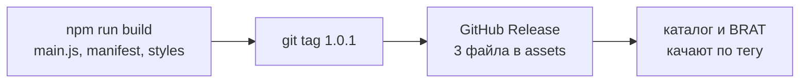

# Сборка и публикация плагина
Сборка плагина — [[Бандлеры#Два поколения инструментов|esbuild]] в один `main.js` с одной особенной настройкой: пакеты, которые предоставляет сама среда, из бандла **исключаются**

```js
// esbuild.config.mjs (сердцевина)
esbuild.build({
  entryPoints: ["src/main.ts"],
  bundle: true,
  outfile: "main.js",
  format: "cjs",                          // Obsidian загружает CommonJS
  external: ["obsidian", "electron", ...builtins],   // ← НЕ включать в бандл
  target: "es2022",
});
```

**`external`** значит "эти импорты оставь как есть — их отдаст хозяин": модуль `obsidian` существует только внутри работающего приложения, [[Архитектура Electron|electron]] и встроенные Node-модули — тоже. Без external esbuild попытался бы втянуть в `main.js` весь редактор — и упал бы, потому что пакета `obsidian` с кодом в npm нет, там лежит лишь `obsidian.d.ts` с типами[^1]

[^1]: Тот же паттерн границы владения — в `peerDependencies` npm-библиотек ("React принеси свой, мой бандл его не включает") и в [[Кэширование и сеть глубже#Паттерн вечного кэша|разделяемых зависимостях]] вообще: не дублируй то, что уже есть в среде. Кто владеет зависимостью — решает рантайм, а не сборщик

## Конвейер качества

У FSRS Vocabulary (личный волт) — полный набор из модуля 08: [[ESLint и Prettier|линтер]], [[Тестирование с vitest|vitest]] на [[Анатомия плагина Obsidian|FSRS]]-логику, строгий tsc

```jsonc
"scripts": {
  "dev": "node esbuild.config.mjs",                  // watch + копирование в хранилище
  "build": "npm run typecheck && node esbuild.config.mjs production",
  "typecheck": "tsc --noEmit",                        // типы отдельно: esbuild их не проверяет
  "check": "npm run typecheck && npm run lint && npm run test"
}
```

`tsc --noEmit` в сборке обязателен: esbuild срезает типы не глядя, и без отдельной проверки строгий TypeScript тихо превращается в декорацию. Dev-приём: esbuild-плагин по `onEnd` копирует `main.js` + `manifest.json` + `styles.css` в `.obsidian/plugins/<id>/` тестового хранилища; путь — из `OBSIDIAN_PLUGIN_DIR` в локальном `.env` ([[Node как рантайм#process|конфиг в окружении]]). Сохранил файл — уже в хранилище, остался Ctrl+R

## Версии

Согласованность держат три места:

| Где | Что |
|---|---|
| `manifest.json` | `version` (semver плагина) + `minAppVersion` |
| `versions.json` | карта "версия плагина → минимальный Obsidian" |
| git-тег | `1.0.1` — **без** префикса `v`, дословно как в манифесте |

[[Node и npm#Semver|Semver]] в терминах плагина: MAJOR — сломан формат данных пользователя, MINOR — фича, PATCH — багфикс. `minAppVersion` — обещание "нужен Obsidian не старше": взял свежий метод [[Программный интерфейс приложения|API]] — подними, иначе на старых версиях плагин молча упадёт при загрузке

## Релиз



1. `npm run build` → три артефакта
2. GitHub Release с тегом-версией; в assets — `main.js`, `manifest.json`, `styles.css` **отдельными файлами**, не архивом: установщики качают их по именам
3. первая публикация — PR в `obsidianmd/obsidian-releases` с записью о плагине; дальше каталог подхватывает новые релизы сам

> [!tip] BRAT — бета-канал до каталога
> Плагин **BRAT** (Beta Reviewer's Auto-update Tool) ставит плагины из любого GitHub-репозитория, минуя каталог: тестерам достаточно строки `rokokol/obsidian-fsrs-vocabulary`, свежие релизы они получают сразу. Ревью каталога занимает недели — BRAT позволяет обкатать плагин на живых людях до подачи. FSRS Vocabulary до каталога живёт именно так

> [!warning] Ревью каталога — конспект чужих граблей
> Гайдлайны Obsidian читаются как список типовых ошибок плагинов, каждая — знакомая тема курса: `innerHTML` пользовательских данных — отказ ([[Безопасность в браузере#XSS|XSS]]), сетевые запросы без нужды — вопросы на ревью, мусор после выключения — нарушение [[Анатомия плагина Obsidian#^register-cleanup|автоочистки]], нечестный `isDesktopOnly` — падение на мобильном. Пройти ревью — значит показать, что весь курс усвоен

> [!success] Ветка плагинов закрыта
> От `manifest.json` до PR в каталог — на коде собственного FSRS Vocabulary. Последняя развилка курса — [[Архитектура Electron|десктоп]]: Obsidian сам построен на Electron, следующий модуль показывает эту среду изнутри
