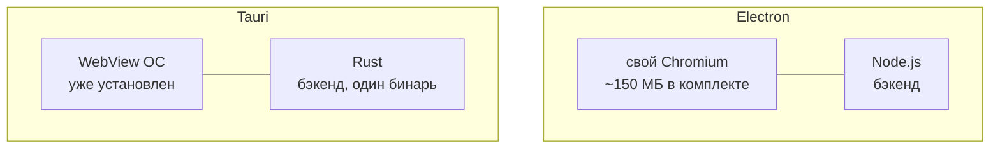

# Tauri
**Tauri** — тот же замысел, что [[Архитектура Electron|Electron]] (десктоп на веб-UI), с другим фундаментом: интерфейс рисует **системный WebView**, а не свой Chromium, бэкенд — **Rust**, а не Node[^1]. Одно решение — и весь профиль приложения другой: размер, память, безопасность, цена входа

[^1]: **WebView** — движок браузера, встроенный в [[Операционная система|ОС]] для чужих приложений: WebView2 (Chromium) в Windows, WKWebView (WebKit) в macOS, WebKitGTK в Linux. Tauri (2020) переиспользует его вместо того, чтобы нести свой. Обратная сторона лёгкости — фрагментация: [[Пользовательский интерфейс|UI]] рендерят *разные* движки на разных ОС, и возвращаются кросс-браузерные различия из [[Рендер-пайплайн|модуля 09]], от которых Electron откупался, таская единый Chromium с собой

## Физическая разница



| | Electron | Tauri |
|---|---|---|
| движок UI | свой Chromium | системный WebView |
| размер приложения | ~85–150 МБ | ~3–10 МБ |
| память | Chromium на каждое приложение | заметно легче |
| бэкенд | [[Node как рантайм\|JavaScript/Node]] | Rust |
| рендеринг един на всех ОС | ✅ | ❌ разные движки |
| зрелость, экосистема | огромная | молодая, растёт быстро |

## Команды

Фронтенд не меняется — та же [[Каркас сайта на Vite|Vite-страница]] с [[DOM API|DOM]]. Меняется мост: вместо [[Electron на практике|IPC-каналов]] — **команды**, вызывающие Rust-функции:

```rust
// src-tauri/src/lib.rs — бэкенд
#[derive(serde::Deserialize, serde::Serialize)]
struct Card { front: String, back: String }

#[tauri::command]
fn save_deck(cards: Vec<Card>) -> Result<(), String> {
    // запись в файл средствами Rust
}
```

```js
// фронтенд — знакомый async/await
import { invoke } from "@tauri-apps/api/core";
await invoke("save_deck", { cards });
```

`invoke("имя", аргументы)` ↔ `#[tauri::command]` — тот же [[async и await|запрос-ответ]], что `ipcRenderer.invoke` ↔ `ipcMain.handle`; модель [[Архитектура Electron#IPC|"клиент зовёт эндпоинт бэкенда"]] переносится дословно. Бонус границы: аргументы десериализуются в Rust-структуры библиотекой serde — пришло не то по форме, команда даже не вызовется. Валидация, которую в Electron писали руками, здесь зашита в систему типов

## Безопасность как архитектура

Tauri проектировался, когда [[Архитектура Electron#Preload и изоляция контекста|уроки дыр Electron]] уже были выучены, — и закрутил гайки сильнее:

- WebView не имеет ни Node, ни прямого системного доступа — только `invoke` к явно объявленным командам
- **capabilities** — белый список в конфигурации: каким окнам какие права (файлы, диалоги, шелл) вообще доступны; неописанное недоступно физически — это [[Безопасность в браузере#CSP|логика CSP]], поднятая на уровень приложения
- Rust закрывает целый класс уязвимостей памяти в самом бэкенде

> [!important] Цена входа — Rust
> Бэкенд-логика (файлы, база, системное) пишется на Rust — языке со строгой моделью владения памятью и настоящей кривой обучения; для веб-разработчика это второй язык, а не "ещё немного [[Типы и коэрция|JS]]". Потому выбор часто решается не техникой, а командой: весь стек на JS — Electron; готовность растить Rust-компетенцию ради лёгкости и безопасности — Tauri

> [!tip] Выбор в 2020-х
> - **Electron** — зрелость, единый рендеринг, вся команда на JS, вес не критичен (VS Code, Obsidian, Discord живут здесь)
> - **Tauri** — важны размер и память, безопасность как приоритет, Rust не пугает
> - **а нужен ли десктоп** — первый честный вопрос: PWA (Progressive Web App — сайт, устанавливаемый как приложение) закрывает многие кейсы без упаковки и подписи. Десктоп берут ради настоящего системного доступа — файлы, трей, офлайн, глобальные хоткеи, — а не "чтобы была иконка"

> [!success] Конец курса
> Дуга пройдена: [[HTTP|как работает веб]] → [[Семантическая разметка|HTML]] → [[Каскад и селекторы|CSS]] → [[Типы и коэрция|JavaScript]] → [[async и await|асинхронность]] → [[DOM API|браузер]] → [[Система типов TypeScript|TypeScript]] → [[Node и npm|инструменты]] → [[Рендер-пайплайн|браузер изнутри]] → [[Дизайн REST API|сервер и API]] → [[Каркас сайта на Vite|свой сайт]] → [[Анатомия плагина Obsidian|плагины]] → десктоп. Один язык и одна платформа-браузер дали полный спектр продуктов. Дальше вглубь ведёт не следующий модуль, а свой проект: FSRS Vocabulary (личный волт), сайт, сервер — под каждым теперь фундамент
