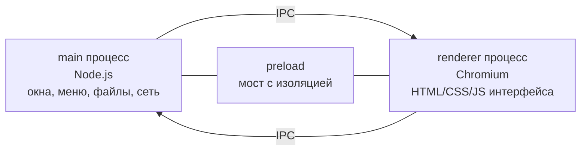

# Архитектура Electron
**Electron** — фреймворк десктоп-приложений на веб-стеке: **Chromium** (рендеринг) и **Node.js** (доступ к системе) склеены в один исполняемый файл. Интерфейс — обычная веб-страница, бэкенд — Node[^1]. VS Code, Discord, Slack, Figma, сам [[Анатомия плагина Obsidian|Obsidian]] — всё это Electron

[^1]: Родословная: GitHub делал редактор Atom (2013), вынес его оболочку в Atom Shell, переименовал в Electron. Идея "десктоп на [[HTML-документ и DOM-дерево|HTML]]" старше (Adobe AIR — Adobe Integrated Runtime, XULRunner у Mozilla), но победила именно связка Chromium+Node — экосистемой: любой веб-разработчик пишет десктоп без нового языка. Цена — вес: каждое приложение несёт свой Chromium, ~150 МБ на диске и сотни мегабайт [[Характеристики ЗУ и типы ПЗУ|RAM]], отсюда мем "Slack ест гигабайт ради чата". Ответ индустрии на эту цену — [[Tauri]], последняя заметка курса

## Два процесса



| | main | renderer |
|---|---|---|
| сколько | один | по одному на окно |
| среда | [[Node как рантайм\|Node]]: fs, сеть, процессы | [[DOM API\|браузер]]: [[HTML-документ и DOM-дерево\|DOM]], без Node |
| роль | окна, системные [[Программный интерфейс приложения\|API]], данные | весь [[Пользовательский интерфейс\|UI]]: [[Каскад и селекторы\|CSS]], [[События\|события]] |
| файл | `main.js` (`app`, `BrowserWindow`) | твоя [[Каркас сайта на Vite\|Vite-страница]] |

Ментальная модель, снимающая путаницу: **main — твой [[Дизайн REST API|сервер]], renderer — твой [[Каркас сайта на Vite|сайт]]**, оба в одном приложении, а вместо [[HTTP|HTTP]] между ними — [[Loopback и локальное взаимодействие|IPC]]. Всё, что известно про клиент-сервер, переносится сюда без изменений — вплоть до того, что renderer-процессов много (окна), а main один и владеет состоянием

## IPC

Renderer не имеет Node, поэтому "прочитать файл" или "показать нативный диалог" он **просит** у main через [[Loopback и локальное взаимодействие|IPC]]:

```js
// renderer: просит
const path = await window.api.openFile();

// main: обслуживает (эндпоинт!)
ipcMain.handle("dialog:open", async () => {
  const { filePaths } = await dialog.showOpenDialog({ properties: ["openFile"] });
  return filePaths[0];
});
```

`ipcRenderer.invoke` ↔ `ipcMain.handle` — [[async и await|асинхронный]] запрос-ответ, [[fetch|fetch]] внутри приложения: канал-имя вместо [[URL и адресация|URL]], промис вместо Response. Каналы проектируются как [[Дизайн REST API|роуты]] — узкие, именованные по смыслу (`deck:save`), с валидацией аргументов на стороне main: доверять данным из renderer нельзя по тем же причинам, что данным из браузера на сервере

## Preload и изоляция контекста

Между мирами стоит **preload** — скрипт, исполняемый в renderer до загрузки страницы, с доступом к обеим сторонам. Он публикует наружу **узкий** API — и только его:

```js
// preload.js — единственный мост
const { contextBridge, ipcRenderer } = require("electron");
contextBridge.exposeInMainWorld("api", {
  openFile: () => ipcRenderer.invoke("dialog:open"),   // ровно это, ничего сверх
});
```

> [!danger] Renderer в Node пускать нельзя
> Renderer показывает веб-контент, а веб-контент бывает враждебным: [[Безопасность в браузере#XSS|XSS]], чужой iframe, открытая ссылка. Если у renderer есть Node, XSS превращается из "украли данные вкладки" в **исполнение произвольных команд на машине пользователя** — чтение файлов, установка малвари
>
> Поэтому современный Electron: `nodeIntegration: false`, `contextIsolation: true` (миры страницы и preload не видят прототипов друг друга — подменить `Array.prototype` и дотянуться до моста нельзя), плюс песочница Chromium для renderer по умолчанию. Наружу торчит ровно то, что preload явно выставил[^2]

[^2]: Ранний Electron давал renderer полный Node по умолчанию — и годами это была фабрика уязвимостей: XSS в чат-приложении = RCE (Remote Code Execution — удалённое исполнение кода) на десктопе; такие дыры находили у Discord, Slack, Signal. Изоляция контекста стала дефолтом только в Electron 12 (2021), песочница renderer — в Electron 20. Итоговая модель — принцип наименьших привилегий: renderer не "может всё, но обещает не делать", а физически не может ничего, кроме выданного

Остальная гигиена безопасности из официального чек-листа Electron логична из той же модели: не грузить в окно удалённые URL (загруженный сайт получил бы твой preload-API), проверять `event.senderFrame` в обработчиках IPC, не отключать `webSecurity`

> [!tip] Три файла — три роли
> `main.js` — сервер (Node, окна, IPC-эндпоинты), `preload.js` — таможня (что пропустить), `index.html` со скриптами — сайт (весь UI). С этой картой не спутаешь, где какой код живёт и почему `require("fs")` в renderer — ошибка, а в main — норма
