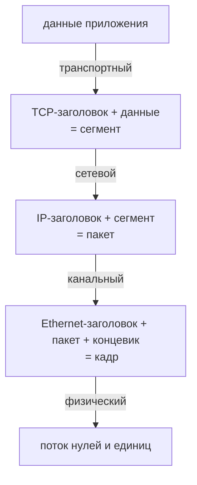
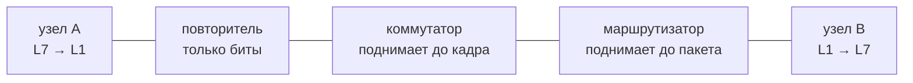

# Инкапсуляция и заголовки
## Слоёный пирог [45:46](https://www.youtube.com/watch?v=PHgnSnlxmLk&t=2746s)

> [!note] Инкапсуляция — помещение данных вышележащего уровня в структуры нижележащего [45:46](https://www.youtube.com/watch?v=PHgnSnlxmLk&t=2746s)
> На отправляющей стороне данные идут последовательно сверху вниз по [[Эталонная модель OSI|уровням]], на принимающей — снизу вверх. Каждый уровень заворачивает то, что получил от соседа сверху, в собственную структуру и передаёт ниже

> [!note] Заголовок, концевик и полезная нагрузка [47:21](https://www.youtube.com/watch?v=PHgnSnlxmLk&t=2841s)
> К данным сверху добавляется **заголовок** (header) и, возможно, **концевик** (trailer, трейлер). Заголовок есть почти всегда, концевик — далеко не у каждого протокола
> Вся конструкция "заголовок + данные + концевик" для нижележащего протокола — просто **полезная нагрузка** (payload): он в неё не заглядывает и о её внутреннем устройстве ничего не знает

> [!warning] Вниз по стеку блок только растёт [51:04](https://www.youtube.com/watch?v=PHgnSnlxmLk&t=3064s)
> Каждый уровень дописывает свои служебные байты, поэтому [[Эталонная модель OSI|PDU]] нижележащего уровня всегда больше PDU вышележащего. Полезных данных при этом не прибавляется — прибавляется служебка

> [!note] Декапсуляция [48:58](https://www.youtube.com/watch?v=PHgnSnlxmLk&t=2938s)
> Обратный ход: из битового потока формируются кадры, в кадре находятся заголовок и концевик, полезная нагрузка ([[IP-адрес и маска подсети|IP]]-пакет) отдаётся выше. IP выделяет свой заголовок и отдаёт сегмент транспортному уровню, тот — сеансовому, и так до приложения

## Роль служебных заголовков [57:40](https://www.youtube.com/watch?v=PHgnSnlxmLk&t=3460s)

Заголовок — единственный способ передать служебную информацию вместе с данными. Читают его промежуточные [[Сетевое оборудование по уровням|устройства]] по пути и операционные системы отправителя и получателя. Что ломается без каждого:

- без [[Заголовок TCP и установление соединения|TCP]]-заголовка приёмная сторона не знает, всё ли пришло, в каком порядке и не исказилось ли по дороге — вместе с заголовком исчезают все функции гарантированной доставки
- без IP-заголовка невозможна [[Таблица маршрутизации|маршрутизация]]: непонятно, куда отправлять данные дальше

## Октет и бит в заголовке

На физическом уровне передаются биты, а начиная с канального данные нарезаны на **октеты**[^octet] и уложены в структуру с заголовком; на проводе кадр всё равно снова сериализуется в биты

> [!note] Октет — единица выравнивания, бит — единица смысла внутри поля
> Заголовки строятся **byte-aligned**: протокол описывается в терминах "поле длиной столько-то байт на таком-то смещении", и сдвиг на $N$ байт приводит ровно к началу поля. Внутри октета значение может дробиться на битовые поля, когда тратить целый байт на один флаг расточительно, — компромисс между экономией места и простотой разбора

| Заголовок | Битовые поля |
|---|---|
| [[Заголовок IPv4\|IPv4]] | Version (4 бита) + [[Заголовок IPv4\|IHL]] (4) в первом октете; [[Заголовок IPv4\|DSCP]] (6) + [[Заголовок IPv4\|ECN]] (2) во втором; три бита флагов с [[MTU и фрагментация\|DF и MF]] + Fragment Offset (13) — одно 16-битное поле поперёк двух октетов |
| [[Заголовок TCP и установление соединения\|TCP]] | восемь однобитных флагов [[Заголовок TCP и установление соединения\|CWR]], [[Заголовок TCP и установление соединения\|ECE]], [[Заголовок TCP и установление соединения\|URG]], [[Заголовок TCP и установление соединения\|ACK]], [[Заголовок TCP и установление соединения\|PSH]], [[Заголовок TCP и установление соединения\|RST]], [[Заголовок TCP и установление соединения\|SYN]], [[Заголовок TCP и установление соединения\|FIN]] в одном октете |
| [[Кадр Ethernet\|Ethernet II]] | без тега все поля кратны байту; битовые поля появляются в [[VLAN и стандарт 802.1Q\|теге 802.1Q]]: [[VLAN и стандарт 802.1Q\|PCP]] (3) + [[VLAN и стандарт 802.1Q\|DEI]] (1) + [[VLAN и стандарт 802.1Q\|VLAN]] ID (12) |

[^octet]: "Октет", а не "байт", — потому что в стандартах важна точность: исторически байт бывал и 6, и 9 бит, а октет — всегда ровно 8. Многобайтовые поля передаются старшим байтом вперёд (big-endian), это и называется **сетевым порядком байт**

## Выделение кадров из битового потока [59:43](https://www.youtube.com/watch?v=PHgnSnlxmLk&t=3583s)

В непрерывном потоке нулей и единиц приёмник ищет **зарезервированные последовательности** — маркеры начала и конца кадра. Всё, что между парой маркеров, считается одним кадром; для следующего кадра передаётся своя пара. Конкретные последовательности, преамбула и то, почему такие комбинации не могут встретиться в данных, — в [[Кодирование сигнала и границы кадра]]

Дальше начинается декапсуляция: срезается заголовок и концевик канального уровня, содержимое идёт на сетевой, там срезается свой заголовок — и так вверх

> [!warning] Ошибку разбора никто не чинит и никому не сообщает [73:57](https://www.youtube.com/watch?v=PHgnSnlxmLk&t=4437s)
> Маркер искажён, два кадра слиплись в один — сетевое оборудование 1–3 уровней **не уведомляет отправителя**: это не его задача, данные просто дропаются. Классический Ethernet — среда с **негарантированной доставкой**, отправитель считает дело сделанным по факту отправки [77:35](https://www.youtube.com/watch?v=PHgnSnlxmLk&t=4655s)
>
> > [!example] Что именно убивает слипшийся кадр [74:29](https://www.youtube.com/watch?v=PHgnSnlxmLk&t=4469s)
> > Если склейка вылезла за [[MTU и фрагментация|MTU]] (Maximum Transmission Unit[^mtu-name]) — кадр отбрасывается как слишком длинный
> > Если уложилась — получается кадр с заголовком первого и концевиком последнего, и его добивает [[Кадр Ethernet|контрольная сумма в концевике]] [76:02](https://www.youtube.com/watch?v=PHgnSnlxmLk&t=4562s). Из-за склейки или из-за одного перевёрнутого бита — [[Кадр Ethernet|Ethernet]] не разбирается и переспрашивать не будет

[^mtu-name]: Лектор расшифровывает как Maximum Transfer Unit — в стандартах закрепилось Maximum *Transmission* Unit

## Путь данных между узлами A и B [61:49](https://www.youtube.com/watch?v=PHgnSnlxmLk&t=3709s)

Идеальный случай — два компьютера, соединённых напрямую кабелем (витая пара, коаксиал — неважно). Данные спускаются по стеку с 7 уровня до 1, физический уровень превращает их в биты и отдаёт в среду; сетевой адаптер на приёме собирает кадры, отдаёт в [[Операционная система|ОС]], дальше движение снизу вверх до приложения

Реальность: A и B почти никогда не соединены напрямую [63:54](https://www.youtube.com/watch?v=PHgnSnlxmLk&t=3834s) — расстояние больше возможностей кабеля, сигнал затухает и искажается настолько, что приёмник перестаёт отличать 0 от 1. Между узлами встаёт цепочка устройств, и каждое поднимает данные ровно на столько уровней, сколько нужно для его собственного решения [68:07](https://www.youtube.com/watch?v=PHgnSnlxmLk&t=4087s)

| Устройство | До какого уровня поднимается | Что делает с данными |
|---|---|---|
| повторитель | 1 [64:57](https://www.youtube.com/watch?v=PHgnSnlxmLk&t=3897s) | биты входят, форма восстанавливается, биты выходят — подъёма по стеку нет вообще |
| мост, коммутатор | 2 [65:28](https://www.youtube.com/watch?v=PHgnSnlxmLk&t=3928s) | поток делится на кадры, кадр обрабатывается на втором уровне, снова превращается в биты и уходит в следующий сегмент |
| маршрутизатор | 3 [67:04](https://www.youtube.com/watch?v=PHgnSnlxmLk&t=4024s) | биты → кадр → извлечённый пакет, решение о маршрутизации, затем вниз: новый канальный заголовок и снова биты |

Кто есть кто и по какому полю заголовка принимает решение — в [[Сетевое оборудование по уровням]]. Как этот же путь выглядит со стороны браузера — в [[Клиент, сервер и путь запроса]]

> [!important] Заголовок и концевик не переживают промежуточное устройство [69:42](https://www.youtube.com/watch?v=PHgnSnlxmLk&t=4182s)
> На разных интерфейсах одного маршрутизатора могут работать разные канальные протоколы: на одном Ethernet, на другом **Frame Relay**, **ATM** (Asynchronous Transfer Mode) или что угодно ещё
> Поэтому старые заголовок и концевик не хранятся "на потом": кадр разобран, пакет отдан выше, остатки отброшены. При движении вниз через другой интерфейс формируются **новые** заголовок и концевик — того протокола, который используется там
> Это и есть выигрыш от иерархии протоколов: канальные протоколы в сегментах разные, а IP-пакет от A до B один и тот же
