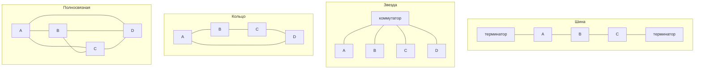
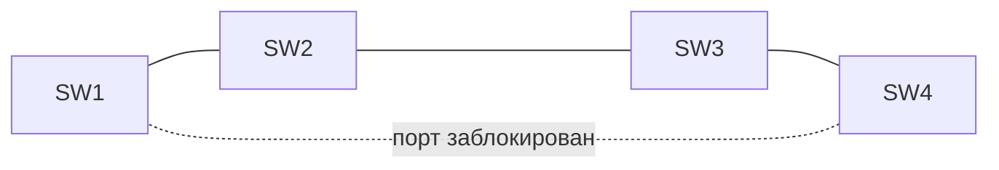

# Топологии сетей
## Физическая и логическая топология [71:46](https://www.youtube.com/watch?v=PHgnSnlxmLk&t=4306s)

> [!warning] Всегда уточняй, о какой топологии речь [71:46](https://www.youtube.com/watch?v=PHgnSnlxmLk&t=4306s)
> **Физическая топология** — как устройства физически соединены кабелями друг с другом. **Логическая** — по каким путям трафик реально ходит поверх этих кабелей
> Они расходятся сплошь и рядом, и вопрос "какая тут топология" без указания типа ответа не имеет. Ниже — только физические

## Базовые топологии

### Шина [73:25](https://www.youtube.com/watch?v=PHgnSnlxmLk&t=4405s)

Исторически Ethernet начинался с толстого или тонкого [[Коаксиальный кабель|коаксиального кабеля]], к которому подключались все устройства подряд. Получается одна общая **разделяемая среда передачи данных**: сигнал одного узла слышат все остальные

Тонкий и толстый коаксиал различаются только диаметром кабеля [79:09](https://www.youtube.com/watch?v=PHgnSnlxmLk&t=4749s); на смену обоим пришли [[Витая пара|витая пара]] и [[Оптическое волокно|оптическое волокно]]. Разделяемая среда требует правил "кто и когда говорит" — это [[CSMA-CD и домены коллизий|CSMA/CD]][^wifi]

[^wifi]: Wi-Fi по той же причине живёт на уровнях 1–2: у него есть и физические функции, и управление разделяемой средой — эфиром [78:06](https://www.youtube.com/watch?v=PHgnSnlxmLk&t=4686s)

### Звезда [79:40](https://www.youtube.com/watch?v=PHgnSnlxmLk&t=4780s)

В центре — сетевое устройство, к нему отдельным линком подключается каждый узел. Сначала в центре стоял хаб, теперь [[Хаб, мост и коммутатор|коммутатор]]. Это топология, к которой Ethernet перешёл после шины

### Кольцо [81:46](https://www.youtube.com/watch?v=PHgnSnlxmLk&t=4906s)

Каждый узел соединён ровно с двумя соседями, цепочка замыкается сама на себя

### Полносвязная и неполносвязная [80:42](https://www.youtube.com/watch?v=PHgnSnlxmLk&t=4842s)

**Полносвязная** (full mesh) — каждый узел соединён отдельным линком с каждым другим: на $n$ узлов нужно $\dfrac{n(n-1)}{2}$ линков, поэтому дальше десятка узлов такое строят редко

Убрали часть линков — получилась **неполносвязная**, она же частично связная (partial mesh) [81:16](https://www.youtube.com/watch?v=PHgnSnlxmLk&t=4876s). На ней и держатся [[Классификация протоколов маршрутизации|маршрутизируемые сети]]: связность есть, а платить за полный mesh не нужно

## Комбинированные топологии [82:16](https://www.youtube.com/watch?v=PHgnSnlxmLk&t=4936s)

Реальная сеть — микс базовых:

- **двойное кольцо** — кольцо с продублированными линками, обрыв одного не разрывает сеть
- **сложная (иерархическая) звезда** — две звезды, соединённые между собой центрами. Развёрнутая до трёх ярусов, это ровно [[Трёхуровневая кампусная топология|доступ / агрегация / ядро]] современного кампуса

## LAN, MAN и WAN

Ортогональное деление — по масштабу, а не по форме связей:

| Класс | Расшифровка | Масштаб | Типичная топология |
|---|---|---|---|
| **LAN** | Local Area Network, локальная сеть | этаж, здание, кампус | сложная звезда на коммутаторах |
| **MAN** | Metropolitan Area Network, городская сеть | город, район | кольцо или двойное кольцо на оптике |
| **WAN** | Wide Area Network, глобальная сеть | страны и континенты | неполносвязная сеть маршрутизаторов |

Граница проходит и по владельцу: LAN строит и обслуживает сам владелец сети, WAN-каналы почти всегда арендуются у оператора

## Ethernet и кольцо [82:46](https://www.youtube.com/watch?v=PHgnSnlxmLk&t=4966s)

Эволюция технологии шла по топологиям: шина → звезда → сложная звезда. Кольцо и mesh в этот список не попали

> [!danger] Классический Ethernet в кольце не выживает [82:46](https://www.youtube.com/watch?v=PHgnSnlxmLk&t=4966s)
> В нём нет ни одного механизма, который останавливал бы трафик, ушедший по кольцу: [[Кадр Ethernet|кадр]] будет бегать по петле бесконечно, а на широковещательных кадрах ещё и размножаться на каждом узле — форма кольца определяет только скорость лавины
> Счётчика прыжков [[TTL, маршрутные петли и traceroute|TTL]], который спасает от петель на третьем уровне, в канальном заголовке Ethernet просто нет. Для кольцевых топологий придуманы другие канальные протоколы — там кольцо работает отлично

## Разрыв петли протоколом STP [84:47](https://www.youtube.com/watch?v=PHgnSnlxmLk&t=5087s)

[[Протокол STP|STP]] (протокол связующего дерева[^stp-names]) накладывается на **любую** физическую топологию — кольцо, частично или полносвязную — и логически блокирует лишние линки [90:03](https://www.youtube.com/watch?v=PHgnSnlxmLk&t=5403s)

Физически из сети ничего не вынимается — кабель на месте, порт переведён в блокирующее состояние. Петля пропадает, и поверх кольцевой физики получается логическая топология без циклов: на языке [[Графы|теории графов]] — [[Деревья#^spanning-tree|остовное дерево]] графа сети. Как выбирается корень и какие именно порты гасятся — в [[Протокол STP]]

[^stp-names]: Переводы разнятся — связующее, покрывающее, объединяющее дерево; в живой речи все говорят "STP"
