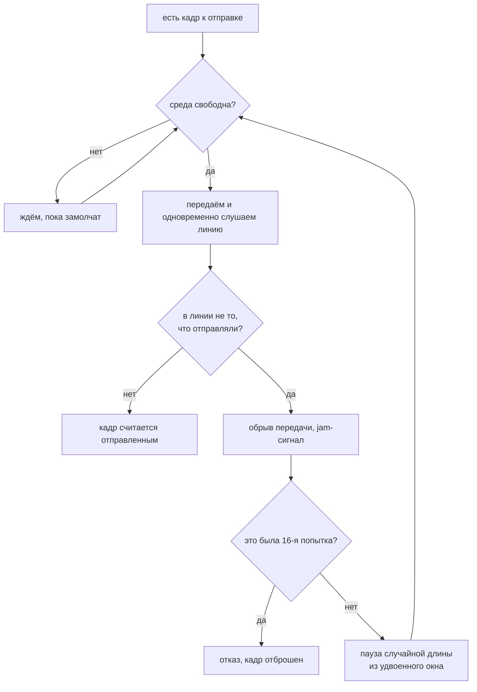
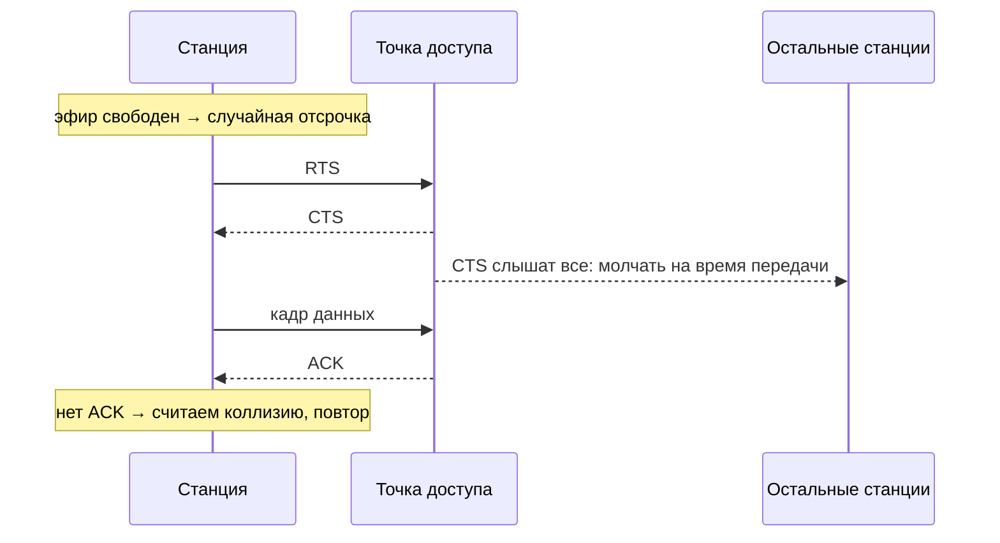

# CSMA/CD и домены коллизий
## Подуровни LLC и MAC

Канальный уровень внутри себя делится надвое, и это деление объясняет, почему доступ к среде вообще относят к L2:

| Подуровень | Что делает | Зависит от среды |
|---|---|---|
| **LLC** (Logical Link Control, управление логическим каналом, [[IEEE]] 802.2) | интерфейс к сетевому уровню, мультиплексирование протоколов, опционально контроль потока и ошибок | нет |
| **[[MAC-адресация\|MAC]]** (управление доступом к среде) | кто и когда имеет право говорить в общей среде; сборка и разбор кадра, [[MAC-адресация\|адресация]], [[Кадр Ethernet\|FCS]] | да |

> [!warning] MAC в названии подуровня — не про MAC-адрес
> **Media Access Control** это управление доступом к среде. MAC-адрес называется так потому, что им оперирует этот подуровень, а не наоборот

## Коллизия в разделяемой среде [28:02](https://www.youtube.com/watch?v=wQhMAl--_r0&t=1682s)

Исходная физическая топология Ethernet — **шина** на [[Коаксиальный кабель|коаксиальном кабеле]]. Арбитра нет, очереди нет: две станции могут начать передачу одновременно. Сигналы накладываются, в линии оказывается неразборчивая смесь — **коллизия**, из которой не восстановить ни один из переданных кадров

Заметить это обязаны сами передающие станции: жаловаться некому

## Алгоритм CSMA/CD [29:33](https://www.youtube.com/watch?v=wQhMAl--_r0&t=1773s)

**CSMA/CD** — Carrier Sense Multiple Access with Collision Detection [35:18](https://www.youtube.com/watch?v=wQhMAl--_r0&t=2118s):

| Часть | Смысл |
|---|---|
| **CS** — Carrier Sense | перед передачей станция слушает среду на предмет чужого сигнала |
| **MA** — Multiple Access | среда общая, станций много, выделенного арбитра нет |
| **CD** — Collision Detection | во время своей передачи станция продолжает слушать и ловит одновременную передачу соседа |

Детектирование устроено буквально так: станция сравнивает то, что слышит в линии, с тем, что сама туда отправляет. Разошлось — значит, в среде есть кто-то ещё [30:37](https://www.youtube.com/watch?v=wQhMAl--_r0&t=1837s)

> [!tip] Коллизия не задетектирована до конца передачи — кадр считается успешно отправленным [1:06:05](https://www.youtube.com/watch?v=wQhMAl--_r0&t=3965s)
> Что с ним случится дальше, станцию уже не волнует: никаких подтверждений Ethernet не ждёт. Именно поэтому [[Кадр Ethernet#Минимальный размер кадра [1 11 47](https //www.youtube.com/watch?v=wQhMAl--_r0&t=4307s)|кадр не может быть короче 64 байт]] — иначе передача успела бы закончиться раньше, чем коллизия доедет до отправителя

### Экспоненциальная отсрочка [31:40](https://www.youtube.com/watch?v=wQhMAl--_r0&t=1900s)

Обнаружив коллизию, станция прекращает передачу и заводит таймер на **случайный** интервал. То же самое делает вторая сторона — и как раз случайность разводит их повторные попытки во времени

При каждой новой коллизии окно выбора **удваивается** (двоичная экспоненциальная отсрочка), так что вероятность снова столкнуться падает. Удвоение идёт не бесконечно: в стандарте окно перестаёт расти после 10-й попытки[^backoff-cap], дальше интервал фиксирован — иначе ожидание стало бы неприлично долгим. Всего попыток **16**, после чего кадр отбрасывается и наверх уходит ошибка [32:43](https://www.youtube.com/watch?v=wQhMAl--_r0&t=1963s)

[^backoff-cap]: Лектор навскидку называет 5-ю попытку и сам оговаривается, что не уверен; в IEEE 802.3 окно фиксируется на десятой

### Jam-сигнал [33:45](https://www.youtube.com/watch?v=wQhMAl--_r0&t=2025s)

Станции, которые в коллизии не участвовали, но её услышали, отправляют в среду **jam** — 32 бита, намеренно **усиливающие** коллизию. Логика вывернутая, но рабочая: испорченный кадр всё равно бесполезен, зато так о коллизии гарантированно узнают все, включая тех, кто её вызвал [25:30](https://www.youtube.com/watch?v=5iMhAOFx38c&t=1530s)

> [!summary] L1 — сенсор, L2 — мозг
> **Физический уровень** фиксирует сам факт: трансивер видит аномалию в среде — в коаксиале скачок напряжения выше нормы от сложения двух сигналов [24:58](https://www.youtube.com/watch?v=5iMhAOFx38c&t=1498s), в 10BASE-T приход сигнала на RX во время собственной передачи — и поднимает collision detect
>
> **Подуровень MAC** отрабатывает логику: оборвать передачу, послать jam, уйти в отсрочку, повторить. Формально коллизии относят к канальному уровню именно потому, что CSMA/CD описан в MAC

## Сильные и слабые стороны Ethernet [37:53](https://www.youtube.com/watch?v=wQhMAl--_r0&t=2273s)

Логика примитивна намеренно: никаких маркеров и токенов, регулирующих очередь вещания, — станция начинает передавать в произвольный момент, лишь бы среда молчала [37:22](https://www.youtube.com/watch?v=wQhMAl--_r0&t=2242s)

За это Ethernet и выиграл: дешёвые микросхемы, простая логика, оборудование дешевле, чем у любого конкурирующего канального протокола. Плата — отсутствие **всех** гарантий сразу [38:24](https://www.youtube.com/watch?v=wQhMAl--_r0&t=2304s): ни доставки, ни времени доставки, ни полосы пропускания, ни даже того, что вы вообще сможете что-то отправить

Полоса вдобавок общая: 10 Мбит/с коаксиального сегмента делятся между всеми станциями, и чем их больше, тем меньше достаётся каждой [42:05](https://www.youtube.com/watch?v=wQhMAl--_r0&t=2525s)

## Домены коллизий и широковещательные домены [08:55](https://www.youtube.com/watch?v=5iMhAOFx38c&t=535s)

**Домен коллизий** — часть сети, узлы которой могут столкнуться друг с другом при передаче. **Широковещательный домен** — часть сети, по которой расходится [[MAC-адресация#Broadcast и multicast [42 45](https //www.youtube.com/watch?v=wQhMAl--_r0&t=2565s)|широковещательный кадр]]. Это две независимые нарезки одной и той же сети:

| Устройство | Домены коллизий | Широковещательные домены |
|---|---|---|
| [[Хаб, мост и коммутатор\|хаб]] | один на всё устройство | не трогает |
| [[Хаб, мост и коммутатор\|мост]] | делит надвое: доменов больше, каждый меньше | не трогает |
| [[Хаб, мост и коммутатор\|коммутатор]] | по домену на порт | не трогает [10:33](https://www.youtube.com/watch?v=5iMhAOFx38c&t=633s) |
| [[VLAN и стандарт 802.1Q\|VLAN]] | не трогает | делит по числу VLAN |
| [[Таблица маршрутизации\|маршрутизатор]] | по домену на интерфейс | по домену на интерфейс |

Разорвать широковещательный домен второй уровень не умеет в принципе — для этого нужен либо VLAN, либо переход на третий

### Полный дуплекс [07:23](https://www.youtube.com/watch?v=5iMhAOFx38c&t=443s)

Когда в сегменте остаётся ровно два устройства — узел и порт коммутатора, — можно передавать в обе стороны одновременно. Коллизия при этом не становится маловероятной, а делается **невозможной**: у каждого направления своя пара проводов, сталкиваться нечему

> [!danger] Коллизии существуют только в полудуплексе
> В современном full-duplex Ethernet CSMA/CD не работает и в IEEE 802.3 признан устаревшим. **Коллизии в статистике порта почти всегда означают duplex mismatch** — одна сторона поднялась в full, другая в half
>
> Отдельный симптом — **late collision**, коллизия после первых 64 байт: это уже не штатная работа CSMA/CD, а либо тот же duplex mismatch, либо превышение допустимой длины сегмента

## В Wi-Fi коллизии не детектируются вовсе

Радиостанция физически не может слушать эфир во время собственной передачи: свой сигнал на антенне на порядки сильнее чужого. Детектировать нечем — значит, остаётся избегать

Отсюда **CSMA/CA** (Collision **Avoidance**, избежание коллизий) в IEEE 802.11: случайная отсрочка **перед** передачей, а не после столкновения, обязательный [[Подтверждение приёма|ACK]] на каждый кадр (нет ACK — считаем, что была коллизия) и опциональный обмен **RTS/CTS** (Request to Send / Clear to Send) для резервирования эфира

