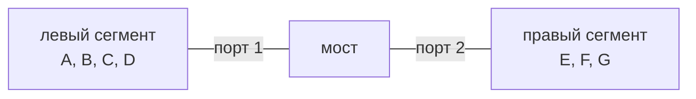
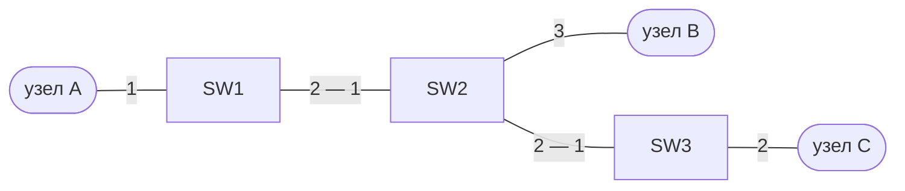

# Хаб, мост и коммутатор
## Хаб [48:54](https://www.youtube.com/watch?v=wQhMAl--_r0&t=2934s)

Коаксиал сменила [[Витая пара|витая пара]], и вместе с ней исчезла возможность построить шину физически: каждый узел тянет свой кабель в центральное устройство. Первым таким устройством был **хаб** (hub). Топология стала **звездой** физически, оставшись **шиной** логически

> [!warning] Хаб не понимает, что через него идёт [51:03](https://www.youtube.com/watch?v=wQhMAl--_r0&t=3063s)
> Сигнал, пришедший на один порт, он дублирует на все остальные — и всё. Не разбирает поток на кадры, ничего не кэширует, не проверяет и не адресует. Максимум умеет усилить сигнал, восстановить его форму и почистить от помех — то есть работает на [[Сетевое оборудование по уровням|первом уровне]]

Отсюда следствие: сеть на хабе ничем не отличается от сети на коаксиале [52:04](https://www.youtube.com/watch?v=wQhMAl--_r0&t=3124s). Та же делимая полоса, те же [[CSMA-CD и домены коллизий|коллизии]], тот же принцип "один вещает — остальные молчат", тот же низкий [[Золотое правило механики. КПД|КПД]]

## Мост [52:36](https://www.youtube.com/watch?v=wQhMAl--_r0&t=3156s)

**Мост** (bridge) — устройство канального уровня, которое ставится между двумя частями сети и **запоминает**, через какой интерфейс оно видело трафик от каждого [[MAC-адресация|MAC]]-адреса. Из чего собраны сами сегменты — коаксиал, хаб на витой паре — мосту безразлично

### Обучение моста [55:11](https://www.youtube.com/watch?v=wQhMAl--_r0&t=3311s)

Приняв кадр, мост смотрит на **source address** и на порт, куда кадр пришёл, и заносит эту пару в таблицу вместе с меткой времени [54:39](https://www.youtube.com/watch?v=wQhMAl--_r0&t=3279s). Никакого служебного протокола: таблица набивается из проходящего пользовательского трафика. Процесс так и называется — **learning** (обучение) [56:12](https://www.youtube.com/watch?v=wQhMAl--_r0&t=3372s)

> [!note] Bridge table, MAC address table и CAM — имена одной и той же таблицы [56:43](https://www.youtube.com/watch?v=wQhMAl--_r0&t=3403s)
> **CAM** (Content Addressable Memory) — [[Характеристики ЗУ и типы ПЗУ|ассоциативная память]]; называют вендоры по-разному, а хранится всегда соответствие "MAC-адрес — интерфейс, через который этот адрес достижим — время последнего обновления"

Ключевой момент, который регулярно понимают неправильно: мост знает **направление**, а не расстояние [29:14](https://www.youtube.com/watch?v=5iMhAOFx38c&t=1754s). Подключён ли узел к порту напрямую или за портом ещё цепочка хабов и коммутаторов — вопрос, которого таблица не задаёт

### Пересылка и фильтрация [57:15](https://www.youtube.com/watch?v=wQhMAl--_r0&t=3435s)

Слева от моста узлы A, B, C, D (порт 1), справа E, F, G (порт 2):

| Кадр | Что в таблице | Решение |
|---|---|---|
| A → F | F числится за портом 2, кадр пришёл в порт 1 | **пересылка** в правый сегмент [58:16](https://www.youtube.com/watch?v=wQhMAl--_r0&t=3496s) |
| A → D | D числится за портом 1, откуда кадр и пришёл | **отброс**: D его уже получил [59:20](https://www.youtube.com/watch?v=wQhMAl--_r0&t=3560s) |

Задача моста — не размножать трафик, а пересылать ровно тогда, когда без этого не обойтись

> [!success] Мост сохраняет связность, но разводит полосы [1:01:25](https://www.youtube.com/watch?v=wQhMAl--_r0&t=3685s)
> Слева своя полоса пропускания, справа своя, и они **независимы**: разговор A с D больше не отнимает время у разговора E с G. Меньше паразитного трафика — выше КПД сети

### Flooding и старение записей [1:01:56](https://www.youtube.com/watch?v=wQhMAl--_r0&t=3716s)

Два случая, когда таблица не даёт ответа, обрабатываются одинаково — рассылкой во все интерфейсы, кроме входного (**flooding**):

- destination address в таблице **отсутствует** [1:02:58](https://www.youtube.com/watch?v=wQhMAl--_r0&t=3778s) — получатель может быть где угодно, и лучше избыточно продублировать, чем оборвать связь
- кадр **широковещательный** [1:03:28](https://www.youtube.com/watch?v=wQhMAl--_r0&t=3808s) — он и адресован всем

Записи не живут вечно: **старение** (aging) определяется по полю времени. Долго нет трафика от станции — запись удаляется, освобождая место. Это же спасает при переезде узла на другой порт

## Коммутатор [02:11](https://www.youtube.com/watch?v=5iMhAOFx38c&t=131s)

**Коммутатор** (switch) — тот же мост, только интерфейсов не два, а 8, 16, 24, 48, а в шасси и под сотню. Логика не изменилась ни на шаг: то же обучение по [[Кадр Ethernet|SA]], та же таблица, только в поле "интерфейс" теперь произвольный номер порта

Рассказ про мост — историческая справка: хабы больше не производят, мостов как отдельного класса устройств тоже нет, а вопрос "когда применять мост" в наши дни имеет ровно один ответ — всегда, в виде коммутатора [1:08:09](https://www.youtube.com/watch?v=wQhMAl--_r0&t=4089s)

### Микросегментация [04:48](https://www.youtube.com/watch?v=5iMhAOFx38c&t=288s)

Чем больше портов, тем мельче сегменты за ними и тем меньше узлов делят одну среду. Вырожденный случай — к порту подключено ровно одно устройство [04:15](https://www.youtube.com/watch?v=5iMhAOFx38c&t=255s): в сегменте остаётся два участника, узел и порт коммутатора. Это и есть **микросегментация**, а вместе с ней — [[CSMA-CD и домены коллизий#Полный дуплекс [07 23](https //www.youtube.com/watch?v=5iMhAOFx38c&t=443s)|полный дуплекс]] и полное исчезновение коллизий

Мост стоит ставить не там, где станций много, а там, где много **активных** станций [1:07:07](https://www.youtube.com/watch?v=wQhMAl--_r0&t=4027s): растёт активность — растёт число коллизий, и сеть всё больше времени простаивает

### Обучение цепочки коммутаторов [26:40](https://www.youtube.com/watch?v=5iMhAOFx38c&t=1600s)

Три коммутатора в сложную звезду, узлы A, B, C:

Включившись, узел A рассылает широковещательный кадр — на практике это [[Протокол ARP|ARP]], проверяющий, не занят ли его [[IP-адрес и маска подсети|IP]]-адрес [27:42](https://www.youtube.com/watch?v=5iMhAOFx38c&t=1662s). Кадр разлетается по всем коммутаторам, и на нём обучаются **все три сразу** [29:14](https://www.youtube.com/watch?v=5iMhAOFx38c&t=1754s), хотя A физически подключён только к SW1. Затем то же делает B, и таблицы приходят к виду [31:50](https://www.youtube.com/watch?v=5iMhAOFx38c&t=1910s):

| Адрес | SW1 | SW2 | SW3 |
|---|---|---|---|
| MAC A | порт 1 | порт 1 | порт 1 |
| MAC B | порт 2 | порт 3 | порт 1 |
| MAC C | порт 2 | порт 2 | порт 2 |

У SW3 адреса A и B висят на одном и том же порту 1 — и это правильно: с его точки зрения оба живут "вон в ту сторону", а сколько там устройств по дороге, его не касается

По той же причине [[Агрегация каналов|пучок физических линков между коммутаторами]] выглядит для таблицы одним интерфейсом: обучение оперирует направлением, а сколько под ним проводов — забота уровнем ниже

### Размер таблицы и MAC-флудинг [1:03:59](https://www.youtube.com/watch?v=wQhMAl--_r0&t=3839s)

У первых мостов памяти было мало, и таблица переполнялась при подключении крупного сегмента. Современные значения — 16 000, 32 000, 128 000 записей, а у оборудования уровня ядра и несколько миллионов [1:05:01](https://www.youtube.com/watch?v=wQhMAl--_r0&t=3901s)

> [!tip] Размер таблицы считается по плану развития сети, а не по текущему числу узлов [1:04:31](https://www.youtube.com/watch?v=wQhMAl--_r0&t=3871s)
> Под 4000 узлов коммутатор с таблицей на 1000 записей не годится — и выяснится это не в момент покупки, а в момент, когда сеть вырастет

> [!danger] Переполнение таблицы — не только авария, но и вектор атаки [05:19](https://www.youtube.com/watch?v=5iMhAOFx38c&t=319s)
> Вытеснение старых записей новыми работает независимо от того, кто эти новые записи создал. Злоумышленник генерирует поток кадров с выдуманными source-адресами, забивает таблицу мусором и вытесняет реальные записи — коммутатор перестаёт находить получателей и начинает **flooding** всего подряд, то есть скатывается до хаба и отдаёт чужой трафик в порт атакующего
>
> Средства защиты существуют (ограничение числа MAC на порт и подобное), но их надо **настроить**: коммутатор из коробки от этого не защищён
