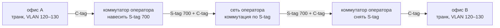

# QinQ и VLAN translation
Оператор вешает поверх клиентской метки собственную и коммутирует по ней — сколько и каких номеров [[VLAN и стандарт 802.1Q|VLAN]] раздал у себя клиент, сети оператора больше не касается

## Один VLAN на клиента [26:20](https://www.youtube.com/watch?v=eC3UwwTFCbg&t=1580s)

Клиент просит соединить два своих офиса каналом второго уровня — так, чтобы для его собственных устройств оба здания выглядели одним [[CSMA-CD и домены коллизий|широковещательным доменом]]. Оператор ставит по коммутатору на каждой границе своей сети и закрепляет за клиентом номер: "ты у меня двадцать пятый, забирай VLAN 125"

Порты, в которые воткнуты кабели клиента, настраиваются как [[VLAN и стандарт 802.1Q|access]] в этом VLAN: клиент отдаёт нетегированные кадры и про номер 125 даже не знает

Внутри своей сети оператор ведёт VLAN 125 [[VLAN и стандарт 802.1Q|транком]] вместе с остальными клиентскими — тянуть отдельный кабель на каждого клиента между своими коммутаторами никогда не окупится [28:23](https://www.youtube.com/watch?v=eC3UwwTFCbg&t=1703s)

## Клиент приносит несколько VLAN [29:25](https://www.youtube.com/watch?v=eC3UwwTFCbg&t=1765s)

Клиент рассадил своих пользователей по разным виртуальным сетям — "квадратные" отдельно, "круглые" отдельно — и хочет, чтобы через канал оператора квадратные видели только квадратных. Значит, на стыке с оператором он поднимает транк, и теперь оттуда приезжает трафик нескольких VLAN сразу

### Диапазон номеров за клиентом [30:26](https://www.youtube.com/watch?v=eC3UwwTFCbg&t=1826s)

Первое, что приходит в голову, — договориться о диапазоне: "принимаю от тебя VLAN 120–130". Пока клиенту хватает десятка номеров, схема работает

Ломается она на росте [30:56](https://www.youtube.com/watch?v=eC3UwwTFCbg&t=1856s). Клиент приходит за тысячей VLAN, а у оператора весь [[VLAN и стандарт 802.1Q#Ограничение 4096 [19 56](https //www.youtube.com/watch?v=eC3UwwTFCbg&t=1196s)|диапазон и есть 4096 номеров]] на всю сеть: при таком аппетите он обслужит четырёх клиентов и закроется

### VLAN translation при пересечении диапазонов [34:07](https://www.youtube.com/watch?v=eC3UwwTFCbg&t=2047s)

Случай мягче: клиентам нужно по десять VLAN, свободных номеров у оператора вагон, но оба просят один и тот же диапазон 120–130 — пересекаются не объёмы, а номера

> [!note] Тег заменяется на входе в сеть оператора
> **VLAN translation** — правило на интерфейсе: пришёл кадр с тегом 120, отправился дальше с тегом 140; 121 → 141 и так далее. Клиентский диапазон целиком сдвигается в свободный участок, коммутация внутри сети идёт уже по новым номерам
>
> Лектор проводит прямую аналогию с [[Статический и динамический NAT|address translation]] с прошлого занятия: там подменялся адрес, здесь — метка виртуальной сети

## Двойное тегирование [25:50](https://www.youtube.com/watch?v=eC3UwwTFCbg&t=1550s)

> [!success] QinQ — две метки 802.1Q подряд в одном кадре [31:28](https://www.youtube.com/watch?v=eC3UwwTFCbg&t=1888s)
> **QinQ** (Q-in-Q, двойное тегирование) оставляет клиентскую метку **C-tag** (customer tag) нетронутой и добавляет поверх неё собственную **S-tag** (service tag, сервисная или провайдерская метка). Коммутация внутри сети оператора идёт **только по сервисной метке**, поэтому в транке оператора на всего клиента расходуется один VLAN — независимо от того, сколько номеров клиент раздал у себя

![[Кадр с двойной меткой QinQ.png]]

Внешний тег отличается от внутреннего значением [[VLAN и стандарт 802.1Q|TPID]]: `0x88A8` против обычного `0x8100`. Стандартизовано это в **[[IEEE]] 802.1ad** (Provider Bridging), поэтому QinQ и 802.1ad в вендорской документации — одно и то же

> [!note] Метка навешивается и снимается ровно на границах оператора [33:03](https://www.youtube.com/watch?v=eC3UwwTFCbg&t=1983s)
> Слияния трафика не происходит: клиентская метка едет через всю сеть оператора как есть, внутри кадра. На выходном коммутаторе провайдерская метка снимается, и клиент получает свой обычный транк с одной своей меткой — с точностью до задержки это тот же кадр, который он отправил

Одному клиенту оператор может выдать и несколько сервисных меток — например свою на каждый физический порт, чтобы трафик разных площадок не смешивался даже при совпадении клиентских номеров [37:20](https://www.youtube.com/watch?v=eC3UwwTFCbg&t=2240s)

## Что операторы используют сегодня [36:17](https://www.youtube.com/watch?v=eC3UwwTFCbg&t=2177s)

Диапазоны и трансляция ограничивают клиента и требуют перенастройки сети под каждого нового: сколько номеров разрешить, куда сдвинуть, не занято ли уже. QinQ этих переговоров не требует вовсе — поэтому операторы, у которых до сих пор есть L2-инфраструктура, просто вешают вторую метку и готовы принимать от каждого клиента все 4096 номеров сразу [36:48](https://www.youtube.com/watch?v=eC3UwwTFCbg&t=2208s)

Потолок при этом не снят, а возведён в квадрат: пар "сервисный номер + клиентский" $4096^2$, но каждая площадка по-прежнему живёт внутри растянутого L2-домена со всеми его широковещательными издержками. Дата-центры от этой конструкции ушли к [[VXLAN и EVPN|туннелям поверх L3]]
