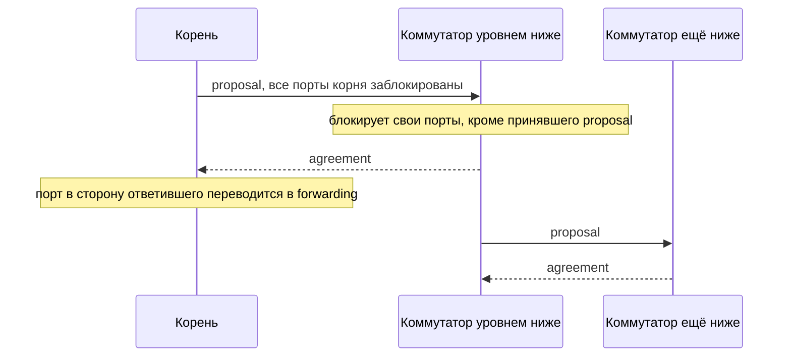
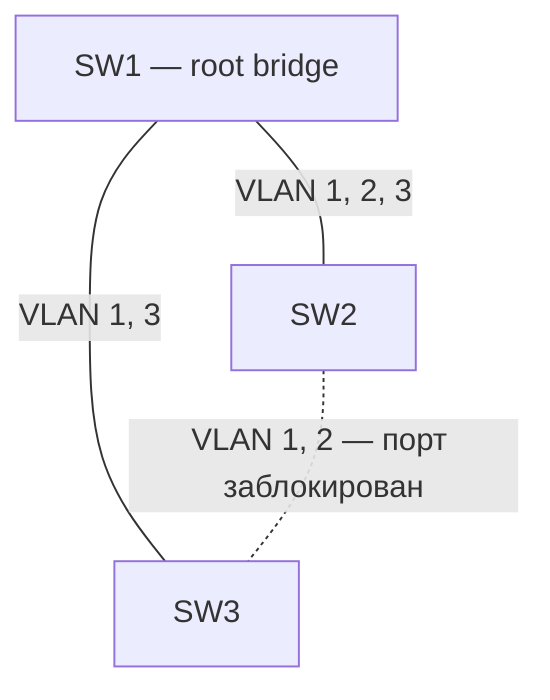

# RSTP, PVST+ и MSTP
## Быстрая сходимость RSTP [1:24:50](https://www.youtube.com/watch?v=eC3UwwTFCbg&t=5090s)

**RSTP** (Rapid Spanning Tree Protocol) переносит решение с таймеров на явное подтверждение от соседа. Полностью таймеры не исчезли — они остались страховкой на случай, когда сосед протокола не понимает, — но в нормальной работе к ним не обращаются

### Обмен proposal и agreement [1:25:54](https://www.youtube.com/watch?v=eC3UwwTFCbg&t=5154s)

Корень блокирует **все** свои интерфейсы и рассылает через них [[Протокол STP|BPDU]]-сообщение **proposal** — "предлагаю себя, разреши включиться". Сосед, получив proposal, блокирует все свои порты, кроме того, на который proposal пришёл, и отвечает **agreement** [1:26:56](https://www.youtube.com/watch?v=eC3UwwTFCbg&t=5216s)

> [!success] Agreement — это гарантия, что за соседом петли нет
> Отвечая agreement, коммутатор уже отрезал свою часть сети заблокированными портами. Значит, разблокировать линк к нему безопасно прямо сейчас, а не через 30 секунд ожидания — проверять больше нечего

Так волна **синхронизации** идёт от корня вниз, пока не упрётся в порты конечных пользователей [1:27:57](https://www.youtube.com/watch?v=eC3UwwTFCbg&t=5277s). Единственное, что её тормозит, — процессоры коммутаторов; ожидания в этой схеме нет вовсе

### Состояния портов в RSTP [1:29:00](https://www.youtube.com/watch?v=eC3UwwTFCbg&t=5340s)

[[Протокол STP#Состояния портов и 30 либо 50 секунд простоя [1 20 07](https //www.youtube.com/watch?v=eC3UwwTFCbg&t=4807s)|Пятёрка состояний классического протокола]] сжалась до трёх: disabled, blocking и listening слились в одно **discarding**[^rstp-states], а learning и forwarding остались как были

[^rstp-states]: На лекции это сказано короче — "одно состояние исчезло, вместо blocking теперь discarding"; в 802.1w схлопнулись три состояния из пяти

Появились и две новые роли порта: **alternate port** — заблокированный порт, через который лежит запасной путь к корню, и **backup port** — запасной выход в тот же сегмент. Запасной путь известен заранее, поэтому при отказе основного он включается без перерасчёта дерева

## Слепота единого дерева к VLAN [1:30:03](https://www.youtube.com/watch?v=eC3UwwTFCbg&t=5403s)

И классический [[Протокол STP|STP]], и RSTP строят **одно** дерево на всю сеть — сколько бы [[VLAN и стандарт 802.1Q|виртуальных сетей]] в ней ни было. Протокол ничего не знает о том, какие [[VLAN и стандарт 802.1Q|VLAN]] разрешены на конкретном транке, и блокирует порт целиком, вместе со всеми номерами, которые через него ходили

Разбор на треугольнике: наборы разрешённых VLAN на транках разные [1:30:33](https://www.youtube.com/watch?v=eC3UwwTFCbg&t=5433s)

Дерево погасило нижний линк, и у SW3 не осталось ни одного пути к пользователям VLAN 2: единственный оставшийся транк этот номер не переносит. Виртуальная сеть разорвана, хотя физическая связность в порядке

## PVST и PVST+ [1:32:11](https://www.youtube.com/watch?v=eC3UwwTFCbg&t=5531s)

**PVST** (Per-VLAN Spanning Tree) строит столько независимых деревьев, сколько сконфигурировано виртуальных сетей: три VLAN — три дерева, двадцать три — двадцать три. У каждого свой корень, свои root- и designated-порты; заблокированный в одном дереве порт спокойно передаёт трафик в другом

PVST — разработка Cisco поверх её же [[VLAN и стандарт 802.1Q|ISL]]; версия, работающая поверх стандартного тегирования, называется **PVST+** и именно она встречается в живых сетях

### Шаг приоритета 4096 [1:33:42](https://www.youtube.com/watch?v=eC3UwwTFCbg&t=5622s)

> [!note] Настроенный приоритет складывается с номером VLAN
> Дерево у каждого VLAN своё, значит и [[Протокол STP#Bridge ID [49 00](https //www.youtube.com/watch?v=eC3UwwTFCbg&t=2940s)|приоритет моста]] нужен свой. В два байта приоритета для этого зашивается номер сети: реальное значение равно "настроенное администратором + [[VLAN и стандарт 802.1Q|VID]]"

Поэтому настраивать приоритет можно только кратно **4096** — на 2 или на 100 его не изменить. Число ровно то же, что и [[VLAN и стандарт 802.1Q#Ограничение 4096 [19 56](https //www.youtube.com/watch?v=eC3UwwTFCbg&t=1196s)|потолок номеров VLAN]]: под слагаемое-VID отдано 12 младших бит, администратору остаются старшие 4 бита и шестнадцать возможных значений от 0 до 61440

## MSTP и instance [1:34:48](https://www.youtube.com/watch?v=eC3UwwTFCbg&t=5688s)

Цена PVST — линейная по числу VLAN: тысяча виртуальных сетей означает тысячу независимо сходящихся деревьев, тысячу наборов таймеров и поток BPDU, который слабый процессор коммутатора уже не тянет

> [!success] MSTP строит дерево не на VLAN, а на группу VLAN [1:35:49](https://www.youtube.com/watch?v=eC3UwwTFCbg&t=5749s)
> **MSTP** (Multiple Spanning Tree Protocol, он же MST) берёт от RSTP механику proposal/agreement и сходится за доли секунды, а от PVST — учёт виртуальных сетей. Администратор вручную раскладывает VLAN по **instance**, и своё независимое дерево получает каждый instance, а не каждый номер

Обоснование чисто практическое: разных **физических** топологий в сети две-три-четыре, и это на порядки меньше, чем VLAN [1:36:53](https://www.youtube.com/watch?v=eC3UwwTFCbg&t=5813s). Столько деревьев и нужно, чтобы задействовать все линки; всё сверх этого — пересчёт одного и того же

## Чем платит каждый вариант

| Протокол | Сколько деревьев | Сходимость | Что не так |
|---|---|---|---|
| **STP** (802.1D) | одно на сеть | 30–50 с на таймерах | VLAN не учитывает, резервные линки простаивают |
| **RSTP** (802.1w) | одно на сеть | доли секунды | VLAN по-прежнему не учитывает |
| **PVST+** | по одному на VLAN | доли секунды | процессор и память растут линейно по числу VLAN |
| **MSTP** (802.1s) | по одному на instance | доли секунды | группы VLAN раскладывает администратор, и ошибка в раскладке рвёт сеть |

Общее у всех четырёх остаётся: часть линков заблокирована, и купленная полоса не работает. Убрать это можно [[Агрегация каналов|склеив линки в один логический]], а в дата-центрах от L2-деревьев отказались вовсе в пользу [[Топология дата-центра Clos|маршрутизируемой фабрики]]
