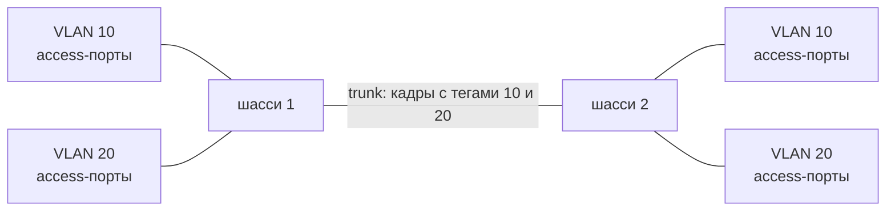

# VLAN и стандарт 802.1Q
Одна коробка нарезается на несколько независимых логических коммутаторов, а четырёхбайтовый тег в кадре позволяет протащить их все через один общий линк, не смешивая трафик

## Коммутатор на отдел и его цена [06:18](https://www.youtube.com/watch?v=eC3UwwTFCbg&t=378s)

Наивная схема: в компании несколько отделов, на каждый покупается свой коммутатор — айтишникам один, безопасникам второй, департаменту X третий. Отделов больше, коммутаторов больше, и в каждом остаётся горсть незанятых портов: оборудование куплено, а используется наполовину

### Шасси как набор логических коммутаторов [07:50](https://www.youtube.com/watch?v=eC3UwwTFCbg&t=470s)

Вместо россыпи мелких коробок ставят одно **шасси** — корпус под сменные модули: два блока питания, модуль управления (**супервизор**, часто дублированный) и стопка **линейных карт** (line card) с высокой плотностью портов [08:21](https://www.youtube.com/watch?v=eC3UwwTFCbg&t=501s)

Подключить всех в одно шасси как есть — получить один [[CSMA-CD и домены коллизий|широковещательный домен]], где все видят всех. Отделы разделяют, нарезав физический коммутатор на логические: эта группа интерфейсов отдана безопасникам, эта — [[Информационные технологии|IT]], эта — департаменту X

> [!success] VLAN — это группа портов, ведущая себя как отдельный коммутатор [06:18](https://www.youtube.com/watch?v=eC3UwwTFCbg&t=378s)
> **VLAN** (Virtual [[Топологии сетей|LAN]], виртуальная локальная сеть) даёт своему набору портов собственный широковещательный домен и собственный L2-сегмент. Между разными VLAN кадры на канальном уровне не ходят вообще — только через маршрутизацию, для которой нужен [[L3-коммутаторы и SVI|интерфейс третьего уровня]]

### Гибкость распределения портов [10:23](https://www.youtube.com/watch?v=eC3UwwTFCbg&t=623s)

Принадлежность порта к VLAN настраивается **удалённо**, командой на интерфейсе. Забился коммутатор отдела — не покупают второй в довесок, а ставят устройство с большей портовой ёмкостью и режут его на виртуальные. Перевод сотрудника в другой отдел сводится к "удалить порт из одного VLAN, добавить в другой" — без похода в серверную и перекоммутации кабелей [11:57](https://www.youtube.com/watch?v=eC3UwwTFCbg&t=717s)

## Access и trunk [12:27](https://www.youtube.com/watch?v=eC3UwwTFCbg&t=747s)

Компания выросла, слоты кончились, ставят второе шасси — и нужно, чтобы пользователи одного VLAN видели друг друга через оба устройства

### Линк на каждый VLAN [13:33](https://www.youtube.com/watch?v=eC3UwwTFCbg&t=813s)

Наивное решение — тянуть от каждого виртуального коммутатора отдельный кабель к одноимённому во втором шасси. Новый отдел означает новый VLAN и сразу новый линк; порты уходят под служебные соединения, а загружены эти линки слабо. Третье шасси умножает всё это на число пар устройств [14:03](https://www.youtube.com/watch?v=eC3UwwTFCbg&t=843s)

### Trunk [15:06](https://www.youtube.com/watch?v=eC3UwwTFCbg&t=906s)

**Trunk** (транк, транковое соединение) — линк, по которому одновременно передаётся трафик нескольких виртуальных сетей. Чтобы приёмная сторона понимала, чьи данные приехали, уходящие в транк кадры **тегируются**: в кадр вставляется номер VLAN

Порт-антипод — **access** (порт доступа): принадлежит ровно одному VLAN и отдаёт кадры без тега. В него включают конечных пользователей, которые про существование VLAN не подозревают

> [!note] Транк-образующие протоколы [16:11](https://www.youtube.com/watch?v=eC3UwwTFCbg&t=971s)
> **[[IEEE]] 802.1Q** — открытый стандарт, сегодня стандарт де-факто. **ISL** (Inter-Switch Link) — проприетарный протокол Cisco, придуманный до стандартизации; живёт в старых сетях

## Формат тега 802.1Q [16:44](https://www.youtube.com/watch?v=eC3UwwTFCbg&t=1004s)

![[Раскладка тега 802.1Q.png]]

Поле на позиции Type становится **TPID** (Tag Protocol Identifier) со значением `0x8100` — по этому [[Кадр Ethernet|EtherType]] приёмник понимает, что следом идёт не [[IP-адрес и маска подсети|IP]]-пакет, а тег, и настоящий протокол ищет внутри тега [24:16](https://www.youtube.com/watch?v=eC3UwwTFCbg&t=1456s)

Следующие 2 байта — **TCI** (Tag Control Information), три поля подряд [17:17](https://www.youtube.com/watch?v=eC3UwwTFCbg&t=1037s):

| Поле | Ширина | Что несёт |
|---|---|---|
| **PCP** (Priority Code Point), он же **CoS** (Class of Service) | 3 бита | приоритет кадра, 8 градаций |
| **DEI** (Drop Eligible Indicator), исторически **CFI** (Canonical Format Indicator) | 1 бит | признак кадра, которым можно пожертвовать при перегрузке[^cfi] |
| **VID** (VLAN Identifier) | 12 бит | номер виртуальной сети |

[^cfi]: В исходном 802.1Q бит назывался CFI и означал "внутри неканонический формат MAC-адреса" — наследие Token Ring; для Ethernet он всегда нулевой. В редакции 802.1Q-2011 биту дали новое имя и новый смысл — DEI

> [!question]+ Чему равен CFI в транке Ethernet [18:25](https://www.youtube.com/watch?v=eC3UwwTFCbg&t=1105s)
> Бит можно увидеть своими глазами: поднять транк и перехватить кадры. Значение лектор специально не называет
>
> > [!success]+ Решение
> > Ноль. Единица означала бы неканонический (Token Ring) порядок бит в [[MAC-адресация|MAC]]-адресах внутри кадра, а в Ethernet порядок всегда канонический

> [!warning] Тегированный кадр длиннее максимального на 4 байта [19:26](https://www.youtube.com/watch?v=eC3UwwTFCbg&t=1166s)
> Тег вставляется внутрь уже готового кадра, поэтому [[Кадр Ethernet|потолок в 1518 байт]] превращается в 1522. Оборудование, не знающее про 802.1Q, считает такие кадры сбойными по длине; в вендорской документации они зовутся **baby giant**

### Ограничение 4096 [19:56](https://www.youtube.com/watch?v=eC3UwwTFCbg&t=1196s)

12 бит VID дают $2^{12}=4096$ номеров[^usable][^isl]. Число стоит запомнить: с тем же шагом 4096 квантуется приоритет моста в [[RSTP, PVST+ и MSTP|PVST+]], а операторские схемы [[QinQ и VLAN translation|двойного тегирования]] выросли именно из тесноты этого диапазона

[^usable]: Реально настраиваемых номеров 4094: VID 0 помечает кадр, у которого осмыслен только приоритет, а VID 4095 зарезервирован. VLAN 1 существует на коммутаторе по умолчанию, в него попадают все порты из коробки

[^isl]: Лектор говорит, что 4096 VLAN — потолок и у 802.1Q, и у ISL [19:56](https://www.youtube.com/watch?v=eC3UwwTFCbg&t=1196s). У ISL поле VLAN ID занимает 15 бит, но используются только младшие 10 — отсюда 1024 номера, а не 4096

Потолок в 4096 снимается только сменой формата идентификатора: у [[VXLAN и EVPN|VXLAN]] под номер сегмента отведено 24 бита, то есть около 16 миллионов

## Способы определения принадлежности трафика к VLAN [21:01](https://www.youtube.com/watch?v=eC3UwwTFCbg&t=1261s)

| Способ | По чему решает | Где встречается |
|---|---|---|
| **port-based** | физический интерфейс, в который пришёл кадр | самый распространённый, обычный access-порт |
| **tag-based** [22:06](https://www.youtube.com/watch?v=eC3UwwTFCbg&t=1326s) | метка внутри кадра | второй по распространённости, обычный транк |
| **MAC-based** [22:39](https://www.youtube.com/watch?v=eC3UwwTFCbg&t=1359s) | [[MAC-адресация\|MAC-адрес]] отправителя по таблице соответствий | реже; ноутбук попадает в свой VLAN из любой розетки |
| **IP-based** | IP-адрес внутри кадра | только [[L3-коммутаторы и SVI\|L3-коммутаторы]], умеющие заглянуть в заголовок сетевого уровня |
| по аутентификации [23:11](https://www.youtube.com/watch?v=eC3UwwTFCbg&t=1391s) | учётные данные, предъявленные узлом по **802.1X** | VLAN выдаётся пользователю, а не порту |

## Отдельная мостовая таблица на каждый VLAN [1:38:58](https://www.youtube.com/watch?v=eC3UwwTFCbg&t=5938s)

При включённых VLAN коммутатор ведёт не одну [[Хаб, мост и коммутатор|мостовую таблицу]] на всё устройство, а свою на каждую виртуальную сеть: и обучается, и ищет получателя строго в таблице того VLAN, из которого пришёл кадр. Поэтому `show mac address-table` показывает адреса сгруппированными по VLAN, а не единым списком

Один и тот же MAC-адрес может при этом числиться сразу в нескольких таблицах и на разных портах — таблицы друг о друге не знают
