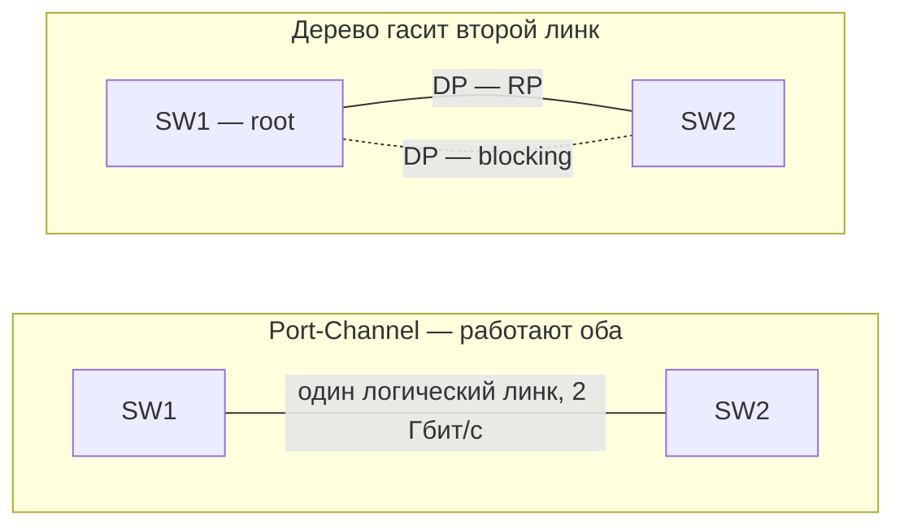
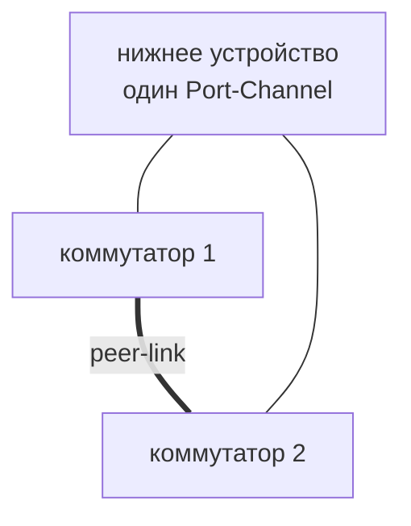

# Агрегация каналов
Несколько физических линков склеиваются в один логический интерфейс раньше, чем к ним подступается любой другой протокол — поэтому дерево видит одно ребро и гасить ему нечего, а полоса складывается

## Купленная полоса, которая не работает [43:47](https://www.youtube.com/watch?v=3S93uq63zlg&t=2627s)

Задача резервирования линка [[Протокол STP|решена деревом]], но решена дорого: из двух кабелей между коммутаторами трафик несёт один, второй ждёт аварии

Лобовая альтернатива — поставить интерфейс быстрее: 1 Гбит/с меняется на 10, 10 на 25 или 40 [41:43](https://www.youtube.com/watch?v=3S93uq63zlg&t=2503s). Работает, но десятикратный по скорости интерфейс и стоит существенно дороже, а уже проложенные кабели при этом остаются лежать без дела

## EtherChannel, Port-Channel и LAG [45:21](https://www.youtube.com/watch?v=3S93uq63zlg&t=2721s)

> [!success] Несколько физических линков объединяются в один логический
> Вендор-нейтральное имя технологии — **LAG** (Link Aggregation Group), у Cisco та же вещь зовётся **EtherChannel** или **Port-Channel**; стандартизована она в [[IEEE]] 802.3ad, позже перенесённом в 802.1AX. Ограничений два: агрегируются только [[Кадр Ethernet|Ethernet]]-линки и только между **двумя** устройствами

### Требования к объединяемым интерфейсам [46:25](https://www.youtube.com/watch?v=3S93uq63zlg&t=2785s)

Интерфейсы должны быть настроены одинаково — одна скорость, полный дуплекс на всех, и, если это [[VLAN и стандарт 802.1Q|транк]], совпадающий набор разрешённых [[VLAN и стандарт 802.1Q|VLAN]]. Разошлась хоть одна настройка — канал не соберётся

### Сначала агрегация, потом остальные протоколы [47:27](https://www.youtube.com/watch?v=3S93uq63zlg&t=2847s)

Порядок здесь не деталь реализации, а вся суть механизма: линки склеиваются **до** того, как поверх них начинает работать что-либо ещё. Два интерфейса, собранные в `port-channel 1`, для [[Протокол STP|дерева]] — один интерфейс, поэтому блокировать внутри него нечего и оба кабеля несут трафик

### L2 и L3 Port-Channel [48:28](https://www.youtube.com/watch?v=3S93uq63zlg&t=2908s)

Логический интерфейс бывает канальным и сетевым — ровно как обычный порт [[L3-коммутаторы и SVI|L3-коммутатора]]. У канального в [[Хаб, мост и коммутатор|мостовой таблице]] адреса числятся за `port-channel`, а не за физическим портом, входящим в группу; у сетевого на логическом интерфейсе живут IP-адрес и маршрутизация

## Статический канал против согласованного

### Статический режим [49:29](https://www.youtube.com/watch?v=3S93uq63zlg&t=2969s)

Администратор просто перечисляет интерфейсы и назначает их в канал с нужным номером. Никакого разговора с противоположной стороной нет: совпали настройки, скорость и дуплекс — канал работает

### LACP и PAgP [50:34](https://www.youtube.com/watch?v=3S93uq63zlg&t=3034s)

**LACP** (Link Aggregation Control Protocol) — стандартный протокол согласования, который поддерживают все, включая Cisco; **PAgP** (Port Aggregation Protocol) — проприетарный протокол Cisco, появившийся до стандартизации. Администратор так же указывает интерфейсы, но канал собирается только после того, как протокол договорился с устройством на другой стороне

Не договорился — есть два варианта поведения порта: **standalone** (работать самостоятельным физическим портом, как будто агрегации не настраивали) и **suspended** (не работать вовсе, ждать согласования)

### Что выбирать [52:08](https://www.youtube.com/watch?v=3S93uq63zlg&t=3128s)

Статика поднимается мгновенно — интерфейс включился, он уже член канала; LACP платит за согласование задержкой перед началом передачи. Взамен он проверяет то, чего статика проверить не в состоянии

> [!warning] Статический канал не знает, куда ведут его кабели [53:24](https://www.youtube.com/watch?v=3S93uq63zlg&t=3204s)
> Классическая авария: линки статически собрали в канал, а физически они уходят в **разные** коммутаторы. Устройство честно балансирует трафик между двумя несвязанными соседями, и половина его теряется. LACP в этой схеме согласует только один линк, второй останется вне канала — потеря половины полосы вместо потери половины трафика

### Шестнадцать интерфейсов, восемь рабочих [55:03](https://www.youtube.com/watch?v=3S93uq63zlg&t=3303s)

LACP объединяет до **16** интерфейсов, из которых одновременно передают **8**, а остальные 8 стоят в горячем резерве. Отказал рабочий линк — на его место немедленно поднимается один из резервных, без пересборки канала

## Балансировка по линкам [55:35](https://www.youtube.com/watch?v=3S93uq63zlg&t=3335s)

Через какой физический интерфейс уйдёт кадр, решает хеш-функция. Набор полей на входе выбирает администратор, а список доступных полей — возможности коммутатора:

| Уровень | Поля на входе хеша |
|---|---|
| L2 | [[MAC-адресация\|MAC]] отправителя, получателя или пара |
| L3 | [[IP-адрес и маска подсети\|IP]] отправителя, получателя или пара — на [[L3-коммутаторы и SVI\|L3-коммутаторах]] |
| L4 | [[Порты и сокеты\|номера портов]] [[Заголовок TCP и установление соединения\|TCP]]/[[Протокол UDP\|UDP]] — на старших моделях |

Функция детерминирована, поэтому один поток целиком уходит в один и тот же линк. Это и достоинство, и потолок: порядок кадров внутри соединения не ломается, но и одно соединение быстрее одного физического линка не поедет — восьмигигабитный канал из восьми гигабитных линков раздаёт восемь гигабит **разным** потокам, а не одному

### Восемь значений хеша [57:05](https://www.youtube.com/watch?v=3S93uq63zlg&t=3425s)

Множество значений хеш-функции имеет мощность 8, и эти восемь значений раскладываются по линкам канала:

| Линков в канале | Как делятся 8 значений | Равномерно |
|---|---|---|
| 1 | 8 | да |
| 2 | 4 + 4 | да |
| 3 | 3 + 3 + 2 | нет |
| 4 | 2 + 2 + 2 + 2 | да |
| 7 | 2 + 1 + 1 + 1 + 1 + 1 + 1 | нет |
| 8 | по 1 | да |

При числе линков, не равном степени двойки, один из них нагружен вдвое сильнее прочих [59:06](https://www.youtube.com/watch?v=3S93uq63zlg&t=3546s) — и он же первым упрётся в потолок. Практический вывод: объединять по 2, 4 или 8 линков, а не сколько нашлось свободных портов

## vPC и MLAG [1:00:14](https://www.youtube.com/watch?v=3S93uq63zlg&t=3614s)

Обычный Port-Channel идёт между двумя коробками, и каждая из них остаётся единой точкой отказа: сколько линков ни собери, отказ устройства целиком обрывает связь

> [!success] Пара коммутаторов притворяется одним устройством
> **vPC** (virtual Port-Channel) у Cisco и **MLAG** (Multi-Chassis Link Aggregation) как вендор-нейтральное имя объединяют два коммутатора в пару, которая для остальной сети неотличима от одной коробки. Нижнее устройство настраивает обычный Port-Channel и "думает", что подключено к одному соседу, — а физически его линки уходят в разные шасси

Резервируется теперь не линк, а устройство, и при этом обе половины пары работают одновременно. В [[Топология дата-центра Clos|дата-центрах]] это стандартный способ подключить сервер или коммутатор доступа; в кампусах встречается там, где оборудование умеет собираться в пару — и хорошо ложится на [[Резервирование шлюза|резервирование шлюза]] на том же уровне [[Трёхуровневая кампусная топология|агрегации]]
