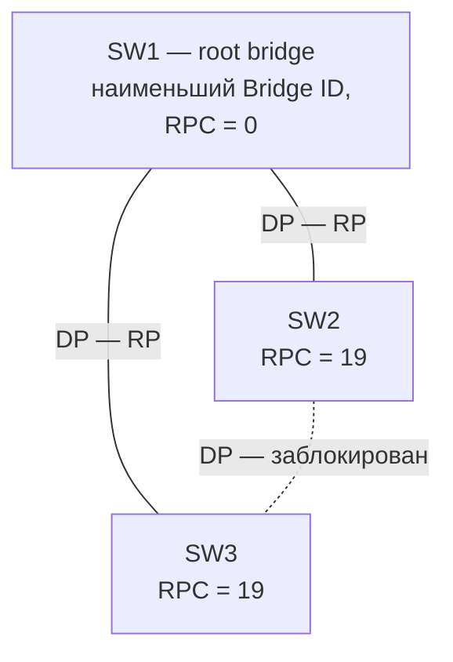
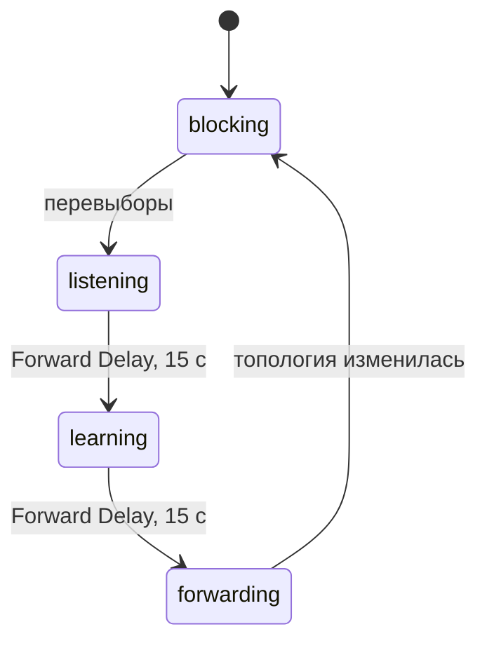

# Протокол STP
Каждое решение протокола — сравнение чисел по правилу "меньше — лучше", и когда очередное число совпало, к сравнению добавляется следующее: получается лексикографический порядок на пятёрке признаков

## Петля живёт только на втором уровне [03:08](https://www.youtube.com/watch?v=eC3UwwTFCbg&t=188s)

В ядре сети избыточные линки строят охотно, вплоть до полносвязности, и петель там не боятся: маршрут выбирают [[Классификация протоколов маршрутизации|протоколы динамической маршрутизации]], а лишний [[TTL, маршрутные петли и traceroute|прыжок съедает TTL]]

На уровне доступа всё наоборот: там второй уровень, и любая попытка задублировать линк немедленно даёт петлю [04:13](https://www.youtube.com/watch?v=eC3UwwTFCbg&t=253s). Коммутатор пересылает кадр по адресу назначения и только по нему — в [[Режимы коммутации|любом режиме коммутации]] у него нет способа узнать, что этот кадр он уже видел

> [!danger] Широковещательный шторм гасит сеть целиком [39:25](https://www.youtube.com/watch?v=eC3UwwTFCbg&t=2365s)
> [[Топологии сетей#Ethernet и кольцо [82 46](https //www.youtube.com/watch?v=PHgnSnlxmLk&t=4966s)|Кадр в кольце не умирает сам]], а широковещательный ещё и размножается на каждом коммутаторе. Забиваются не только линки: каждую копию нужно обработать, поэтому в шторм уходят и процессоры коммутаторов, и стек каждого подключённого узла — сеть перестаёт отвечать раньше, чем администратор успевает в неё зайти

Минимальный практический пример — два коммутатора агрегации, соединённых между собой, и коммутатор доступа, подключённый к обоим [04:44](https://www.youtube.com/watch?v=eC3UwwTFCbg&t=284s). Резервирование здесь не роскошь, а требование; значит, петлю надо не запретить, а погасить логически

## Дерево с единственным корнем [39:57](https://www.youtube.com/watch?v=eC3UwwTFCbg&t=2397s)

**STP** (Spanning Tree Protocol) смотрит на сеть как на [[Графы#^graph|граф]], где вершины — коммутаторы, а рёбра — линки, и выделяет в нём [[Деревья#^spanning-tree|остовное дерево]] с выделенным [[Корневые деревья|корнем]][^stp-tp]. Всё, что в дерево не вошло, логически выключается

[^stp-tp]: Не путать с STP из [[Витая пара#^stp-omonym|витой пары]] — там это Shielded Twisted Pair, экранированный кабель

Роли распределяются в четыре шага:

| Шаг | Что выбирается | Правило |
|---|---|---|
| 1 [46:53](https://www.youtube.com/watch?v=eC3UwwTFCbg&t=2813s) | **root bridge** (корневой мост) | один на всю сеть, наименьший Bridge ID |
| 2 [41:03](https://www.youtube.com/watch?v=eC3UwwTFCbg&t=2463s) | **root port** (корневой порт) | по одному на каждом некорневом коммутаторе — интерфейс с кратчайшим путём к корню |
| 3 [42:06](https://www.youtube.com/watch?v=eC3UwwTFCbg&t=2526s) | **designated port** (назначенный порт) | ровно один на каждый сетевой сегмент — через него трафик сегмента уходит к корню |
| 4 [44:47](https://www.youtube.com/watch?v=eC3UwwTFCbg&t=2687s) | **blocked port** | всё, что не стало ни тем, ни другим |

Блокировка виртуальная: кабель на месте, порт просто не пропускает пользовательский трафик[^bpdu-through]. Кольцо разорвано, логическая топология стала деревом

[^bpdu-through]: BPDU через заблокированный порт по-прежнему принимаются — иначе коммутатор не заметил бы, что резервный путь понадобился

### Перестройка после отказа линка [45:53](https://www.youtube.com/watch?v=eC3UwwTFCbg&t=2753s)

Упал прямой линк SW1–SW3 — SW3 перестаёт получать BPDU от корня через свой root port, пересчитывает дерево и разблокирует порт в сторону SW2. Тот же порт, который только что стоял выключенным, становится новым root port, и связь с корнем идёт транзитом через SW2. Ради этого момента резервный линк и прокладывался

## Выборы корневого моста [46:53](https://www.youtube.com/watch?v=eC3UwwTFCbg&t=2813s)

При включении **каждый** мост считает корнем себя и рассылает через все интерфейсы **BPDU** (Bridge Protocol Data Unit) — служебный кадр протокола с объявлением "корень — я"

> [!note] Сравнивается не отправитель, а объявленный им корень
> Получив BPDU, коммутатор смотрит на **Root ID** — идентификатор того устройства, которое сосед считает корневым, — а не на Bridge ID самого соседа. Иначе выбор был бы локальным и в разных углах сети получились бы разные корни

### Bridge ID [49:00](https://www.youtube.com/watch?v=eC3UwwTFCbg&t=2940s)

> [!summary] Bridge ID — конкатенация приоритета и [[MAC-адресация|MAC]]-адреса, 8 байт целиком
> "+" в записи "приоритет + MAC" означает не сложение, а склейку: 2 байта приоритета (настраивает администратор, по умолчанию 32768) и 6 байт [[MAC-адресация|MAC-адреса]] встают подряд и дальше сравниваются как одно восьмибайтовое число [51:03](https://www.youtube.com/watch?v=eC3UwwTFCbg&t=3063s). MAC глобально уникален, поэтому совпасть два Bridge ID не могут ни при каких приоритетах

Сравнение по такому склеенному числу — ровно лексикографический порядок на паре (приоритет, MAC): приоритет решает, а MAC служит разрешением ничьей. Из-за этого при заводских настройках корнем становится коммутатор с наименьшим MAC, а внутри одной вендорской серии это **самый старый** в сети [52:05](https://www.youtube.com/watch?v=eC3UwwTFCbg&t=3125s)

Лектор отдельно отмечает абсурдность результата: роль корня достаётся наименее производительной коробке — поэтому приоритет на нужном устройстве понижают вручную, а не полагаются на выбор по умолчанию

> [!warning] У коммутатора всё-таки есть свой MAC-адрес [49:30](https://www.youtube.com/watch?v=eC3UwwTFCbg&t=2970s)
> Поправка к сказанному в прошлых лекциях: [[Хаб, мост и коммутатор|при коммутации]] устройство действительно только читает чужие адреса и своего не подставляет. Но у управляющего модуля MAC есть, и в STP участвует именно он — в форвардинге этот адрес не появляется вовсе [50:00](https://www.youtube.com/watch?v=eC3UwwTFCbg&t=3000s)

### Замолчавшие коммутаторы [53:42](https://www.youtube.com/watch?v=eC3UwwTFCbg&t=3222s)

Коммутатор, признавший корнем не себя, **перестаёт генерировать** собственные BPDU. Дальше он только ретранслирует пришедшие от корня, подставляя корневой Root ID и свои значения стоимости. Поэтому в установившейся сети источник всех BPDU один — корень, а остальные работают ретрансляторами

## Стоимость пути до корня [55:14](https://www.youtube.com/watch?v=eC3UwwTFCbg&t=3314s)

Корень рассылает BPDU с **Root Path Cost** (RPC), равным нулю. Каждый следующий коммутатор прибавляет к полученному значению **cost своего интерфейса**, через который BPDU пришёл, и уже с этой суммой отправляет BPDU дальше [56:50](https://www.youtube.com/watch?v=eC3UwwTFCbg&t=3410s)

Cost задан таблицей и обратен скорости — чем быстрее линк, тем дешевле[^cost-table]:

| Скорость интерфейса | Cost в 802.1D |
|---|---|
| 10 Мбит/с | 100 |
| 100 Мбит/с | 19 |
| 1 Гбит/с | 4 |
| 10 Гбит/с | 2 |

[^cost-table]: Таблицу лектор не приводит: отсылает к справочникам и в примерах берёт условную стоимость 19 [57:21](https://www.youtube.com/watch?v=eC3UwwTFCbg&t=3441s). Значения здесь — классическая короткая шкала 802.1D. Она упирается в потолок на 10 Гбит/с и выше, поэтому в 802.1t ввели длинную шкалу с четырёхбайтовым значением — там 10 Гбит/с стоит 2000, а 100 Гбит/с 200

### Выбор root port и designated port [59:33](https://www.youtube.com/watch?v=eC3UwwTFCbg&t=3573s)

В треугольнике из трёх коммутаторов при cost 19 на каждом линке SW2 и SW3 получают от корня RPC = 19 и объявляют это значение в нижний сегмент. Каждый из них видит через соседа путь стоимостью $19+19=38$ [1:00:03](https://www.youtube.com/watch?v=eC3UwwTFCbg&t=3603s) — против 19 напрямую, поэтому root port'ом становится прямой линк к корню

Designated port сегмента определяется сравнением RPC, которые кандидаты объявляют **в этот сегмент** [1:01:04](https://www.youtube.com/watch?v=eC3UwwTFCbg&t=3664s). У корня RPC = 0, меньше не бывает — значит, обе его стороны верхних линков designated. Сегментом здесь чаще всего оказывается [[Хаб, мост и коммутатор|микросегмент]] из двух устройств [1:01:34](https://www.youtube.com/watch?v=eC3UwwTFCbg&t=3694s), но правило "один designated на сегмент" формулируется именно про сегмент, потому что в него может быть включён и хаб

## Тай-брейки при равных стоимостях

### Bridge ID отправителя [1:02:34](https://www.youtube.com/watch?v=eC3UwwTFCbg&t=3754s)

Нижний линк SW2–SW3: обе стороны объявляют RPC = 19, пути равностоимостные. В BPDU, кроме Root ID и Root Path Cost, едет **Bridge ID отправителя** [1:03:36](https://www.youtube.com/watch?v=eC3UwwTFCbg&t=3816s) — по нему и разрешается ничья. У SW2 он меньше, его порт становится designated, SW3 блокирует свой. Это и есть та самая блокировка из вводного примера

### Port ID отправителя [1:05:10](https://www.youtube.com/watch?v=eC3UwwTFCbg&t=3910s)

Bridge ID перестаёт различать, когда в сегмент смотрят **два порта одного и того же коммутатора** — например, SW2 воткнут в общий хаб двумя кабелями. Для STP хаб прозрачен и эквивалентен куску шины, так что в сегмент летят два одинаковых во всём BPDU

> [!note] Port ID — номер интерфейса, и меньший опять лучше [1:07:23](https://www.youtube.com/watch?v=eC3UwwTFCbg&t=4043s)
> Все интерфейсы коммутатора пронумерованы; из портов 2 и 5 выигрывает второй, пятый блокируется

Тот же критерий работает и в куда более частом случае — два линка между двумя коммутаторами [1:08:25](https://www.youtube.com/watch?v=eC3UwwTFCbg&t=4105s). SW2 видит по обоим RPC = 0 и одинаковый Bridge ID соседа, и выбирает по **Port ID соседа, приехавшему в BPDU**, а не по своим номерам

> [!warning] Смотрим на порт соседа, а не на свой [1:10:29](https://www.youtube.com/watch?v=eC3UwwTFCbg&t=4229s)
> При перекрёстной разводке (свой порт 3 — чужой 4, свой 4 — чужой 3) root port'ом станет собственный интерфейс 4, потому что BPDU в него приходит из третьего порта соседа. Ровно этот вопрос задали лектору из чата [1:13:40](https://www.youtube.com/watch?v=eC3UwwTFCbg&t=4420s) — важно, из какого порта устройства, более близкого к корню, ушёл BPDU

### Собственный Port ID [1:11:33](https://www.youtube.com/watch?v=eC3UwwTFCbg&t=4293s)

Последнее средство, когда совпало вообще всё: SW3 портом 5 включён в хаб, SW4 включён в тот же хаб портами 6 и 7. Оба BPDU на SW4 несут одинаковые Root ID, RPC, Bridge ID и Port ID отправителя — различить их можно только по собственным номерам, поэтому порт 6 становится root port, а 7 блокируется

### Порядок сравнения целиком

Признаки применяются строго по очереди, следующий смотрят только при полном совпадении предыдущего — то есть сравниваются не числа, а кортежи в лексикографическом порядке:

$$(\text{Root ID},\ \text{Root Path Cost},\ \text{Bridge ID отправителя},\ \text{Port ID отправителя},\ \text{собственный Port ID})$$

По каждой координате правило одно и то же — меньше значит лучше

## Классический 802.1D полагается на таймеры [1:15:13](https://www.youtube.com/watch?v=eC3UwwTFCbg&t=4513s)

Протокол придумала **Радья Перлман** (Radia Perlman)[^algorhyme] и много лет он честно закрывал проблему петель. Претензия к нему сегодня одна, зато принципиальная: обо всех изменениях в сети 802.1D узнаёт по истечении таймеров, а не по событию

[^algorhyme]: Перлман разработала алгоритм в DEC в 1985 году и приложила к спецификации стихотворение "Algorhyme", начинающееся строчкой "I think that I shall never see / A graph more lovely than a tree"

### Hello и Max Age [1:16:17](https://www.youtube.com/watch?v=eC3UwwTFCbg&t=4577s)

**Hello timer** — 2 секунды: с таким интервалом корень отправляет BPDU, а остальные их ретранслируют. Сами кадры крошечные, нагрузки от них нет

Проблема в обнаружении обрыва. Если линк пропал **косвенно** — например, между двумя хабами посреди сегмента, и статус портов на самих коммутаторах не изменился, — коммутатор узнает об этом, только не дождавшись подряд десяти BPDU. Это **Max Age**, 20 секунд, и всё это время трафик может никуда не идти

### Состояния портов и 30 либо 50 секунд простоя [1:20:07](https://www.youtube.com/watch?v=eC3UwwTFCbg&t=4807s)

После перевыборов порт не начинает передавать сразу, а проходит цепочку:

| Состояние | Что делает порт | Сколько длится |
|---|---|---|
| **blocking** | принимает BPDU, трафик не передаёт | устойчивое |
| **listening** | слушает BPDU — не объявится ли кто с лучшей стоимостью или новым корнем | 15 с |
| **learning** | заполняет [[Хаб, мост и коммутатор\|мостовую таблицу]], пользовательский трафик всё ещё не передаёт | 15 с |
| **forwarding** | передаёт данные | устойчивое |

Устойчивы только blocking и forwarding — в них порт может находиться сколь угодно долго; listening и learning всегда переходные

Отсюда итоговая арифметика простоя:

- **direct failure** — упал сам порт, ждать Max Age не нужно: $15+15=30$ секунд
- **indirect failure** — обрыв замечен по молчанию BPDU: $20+15+15=50$ секунд

Десятки секунд без трафика по современным меркам недопустимы — с этого и начинается [[RSTP, PVST+ и MSTP|быстрая версия протокола]]
