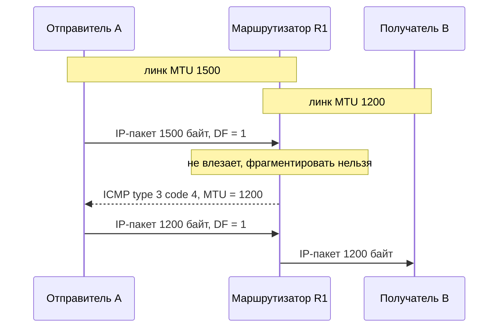

# MTU и фрагментация
$$\boxed{\text{Path MTU} = \min_{\text{линки пути}} \text{MTU}}$$

Ограничение принадлежит отдельному линку, а не пути; узкое место в середине определяет размер для всех

## MTU линка [1:04:26](https://www.youtube.com/watch?v=l9F567JS-5o&t=3866s)

**Линк** — прямое соединение [[Эталонная модель OSI|канального уровня]] между двумя устройствами без промежуточных маршрутизаторов: кабель, Wi-Fi, [[PPP и PPPoE|PPP-туннель]]

**MTU** (Maximum Transmission Unit, максимальный передаваемый блок) — предельный размер блока данных, который в такой линк проходит. Определяется он **для каждого линка отдельно**, и путь от отправителя до получателя обычно набран из линков с разными MTU:

$$\text{ПК} \xrightarrow{\text{Wi-Fi, MTU 1500}} \text{роутер} \xrightarrow{\text{провайдер, MTU 1492}} \dots \to \text{сервер}$$

У [[Кадр Ethernet|Ethernet]] это привычные 1500 байт, у [[PPP и PPPoE|PPPoE]] — 1492, и стоит одному линку в середине оказаться уже остальных, как выбор встаёт перед маршрутизатором: отбросить пакет или разрезать его

## Фрагментация [1:07:52](https://www.youtube.com/watch?v=l9F567JS-5o&t=4072s)

> [!note] Фрагментация — деление одного [[IP-адрес и маска подсети|IP]]-пакета на несколько IP-пакетов помельче, чтобы каждый влез в MTU
> Не путать с **сегментацией**: та делит [[CSMA-CD и домены коллизий|домен коллизий]], и к размеру пакета отношения не имеет. Дефрагментация файловой системы к сетям тоже не относится

![[Фрагментация пакета по MTU.png]]

Каждый фрагмент — полноценный IP-пакет с собственным заголовком, тем же [[Заголовок IPv4|TTL]] и теми же адресами отправителя и получателя; отличаются они только смещением и флагом продолжения [1:21:10](https://www.youtube.com/watch?v=l9F567JS-5o&t=4870s)

### Поля фрагментации [1:08:55](https://www.youtube.com/watch?v=l9F567JS-5o&t=4135s)

Работу делят три поля [[Заголовок IPv4|заголовка]]:

| Поле | Размер | Что несёт |
|---|---|---|
| Identification | 16 бит | идентификатор исходного пакета, наследуется всеми его фрагментами — "чей это кусок" |
| Fragment Offset | 13 бит | смещение фрагмента от начала исходного пакета — "где он стоит"[^offset-units] |
| Flags | 3 бита | зарезервированный бит, **DF** и **MF** |

[^offset-units]: Смещение считается не в байтах, а в **восьмибайтных блоках** — иначе 13 бит не покрыли бы пакет длиной до $2^{16}$ байт. Отсюда же требование: длина всех фрагментов, кроме последнего, кратна восьми

Первый бит флагов зарезервирован и всегда нулевой — применения ему так и не нашли. Остальные два:

- **DF** (Don't Fragment, не фрагментировать) — отправитель запрещает дробление. Пакет, не влезающий в MTU, просто отбрасывается [1:12:34](https://www.youtube.com/watch?v=l9F567JS-5o&t=4354s)
- **MF** (More Fragments, есть продолжение) — стоит у всех фрагментов, кроме последнего. В нефрагментированном пакете $\text{MF}=0$: он единственный и полный [1:14:38](https://www.youtube.com/watch?v=l9F567JS-5o&t=4478s)

> [!tip] DF поднимают, чтобы не пускать трафик через процессор маршрутизатора [1:13:05](https://www.youtube.com/watch?v=l9F567JS-5o&t=4385s)
> Фрагментация выполняется центральным процессором и роняет пропускную способность всего пути; без неё пакеты обрабатываются аппаратно на линейных картах, минуя [[Центральный процессор|CPU]]. Поэтому современные операционные системы поднимают DF по умолчанию — это хорошо видно в любом перехвате Wireshark

### Сборка на получателе [1:16:21](https://www.youtube.com/watch?v=l9F567JS-5o&t=4581s)

Фрагменты приходят вперемешку: разные очереди, разные буферы, между ними чужие пакеты. Их и различают по Identification, а собирают по трём признакам сразу — чей кусок, где он стоит, последний ли он

Первый фрагмент опознаётся нулевым смещением, последний — нулевым MF. По смещению и длине последнего сразу известна полная длина исходного пакета, дальше заполняются промежутки [1:19:39](https://www.youtube.com/watch?v=l9F567JS-5o&t=4779s). Пришёл он раньше всех — не беда: буфер резервируется нужного размера, и получатель ждёт остальных [1:19:06](https://www.youtube.com/watch?v=l9F567JS-5o&t=4746s)

> [!important] Фрагментирует любой маршрутизатор по пути, собирает только конечный получатель [1:21:40](https://www.youtube.com/watch?v=l9F567JS-5o&t=4900s)
> Иначе каждый узкий линк заставлял бы разбирать и собирать пакет заново. Вместо этого один раз разрезали — и мелкими кусками гоним до адресата
>
> Дошли фрагменты до линка с ещё меньшим MTU — режутся повторно, они же обычные пакеты [1:23:14](https://www.youtube.com/watch?v=l9F567JS-5o&t=4994s). Смещения новых кусков складываются с исходным, Identification у всех остаётся общим, а при дроблении последнего фрагмента $\text{MF}=0$ достаётся только последнему из полученных [1:29:23](https://www.youtube.com/watch?v=l9F567JS-5o&t=5363s)

> [!warning] Потерялся один фрагмент — потерян весь пакет [1:26:28](https://www.youtube.com/watch?v=l9F567JS-5o&t=5188s)
> У получателя есть таймаут ожидания (зависит от операционной системы и настроек стека). Истёк — буфер очищается, и исходный пакет считается потерянным целиком, сколько бы кусков ни дошло

### Транспортный заголовок только в первом фрагменте [1:30:26](https://www.youtube.com/watch?v=l9F567JS-5o&t=5426s)

IP-заголовок получает каждый фрагмент, а заголовок [[Заголовок TCP и установление соединения|TCP]] или [[Протокол UDP|UDP]] остаётся только в куске с нулевым смещением — он же и был началом пакета

> [!failure] Правило по [[Порты и сокеты|номеру порта]] формально распространяется лишь на первый фрагмент [1:32:30](https://www.youtube.com/watch?v=l9F567JS-5o&t=5550s)
> **ACL** (Access Control List, список доступа) вида "разрешить 80-й порт, запретить 22-й" читает порты из транспортного заголовка — а в остальных фрагментах его нет. Реализации расходятся: одни отбрасывают такие фрагменты, другие сначала собирают пакет и только потом прогоняют через фильтр, третьи проверяют фрагмент с нулевым смещением и пропускают остальные. Часть поведения настраивается

> [!info]- Фрагменты идут максимальной длины, а не равной [1:34:41](https://www.youtube.com/watch?v=l9F567JS-5o&t=5681s)
> В учебнике Уэнделла Одома написано, что пакет 1500 при MTU 1000 режется на два по 750 байт — якобы затем, чтобы куски не пришлось делить повторно на линке с MTU 900
>
> На деле отправляются куски предельной длины, а остаток идёт последним: 1500 превращается в 1000 и 500, а 4500 — в четыре по 1000 и один на 500. Числа здесь округлённые, без поправки на заголовок и кратность восьми — точная резка того же пакета нарисована на схеме выше
>
> Лектор писал автору и за три-четыре года ответа не получил. Почему реализовали именно так, точного ответа нет — вероятно, проще и дешевле по тактам процессора

## Path MTU Discovery [1:11:29](https://www.youtube.com/watch?v=6iEZOuH75cw&t=4289s)

**Path MTU** — минимальный MTU среди всех линков пути, и знать его отправителю выгоднее, чем полагаться на дробление в середине. **PMTUD** (Path MTU Discovery, обнаружение MTU пути) выясняет это значение опытным путём

1. отправитель ставит $\text{DF}=1$ и шлёт пакет максимального размера
2. пакет не влезает в MTU промежуточного линка — маршрутизатор его дропает и отвечает [[Протокол ICMP|ICMP Fragmentation Needed]] (type 3, code 4) с указанием MTU узкого места [1:11:29](https://www.youtube.com/watch?v=6iEZOuH75cw&t=4289s)
3. отправитель уменьшает размер и повторяет

> [!danger] PMTUD black hole — ICMP заблокирован, и путь молча не работает
> Сообщение об ошибке не доходит, отправитель никогда не узнаёт нужный MTU, пакеты теряются без единого признака
>
> Симптом характерный: маленькие пакеты (ping, [[Протокол DNS|DNS]], TCP-рукопожатие) проходят, а полноразмерные — загрузка страницы, вывод команды по [[SSH]] — виснут. Соединение установилось, а данные не идут — это почти всегда MTU
>
> Туннели попадают в эту ловушку чаще всего: собственный заголовок съедает часть MTU, а сами они не фрагментируют — расчёт MTU для WireGuard поверх Ethernet, PPPoE и мобильных сетей

## MSS и MSS clamping [1:14:36](https://www.youtube.com/watch?v=6iEZOuH75cw&t=4476s)

Второй способ — договориться заранее. **MSS** (Maximum Segment Size, максимальный размер сегмента) передаётся опцией в [[Заголовок TCP и установление соединения|заголовке TCP]] при рукопожатии: единственный случай, когда значение прямо объявляется в протоколе, а не выясняется пробами. Каждая сторона считает своё MSS из MTU исходящего интерфейса, вычитая 40 байт на заголовки IP и TCP

Сегмент с [[Заголовок TCP и установление соединения|SYN]] пустой, поэтому пролезает через канал с любым MTU. Сторона A предлагает своё значение, B при необходимости ставит **меньшее** — уменьшить можно, увеличить нельзя [1:16:39](https://www.youtube.com/watch?v=6iEZOuH75cw&t=4599s)

> [!tip] **MSS clamping** — маршрутизатор переписывает MSS в чужом рукопожатии [1:17:09](https://www.youtube.com/watch?v=6iEZOuH75cw&t=4629s)
> Устройство на узком линке вмешивается в установление TCP-соединения и подставляет своё значение, чтобы после всех инкапсуляций сегмент влезал. Данные при этом не теряются и скорость нигде не проседает — размер задан сразу, до первого байта полезной нагрузки [1:19:49](https://www.youtube.com/watch?v=6iEZOuH75cw&t=4789s)
>
> Практически это и есть лекарство от чёрной дыры PMTUD: клиент не полагается на ICMP, потому что о размере с ним договорились принудительно. Момент один — только SYN: после установления сессии менять MSS бесполезно [1:19:16](https://www.youtube.com/watch?v=6iEZOuH75cw&t=4756s)

## Фрагментация в IPv6

Маршрутизаторам её запретили совсем: дробить пакет вправе только отправитель, и делает он это [[Заголовок IPv6|отдельным расширенным заголовком]] Fragment. На превышение MTU маршрутизатор отвечает [[NDP и ICMPv6|ICMPv6 Packet Too Big]] — то есть PMTUD из необязательной оптимизации превратился в единственный рабочий механизм
