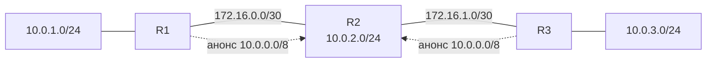

# Расчёт подсетей и VLSM
$$\boxed{N_{\text{узлов}} = 2^{n} - 2}$$

$n$ — число битов хостовой части; задача на эту формулу стоит в каждом варианте контрольной

## Два зарезервированных адреса [51:00](https://www.youtube.com/watch?v=5iMhAOFx38c&t=3060s)

> [!note] Крайние значения хостовой части заняты подсетью под себя
> - все биты хостовой части в нули — **адрес сети** (network address), имя самой подсети
> - все биты хостовой части в единицы — **широковещательный адрес** этой подсети

Назначать их нельзя никому: ни компьютеру, ни серверу, ни интерфейсу маршрутизатора. Всё, что между ними, администратор раздаёт по своему усмотрению

## Счёт узлов по маске [52:30](https://www.youtube.com/watch?v=5iMhAOFx38c&t=3150s)

Обе стандартные задачи решаются одним переходом между $n$ (битов под хост) и длиной маски $32-n$ [57:47](https://www.youtube.com/watch?v=5iMhAOFx38c&t=3467s)

### От маски к числу узлов [53:02](https://www.youtube.com/watch?v=5iMhAOFx38c&t=3182s)

Перевести маску в двоичный вид, найти границу единиц и нулей, посчитать нули — это $n$, написать $2^n-2$. Само число обычно можно не досчитывать, формулы достаточно

> [!warning] Условие задачи читается целиком [54:36](https://www.youtube.com/watch?v=5iMhAOFx38c&t=3276s)
> Типовой провал: студент видит первый вопрос, пишет формулу и не замечает дополнительных условий — часть адресов уже занята, часть запрещена к использованию. Ответ по чистой формуле в такой задаче неверен

### От числа узлов к маске [56:40](https://www.youtube.com/watch?v=5iMhAOFx38c&t=3400s)

> [!example] Какая маска нужна, чтобы разместить 5 узлов
> $$2^{n}-2\geqslant 5 \implies 2^{n}\geqslant 7 \implies n=3$$
>
> Длина маски $32-3=29$: двадцать девять единиц и три нуля. В [[Классовая адресация и CIDR|точечную нотацию]] это разворачивается как **255.255.255.248** [58:17](https://www.youtube.com/watch?v=5iMhAOFx38c&t=3497s)

Маска берётся **максимально длинная** из подходящих: каждый лишний бит под хост удваивает потери адресного пространства

## VLSM [1:25:52](https://www.youtube.com/watch?v=oOFuvP3JxUM&t=5152s)

**VLSM** (variable length subnet mask, маски подсетей переменной длины) — одну сеть режут на подсети с **разными** масками: где-то /23, где-то /24, а на линке между маршрутизаторами /30, потому что там ровно два адреса и есть весь спрос

Пока маска во всей сети одна, её можно и не передавать: [[Протокол RIP|RIPv1]] получал голый префикс и достраивал маску по своим собственным интерфейсам из той же классовой сети [1:23:17](https://www.youtube.com/watch?v=oOFuvP3JxUM&t=4997s). Схема разваливается ровно в тот момент, когда маски перестают совпадать — вот для чего протоколу переносить маску вместе с префиксом

## Суммаризация [1:05:48](https://www.youtube.com/watch?v=oOFuvP3JxUM&t=3948s)

Операция, обратная разбиению: несколько соседних префиксов анонсируются наружу одним, более коротким. Объявленная сеть **больше** реально существующих, но все они в неё попадают

### Автоматическая суммаризация [1:05:48](https://www.youtube.com/watch?v=oOFuvP3JxUM&t=3948s)

RIP по умолчанию суммирует до **классовой** сети на границе между сетями разных классов [1:06:49](https://www.youtube.com/watch?v=oOFuvP3JxUM&t=4009s). Схема: сети 10.0.1.0/24 за R1, 10.0.2.0/24 у R2, 10.0.3.0/24 за R3, линки между маршрутизаторами — 172.16.0.0/30 и 172.16.1.0/30. Десятки исторически класс A, 172.16 — класс B, значит R1 и R3 стоят ровно на классовой границе

> [!failure] Оба соседа анонсируют R2 один и тот же 10.0.0.0/8, и выбрать он не может [1:09:01](https://www.youtube.com/watch?v=oOFuvP3JxUM&t=4141s)
> Вместо 10.0.1.0/24 R1 объявляет 10.0.0.0/8; R3 со своей стороны делает буквально то же самое. У обоих анонсов одинаковая [[Административная дистанция|административная дистанция]] 120 и одинаковая метрика, поэтому в таблицу попадают оба как равноправные [1:09:32](https://www.youtube.com/watch?v=oOFuvP3JxUM&t=4172s)
>
> R2 включает **ECMP** (equal cost multipath, балансировку по путям равной стоимости) — часть трафика налево, часть направо. Итог: около половины пакетов уходит не туда [1:11:39](https://www.youtube.com/watch?v=oOFuvP3JxUM&t=4299s), и автосуммаризацию при настройке RIP отключают всегда

> [!info]- Балансировка бывает попакетной и попоточной [1:11:07](https://www.youtube.com/watch?v=oOFuvP3JxUM&t=4267s)
> **Per-packet** раскидывает по путям отдельные пакеты, **per-flow** уводит целый поток одной дорогой; поток обычно опознаётся парой адресов отправителя и получателя, иногда с добавлением портов транспортного уровня

### Ручная суммаризация и запрет суперсетей [1:14:13](https://www.youtube.com/watch?v=oOFuvP3JxUM&t=4453s)

Администратор задаёт границу агрегата сам: вместо 10.0.1.0/24 анонсировать вправо 10.0.0.0/16

> [!warning] RIP не поднимается выше классовой маски [1:16:30](https://www.youtube.com/watch?v=oOFuvP3JxUM&t=4590s)
> **Суперсеть** (supernet) — префикс с маской **короче** классовой. Для сетей класса A с их /8 агрегировать можно до /16, /20 и любых более длинных, но /7 и /6 RIP анонсировать откажется. Другие протоколы маршрутизации это умеют

### Зачем агрегировать [1:18:03](https://www.youtube.com/watch?v=oOFuvP3JxUM&t=4683s)

- **объём обновлений**: за R1 висит 200 подсетей — значит каждые 30 секунд по сети едут 200 префиксов, и каждый маршрутизатор держит их у себя
- **сходимость**: пропала одна подсеть внутри агрегата — сам агрегат не изменился, перестраивать сеть не надо [1:19:40](https://www.youtube.com/watch?v=oOFuvP3JxUM&t=4780s). Достучаться до этой подсети, конечно, нельзя, но процессоры маршрутизаторов не дёргаются

> [!tip] Агрегат и точные префиксы уживаются благодаря [[Правило самой длинной маски|самой длинной маске]] [1:21:15](https://www.youtube.com/watch?v=oOFuvP3JxUM&t=4875s)
> Даже кривой дизайн, где часть сетей 10.0.x.0/24 висит не за R1, работает корректно: R1 шлёт агрегат 10.0.0.0/16, R2 и R3 анонсируют свои конкретные /24, в таблице лежит и то и другое. Трафик в 10.0.2.0/24 уходит по точному маршруту, весь остальной — на агрегат
>
> Полагаться на это как на архитектуру всё же не стоит: агрегировать правильно только то, что реально находится за тобой [1:22:46](https://www.youtube.com/watch?v=oOFuvP3JxUM&t=4966s)
