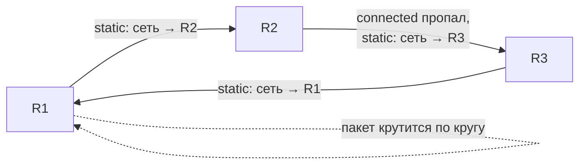
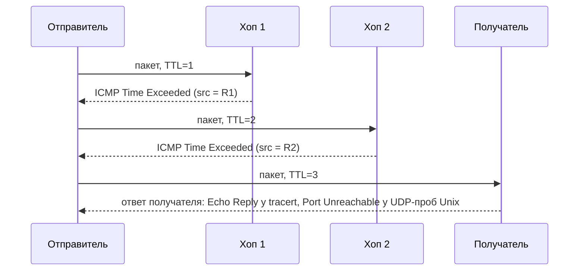

# TTL, маршрутные петли и traceroute

## Как ошибка администратора превращается в петлю [48:17](https://www.youtube.com/watch?v=l9F567JS-5o&t=2897s)

Администратор кольцом прописывает статические маршруты на одну и ту же сеть: на R1 — в сторону R2, на R2 — в сторону R3, на R3 — снова в сторону R1. Пока настоящий владелец сети (пусть это R2) видит её как connected, [[Административная дистанция#Когда конфликт остаётся незамеченным [50 23](https //www.youtube.com/watch?v=l9F567JS-5o&t=3023s)|ошибка не проявляется]] — connected побеждает статику, трафик идёт напрямую, а лишняя строка молча простаивает

Проблема наступает, когда у R2 падает интерфейс в сторону этой сети: connected-запись исчезает, и в дело вступает та самая статика — на R2. Пакет к сети уходит по кольцу:

В Ethernet-кадре защиты от такого вечного движения нет вообще — она появляется на уровень выше

## TTL как защита от бесконечной петли [54:01](https://www.youtube.com/watch?v=l9F567JS-5o&t=3241s)

Поле [[Заголовок IPv4#Время жизни пакета [1 14 02](https //www.youtube.com/watch?v=5iMhAOFx38c&t=4442s)|TTL]] решает именно эту задачу: каждый маршрутизатор на пути декрементирует его на единицу, и по достижении нуля пакет отбрасывается — вне зависимости от того, есть петля или нет. Лектор берёт пример со стартовым TTL 64: на R2 приходит уже 63, дальше 62, 61…, и когда декремент даёт ноль, пакет уничтожается — конкретно эта петля живёт не больше 64 переходов

> [!summary] Потолок петли — начальное значение TTL, не топология
> $$\boxed{\text{сеть с петлёй никогда не убьёт себя трафиком, который бесконечно множится} — \text{предельная жизнь одного пакета} = \text{TTL}_0 \text{ хопов}}$$

Начальное значение выставляет отправитель, и оно разное у разных [[Операционная система|ОС]] [59:20](https://www.youtube.com/watch?v=l9F567JS-5o&t=3560s):

| ОС | Типичный начальный TTL |
|---|---|
| Linux, Android, macOS, \*[[BSD]] | 64 |
| Windows | 128 |
| Cisco IOS, старые Unix-системы | 255 |

Поскольку поле заголовка на каждом хопе меняется, вместе с ним пересчитывается и [[Заголовок IPv4#Контрольная сумма заголовка [1 16 05](https //www.youtube.com/watch?v=5iMhAOFx38c&t=4565s)|контрольная сумма заголовка]] — иначе она перестала бы сходиться

### Опция Record Route [57:40](https://www.youtube.com/watch?v=l9F567JS-5o&t=3460s)

Маршрутизатор не хранит историю прошедшего трафика и сам по себе не отличит "пакет идёт по кругу второй раз" от обычного транзита. Формально способ есть — необязательная опция заголовка **Record Route**[^options-size], вписывающая в пакет [[IP-адрес и маска подсети|IP]]-адреса пройденных маршрутизаторов по мере продвижения

[^options-size]: Максимум записей — **9**: поле Options ограничено 40 байтами ([[Заголовок IPv4|IHL]] растёт по 4-байтным словам, максимум 15 слов = 60 байт заголовка, минус обязательные 20), 3 байта из них уходят под служебные поля самой опции (тип, длина, указатель), а на оставшиеся 37 байт по 4 байта на IPv4-адрес влезает 9 целых записей

Крупное кольцо в 9 записей не поместится, но на практике это редко важно: опция сегодня почти всегда выключена, а сами IP Options — красный флаг для межсетевых экранов, их наличие само по себе повод отбросить пакет

## ICMP Time Exceeded и traceroute [60:41](https://www.youtube.com/watch?v=l9F567JS-5o&t=3641s)

Маршрутизатор, обнуливший TTL, отбрасывает пакет и **обязан** сообщить об этом отправителю сообщением [[Протокол ICMP|ICMP]] **Time Exceeded** (Type 11, Code 0 — "TTL exceeded in transit")[^code1][^must]. На практике ответ всё равно доходит не всегда: генерацию ограничивают по скорости, отключают на отдельных интерфейсах, а межсетевые экраны по пути отбрасывают исходящий ICMP — тогда пакет умирает молча

[^must]: Лектор говорит, что маршрутизатор "может, но не должен" уведомить отправителя [60:41](https://www.youtube.com/watch?v=l9F567JS-5o&t=3641s). По [[RFC]] 1812 (§5.2.7.3, §5.3.1) это MUST; разрешена только опция на интерфейсе, отключающая генерацию, и по умолчанию она обязана оставлять сообщения включёнными

[^code1]: Тот же Type 11 с Code 1 значит другое — истёк [[MTU и фрагментация#Сборка на получателе [1 16 21](https //www.youtube.com/watch?v=l9F567JS-5o&t=4581s)|таймаут сборки фрагментов]] на получателе, а не декремент TTL транзитным роутером; события разные, ICMP-тип общий

На этом сообщении построена утилита **traceroute** (`tracert` в Windows): отправитель шлёт последовательность пакетов с TTL 1, 2, 3, …, каждый умирает на очередном по счёту маршрутизаторе, и по source address пришедшего Time Exceeded восстанавливается IP-адрес этого хопа

Пробами `tracert` в Windows служат [[Протокол ICMP|ICMP Echo Request]], а классический `traceroute` в Unix шлёт [[Протокол UDP|UDP]] на заведомо закрытые порты начиная с 33434 — получатель узнаётся по ответу Port Unreachable

> [!warning] traceroute показывает путь только в одну сторону [62:19](https://www.youtube.com/watch?v=l9F567JS-5o&t=3739s)
> Видна цепочка хопов от отправителя к получателю; обратный трафик вполне может идти совсем другим маршрутом — асимметричную маршрутизацию traceroute не показывает вообще

### Диагностика петли по выводу traceroute [63:54](https://www.youtube.com/watch?v=l9F567JS-5o&t=3834s)

С узла A ожидается путь R1 → R2 → узел-получатель. Если петля из первого раздела уже сложилась, вывод вместо этого показывает R3, R1, R2, R3, R1… — повторяющиеся хопы прямо выдают кольцо, ещё до всякого TTL-таймаута на самой утилите

IP-адрес источника в каждом ICMP-ответе — это адрес хопа, но чтобы этот ответ физически дошёл обратно, его [[MAC-адресация|MAC]] на очередном линке всё равно ищут тем же способом, что и для любого другого пакета — через [[Протокол ARP]]
