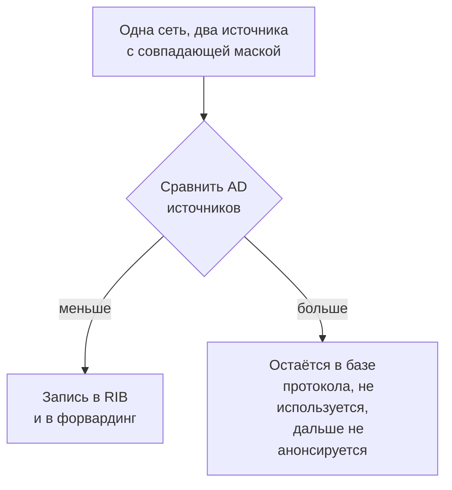

# Административная дистанция

## Конфликт источников [45:12](https://www.youtube.com/watch?v=l9F567JS-5o&t=2712s)

[[Таблица маршрутизации#Колонка источника маршрутной информации [28 16](https //www.youtube.com/watch?v=l9F567JS-5o&t=1696s)|Источников маршрутной информации]] несколько: connected, статика, а с появлением [[Классификация протоколов маршрутизации|динамических протоколов]] — ещё и они. Когда два источника предлагают для одной и той же сети **точно совпадающий** префикс с той же маской, в [[Таблица маршрутизации|RIB]][^rib-fit] может попасть только один — нужен критерий, кому верить

[^rib-fit]: Если префиксы точно совпали не только адресом, но и маской, [[Правило самой длинной маски|правило самой длинной маски]] здесь бессильно — маски-то равны

> [!note] Administrative Distance — мера доверия к источнику
> **AD** (Administrative Distance) — число, приписанное каждому источнику маршрутной информации на самом роутере; чем оно меньше, тем источнику больше доверия. При конфликте в таблицу маршрутизации попадает запись с **меньшим** AD, а конкурирующая остаётся только во внутренней базе своего протокола, не анонсируется дальше и не участвует в форвардинге

AD — сугубо локальная настройка роутера, не поле протокола и не то, чем обмениваются соседи: у двух разных маршрутизаторов один и тот же источник вполне может иметь разный AD

## Типовые значения [45:12](https://www.youtube.com/watch?v=l9F567JS-5o&t=2712s)

| Источник | AD (Cisco) |
|---|---|
| Connected | 0 |
| Статический маршрут | 1 |
| [[Протокол EIGRP\|EIGRP]] summary route | 5 |
| Внешний [[Классификация протоколов маршрутизации\|BGP]] | 20 |
| Внутренний EIGRP | 90 |
| [[Протокол EIGRP\|IGRP]] | 100 |
| [[Протокол OSPF\|OSPF]] | 110 |
| [[Классификация протоколов маршрутизации\|IS-IS]] | 115 |
| RIP | 120 |
| Внешний EIGRP | 170 |
| Внутренний BGP | 200 |
| Недостижимо / неизвестно | 255 |

Лектор называет четыре: connected — 0, static — 1, [[Классификация протоколов маршрутизации|OSPF]] — 110, [[Протокол RIP|RIP]] — 120[^ripad]; остальные — стандартные значения Cisco по умолчанию, вписаны для полноты картины таблицы источников

[^ripad]: Значение 120 для RIP повторно всплывает в [[Протокол RIP|разборе самого протокола]] — тот же пример, где два одинаковых по AD RIP-маршрута приводят к [[Расчёт подсетей и VLSM|ECMP]]

> [!tip] Зазоры между значениями оставлены специально [51:28](https://www.youtube.com/watch?v=l9F567JS-5o&t=3088s)
> AD каждого источника можно менять руками, и большие промежутки между стандартными значениями (0, 1, 90, 100, 110, 120…) дают пространство для манёвра. Классический приём — **floating static route**: статике вручную поднимают AD выше, чем у работающего динамического протокола (например, до 130 при RIP с его 120)
>
> Пока протокол видит сеть, его маршрут с меньшим AD побеждает; как только динамический маршрут пропадает, всплывает статический — резервный путь без единой строки в конфигурации протокола

## Пример: статика гасит RIP-анонс [37:34](https://www.youtube.com/watch?v=oOFuvP3JxUM&t=2254s)

Сосед регулярно шлёт по [[Протокол RIP|RIP]] префикс со своей стороны, но на роутере на тот же префикс вручную прописан статический маршрут

В таблицу маршрутизации попадает статика (AD 1 против AD 120 у RIP) — RIP-запись остаётся только в RIP-базе, не используется и, что важнее, **не анонсируется дальше остальным соседям**[^rip-announce]. Удалили статику — RIP-маршрут тут же встаёт в таблицу и снова начинает анонсироваться

[^rip-announce]: RIP в принципе анонсирует соседям только те префиксы, что сам использует из своей таблицы маршрутизации — [[Протокол RIP|правило]] не специфично для конфликта со статикой

## Когда конфликт остаётся незамеченным [50:23](https://www.youtube.com/watch?v=l9F567JS-5o&t=3023s)

AD молчаливо прячет и настоящие ошибки конфигурации. Если администратор по ошибке пропишет статический маршрут на сеть, которая на самом деле directly connected к этому же роутеру, ошибка ничем себя не выдаст: connected побеждает статику (0 против 1) при любой её конфигурации — ровно до тех пор, пока connected-запись не исчезнет сама

Что происходит дальше и почему это не приводит к вечной петле — [[TTL, маршрутные петли и traceroute]]
