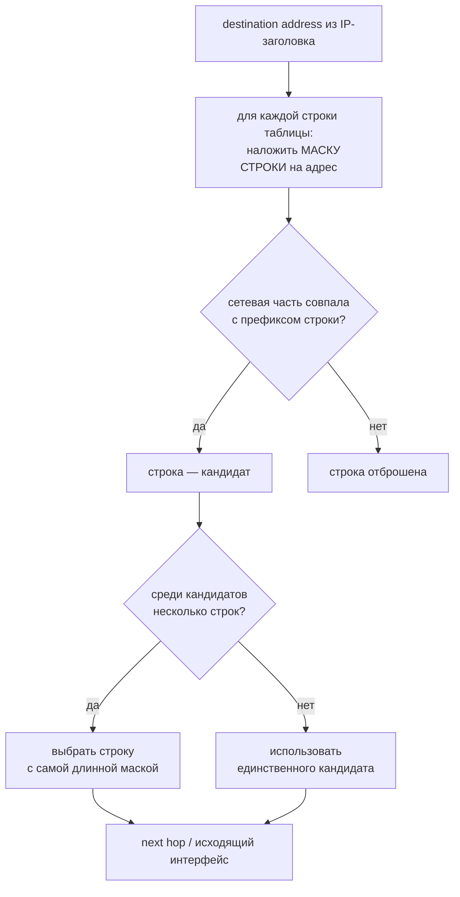

# Правило самой длинной маски

## Алгоритм поиска записи [29:52](https://www.youtube.com/watch?v=l9F567JS-5o&t=1792s)

Маршрутизатор ищет в таблице наилучшее соответствие destination address из заголовка пакета. В самом пакете маски нет — узнать маску отправителя или получателя неоткуда[^no-mask-in-packet], поэтому в распоряжении только маски строк собственной таблицы

[^no-mask-in-packet]: Ровно та же асимметрия, что и на хосте-отправителе при решении "локальная сеть или шлюз" — [[Таблица маршрутизации#Решение на хосте-отправителе [10 20](https //www.youtube.com/watch?v=l9F567JS-5o&t=620s)|там]] хост тоже сравнивает только под **своей** маской

Победившая строка отдаёт next hop или исходящий интерфейс. Если next hop — не адрес из directly connected сети, а более дальний узел, таблицу приходится просматривать повторно для его разрешения — **рекурсивный [[Статические маршруты и маршрут по умолчанию#Next hop против выходного интерфейса [67 43](https //www.youtube.com/watch?v=b4WWXd9Uu0k&t=4063s)|lookup]]**

### Разбор для пакета к 192.168.2.2 [31:27](https://www.youtube.com/watch?v=l9F567JS-5o&t=1887s)

На [[Таблица маршрутизации#Таблица маршрутизации маршрутизатора [22 28](https //www.youtube.com/watch?v=l9F567JS-5o&t=1348s)|базовой таблице]] R1 проверка идёт по очереди: `192.168.0.0/24` — нет, `10.0.12.0/24` — нет, `10.0.13.0/24` — нет, `192.168.2.0/24` — да, `172.16.3.0/24` — нет. Подошла единственная строка, next hop `10.0.12.2` — он лежит в connected-сети `10.0.12.0/24` на `Fa0/1`, значит рекурсивный lookup сразу разрешается, и пакет уходит через `Fa0/1` [32:59](https://www.youtube.com/watch?v=l9F567JS-5o&t=1979s)

## Сначала подходящие строки, потом самая длинная маска среди них [38:51](https://www.youtube.com/watch?v=l9F567JS-5o&t=2331s)

В таблицу R1 добавлена ещё одна строка: `192.168.0.0/16` → next hop `10.0.13.3`. Для того же получателя `192.168.2.2` она тоже подходит — `192.168.0.0/16` накрывает `192.168.2.0/24` целиком. Теперь у адреса два кандидата:

| Префикс | Маска | Next hop | Совпадает с `192.168.2.2`? |
|---|---|---|---|
| `192.168.2.0` | `/24` | `10.0.12.2` | Да |
| `192.168.0.0` | `/16` | `10.0.13.3` | Да |

> [!summary] Из подходящих строк побеждает та, у которой маска длиннее
> $$\boxed{\text{сначала фильтр "подходит вообще", и только среди прошедших — максимум длины маски}}$$
> Здесь `/24` длиннее `/16` → пакет уходит на `10.0.12.2`, более общая запись `/16` остаётся неиспользованной для этого адреса

Более длинная маска описывает более узкую, точную сеть — при прочих равных запись с ней предпочтительнее, потому что несёт больше информации именно об этом адресе

### Контрпример: маска длиннее, но строка не подходит [41:26](https://www.youtube.com/watch?v=l9F567JS-5o&t=2486s)

Добавлена строка `192.168.2.128/25` → next hop `10.0.13.3`. У неё маска длиннее (`/25` против `/24`), но правило работает в два шага, а не в один — **сначала** отбор подходящих строк, **потом** поиск максимума среди них:

| Адрес | Последний октет (бинарно) | Старший бит под `/25` |
|---|---|---|
| `192.168.2.2` | `00000010` | `0` |
| `192.168.2.128` | `10000000` | `1` |

Под маской `/25` сеть делится ровно по старшему биту последнего октета: подсеть `192.168.2.128/25` — это диапазон `.128`–`.255` (старший бит `1`), а `192.168.2.2` (старший бит `0`) в неё не попадает. Строка с `/25` отбрасывается на первом шаге, несмотря на самую длинную маску среди всех трёх; выигрывает по-прежнему `192.168.2.0/24`[^no-127]

[^no-127]: Заодно лектор поправляет частую путаницу: `192.168.2.127/25` как адрес подсети существовать не может [44:12](https://www.youtube.com/watch?v=l9F567JS-5o&t=2652s) — у адреса сети хостовая часть обязана быть нулевой, а `.127` = `01111111` даёт единицы в семи младших битах

> [!warning] Длина маски — тай-брейк, а не первый критерий
> Самая частая ошибка при разборе **LPM** (longest prefix match) руками — сортировать строки по длине маски и проверять их в этом порядке первую подошедшую. Правильно наоборот: сначала весь набор подходящих строк, длина маски решает только между ними
