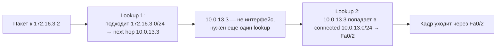

# Статические маршруты и маршрут по умолчанию

## Статический маршрут [26:12](https://www.youtube.com/watch?v=l9F567JS-5o&t=1572s)

В отличие от [[Таблица маршрутизации#Таблица маршрутизации маршрутизатора [22 28](https //www.youtube.com/watch?v=l9F567JS-5o&t=1348s)|connected-сети]], которая появляется в таблице сама при поднятии интерфейса, **статический маршрут** администратор прописывает вручную: для чужой сети, недостижимой напрямую, указывается либо адрес следующего перехода, либо исходящий интерфейс

## Next hop против выходного интерфейса [67:43](https://www.youtube.com/watch?v=b4WWXd9Uu0k&t=4063s)

Запись статического маршрута задают тремя способами: только next hop, только исходящий интерфейс, оба сразу. Разница проявляется на **multi-access** сегментах (Ethernet с несколькими устройствами на линке); на **point-to-point**-линке, где на другом конце всегда ровно один сосед, способы равнозначны

| Способ | На point-to-point | На multi-access |
|---|---|---|
| Только next hop | Работает | Работает — рекомендуемый вариант |
| Только исходящий интерфейс | Работает | Формально работает, но роутер обязан выяснить [[MAC-адресация\|MAC]] получателя [[Протокол ARP\|ARP-запросом]] для **каждого** адреса назначения — тот же расход, что и при [[Proxy ARP и разновидности ARP\|proxy ARP]], без его пользы |
| Оба | Работает, избыточно | Однозначно и без накладных расходов |

Курс придерживается первого варианта — только next hop[^interface-caveat]

[^interface-caveat]: Указывать интерфейс тоже не запрещено, но раз способ создаёт скрытые накладные расходы на multi-access-линках, курс советует его не использовать

Next hop — не обязательно сосед в directly connected сети. Если он дальше, победившая по [[Правило самой длинной маски|longest prefix match]] строка не даёт готового ответа "в какой физический интерфейс слать" — таблицу приходится смотреть повторно уже для адреса next hop, и так до тех пор, пока очередной результат не окажется connected-записью с интерфейсом:

Это и есть **рекурсивный lookup**: число уровней рекурсии ограничено только тем, сколько раз next hop очередной строки сам не оказывается directly connected

## Маршрут по умолчанию [12:27](https://www.youtube.com/watch?v=l9F567JS-5o&t=747s)

[[Таблица маршрутизации#Таблица маршрутизации хоста [12 27](https //www.youtube.com/watch?v=l9F567JS-5o&t=747s)|Таблица маршрутизации хоста]] уже показала вторую строку — маршрут по умолчанию, тот самый **default gateway**, что вводится в настройках [[Операционная система|ОС]] рядом с адресом и маской. Записывается он как обычная строка таблицы с префиксом `0.0.0.0` и маской `/0` — **`0.0.0.0/0`**

> [!note] Нулевая маска матчит любой адрес, но проигрывает всем остальным строкам
> Маска длины 0 накладывает на адрес назначения ноль бит сравнения — под неё подходит **любой** [[IP-адрес и маска подсети|IP]]. По [[Правило самой длинной маски|правилу самой длинной маски]] это самая короткая из возможных масок, поэтому запись `0.0.0.0/0` побеждает только тогда, когда для адреса не нашлось ни одной более точной строки — она работает маршрутом последней надежды, а не приоритетным вариантом

Как и любая другая запись, `0.0.0.0/0` может быть connected (не бывает в жизни, некуда быть подключённым к "любому адресу"), статической (`ip route 0.0.0.0 0.0.0.0 <next hop>` на Cisco) или полученной по протоколу динамической маршрутизации — источник у неё определяется тем же образом, что и у прочих строк, через [[Административная дистанция]]

## Маршрут в Null0 [57:44](https://www.youtube.com/watch?v=b4WWXd9Uu0k&t=3464s)

**Null0** — виртуальный интерфейс без физического воплощения: пакет, направленный в него, молча отбрасывается. Строка `ip route <агрегат> Null0` появляется, когда нужно объявить агрегированную сеть, для которой на самом роутере нет ни одного интерфейса с точно такой маской — а значит нет и connected-записи, которую можно было бы анонсировать дальше[^redistribute]

[^redistribute]: Появившийся статический маршрут дальше передаётся в [[Классификация протоколов маршрутизации|протокол динамической маршрутизации]] командой `redistribute static`

> [!tip] Почему именно Null0, а не обычный интерфейс
> Направить агрегированный маршрут в реальный интерфейс опасно: пакет на адрес из агрегата, для которого нет более точной записи, уйдёт в сеть и там либо потеряется, либо, того хуже, вернётся на этот же роутер по чужому маршруту — источник петли. Null0 гарантированно не создаёт петель: у отбрасывания нет "дальше"

Раскладка провайдерского блока на несколько таких маршрутов и их анонс — детали конкретного сценария [[Маршрутизация NAT-пула]]
