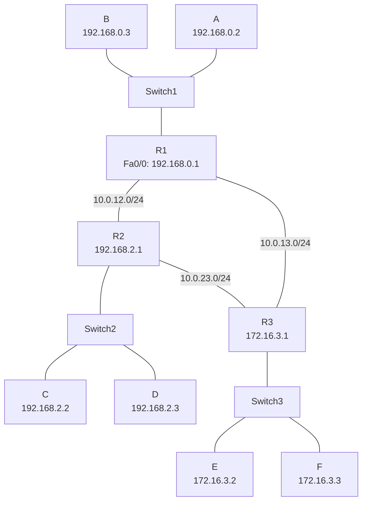

# Таблица маршрутизации
Пакет доезжает до получателя с теми же адресами, меняются в нём только [[Заголовок IPv4|TTL]] и контрольная сумма, а кадр вокруг него пересобирается на каждом маршрутизаторе заново

## Опорная схема сети [02:04](https://www.youtube.com/watch?v=l9F567JS-5o&t=124s)

Три маршрутизатора, соединённых треугольником, за каждым — свой коммутатор и два узла. На этой схеме разбирается вся тема

Пользовательские подсети — `192.168.0.0/24` за R1, `192.168.2.0/24` за R2, `172.16.3.0/24` за R3. Интерфейсу маршрутизатора по соглашению дают первый или последний адрес подсети, брать адрес из середины никто не запрещает [07:15](https://www.youtube.com/watch?v=l9F567JS-5o&t=435s)

[[Классовая адресация и CIDR|Класс адреса]] при этом не учитывается вообще: `10.0.0.0` формально относится к классу A, но маска у неё ровно та, что назначена администратором [03:34](https://www.youtube.com/watch?v=l9F567JS-5o&t=214s)

Линки между маршрутизаторами — тоже подсети, и им тоже нужна адресация [16:02](https://www.youtube.com/watch?v=l9F567JS-5o&t=962s):

| Линк | Подсеть | Адреса |
|---|---|---|
| R1 — R2 | `10.0.12.0/24` | `.1` у R1, `.2` у R2 |
| R1 — R3 | `10.0.13.0/24` | `.1` у R1, `.3` у R3 |
| R2 — R3 | `10.0.23.0/24` | `.2` у R2, `.3` у R3 |

> [!tip] Номера роутеров, зашитые в адрес линка, избавляют от таблички соответствий [17:38](https://www.youtube.com/watch?v=l9F567JS-5o&t=1058s)
> Совет лектора для лабораторных, не стандарт: линк между роутерами $X$ и $Y$ ($X<Y$) адресовать как `10.0.XY.0/24` с адресами `.X` и `.Y`. Тогда принадлежность подсети читается прямо с рисунка
>
> Ограничение — номера должны быть однозначными; на сети с сотнями устройств номера разносят по октетам — подсеть `10.X.Y.0/24` с адресами `.X` и `.Y`, и номер роутера может доходить до 255 [18:41](https://www.youtube.com/watch?v=l9F567JS-5o&t=1121s). Единственное жёсткое требование: эти подсети не должны использоваться больше нигде

## Прямая доставка против маршрутизации [09:19](https://www.youtube.com/watch?v=l9F567JS-5o&t=559s)

A и B [[IP-адрес и маска подсети|в одной подсети]] — достают друг друга напрямую, устройство третьего уровня в этом обмене не участвует вовсе. У A и C сетевые части не совпадают, и без маршрутизатора пакет не пройдёт: путь A → R1 → R2 → C

## Решение на хосте-отправителе [10:20](https://www.youtube.com/watch?v=l9F567JS-5o&t=620s)

> [!note] Локальная сеть или шлюз — решает наложение своей маски на оба адреса
> Хост сравнивает IP назначения со своим IP и маской подсети. Если адрес не входит в локальную сеть — пакет уходит на **default gateway**, а не напрямую получателю

> [!warning] Маска берётся своя — чужую узнать неоткуда [13:27](https://www.youtube.com/watch?v=l9F567JS-5o&t=807s)
> В распоряжении отправителя ровно три числа: свой адрес, своя маска и адрес получателя. Маска получателя не передаётся ни в каком протоколе, поэтому сравнение всегда идёт под своей маской

Дальше начинается канальный уровень, и здесь важный поворот: кадр надо адресовать **шлюзу**, а не получателю. Для отправки нужен [[MAC-адресация|MAC-адрес]] следующего узла — шлюза, не конечного получателя. Хост берёт его из [[Протокол ARP|ARP-кэша]]; при промахе — широковещательный запрос, шлюз отвечает своим MAC

Итоговый кадр: MAC-заголовок — источник хост, назначение шлюз; IP-заголовок — источник хост, назначение внешний адрес, и он не меняется

### Таблица маршрутизации хоста [12:27](https://www.youtube.com/watch?v=l9F567JS-5o&t=747s)

На компьютере, телефоне, планшете и рядовом сервере она состоит из двух строк: собственная подсеть и [[Статические маршруты и маршрут по умолчанию|маршрут по умолчанию]] — тот самый шлюз, который вводится при настройке системы рядом с адресом, маской и адресами [[Протокол DNS|DNS]]-серверов

Шлюзом у A и B стоит адрес именно того интерфейса R1, который сидит с ними в одной подсети — `192.168.0.1` [15:01](https://www.youtube.com/watch?v=l9F567JS-5o&t=901s). Адрес другого интерфейса того же роутера в этой роли бесполезен: до него хост не дотянется по канальному уровню

## Оптимальный путь и число переходов [20:50](https://www.youtube.com/watch?v=l9F567JS-5o&t=1250s)

Пока принимается допущение: лучше тот путь, где меньше маршрутизаторов. Сеть при этом — обычный [[Пути, циклы и связность#Пути и цепи [26 15](https //www.youtube.com/watch?t=1575&v=goTc0e1vsKw)|граф]], узлы которого ищут в нём путь, а критерий "меньше переходов" — простейшая из возможных мер длины. Так считает [[Протокол RIP|RIP]]; что бывает, когда переходы одинаковы, а каналы за ними разные — тема [[Классификация протоколов маршрутизации|протоколов динамической маршрутизации]]

## Таблица маршрутизации маршрутизатора [22:28](https://www.youtube.com/watch?v=l9F567JS-5o&t=1348s)

У R1 три интерфейса: `Fa0/0` в пользовательскую сеть, `Fa0/1` в сторону R2, `Fa0/2` в сторону R3[^fa]. Его таблица целиком:

| Источник | Сеть | Маска | Куда отправлять |
|---|---|---|---|
| C | `192.168.0.0` | `/24` | `Fa0/0` |
| C | `10.0.12.0` | `/24` | `Fa0/1` |
| C | `10.0.13.0` | `/24` | `Fa0/2` |
| S | `192.168.2.0` | `/24` | `10.0.12.2` |
| S | `172.16.3.0` | `/24` | `10.0.13.3` |

[^fa]: `Fa` — сокращение Cisco для FastEthernet, интерфейса на 100 Мбит/с; нумерация `слот/порт`

> [!note] Connected-сеть попадает в таблицу сама, без единой команды маршрутизации [25:08](https://www.youtube.com/watch?v=l9F567JS-5o&t=1508s)
> Достаточно настроить на интерфейсе адрес с маской и дождаться, пока интерфейс перейдёт в состояние **up/up** (поднят физически и логически). Подсеть, к которой интерфейс принадлежит, немедленно появляется в таблице с указанием этого интерфейса — маршрутизатор в неё подключён напрямую и знает о ней из первых рук

Две нижних строки — [[Статические маршруты и маршрут по умолчанию|статика]]: чужие пользовательские сети администратор вписал руками [26:12](https://www.youtube.com/watch?v=l9F567JS-5o&t=1572s)

### Колонка источника маршрутной информации [28:16](https://www.youtube.com/watch?v=l9F567JS-5o&t=1696s)

Первая колонка отвечает на вопрос, откуда префикс попал в **RIB** (Routing Information Base, база маршрутной информации)[^rib]. `C` — connected, `S` — static; буквы вендорские, у другого производителя connected может обозначаться `D` (direct), и это нормально

С появлением [[Классификация протоколов маршрутизации|динамических протоколов]] к ним добавятся свои буквы, а вместе с ними и вопрос, кому верить, когда об одной сети говорят двое — [[Административная дистанция]]

[^rib]: Роутер может держать несколько независимых RIB одновременно — на этом построен [[VRF]]

## Переупаковка кадра на каждом хопе [33:30](https://www.youtube.com/watch?v=l9F567JS-5o&t=2010s)

Маршрутизатор принимает кадр, сверяет [[Кадр Ethernet|контрольную сумму]] и убеждается, что destination MAC — адрес его собственного интерфейса. После этого канальное обрамление отбрасывается целиком, остаётся полезная нагрузка — IP-пакет. Обработанный пакет [[Инкапсуляция и заголовки|инкапсулируется]] в **новый** кадр для исходящего интерфейса

> [!important] Старый кадр незачем хранить — на выходе может быть вообще другая канальная технология [36:05](https://www.youtube.com/watch?v=l9F567JS-5o&t=2165s)
> Пакет пришёл по Ethernet, а уходит в [[PPP и PPPoE|PPP]], **HDLC** (High-Level Data Link Control), Frame Relay или X.25 — с совершенно другим заголовком и другой адресацией. Пересборка кадра на каждом хопе делает эти переходы бесплатными: сквозным едет только пакет

![[Переупаковка кадра на хопах.png]]

Адреса нового кадра — MAC исходящего интерфейса самого роутера и MAC следующего устройства [38:21](https://www.youtube.com/watch?v=l9F567JS-5o&t=2301s); откуда берётся второй, разбирает [[Протокол ARP]]. Пакет при этом не остаётся совсем нетронутым: на каждом хопе уменьшается [[TTL, маршрутные петли и traceroute|TTL]]
