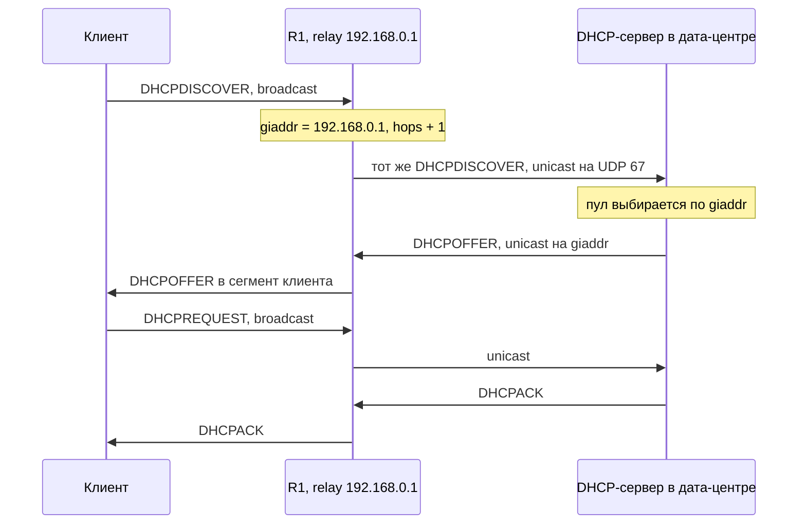

# DHCP Relay и Option 82

## Broadcast не проходит через маршрутизатор [1:02:39](https://www.youtube.com/watch?v=1XavYjeAaog&t=3759s)

[[Протокол DHCP#DORA [54 11](https //www.youtube.com/watch?v=1XavYjeAaog&t=3251s)|DHCPDISCOVER]] — [[Типы адресации|широковещательное]] сообщение, и до сих пор молча предполагалось, что клиент и сервер сидят в одном широковещательном домене, за одним коммутатором. Стоит поставить сервер за маршрутизатором — и Discover до него не долетит: маршрутизатор широковещательные пакеты дальше не передаёт [1:03:41](https://www.youtube.com/watch?v=1XavYjeAaog&t=3821s)

Решение "в лоб" — [[Протокол DHCP|DHCP]]-сервер в каждый сегмент, а ради отказоустойчивости два [1:04:11](https://www.youtube.com/watch?v=1XavYjeAaog&t=3851s). Выходит перерасход серверов. Вариант "один сервер с сетевой картой в каждом сегменте" встречается, но число сегментов упирается в число интерфейсов [1:04:44](https://www.youtube.com/watch?v=1XavYjeAaog&t=3884s)

## DHCP-сервер на маршрутизаторе [1:05:16](https://www.youtube.com/watch?v=1XavYjeAaog&t=3916s)

Маршрутизатор и так подключён к каждому своему сегменту, поэтому при небольшой нагрузке сервер DHCP поднимают прямо на нём. Работа идёт на центральном процессоре — это [[VRF|control plane]], на специализированные микросхемы пересылки она не выгружается, — но запросов мало, и практика стандартная. Любой домашний маршрутизатор в 99 % случаев сам раздаёт адреса ноутбуку [1:06:19](https://www.youtube.com/watch?v=1XavYjeAaog&t=3979s)

> [!failure] Адресное пространство перестаёт быть видно из одной точки [1:07:20](https://www.youtube.com/watch?v=1XavYjeAaog&t=4040s)
> Сотни сегментов по `/24` раздаются сотней маршрутизаторов. Где уже выдано 250 адресов из 254 и пул вот-вот кончится? Ответ — только обойти каждое устройство и посмотреть его аренды

## IPAM [1:08:51](https://www.youtube.com/watch?v=1XavYjeAaog&t=4131s)

> [!note] **IPAM** (IP Address Management, управление IP-адресами) — система, хранящая в одном месте, какие сети подо что заняты и сколько в них выдано адресов
> Показывает процент утилизации каждой подсети и предупреждает заранее: пять сегментов близки к исчерпанию — пора пересаживать пользователей в другие сегменты или [[Расчёт подсетей и VLSM|расширять сеть]], например с `/24` до `/23` [1:09:52](https://www.youtube.com/watch?v=1XavYjeAaog&t=4192s)

Чтобы IPAM знал реальную выдачу, DHCP-серверы надо с ним связать; в продвинутых решениях Microsoft и Cisco IPAM и DHCP совмещены в одном сервере [1:10:22](https://www.youtube.com/watch?v=1XavYjeAaog&t=4222s). А централизованный сервер возвращает к исходной проблеме — как до него дойти широковещательному Discover

## DHCP Relay [1:10:54](https://www.youtube.com/watch?v=1XavYjeAaog&t=4254s)

> [!note] **DHCP Relay** — функция маршрутизатора, пересылающая широковещательные DHCP-сообщения клиентов на заданный адрес центрального сервера unicast-ом
> На маршрутизаторе указывается [[IP-адрес и маска подсети|IP]] одного или нескольких DHCP-серверов — в Cisco IOS это `ip helper-address` на интерфейсе в сторону клиентов. Сам маршрутизатор DHCP-сервером не является

1. клиент рассылает Discover как обычно — о ретрансляторе он не знает
2. маршрутизатор перехватывает сообщение, вписывает в поле **giaddr** адрес интерфейса, на котором его получил, увеличивает счётчик hops и отправляет unicast-ом на адрес сервера[^encap]
3. сервер по giaddr понимает, из какого сегмента пришёл запрос, берёт пул и опции именно этого сегмента и отвечает unicast-ом на giaddr [1:12:33](https://www.youtube.com/watch?v=1XavYjeAaog&t=4353s)
4. маршрутизатор доставляет ответ клиенту в его сегмент; дальше [[Протокол DHCP|DORA]] идёт своим чередом, просто участок "маршрутизатор — сервер" проходит unicast-ом

[^encap]: Лектор говорит, что маршрутизатор "инкапсулирует сообщение в unicast". Туннеля при этом нет: то же DHCP-сообщение уходит новым [[Протокол UDP|UDP]]-пакетом с адресом сервера в заголовке IP, а сведения о сегменте несёт поле giaddr внутри самого сообщения

> [!quote]- Аналогия лектора [1:13:37](https://www.youtube.com/watch?v=1XavYjeAaog&t=4417s)
> Студенту дали задачу, и он поворачивается не ко всей аудитории, а к конкретному однокурснику, про которого известно, что решит. Забирает решение, переписывает своим почерком и показывает преподавателю

Итог [1:14:07](https://www.youtube.com/watch?v=1XavYjeAaog&t=4447s): серверы стоят в одном месте без десятков интерфейсов в разные подсети, обслуживают все подсети компании и централизованно интегрируются с IPAM. Сервер при этом в другом сегменте, и проверять адрес [[Протокол ARP|ARP]]-ом он не может — отсюда [[Протокол DHCP#Проверка занятости адреса [1 17 49](https //www.youtube.com/watch?v=1XavYjeAaog&t=4669s)|проверка пингом и её дыра]]

## Option 82 [07:51](https://www.youtube.com/watch?v=oOFuvP3JxUM&t=471s)

### Привязка адреса к MAC ломается [09:57](https://www.youtube.com/watch?v=oOFuvP3JxUM&t=597s)

Сервер раздаёт адреса из пула — диапазона "откуда — докуда" с исключениями, — двигая указатель на следующий свободный адрес (**current index** в терминах Cisco) [09:26](https://www.youtube.com/watch?v=oOFuvP3JxUM&t=566s). Поэтому клиент, отпустивший адрес и вернувшийся через время, спокойно получит другой

Закрепить адрес за клиентом можно **статической привязкой** на сервере: идентификатор клиента, обычно [[MAC-адресация|MAC]], → конкретный IP. Но у клиента сгорела сетевая карта или вместо стационарного компьютера он принёс ноутбук — MAC другой, привязка не срабатывает

> [!info] Зачем вообще фиксировать адрес [11:28](https://www.youtube.com/watch?v=oOFuvP3JxUM&t=688s)
> - **биллинг по IP** — учёт скачанных байт при помегабайтных тарифах
> - **доступы**, прописанные в [[MTU и фрагментация|ACL]] на конкретный адрес: сменился адрес — пропал доступ

### Доверие коммутатору, а не клиенту [11:58](https://www.youtube.com/watch?v=oOFuvP3JxUM&t=718s)

> [!note] **Option 82** (Relay Agent Information, [[RFC]] 3046) — опция, которую в DHCP-сообщение клиента вставляет не клиент и не сервер, а коммутатор по пути
> Все остальные опции добавляют сами клиент и сервер. В опцию 82 коммутатор пишет, **какой он** и **в какой его порт** подключён клиент:
> - подопция 1 **Circuit ID** — порт и [[VLAN и стандарт 802.1Q|VLAN]], откуда пришёл запрос
> - подопция 2 **Remote ID** — идентификатор самого коммутатора

Сервер выдаёт адрес и параметры по данным коммутатора, а не по самоописанию клиента: какой бы MAC и client identifier клиент ни прислал, коммутатор допишет правду [13:04](https://www.youtube.com/watch?v=oOFuvP3JxUM&t=784s). Сервер возвращает опцию в ответе, коммутатор убирает её перед отправкой клиенту, а опцию 82, вставленную самим клиентом, удаляет или переписывает — подделать её нельзя

> [!success] Фиксированный адрес привязан к проводу, а не к устройству
> Что бы ни воткнули в этот порт, оно получит тот же IP и те же параметры

Для этого коммутатор должен разбирать IP- и [[Протокол UDP|UDP]]-заголовки и заглядывать внутрь DHCP-сообщения — простой L2-коммутатор, который смотрит только в [[Кадр Ethernet|кадр]], не годится[^snooping]

[^snooping]: Лектор говорит, что нужен L3-коммутатор [08:24](https://www.youtube.com/watch?v=oOFuvP3JxUM&t=504s). На деле опцию 82 чаще всего вставляют обычные коммутаторы доступа второго уровня с функцией **DHCP snooping**: порты делятся на доверенные, в сторону сервера, и недоверенные, в сторону клиентов; серверные ответы с недоверенных портов отбрасываются, а из подсмотренных обменов строится таблица "MAC — IP — порт — VLAN". Маршрутизировать такому коммутатору не нужно, нужно только уметь заглянуть в DHCP

### Беспроводные клиенты [14:05](https://www.youtube.com/watch?v=oOFuvP3JxUM&t=845s)

Для Wi-Fi опция 82 неприменима: физического порта нет, привязаться можно только к точке доступа, а клиент перемещается между точками в роуминге. Работает она **только для проводных клиентов**

Привязка к MAC в беспроводной сети тем более не спасает: начиная с Android 10 и iOS 14 телефоны по умолчанию подключаются со **случайным MAC**, своим для каждой сети, а в более новых версиях есть и режим, в котором MAC периодически меняется[^randomization]

[^randomization]: Лектор говорит, что MAC "каждый раз при новом подключении генерируется заново". По умолчанию случайный адрес постоянен для конкретной сети; меняющийся при подключениях — отдельный, более строгий режим
