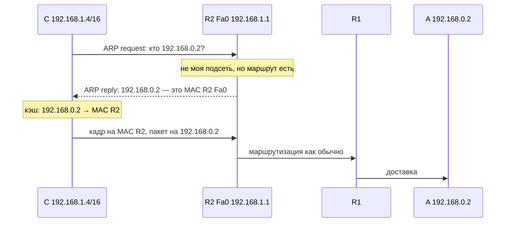

# Proxy ARP и разновидности ARP

## Семейство ARP [42:07](https://www.youtube.com/watch?v=HxGsA6Ps-T8&t=2527s)

Кроме классического [[Протокол ARP|ARP]] на той же основе выросло несколько протоколов со схожей задачей — связать адреса разных уровней:

| Разновидность | Что по чему узнаёт | Где встречается |
|---|---|---|
| Proxy ARP | маршрутизатор отвечает своим [[MAC-адресация\|MAC]] за узел из другой подсети | исправление ошибок адресации, см. ниже |
| Gratuitous ARP | узел спрашивает о **собственном** [[IP-адрес и маска подсети\|IP]] | проверка занятости адреса, оповещение соседей о смене MAC |
| **InARP** (Inverse ARP, обратный ARP) | по известному идентификатору канала — IP-адрес узла на другом его конце | [[Инкапсуляция и заголовки\|Frame Relay]], [[RFC]] 2390 |
| ARP-сервер | узлы регистрируют у сервера свои пары адресов и спрашивают его вместо рассылки | **NBMA**-сети (Non-Broadcast Multiple Access, множественный доступ без широковещания), например Classical IP over [[Инкапсуляция и заголовки\|ATM]] — ATMARP, RFC 2225 |
| **RARP** (Reverse ARP) | по своему MAC — свой IP | бездисковые станции, RFC 903; вытеснен [[Протокол DHCP\|BOOTP и DHCP]] |

В Frame Relay адресом канального уровня служит **DLCI** (Data Link Connection Identifier, идентификатор виртуального канала): свой DLCI маршрутизатор знает из настройки, а IP соседа на том конце узнаёт через InARP. В NBMA-сети спросить "всех" нельзя физически — широковещания нет, поэтому и нужен сервер

RARP выдавал только адрес и, как любой ARP, не выходил из сегмента — сервер приходилось ставить в каждый. По функции лектор сопоставляет его с [[Протокол DHCP|DHCP]], который и занял эту нишу через BOOTP [42:38](https://www.youtube.com/watch?v=HxGsA6Ps-T8&t=2558s)

## Proxy ARP [43:39](https://www.youtube.com/watch?v=HxGsA6Ps-T8&t=2619s)

### Сервер с неверной маской

Сеть та же, что в [[Протокол ARP#ARP на каждом участке пути [26 22](https //www.youtube.com/watch?v=HxGsA6Ps-T8&t=1582s)|разборе ARP вдоль пути]]: пользователи слева в `192.168.0.0/24` за R1, серверы C и D справа в `192.168.1.0/24` за R2. Администратор сидит на A (`192.168.0.2`), удалённо меняет адрес сервера C с `.2` на `192.168.1.4` — и вместо `/24` вводит `/16`

- **туда** пакеты доходят: A по-прежнему шлёт через шлюз, R2 спрашивает ARP о `192.168.1.4`, C отвечает [45:14](https://www.youtube.com/watch?v=HxGsA6Ps-T8&t=2714s)
- **обратно** — нет: C накладывает маску `/16` на `192.168.0.2`, [[Таблица маршрутизации#Решение на хосте-отправителе [10 20](https //www.youtube.com/watch?v=l9F567JS-5o&t=620s)|решает]], что A в его сегменте, и рассылает ARP-запрос о `192.168.0.2` в правый сегмент. Там такого адреса нет, отвечать некому, а в левый сегмент запрос не пройдёт [46:18](https://www.youtube.com/watch?v=HxGsA6Ps-T8&t=2778s)

Без вмешательства сервер потерян: исправлять маску придётся, подключившись к нему физически, — возможно, в другом конце страны

### Ответ маршрутизатора за чужой узел [47:55](https://www.youtube.com/watch?v=HxGsA6Ps-T8&t=2875s)

> [!note] **Proxy ARP** — маршрутизатор отвечает на ARP-запрос за узел из другой подсети, подставляя собственный MAC
> Включается на маршрутизаторе и срабатывает при двух условиях сразу:
> - запрошенный IP не может находиться в сегменте, откуда пришёл запрос — не принадлежит подсети интерфейса
> - у маршрутизатора есть маршрут до подсети, где этот IP живёт на самом деле, — иначе отвечать бессмысленно [48:58](https://www.youtube.com/watch?v=HxGsA6Ps-T8&t=2938s)

1. C считает A соседом и шлёт широковещательный ARP-запрос о его IP
2. R2 видит запрос, находит в таблице маршрут до `192.168.0.0/24` через другой интерфейс
3. R2 отвечает **за A**, подставляя MAC своего интерфейса Fa0
4. C заносит в [[Протокол ARP#ARP-кэш [32 10](https //www.youtube.com/watch?v=HxGsA6Ps-T8&t=1930s)|кэш]] пару "`192.168.0.2` → MAC R2" и шлёт кадры на R2
5. R2 получает кадр, смотрит IP-заголовок и маршрутизирует пакет дальше — в левом сегменте уже свой, отдельный ARP-обмен

> [!tip] Обман только на канальном уровне [50:29](https://www.youtube.com/watch?v=HxGsA6Ps-T8&t=3029s)
> C по-прежнему думает, что A рядом, но собирает **ровно те же** IP-пакет и кадр, что собрал бы при правильной маске с R2 в роли шлюза: MAC назначения тот же, IP-адреса те же. Маршрутизация на IP-уровне остаётся честной. Администратор дотягивается до C, исправляет маску, Proxy ARP выключает

Так отвечать — прерогатива маршрутизаторов: обычные хосты с пользовательскими и серверными [[Операционная система|ОС]] на чужие ARP-запросы не отвечают [52:05](https://www.youtube.com/watch?v=HxGsA6Ps-T8&t=3125s). В Cisco IOS Proxy ARP включён на интерфейсах по умолчанию (`ip proxy-arp`), поэтому хост с неверной маской в такой сети нередко просто работает, и ошибка годами остаётся незамеченной

### Зачем существует

Proxy ARP задумывался как заплатка там, где перенастраивать хосты дорого или невозможно:

- **хосты эпохи [[Классовая адресация и CIDR|классовой адресации]]** с жёсткой классовой маской не понимали, что один физический сегмент разбит маршрутизатором на подсети
- **хосты без шлюза или с кривой маской** — встраиваемые устройства, старые ОС без настройки default gateway
- **миграция сети** — временный мост, пока часть хостов ещё не переведена на новую адресацию
- **dial-up и ранний удалённый доступ** — клиент по [[PPP и PPPoE|PPP]] выглядел локальным хостом офисной сети без отдельной маршрутизации до него

> [!warning] Точечный костыль, а не архитектурный принцип
> - **раздувает ARP-кэши** на хостах: запись заводится на каждый удалённый адрес, а не одна на шлюз, растут память и широковещательный трафик
> - **скрывает топологию** — диагностика не показывает реального расположения узлов
> - **неотличим от ARP-спуфинга** — легитимный ответ "за другого" выглядит так же, как атака
> - **не масштабируется**: широковещательный домен фактически расползается на всю сеть, весь ARP-трафик идёт через маршрутизатор
> - при нескольких маршрутизаторах непредсказуемо, кто ответит, и маршрутизация становится асимметричной
>
> Правильное решение — корректное разбиение на подсети, [[VLAN и стандарт 802.1Q|VLAN]], нормальная маршрутизация и [[Протокол DHCP|DHCP]], раздающий хостам верные маску и шлюз. Proxy ARP остаётся временной мерой

> [!danger]- ARP-спуфинг — ARP не проверяет, кто отвечает
> Узел принимает любой ARP-ответ, даже не спрашивав. Атакующий в сегменте рассылает ответы "IP шлюза — это мой MAC", жертвы перезаписывают кэш и отправляют трафик через него — классическая атака **MITM** (Man-in-the-Middle, "человек посередине"). На коммутаторах от этого защищает Dynamic ARP Inspection: ответы сверяются с таблицей привязок, которую строит [[DHCP Relay и Option 82|DHCP snooping]]

## Gratuitous ARP [1:00:35](https://www.youtube.com/watch?v=1XavYjeAaog&t=3635s)

> [!note] **Gratuitous ARP** — ARP-запрос узла о собственном IP-адресе
> В сообщении IP отправителя и IP цели совпадают, рассылается широковещательно. Нормальный ответ на него — тишина

Применений два, и оба держатся на том, что запрос видят все:

- **проверка занятости адреса.** Никто не ответил — адрес в сегменте свободен; пришёл ARP reply — адрес уже у кого-то настроен, занимать его нельзя. Так [[Протокол DHCP#Проверка занятости адреса [1 17 49](https //www.youtube.com/watch?v=1XavYjeAaog&t=4669s)|DHCP-клиент проверяет выданный адрес]] и при конфликте шлёт серверу `DHCPDECLINE`[^probe]
- **оповещение о смене MAC.** Соседи, у которых этот IP уже в кэше, перезаписывают запись, а коммутаторы заодно [[Хаб, мост и коммутатор#Обучение моста [55 11](https //www.youtube.com/watch?v=wQhMAl--_r0&t=3311s)|обучаются]] новому порту. На этом держится [[Резервирование шлюза|переключение на резервный шлюз]]

[^probe]: Строго по RFC 5227 проверка занятости — это **ARP Probe**: IP отправителя в нём `0.0.0.0`, чтобы соседи не занесли в кэш адрес, который узлу ещё не принадлежит. Gratuitous ARP с собственным IP в поле отправителя там называется **ARP Announcement** и рассылается уже после того, как адрес занят. Лектор, как и многие вендоры, называет gratuitous ARP оба сообщения
