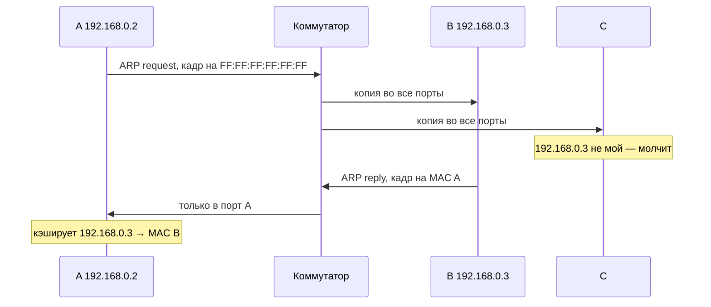

# Протокол ARP
$$\boxed{\text{IPv4-адрес соседа} \xrightarrow{\ \text{ARP}\ } \text{его MAC-адрес}}$$

Работает только внутри одного широковещательного сегмента: через маршрутизатор ARP не проходит

## Связка сетевого и канального адресов [00:59](https://www.youtube.com/watch?v=HxGsA6Ps-T8&t=59s)

Прежде чем отправить [[IP-адрес и маска подсети|IP]]-пакет соседу, узел должен вложить его в [[Кадр Ethernet|кадр]] с правильным [[MAC-адресация|MAC-адресом]] назначения. IP-адрес получателя известен — его сообщили вручную или выдал [[Протокол DNS|DNS]] [06:38](https://www.youtube.com/watch?v=HxGsA6Ps-T8&t=398s), — а MAC нет

> [!note] **ARP** (Address Resolution Protocol, протокол разрешения адресов) по известному IPv4-адресу узла своего сегмента выясняет его MAC-адрес
> Описан в [[RFC]] 826 (1982). Кому вообще слать кадр — соседу или шлюзу — хост решает раньше, [[Таблица маршрутизации#Решение на хосте-отправителе [10 20](https //www.youtube.com/watch?v=l9F567JS-5o&t=620s)|по своей маске]]; ARP отвечает только на вопрос "какой MAC у этого IP"

## Запрос и ответ [03:02](https://www.youtube.com/watch?v=HxGsA6Ps-T8&t=182s)

- **ARP request** уходит [[Типы адресации|широковещательно]] — получает весь сегмент, но отвечает только узел, у которого запрошенный IP настроен на интерфейсе
- **ARP reply** идёт [[Типы адресации|unicast]] прямо спрашивавшему: MAC отправителя запроса уже лежит в самом запросе
- после ответа A собирает полноценный кадр с MAC B в поле назначения [05:04](https://www.youtube.com/watch?v=HxGsA6Ps-T8&t=304s)

Попутно B заносит к себе пару "IP A → MAC A" из полей запроса: раз A с ним заговорил, ответный трафик почти наверняка будет, и второй обмен не нужен

> [!tip] Правильный MAC назначения стал критичен вместе с коммутаторами [05:34](https://www.youtube.com/watch?v=HxGsA6Ps-T8&t=334s)
> В Ethernet на [[Коаксиальный кабель|коаксиале]] кадр физически доходил до всех, и адресат просто узнавал себя. [[Хаб, мост и коммутатор|Коммутатор]] же отправляет кадр только в порт получателя, так что кадр с неверным MAC назначения до адресата не дойдёт вовсе

## Формат сообщения [08:09](https://www.youtube.com/watch?v=HxGsA6Ps-T8&t=489s)

| Поле | Размер | Для Ethernet и IPv4 |
|---|---|---|
| Hardware Type | 2 байта | `1` — Ethernet |
| Protocol Type | 2 байта | `0x0800` — IPv4, те же коды, что в [[Кадр Ethernet#Поле Type/Length [17 07](https //www.youtube.com/watch?v=wQhMAl--_r0&t=1027s)\|EtherType]] |
| HLEN | 1 байт | `6` — длина аппаратного адреса |
| PLEN | 1 байт | `4` — длина адреса сетевого уровня |
| Operation | 2 байта | `1` — request, `2` — reply |
| Sender Hardware Address | HLEN | MAC отправителя |
| Sender Protocol Address | PLEN | IP отправителя |
| Target Hardware Address | HLEN | в запросе нули, в ответе — искомый MAC |
| Target Protocol Address | PLEN | IP, чей MAC ищут |

Длины адресных полей не зашиты в протокол, а задаются HLEN и PLEN: ARP с самого начала проектировался под любую пару "канальный протокол + сетевой протокол", не только под Ethernet и IPv4 [09:44](https://www.youtube.com/watch?v=HxGsA6Ps-T8&t=584s). Для этой пары сообщение занимает ровно **28 байт**

> [!info]- Избыточность формата ничего не стоит [19:27](https://www.youtube.com/watch?v=HxGsA6Ps-T8&t=1167s)
> Запрос несёт все четыре адреса, хотя половина в нём не заполнена. Причин держать так две:
> - для пары Ethernet и IPv4 сообщение фиксированной длины, его легко разбирать аппаратно и не грузить процессор
> - 28 байт всё равно меньше 46 байт минимального поля данных — кадр добивается [[Кадр Ethernet#Минимальный размер кадра [1 11 47](https //www.youtube.com/watch?v=wQhMAl--_r0&t=4307s)|заполнителем до 64 байт]], и "лишние" поля занимают место, которое иначе заняли бы 18 байт padding

> [!note] ARP кладётся прямо в кадр Ethernet, без IP [13:26](https://www.youtube.com/watch?v=HxGsA6Ps-T8&t=806s)
> EtherType `0x0806`. Отсюда спор об уровне: по инкапсуляции это [[Эталонная модель OSI#Канальный уровень [19 56](https //www.youtube.com/watch?v=PHgnSnlxmLk&t=1196s)|канальный уровень]], по содержимому — работа с IP-адресами, и нередко ARP называют протоколом **уровня 2.5**

## Граница сегмента [14:33](https://www.youtube.com/watch?v=HxGsA6Ps-T8&t=873s)

> [!important] ARP-сообщения не проходят через маршрутизатор
> Узнать MAC можно только у устройства своего широковещательного сегмента — своей подсети. Лектор просит выделить это цветом: здесь ошибаются чаще всего

И не нужно: даже если каким-то образом узнать MAC узла из чужой подсети и вписать его в кадр, в локальном сегменте такого устройства нет, и кадр отбросят все, включая маршрутизатор [37:56](https://www.youtube.com/watch?v=HxGsA6Ps-T8&t=2276s). MAC-адрес нужен только там, где получатель достижим по Ethernet

### ARP на каждом участке пути [26:22](https://www.youtube.com/watch?v=HxGsA6Ps-T8&t=1582s)

Сеть лекции: A (`192.168.0.2`) и B (`.3`) за R1 (`192.168.0.1`), линк R1–R2 — `10.0.0.0/30` с адресами `.1` и `.2`, за R2 (`192.168.1.1`) — C (`.2`) и D (`.3`). Пакет A → C:

| Участок | Кто спрашивает | О каком IP | Кто отвечает |
|---|---|---|---|
| A — R1 | A | `192.168.0.1`, свой шлюз | R1 (B запрос тоже получает, но молчит) |
| R1 — R2 | R1 | `10.0.0.2`, next hop из таблицы | R2 [30:36](https://www.youtube.com/watch?v=HxGsA6Ps-T8&t=1836s) |
| R2 — C | R2 | `192.168.1.2`, сам получатель в connected-сети | C (D молчит) [31:40](https://www.youtube.com/watch?v=HxGsA6Ps-T8&t=1900s) |

Спрашивать об адресе C с узла A бесполезно — запрос не выйдет из сегмента. Поэтому ARP всегда разрешает адрес **следующего узла**: шлюза, next hop или, на последнем участке, самого получателя. Что при этом происходит с кадром на каждом хопе — [[Таблица маршрутизации#Переупаковка кадра на каждом хопе [33 30](https //www.youtube.com/watch?v=l9F567JS-5o&t=2010s)|переупаковка кадра]]

> [!tip] Один ARP-обмен на next hop, а не на получателя [56:30](https://www.youtube.com/watch?v=HxGsA6Ps-T8&t=3390s)
> Узнав MAC R2 ради трафика к C, R1 не пошлёт новый запрос ради D: next hop тот же, значит и MAC тот же. Точно так же A одной записью о шлюзе обслуживает все адреса за пределами сегмента [28:28](https://www.youtube.com/watch?v=HxGsA6Ps-T8&t=1708s)

> [!example] Два маршрутизатора за одним интерфейсом различаются по MAC назначения [59:06](https://www.youtube.com/watch?v=HxGsA6Ps-T8&t=3546s)
> R1 одним интерфейсом смотрит в коммутатор, за которым стоят и R2, и R3. Какому из них уйдёт пакет, решает MAC назначения: next hop из таблицы маршрутизации — IP R2, ARP даёт MAC его интерфейса, и коммутатор по [[Хаб, мост и коммутатор#Пересылка и фильтрация [57 15](https //www.youtube.com/watch?v=wQhMAl--_r0&t=3435s)|мостовой таблице]] доставляет кадр в порт R2. IP-адреса в пакете при этом остаются сквозными — A и B [1:01:44](https://www.youtube.com/watch?v=HxGsA6Ps-T8&t=3704s)

## ARP-кэш [32:10](https://www.youtube.com/watch?v=HxGsA6Ps-T8&t=1930s)

**ARP-кэш** (ARP-таблица) — таблица соответствий "IP → MAC" для соседей из тех сетей, куда подключено устройство. Живёт в оперативной памяти, и полей в ней немного: IP, MAC и время жизни записи; бывают ещё статические записи, прописанные руками

| Система | Посмотреть кэш |
|---|---|
| Cisco IOS | `show ip arp` |
| Windows | `arp -a` |
| Linux | `ip neigh` |

> [!note] Запись обязана устаревать [40:06](https://www.youtube.com/watch?v=HxGsA6Ps-T8&t=2406s)
> Кэш не вечен, потому что связка IP → MAC меняется:
> - в компьютере заменили сетевую карту — сгорела или поменяли FastEthernet на гигабитную, — и у того же IP теперь другой MAC
> - адрес переехал на другое устройство: резервный маршрутизатор [[Резервирование шлюза|принял на себя адрес шлюза]], плавающий IP перешёл на другую виртуальную машину
>
> Истёк таймер — запись удаляется, и при следующей отправке обмен request/reply повторяется. Без кэша ARP-обмен предварял бы каждый исходящий пакет; время жизни — компромисс между "не спрашивать зря" и "не жить с устаревшими данными"[^vmac]

[^vmac]: Смену MAC у адреса соседи узнают и без таймера — новый владелец рассылает [[Proxy ARP и разновидности ARP|gratuitous ARP]]. Таймер — страховка на случай, когда объявления не было или оно потерялось. У [[Резервирование шлюза|HSRP и VRRP]] с виртуальным MAC связка IP → MAC при переключении вовсе не меняется, меняется порт в таблице коммутатора

Сколько живёт запись, зависит от системы:

| Система | Время жизни записи |
|---|---|
| Cisco IOS | 4 часа |
| Linux | около 30 секунд в состоянии reachable (случайно в пределах 15–45), потом stale: запись остаётся, но перед использованием перепроверяется |
| Windows (начиная с Vista) | 15–45 секунд в состоянии reachable, дальше так же stale |

Лектор говорит о "минутах, а иногда часах" [41:37](https://www.youtube.com/watch?v=HxGsA6Ps-T8&t=2497s) — это верно для маршрутизаторов; хосты с Linux и Windows ведут кэш по модели [[NDP и ICMPv6|neighbor cache из IPv6]] и перепроверяют соседа уже через десятки секунд

### Почему теряется первый ping [34:17](https://www.youtube.com/watch?v=HxGsA6Ps-T8&t=2057s)

Пакет [[Протокол ICMP|ICMP Echo Request]] сформирован, а инкапсулировать его не во что: MAC следующего узла в кэше ещё нет. Пока идут ARP-обмены вдоль пути, первый пакет не дожидается и отбрасывается по таймауту, поэтому потеря первого, иногда первых двух пингов — норма. Повторный запуск проходит без потерь: кэши уже заполнены [35:50](https://www.youtube.com/watch?v=HxGsA6Ps-T8&t=2150s)

> [!example] Cisco IOS показывает это прямо в выводе `ping`
> Первый из пяти пакетов теряется, и строка результата выглядит как `.!!!!`: точка — таймаут, восклицательные знаки — ответы. Linux, наоборот, придерживает несколько пакетов в очереди до разрешения адреса, и первый ping обычно приходит с чуть большей задержкой, но приходит
